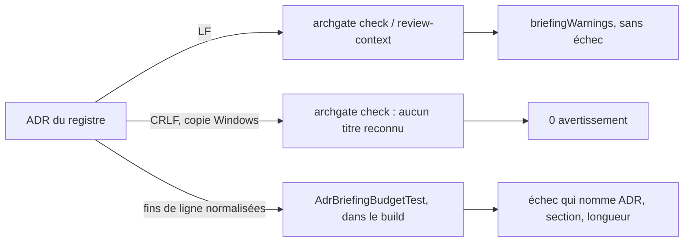

# Conception : les sections remises aux agents tiennent dans le briefing d'Archgate

Conception allégée : un contrôle de cohérence documentaire et une réécriture de prose, sans comportement du produit
modifié.

## Contexte

[EXISTANT VÉRIFIÉ] La CLI Archgate 0.61.0 (`~/.archgate/bin/archgate.exe`, code JavaScript embarqué) déclare
`o_=["Decision","Do's and Don'ts"]` et `s_=2000`. `QA` découpe le corps de l'ADR sur `\n`, ouvre une section à chaque
ligne qui correspond à `/^## (.+)$/u` et la ferme à la suivante ; `gme` compare la longueur `trim()` de chaque section
au plafond et produit un `briefingWarning` ; `e6` coupe le texte remis par `review-context` au plafond.

[EXISTANT VÉRIFIÉ] Sans drapeau `m`, `$` exige la fin de la chaîne et `.` ne reconnaît pas `\r` : sur une copie de
travail CRLF, aucune ligne `## Decision\r` n'est un titre. Mesuré le 17/11/2026 : `archgate check` rend 0 avertissement
sur la copie de travail Windows, 60 sur la même arborescence convertie en LF.

[EXISTANT VÉRIFIÉ] `.claude/rules/adr.md` énonçait la borne pour la seule section `Decision`, sans dire ce qu'elle
compte ; aucun workflow ni script ne lance Archgate.

Motivation : voir `proposal.md`, section Why.

## Exigences couvertes

- « Chaque section d'un ADR que le briefing remet aux agents DOIT tenir dans la borne de ce briefing »
- « La mesure d'une section DOIT être indépendante des fins de ligne de la copie de travail »

## Composants et frontières

Sans objet : aucune frontière du produit ne bouge. Le contrôle est une classe de test du module
`morpheus-architecture-tests`, marquée `@CoherenceCheck` : elle ne lit que des fichiers Markdown.

## Modèle de domaine et invariants

Sans objet.

## Traitements et interactions

### Quelle mesure tient la borne, sur quelle plateforme ?

Existant (Archgate) et cible (test).

## États et transitions

Sans objet.

## Contrats d'interface

Sans objet : aucune surface publique.

## Persistance et intégrité

Sans objet.

## Transactions, concurrence et idempotence

Sans objet.

## Sécurité et isolation

Sans objet.

## Gestion des erreurs et reprise

Le refus liste tous les ADR hors borne en une fois, avec le remède (déplacer raisons et exemples vers `Context`).

## Observabilité

Sans objet.

## Performance et stratégie de mesure

La mesure lit chaque ADR du registre une fois ; aucun budget.

## Compatibilité, migration et retour arrière

Un `git revert` rend les ADR et la règle à leur état antérieur.

## Décisions

### D1 : tenir la borne plutôt que la requalifier ou la retirer
- **Nature** : [DÉCISION]
- **Exigences servies** : la première exigence.
- **Choix** : ramener les 56 ADR sous 2 000 caractères, en gardant chaque règle dans `Decision` et en déplaçant le
  reste dans `Context`, selon le patron du commit `003199fd`.
- **Alternatives écartées** : requalifier la borne sur le corpus — le plafond n'est pas le nôtre, il est codé dans
  Archgate, et une borne plus haute dans le dépôt laisserait le briefing tronqué ; retirer la borne — l'agent
  recevrait toujours un texte coupé, sans que rien ne le dise.
- **Compromis** : la section `Context` des ADR concernés s'allonge ; une décision se lit en deux endroits (la règle
  dans `Decision`, sa justification dans `Context`).
- **ADR** : non concerné ; la borne est une convention de rédaction (`.claude/rules/adr.md`), et aucune décision
  d'ADR ne change.

### D2 : compter comme Archgate, deux sections, sous-sections comprises
- **Nature** : [DÉCISION]
- **Exigences servies** : les deux exigences.
- **Choix** : la règle et le test comptent ce que `review-context` coupe : `Decision` et `Do's and Don'ts`, chacune
  de sa ligne `## ` à la suivante, après retrait des blancs de bord, en unités UTF-16 (`String.length()`).
- **Alternatives écartées** : mesurer jusqu'au premier `###` — vaut 0 pour un ADR dont la section commence par un
  sous-titre, et ne correspond pas à ce que l'agent reçoit ; ne borner que `Decision` — laisse tronquer
  `Do's and Don'ts`, que l'outil remet aussi.
- **Compromis** : si Archgate change sa mesure, le test doit suivre ; `docs/developer/ARCHGATE.md` dit la mesure pour
  qu'on puisse la relire à une montée de version.
- **ADR** : non concerné.

### D3 : tenir la borne par un test de cohérence plutôt que par Archgate en CI
- **Nature** : [DÉCISION]
- **Exigences servies** : la seconde exigence.
- **Choix** : `AdrBriefingBudgetTest` normalise les fins de ligne et refuse une section vide.
- **Alternatives écartées** : lancer `archgate check --strict` en CI — l'outil n'y est pas installé, `--strict` échoue
  déjà sur `README.md` non lu (GEN-0132, conséquences négatives) et la cécité CRLF resterait vraie sous Windows en
  local.
- **Compromis** : la mesure existe en deux implémentations, Archgate et le test.
- **ADR** : non concerné.

## Écarts constatés

| Constat | Source A | Source B | Traitement proposé |
|---|---|---|---|
| 56 ADR dépassent la borne en `Decision` (`AUD-QUA-26`) | `.claude/rules/adr.md` : 2 000 caractères | registre : jusqu'à 10 279 | réécriture (D1) |
| La règle ne bornait que `Decision` | `.claude/rules/adr.md` | Archgate borne aussi `Do's and Don'ts` (4 ADR au-delà) | règle réécrite (D2) |
| `archgate check` ne voit rien sur une copie CRLF | `docs/developer/ARCHGATE.md` le présente comme le contrôle | 0 avertissement sous Windows, 60 en LF | test dans le build (D3), page Archgate corrigée |

## Stratégie de vérification

| Exigence | Scénario | Preuve | État |
|---|---|---|---|
| borne du briefing | dépassement, borne exacte, `Do's and Don'ts` | `AdrBriefingBudgetTest#anOverrunNamesTheRecordTheSectionAndItsLengthWhileASectionAtTheBudgetPasses` | nouveau |
| borne du briefing | les sous-sections comptent | `AdrBriefingBudgetTest#aSectionRunsToTheNextLevelTwoHeadingAndMeasuresTheSameWhateverTheLineEndings` | nouveau |
| borne du briefing | registre réel | `AdrBriefingBudgetTest#everyRecordInForceKeepsEachBriefedSectionWithinTheBudget` | nouveau |
| borne du briefing | ADR archivés non lus | même méthode : seul le registre est listé, pas son sous-dossier `archive/` | nouveau |
| fins de ligne | registre CRLF, section absente, registre vide | les trois méthodes ci-dessus | nouveau |
| aucune décision ne change | relecture des 56 ADR | revue de la PR ; `archgate check` sur une copie LF : 0 `briefingWarnings` | revue |

## Documentation durable et diagrammes à mettre à jour

`docs/developer/specifications/adr-briefing-budget.md` (nouvelle page, diagramme ci-dessus) et l'index du dossier ;
`docs/developer/ARCHGATE.md` ; `.claude/rules/adr.md` ; le gabarit d'ADR.

## Questions ouvertes

Aucune.
