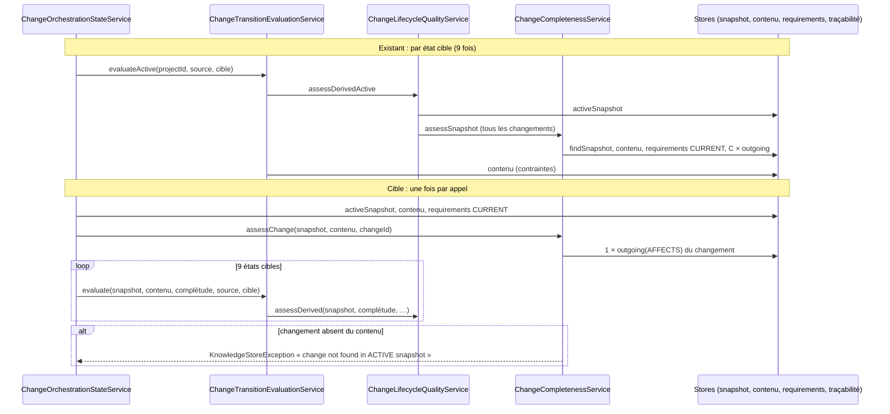

# Conception : évaluer une seule fois l'état d'orchestration d'un changement

## Contexte

[EXISTANT VÉRIFIÉ] sur `1a539c22` (motivation : proposal.md, section Why) :

- `ChangeOrchestrationStateService.active` (`morpheus-application/.../orchestration/ChangeOrchestrationStateService.java:65-121`)
  lit le snapshot actif, filtre le rapport de complétude complet (`:78`), relit le contenu (`:82`), puis appelle
  `transitionEvaluations` (`:148-173`) qui boucle sur `ChangeLifecycleState.values()`.
- `ChangeTransitionEvaluationService.evaluateActive` (`:47-66`) délègue à
  `ChangeLifecycleQualityService.assessDerivedActive` (`:38-47`), qui relit `activeSnapshot` puis
  `ChangeCompletenessService.assessSnapshot` (via `completeness`, `:176-184`) — lequel relit `findSnapshot`, le contenu,
  les requirements CURRENT et la traçabilité de chaque changement (`ChangeCompletenessService.java:59-117`).
  `toEvaluation` relit encore le contenu pour les contraintes (`:162-171`).
- `ChangeCompletenessService.assessChange` (`:84-...`) est déjà une fonction du changement, du contenu et de
  l'ensemble des identités CURRENT : l'évaluation d'un changement isolé ne demande rien de plus.
- Les tests de coût d'un service de l'application vivent sous `morpheus-architecture-tests` avec les stores mémoire et
  un port compté (`ChangeAnalysisTraversalCostTest`) ; `morpheus-application` ne peut pas dépendre de
  `morpheus-store-memory` (`.claude/rules/testing.md`).
- [EXISTANT VÉRIFIÉ] La lecture du contenu métier coûte un nombre fixe de requêtes et n'est pas en cause
  (`snapshot-content-read-cost`, constat Info `AUD-PRF-31`) : ce changement réduit le **nombre** de lectures, il ne
  touche pas au lecteur.

## Exigences couvertes

| Capacité | Exigence (titre exact) | Rubriques de conception qui y répondent |
|---|---|---|
| `change-orchestration-state` | Building the orchestration state SHALL read the snapshot content once and assess the requested change only | §Décisions D1, D2, D3 ; §Traitements ; §Stratégie de vérification |

## Composants et frontières

- `com.morpheus.application.quality` : `ChangeCompletenessService` gagne une évaluation publique d'un seul changement
  sur un snapshot et un contenu déjà lus ; `ChangeLifecycleQualityService` gagne une variante `assessDerived` publique
  qui reçoit le snapshot et l'évaluation de complétude du changement.
- `com.morpheus.application.orchestration` : `ChangeTransitionEvaluationService` gagne une variante qui reçoit
  snapshot, contenu et complétude ; `ChangeOrchestrationStateService` lit chaque chose une fois et la passe.
- Frontière : tout reste dans `morpheus-application`, sans nouveau port ni nouvelle dépendance. Le paquet
  `orchestration` dépend déjà de `quality` (`ChangeTransitionEvaluationService.java:6-8`) ; aucune arête nouvelle,
  donc `theApplicationPackagesAreFreeOfCycles` (`ApplicationPackageCyclesArchitectureTest`) n'est pas concerné.

## Modèle de domaine et invariants

Sans objet : aucun type du domaine ne change ; la décision de transition reste `ChangeLifecycleTransitionRequest.decide()`
(ARCH-0162, `LifecycleTransitionDecisionInTheDomainArchitectureTest`).

## Traitements et interactions

Question : combien de fois un état d'orchestration lit-il chaque store, avant et après ?

Explication : les neuf évaluations deviennent du calcul pur sur des valeurs déjà lues ; seule la lecture de
traçabilité du changement demandé subsiste. `unresolvedLinks` (`:175-194`) garde sa lecture `outgoing` et
`findByOwner` (coût traité par `AUD-PRF-24` et `AUD-PRF-26`). Exigence servie : `change-orchestration-state` ›
Building the orchestration state SHALL read the snapshot content once and assess the requested change only.

## États et transitions

Sans objet : la politique `forwardOnly` et l'ensemble des états cibles ne changent pas.

## Contrats d'interface

Sans objet : `orchestration.state` et `orchestration.transition` (`contracts/public-surfaces.tsv`) et leurs opérations
OpenAPI gardent forme et valeurs ; `JarvisOrchestrationContractTest` et `MorpheusJarvisOrchestrationApiContractTest`
le tiennent déjà.

## Persistance et intégrité

Sans objet : aucune écriture, aucun schéma.

## Transactions, concurrence et idempotence

[EXISTANT VÉRIFIÉ] Aujourd'hui chaque évaluation relit `activeSnapshot` : une publication concurrente entre deux
évaluations peut faire porter un même état sur deux snapshots. [DÉCISION] La variante lit le snapshot une fois : toutes
les évaluations portent sur le snapshot nommé par le champ `snapshot`, ce qui rend l'état cohérent sans rien promettre
de plus (aucune transaction n'est ouverte).

## Sécurité et isolation

Sans objet : aucune frontière de confiance ne bouge.

## Gestion des erreurs et reprise

Le refus d'un changement absent garde son message `change not found in ACTIVE snapshot: <id>` et survient avant toute
évaluation ; un snapshot sans projection de contenu garde `published snapshot has no business-content projection`.

## Observabilité

Sans objet.

## Performance et stratégie de mesure

[DÉCISION] La preuve est un compte de lectures de ports, pas un chronomètre : un test sous
`morpheus-architecture-tests` enveloppe les stores mémoire dans des ports comptés et compare deux snapshots (un
changement seul, puis le même parmi beaucoup d'autres). [EXISTANT VÉRIFIÉ] Le budget M19 de durée sur ce chemin est
déclaré par `AUD-PRF-30` (sprint 2), avant cette correction ; l'ordre de grandeur de l'audit est une extrapolation non mesurée et n'est pas recopié comme seuil.

## Compatibilité, migration et retour arrière

Les anciennes méthodes `evaluateActive` / `assessDerivedActive` restent pour leurs autres appelants
(`orchestration.transition`, `DefaultPolicyFactResolver`) et délèguent à la variante. Retour arrière : revert du commit,
rien de persisté.

## Décisions

### D1 : évaluer la complétude du seul changement demandé
- **Nature** : [DÉCISION]
- **Exigences servies** : `change-orchestration-state` › Building the orchestration state SHALL read the snapshot content once and assess the requested change only
- **Choix** : exposer dans `ChangeCompletenessService` une évaluation d'un changement sur un snapshot, un contenu et
  l'ensemble des identités CURRENT déjà lus, réutilisant `assessChange` tel quel.
- **Alternatives écartées** : mémoïser le rapport complet par appel (garde C lectures de traçabilité pour un seul
  changement utile) ; ajouter un port de complétude par changement (aucun besoin de store nouveau).
- **Compromis** : une méthode publique de plus dans `quality`.
- **ADR** : non concerné.

### D2 : passer les valeurs lues aux évaluations au lieu de les relire
- **Nature** : [DÉCISION]
- **Exigences servies** : même exigence
- **Choix** : `ChangeTransitionEvaluationService` et `ChangeLifecycleQualityService` gagnent une variante qui reçoit
  snapshot, contenu et complétude ; les méthodes existantes lisent puis délèguent. `AUD-PRF-22` réutilise cette
  variante (`resolve-each-governance-report-once-per-evaluation`).
- **Alternatives écartées** : un cache caché dans le service (état mutable partagé entre appels, contraire à la
  confination par opération) ; un objet « contexte de snapshot » nouveau dans le domaine (le domaine n'en a pas besoin).
- **Compromis** : signatures plus longues ; `java:S107` possible, à justifier sur place si le seuil est atteint.
- **ADR** : non concerné.

### D3 : prouver par un compte de lectures sur des ports comptés
- **Nature** : [DÉCISION]
- **Exigences servies** : même exigence, scénarios « More changes… », « Evaluating every transition… », « The count is
  checked… »
- **Choix** : `ChangeOrchestrationStateCostTest` (à écrire, paquet `com.morpheus.architecture`), sur le patron de
  `ChangeAnalysisTraversalCostTest` ; il compte `findSnapshotContent`, `listCurrentRequirementVersions`, `outgoing` et
  `incoming`, et nomme les deux comptes dans son message.
- **Alternatives écartées** : compter les `prepareStatement` SQLite (mesure aussi le coût d'une lecture de liens, qui
  appartient à `AUD-PRF-24`) ; un test sous `morpheus-application` (cycle de réacteur avec `store-memory`).
- **Compromis** : ajoute des exécutions déclarées au module d'architecture (aucun ratchet ne baisse).
- **ADR** : non concerné.

## Écarts constatés

| Constat | Source A | Source B | Traitement proposé |
|---|---|---|---|
| L'audit cite `ChangeCompletenessService.java:94` pour la lecture de traçabilité | audit (`a04f32bd`) | code (`1a539c22`, `:93-94`) | écart d'une ligne, sans effet |
| Aucun test ni budget ne mesure le coût de l'état d'orchestration | `docs/project/roadmap/M19_PERFORMANCE_BUDGETS.md` | constat `AUD-PRF-21` | test de coût (D3) ; budget M19 par `AUD-PRF-30` |

## Stratégie de vérification

| Exigence | Scénario | Preuve | État |
|---|---|---|---|
| Building the orchestration state SHALL read… | More changes in the snapshot cost no more reads | `ChangeOrchestrationStateCostTest#moreChangesInTheSnapshotCostNoMoreReads` | à écrire |
| idem | Evaluating every transition reads the content once | `ChangeOrchestrationStateCostTest#everyTransitionIsEvaluatedOnOneContentRead` | à écrire |
| idem | The state of a change does not depend on its neighbours | `ChangeOrchestrationStateCostTest#theStateOfAChangeDoesNotDependOnItsNeighbours` | à écrire |
| idem | The count is checked on every build | rouge sur `HEAD` (comptes nommés), vert après | à écrire |
| idem | A change absent from the snapshot is still refused | `ChangeOrchestrationStateServiceTest` (refus existant) + assertion « aucune évaluation » | existant · à compléter |

## Documentation durable et diagrammes à mettre à jour

`docs/developer/specifications/change-orchestration-state.md` : nouvelle exigence dans « Exigences », diagramme de
séquence ci-dessus (cible) dans « Diagrammes », ligne de traçabilité.

## Questions ouvertes

Aucune.
