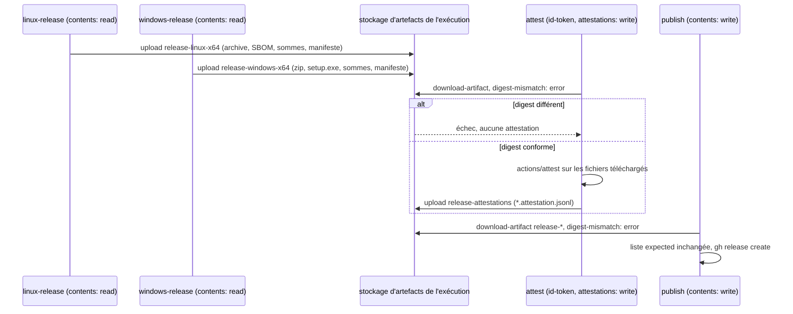

# Conception : attester les artefacts de release dans un job qui n'exécute aucun code du dépôt

<!-- Conception allégée : workflow CI et test de contrat, sans code de production ni surface publique. -->

## Contexte

- [EXISTANT VÉRIFIÉ] `.github/workflows/release.yml` : `permissions: contents: read` au niveau global ; les jobs
  `linux-release` et `windows-release` ajoutent `id-token: write` et `attestations: write` et enchaînent checkout,
  `actions/setup-java` avec `cache: maven`, construction (`distribution/build-release.sh` ou `.ps1`), sous Windows
  `scripts/validate-m28.ps1` (avant la construction), puis `actions/attest`, copie du paquet d'attestation dans `dist/`
  et `actions/upload-artifact`. Le job `publish` (`contents: write`) télécharge avec `digest-mismatch: error` et publie.
- [EXISTANT VÉRIFIÉ] `AuditHardeningWorkflowContractTest#releaseWorkflowPublishesAttestedNonOverwritableAssetsFromMain`
  exige la présence textuelle de `id-token: write` et `attestations: write` et le SHA d'`actions/attest`, sans dire dans
  quel job.
- [EXISTANT VÉRIFIÉ] `release-component-disclosure` › « The expected asset set SHALL be the same in the release
  workflow and in both qualification scripts » : la liste `expected=(…)` du job `publish` comprend les deux
  `*.attestation.jsonl`.

## Exigences couvertes

| Capacité | Exigence (titre exact) | Rubriques de conception qui y répondent |
|---|---|---|
| `release-attestation-isolation` | Seul un job qui n'exécute aucun code du dépôt DOIT porter les permissions d'attestation | D1, D2 |
| `release-attestation-isolation` | Le job d'attestation DOIT attester les octets téléversés par le build | D1 |

## Traitements et interactions

Question : quel job détient quel droit, et que reçoit-il ? Cible :

Existant : l'attestation et la copie du paquet ont lieu dans `linux-release` et `windows-release`. Cible : elles
quittent ces jobs. Exigences : les deux de la capacité.

## Sécurité et isolation

La frontière est le job : un jeton OIDC ne peut être demandé que depuis un job qui en a la permission. Le job
d'attestation n'exécute que des actions épinglées par SHA (`actions/download-artifact`, `actions/attest`,
`actions/upload-artifact`) ; il ne fait pas de checkout, donc aucun script, POM ni plugin du dépôt n'y tourne. Le cache
Maven n'y est pas restauré. Le risque résiduel est une action épinglée compromise, couvert par la règle de pinning SHA
(`.claude/rules/security.md`).

## Décisions

### D1 : un seul job d'attestation pour les deux plateformes
- **Nature** : [PROPOSITION]
- **Exigences servies** : les deux exigences de `release-attestation-isolation`
- **Choix** : un job `attest` sur `ubuntu-latest`, `needs: [linux-release, windows-release]`, qui télécharge
  `release-*`, atteste archive Linux, SBOM, zip et installeur Windows, renomme chaque paquet d'attestation selon le nom
  attendu (`morpheus-X.Y.Z-linux-x64.attestation.jsonl`, `…-windows-x64.attestation.jsonl`) sans script du dépôt, et
  téléverse `release-attestations`. Les noms des paquets se dérivent du tag par une expression de workflow, pas par un
  `run:` (exigence 1) : si le renommage exige un `run:`, il se fait dans `publish`, qui n'a pas la permission OIDC.
- **Alternatives écartées** : un job d'attestation par plateforme (deux fois la même surface, aucun gain d'isolation) ;
  garder l'attestation dans le job de build mais isoler Maven dans un conteneur (contraire au « pas de Docker » du dépôt
  et sans effet sur `validate-m28.ps1`).
- **Compromis** : la release attend la fin des deux constructions avant toute attestation (déjà le cas de `publish`).
- **ADR** : non concerné.

### D2 : le contrat se tient par le test de workflow existant
- **Nature** : [DÉCISION]
- **Exigences servies** : `release-attestation-isolation` › Seul un job qui n'exécute aucun code du dépôt DOIT porter les permissions d'attestation
- **Choix** : `AuditHardeningWorkflowContractTest` découpe `release.yml` par job (même méthode que `namedJob` du test)
  et refuse un job qui porte une permission d'attestation et une étape `run:` ou `actions/checkout`, ainsi qu'un bloc
  `permissions` de premier niveau qui en porte une. Assertion textuelle : la cible est un `.yml`, le texte y est la seule
  prise (`.claude/rules/architecture.md`).
- **Alternatives écartées** : un nouveau test dédié (le test existant porte déjà le contrat de release ; un test de
  plus ne diminue pas `architectureTestsMinimum`, mais disperserait le contrat).
- **ADR** : non concerné.

### D3 : aucun ADR
- **Nature** : [DÉCISION]
- **Choix** : réorganisation d'un workflow, retour arrière sans coût : le filtre de `.claude/rules/adr.md` échoue à la
  troisième question.

## Écarts constatés

| Constat | Source A | Source B | Traitement proposé |
|---|---|---|---|
| Les pages développeur décrivent l'attestation sans dire quel job la porte | `docs/developer/BUILD_AND_TEST.md`, `docs/developer/PRODUCTION_INTEGRITY.md` | cible | ajouter une phrase sur le job dédié (tâche 2.3) |

## Stratégie de vérification

| Exigence | Scénario | Preuve | État |
|---|---|---|---|
| Seul un job qui n'exécute aucun code du dépôt DOIT porter les permissions d'attestation | Les jobs de construction ne peuvent pas obtenir de jeton OIDC | nouvelle méthode de `AuditHardeningWorkflowContractTest` | à écrire |
| idem | Une étape de build ajoutée au job d'attestation fait échouer le build | même méthode, violation plantée sur l'arbre courant (qui la viole aujourd'hui) | à écrire |
| idem | Une permission déclarée au niveau du workflow fait échouer le build | même méthode | à écrire |
| idem | Le contrôle a trouvé un job d'attestation | assertion de non-vacuité | à écrire |
| Le job d'attestation DOIT attester les octets téléversés par le build | Une release vérifie publiquement | `scripts/verify-release-provenance.*` sur la première release, ou sur une exécution de répétition | manuel |
| idem | Un artefact altéré entre deux jobs n'est pas attesté | comportement de `actions/download-artifact` ; le test vérifie la présence de `digest-mismatch: error` | existant (action) |
| idem | Un téléchargement sans contrôle de digest fait échouer le build | nouvelle assertion du même test | à écrire |

## Documentation durable et diagrammes à mettre à jour

Nouvelle page `docs/developer/specifications/release-attestation-isolation.md` (gabarit de
`docs/developer/specifications/README.md`, diagramme de séquence ci-dessus), ligne d'index dans la section « Gates,
preuves et dépendances » ; `docs/developer/BUILD_AND_TEST.md` et `docs/developer/PRODUCTION_INTEGRITY.md`.

## Questions ouvertes

Aucune.
