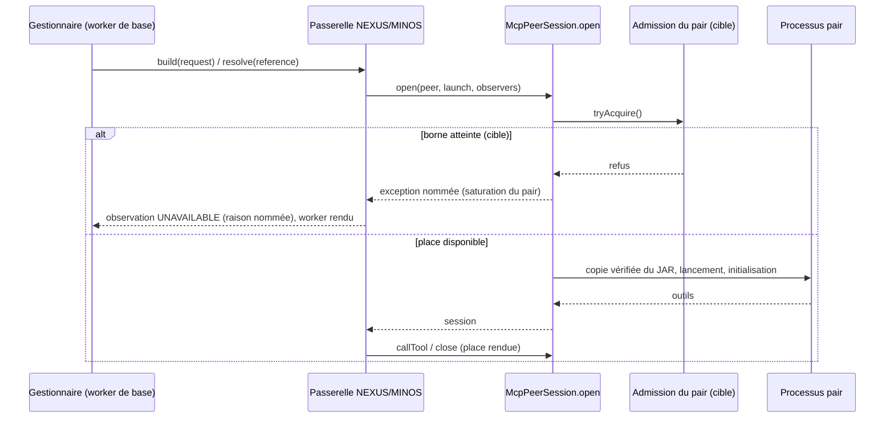

# Conception : borner les appels simultanés à chaque pair MCP

## Contexte

- [EXISTANT VÉRIFIÉ] `McpPeerSession.open(peer, launch, observers)` (`com.morpheus.transport.mcp`) lance le client
  borné, arme `PeerOperationDeadline`, vérifie les outils ; `close()` ferme le client et supprime la copie vérifiée.
  Il ne dépend d'aucun autre paquet MORPHEUS (`theMcpTransportDependsOnNoOtherMorpheusPackage`).
- [EXISTANT VÉRIFIÉ] `MinosMcpExternalReferenceResolver` et `NexusMcpTechnicalContextProvider` ouvrent une passerelle par
  appel et convertissent toute `RuntimeException` en observation `UNAVAILABLE` (`TechnicalContextObservation.unavailable`,
  statut `ExternalIntegrationStatus` non disponible).
- [EXISTANT VÉRIFIÉ] `MinosIntegrationRuntime` et `NexusIntegrationRuntime` sont résolus une fois par processus
  (`MorpheusMain.runApi`), donc un porteur naturel d'une borne par pair et par processus.
- [EXISTANT VÉRIFIÉ] Les gestionnaires HTTP tournent sur un worker de `DatabaseCallWorkers`
  (`DatabaseWorkOffloadingHttpServer`) ; un appel de pair y tient son worker jusqu'à son échéance.

## Exigences couvertes

| Capacité | Exigence (titre exact) | Rubriques de conception qui y répondent |
|---|---|---|
| `mcp-peer-gateway-lifecycle` | Les sessions simultanées d'un même pair sont bornées par processus | D1, D2, Traitements |

## Composants et frontières

- `morpheus-mcp-transport` : `McpPeerSession` reçoit une admission de pair (un type du paquet, à créer, par exemple
  `McpPeerAdmission`, enveloppant un `Semaphore` à `tryAcquire`) dans son `Peer` ou son `Launch`, la prend avant le
  lancement, la rend à la fermeture et sur tout échec d'ouverture.
- `morpheus-integration-minos`, `morpheus-integration-nexus` : chaque runtime crée l'admission de son pair une fois et
  la remet à sa fabrique de passerelles.
- Frontières tenues : le socle ne connaît aucun type MORPHEUS ; les passerelles ne recopient pas le cycle de vie
  (« Une passerelle ne refait pas le cycle de vie »).

## Modèle de domaine et invariants

Invariant : nombre de sessions ouvertes d'un pair ≤ borne, tenu par l'admission ; une place prise est rendue une fois,
quel que soit le chemin de sortie (fermeture, échec d'initialisation, `Error`).

## Traitements et interactions

Question : où la borne coupe-t-elle une rafale de lecteurs ?

Existant : pas d'admission, chaque requête lance un processus.

## États et transitions

Sans objet.

## Contrats d'interface

Sans objet : la forme d'une observation `UNAVAILABLE` et de ses détails existe déjà sur HTTP et MCP ; la raison nommée
est un message et une clé de détail, pas un nouveau code de statut.

## Persistance et intégrité

Sans objet.

## Transactions, concurrence et idempotence

`tryAcquire` sans attente : attendre une place garderait le worker de base, ce que le constat dénonce. L'admission est
partagée par toutes les requêtes du processus pour ce pair, HTTP local, remote et MCP confondus.

## Sécurité et isolation

Retire au rôle READ le levier de saturation des workers par les pairs ; le pair reste du code de confiance sous le
compte MORPHEUS (`SECURITY.md`, External code trust boundary).

## Gestion des erreurs et reprise

Raison nommée, rendue comme indisponibilité explicite (jamais convertie en succès vide) ; la requête suivante est
servie dès qu'une place se libère.

## Observabilité

[PROPOSITION] Un compteur de refus de saturation par pair dans les métriques opérationnelles, à côté des compteurs
d'abandon déjà remis par les observateurs du socle.

## Performance et stratégie de mesure

Le test de rafale prouve que les requêtes en surplus rendent leur worker sans attendre l'échéance du pair (mesure de
durée bornée bien en dessous de `PeerLaunchSettings.DEFAULT_TIMEOUT_SECONDS`).

## Compatibilité, migration et retour arrière

Un usage qui ouvrait plus de sessions simultanées que la borne voit des observations `UNAVAILABLE` là où il attendait
un pair lent. Retour arrière : retirer l'admission.

## Décisions

### D1 : une borne par pair, dans le socle
- **Nature** : [PROPOSITION]
- **Exigences servies** : `mcp-peer-gateway-lifecycle` › Les sessions simultanées d'un même pair sont bornées par processus
- **Choix** : admission par pair, créée par le runtime de l'intégration, prise par `McpPeerSession` ; valeur proposée
  2 sessions par pair, à confirmer à la revue.
- **Alternatives écartées** : borne dans chaque passerelle — copie du cycle de vie que la capacité refuse ; borne
  globale pour les deux pairs — un pair lent priverait l'autre.
- **ADR** : non concerné (`.claude/rules/adr.md` : borne interne, retour arrière sans coût).

### D2 : refus immédiat rendu comme indisponibilité, sans changer le rôle des routes
- **Nature** : [DÉCISION]
- **Exigences servies** : idem
- **Choix** : échec immédiat converti en observation `UNAVAILABLE` nommée, comme toute défaillance d'un pair.
- **Alternatives écartées** : `429` au niveau HTTP — la passerelle ne connaît pas HTTP et le MCP n'a pas de statut ;
  exiger le rôle WRITE sur ces routes — une lecture deviendrait une écriture dans `MorpheusRemoteRoutePolicy` et la
  saturation resterait ouverte au rôle WRITE.
- **ADR** : non concerné.

### D3 : pas de session réutilisée par processus dans ce changement
- **Nature** : [DÉCISION]
- **Exigences servies** : idem
- **Choix** : garder une session par appel, bornée.
- **Alternatives écartées** : une session de pair longue par processus — elle changerait le cycle de vie (ADR-0106,
  arbre de processus, reprise après plantage du pair) bien au-delà du constat.
- **ADR** : non concerné.

## Écarts constatés

| Constat | Source A | Source B | Traitement proposé |
|---|---|---|---|
| L'audit dit « aucun sémaphore » dans `morpheus-mcp-transport` ; il y en a un, qui borne les messages entrants d'une session | `docs/project/audits/2026-11-17/findings.md`, `AUD-SEC-24` | `BoundedStdioClientTransport.inboundCapacity` | constat maintenu : aucune borne du nombre de sessions |

## Stratégie de vérification

| Exigence | Scénario | Preuve | État |
|---|---|---|---|
| Les sessions simultanées… | Une ouverture au-delà de la borne | `McpPeerSessionAdmissionTest#anOpeningBeyondTheBoundLaunchesNothing` | à écrire |
| Les sessions simultanées… | Une session libérée rend sa place | `McpPeerSessionAdmissionTest#aClosedOrFailedSessionReturnsItsPlace` | à écrire |
| Les sessions simultanées… | Les deux pairs ont des bornes séparées | `NexusMcpTechnicalContextProviderTest`, `MinosMcpExternalReferenceResolverTest` (cas à écrire) | à écrire |
| Les sessions simultanées… | La borne tient sous une rafale de lecteurs | `RemotePeerCallAdmissionIntegrationTest` (pair factice lent) | à écrire |

## Documentation durable et diagrammes à mettre à jour

`docs/developer/specifications/mcp-peer-gateway-lifecycle.md` (exigence, diagramme de séquence, traçabilité) ;
`docs/user/INTEGRATIONS.md` (indisponibilité nommée sous charge).

## Questions ouvertes

- Valeur de la borne par pair (D1).
