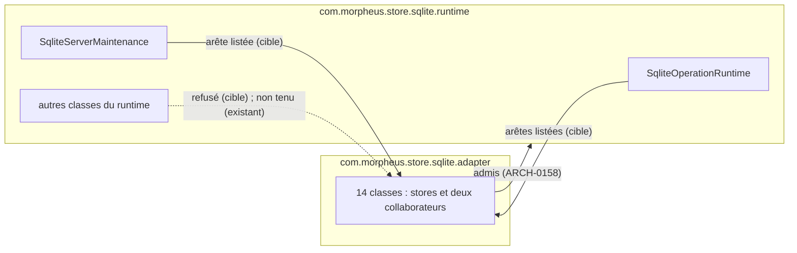

# Conception : borner les arêtes du runtime vers l'adaptateur du store SQLite

Motivation : voir proposal.md, section Why. Changement d'architecture sans code de production : une règle, une liste
et la décision qui la porte.

## Contexte

- [EXISTANT VÉRIFIÉ] `SqliteStorePackagesArchitectureTest` tient six propriétés : les points d'entrée du runtime atteints
  de l'extérieur (`RUNTIME_ENTRY_POINTS`, compteur de dette d'ARCH-0158, énuméré par l'ADR), la dépendance des autres
  modules au runtime (règle et texte), les types publics du runtime (`RUNTIME_PUBLIC_TYPES`), le contenu du paquet
  adaptateur (`ADAPTER_COLLABORATORS`, table de faits) et l'absence de classe dans le paquet parent. Aucune ne prend le
  runtime comme origine et l'adaptateur comme cible.
- [EXISTANT VÉRIFIÉ] Sur `1a539c22`, `SqliteOperationRuntime` importe 12 stores de l'adaptateur et
  `SqliteServerMaintenance` en importe un (`SqliteSpecificationKnowledgeStore`) ; aucune autre source du runtime ne nomme
  le paquet adaptateur.
- [EXISTANT VÉRIFIÉ] `SqliteConnectionScopeUseArchitectureTest` refuse une classe qui **construit** un store hors des
  classes qu'il nomme ; il ne voit pas une dépendance sans construction (appel statique, type employé, constante).
- [EXISTANT VÉRIFIÉ] ARCH-0158, décision 1 : « `com.morpheus.store.sqlite.runtime` contient tout le reste » ; décision
  3 : une entrée ajoutée à l'une de ses deux listes exige un ADR consolidé qui le remplace. Il ne dit rien de la
  direction runtime → adaptateur.
- [EXISTANT VÉRIFIÉ] `.claude/rules/architecture.md` et `ProductionClassListsArchitectureTest` : une liste de classes de
  production d'un test d'architecture est un compteur de dette ou une table de faits ; un compteur de dette déclare
  l'ADR qui le dit, cet ADR accepté le nomme par `TestClass.CHAMP`, et sa taille égale sa clé de
  `config/debt-counter-ratchets.properties`, qui ne fait que baisser.
- [EXISTANT VÉRIFIÉ] Précédent du même patron : la paire `query.dsl` / `query.saved`
  (`ApplicationPackageCyclesArchitectureTest.QUERY_DSL_AND_SAVED_EDGES`, compteur de dette d'ARCH-0162, bytecode et
  texte).
- [EXISTANT VÉRIFIÉ] `archRule.failOnEmptyShould` est actif (`AnEmptyArchitectureRuleFailsTest`) : la règle sélectionne
  les classes du runtime, ensemble non vide.

## Exigences couvertes

| Capacité | Exigence (titre exact) | Rubriques de conception qui y répondent |
|---|---|---|
| `sqlite-store-packages` | Le runtime du store SQLite ne dépend de son adaptateur que par des arêtes nommées | D2, D3, Composants |
| `sqlite-store-packages` | Les arêtes du runtime vers l'adaptateur forment une liste exacte qui ne fait que rétrécir | D1, D2 |

## Composants et frontières

Question : quelles dépendances entre les deux paquets la règle admet-elle ?

Existant : seules les flèches pleines existent, mais rien n'interdit la flèche pointillée. Cible : la règle refuse toute
flèche du runtime vers l'adaptateur absente de la liste. Exigences : les deux de `sqlite-store-packages` ajoutées par ce
changement.

## Modèle de domaine et invariants

Sans objet.

## Traitements et interactions

Sans objet : règle de build.

## États et transitions

Sans objet.

## Contrats d'interface

Sans objet.

## Persistance et intégrité

Sans objet.

## Transactions, concurrence et idempotence

Sans objet.

## Sécurité et isolation

Sans objet.

## Gestion des erreurs et reprise

Le message de la règle nomme l'origine, la cible, et le remède : passer par une classe déjà nommée, ou un ADR consolidé.

## Observabilité

Sans objet.

## Performance et stratégie de mesure

Sans objet.

## Compatibilité, migration et retour arrière

Aucun code de production ne change ; retour arrière par revert de la règle, de la clé et de l'ADR.

## Décisions

### D1 : quelle décision porte la liste
- **Nature** : [QUESTION] — décision du mainteneur
- **Exigences servies** : `sqlite-store-packages` › Les arêtes du runtime vers l'adaptateur forment une liste exacte qui
  ne fait que rétrécir
- **Options** :
  - **A — réemployer `RUNTIME_ENTRY_POINTS` comme exception de la règle.** Aucune liste ni clé nouvelle. Mais une même
    liste porterait deux faits distincts (qui, hors du store, atteint le runtime ; qui, dans le runtime, atteint
    l'adaptateur) : l'exception ne serait pas exacte (une entrée qui cesserait de dépendre de l'adaptateur resterait
    listée pour l'autre raison), et la contrainte nouvelle reste une décision qu'ARCH-0158 n'énonce pas.
  - **B — une liste d'arêtes exacte, compteur de dette sous un ADR consolidé qui remplace ARCH-0158.** L'ADR reprend les
    décisions 1 à 4 d'ARCH-0158 et ajoute la direction runtime → adaptateur, en nommant la liste par
    `SqliteStorePackagesArchitectureTest.<CHAMP>`. Forme suivie par la paire `query.dsl` / `query.saved` (ARCH-0162).
  - **C — un troisième paquet** (par exemple `com.morpheus.store.sqlite.composition` (à créer)) pour la fabrique des
    stores et la maintenance, sans cycle entre paquets. Exige aussi un ADR consolidé qui remplace ARCH-0158, déplace les
    deux points d'entrée que `morpheus-api`, `morpheus-cli` et `morpheus-mcp` importent, et revoit
    `RUNTIME_ENTRY_POINTS`, `RUNTIME_PUBLIC_TYPES` et `SqliteConnectionScopeUseArchitectureTest`.
- **[PROPOSITION]** Option B : elle borne le cycle sans déplacer de code, rend chaque arête nouvelle visible sous son
  nom, et laisse C possible plus tard sans changer de règle.
- **Compromis** : un ADR consolidé pour un constat de sévérité faible ; c'est le prix qu'exige la règle des compteurs
  de dette.
- **ADR** : ADR à proposer (consolidé, remplace ARCH-0158) ; jamais déclaré accepté par ce changement. ARCH-0158 passe
  `Remplacée` et part en archive une fois le nouveau accepté.

### D2 : une arête par paire de classes de premier rang
- **Nature** : [PROPOSITION]
- **Exigences servies** : les deux exigences ajoutées
- **Choix** : la liste énumère des paires `origine -> cible` de types de premier rang (types imbriqués ramenés à leur
  type englobant, comme `topLevelSimpleName` le fait déjà). Mesurée le 17/11/2026 par les imports : 12 paires depuis
  `SqliteOperationRuntime`, une depuis `SqliteServerMaintenance` ; la clé prend la taille mesurée sur l'arbre où le
  changement s'applique.
- **Alternatives écartées** : une entrée par classe d'origine (deux entrées) — la maintenance pourrait employer
  n'importe quel autre store sans être vue ; une règle de cycle par tranches (`slices().beFreeOfCycles()`) — l'arête
  adaptateur → runtime est voulue et massive, et seule la direction inverse est à borner.
- **Compromis** : une entrée à retirer quand `SqliteOperationRuntime` cesse de construire un store.
- **ADR** : couvert par l'ADR de D1.

### D3 : la règle sur le bytecode, doublée du texte des sources du runtime
- **Nature** : [DÉCISION]
- **Exigences servies** : `sqlite-store-packages` › Le runtime du store SQLite ne dépend de son adaptateur que par des
  arêtes nommées
- **Choix** : une règle ArchUnit `noClasses()` sur le runtime, hors des paires listées, et un scan du texte hors
  commentaires de `morpheus-store-sqlite/src/main/java/com/morpheus/store/sqlite/runtime/` qui compare les classes de
  l'adaptateur nommées à la liste, dans les deux sens. Intention en une phrase : « aucune classe du runtime ne dépend
  d'une classe de l'adaptateur hors des arêtes listées ».
- **Alternatives écartées** : la règle seule — une constante inlinée d'un store ne laisserait aucune dépendance ; le
  texte seul — une dépendance non épelée (type d'un retour) lui échapperait (`.claude/rules/architecture.md`, « Règle
  ArchUnit ou assertion textuelle »).
- **Compromis** : deux mesures à tenir d'accord ; la liste est la même.
- **ADR** : couvert par l'ADR de D1.

## Écarts constatés

| Constat | Source A | Source B | Traitement proposé |
|---|---|---|---|
| L'audit dit « rien ne refuse » une nouvelle dépendance du runtime vers un store ; la **construction** d'un store hors des classes nommées est déjà refusée | `docs/project/audits/2026-11-17/findings.md`, `AUD-ARC-28` | `SqliteConnectionScopeUseArchitectureTest` | le constat reste vrai pour une dépendance sans construction ; la règle de ce changement la couvre |
| Les règles du store sont rangées dans `.claude/rules/architecture.md` sous ARCH-0158 | `.claude/rules/architecture.md` | ADR consolidé à proposer | la section suit l'ADR retenu |

## Stratégie de vérification

| Exigence | Scénario | Preuve | État |
|---|---|---|---|
| Le runtime du store SQLite ne dépend de son adaptateur que par des arêtes nommées | Une classe du runtime emploie un store | méthode à écrire de `SqliteStorePackagesArchitectureTest` ; violation plantée (une classe du runtime qui emploie `SqliteSavedViewStore`) consignée dans la Javadoc et la PR, puis retirée | à écrire |
| idem | Une classe nommée emploie un store de plus | même méthode ; violation plantée dans `SqliteServerMaintenance` | à écrire |
| idem | Une arête qui ne laisse qu'une mention dans le texte | méthode textuelle à écrire, éprouvée sur une constante | à écrire |
| idem | Le code en vigueur passe | `./mvnw test -pl morpheus-architecture-tests -Dtest=SqliteStorePackagesArchitectureTest` | à écrire |
| Les arêtes du runtime vers l'adaptateur forment une liste exacte qui ne fait que rétrécir | Une arête disparue reste listée | même méthode (comparaison exacte dans les deux sens) | à écrire |
| idem | Une arête ajoutée sans relever la clé | `ProductionClassListsArchitectureTest#everyDebtCounterHoldsExactlyTheSizeItsRatchetAllows` | existant |
| idem | La liste sans ADR qui la nomme | `ProductionClassListsArchitectureTest#everyListIsNamedByTheAcceptedDecisionRecordItDeclares` (et `everyListADecisionRecordEnumeratesEqualsItsEnumeration` si l'ADR énumère la liste) | existant |

## Documentation durable et diagrammes à mettre à jour

- `docs/developer/specifications/sqlite-store-packages.md` : exigences, diagramme ci-dessus, traçabilité, ADR cité.
- `docs/developer/specifications/adapter-internal-boundaries.md` : citation d'ARCH-0158 suivie au nouvel ADR.
- `docs/architecture/adr/README.md`, `docs/architecture/arc42/09-decisions.md` : ligne du nouvel ADR, statut d'ARCH-0158.
- `.claude/rules/architecture.md` : section « `store-sqlite` : `adapter` et `runtime` ».

## Questions ouvertes

Aucune autre que D1, qui se tranche avant l'application.
