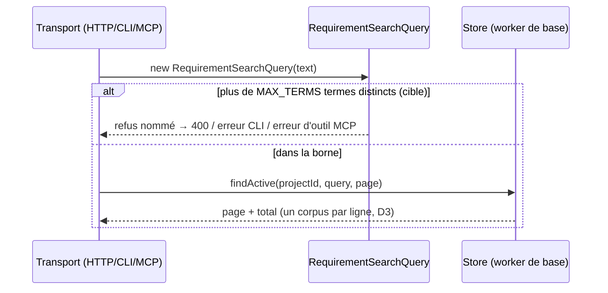

# Conception : borner les termes d'une recherche d'exigences

## Contexte

- [EXISTANT VÉRIFIÉ] `RequirementSearchQuery(String text)` normalise le texte par `RequirementPageCriteria.normalize` ;
  `terms()` le découpe sur `\p{javaWhitespace}+` sans plafond. Il est construit par `MorpheusRequirementQueryApiService`
  (HTTP), `MorpheusRequirementCli` (CLI) et `MorpheusRequirementMcpTools` (MCP).
- [EXISTANT VÉRIFIÉ] `RequirementPageCriteria` refuse un terme non normalisé ou avec blanc ; `matches` exige que le
  corpus contienne chaque terme : dédoublonner ne change pas le résultat.
- [EXISTANT VÉRIFIÉ] `SqliteVersionedRequirementStore.pageSql(bySpecification, terms, order)` produit une conjonction
  de `instr(morpheus_requirement_corpus(...), ?) > 0` dans un CTE `NOT MATERIALIZED` lu deux fois ;
  `registerCorpusFunction` enregistre `CorpusFunction` (`FLAG_DETERMINISTIC`).
- [EXISTANT VÉRIFIÉ] `HttpQueryBudget.MAX_PARAMETER_VALUE_BYTES` borne la valeur brute ; l'OpenAPI déclare
  `maxLength: 8192` pour `query` de `/projects/{projectId}/requirements`.
- [QUESTION] La limite SQLite atteinte au-delà d'environ mille termes (profondeur d'expression ou nombre de paramètres)
  et le statut HTTP rendu aujourd'hui : l'audit ne l'a pas mesuré ; la tâche 1.1 le fixe.

## Exigences couvertes

| Capacité | Exigence (titre exact) | Rubriques de conception qui y répondent |
|---|---|---|
| `requirement-page-reads` | The number of terms of a requirement search SHALL be bounded | D1, D2, Contrats |
| `requirement-page-reads` | The cost of matching a requirement SHALL NOT grow with each term beyond one corpus per row | D3, Persistance |

## Composants et frontières

- `morpheus-application` : `RequirementSearchQuery` (plafond, dédoublonnage, refus nommé) — le refus vit là parce que
  les trois transports le construisent ; aucun adaptateur ne répète la règle.
- `morpheus-store-sqlite`, `com.morpheus.store.sqlite.adapter.SqliteVersionedRequirementStore` : forme de la requête.
- `morpheus-api` : vérifier que le refus est classé en `400` par le décodage d'erreur existant.
- `morpheus-store-memory` : inchangé dans son résultat ; parité tenue par les tests existants.

## Modèle de domaine et invariants

Invariant ajouté au record `RequirementSearchQuery`, tenu dans son constructeur compact : au plus `MAX_TERMS`
termes distincts (constante à créer).

## Traitements et interactions

Question : où le refus intervient-il par rapport au worker de base ?

Note : en HTTP, la construction a lieu dans le service, donc sur le worker ; le refus est immédiat et ne lit pas la
base.

## États et transitions

Sans objet.

## Contrats d'interface

`GET /api/v1/projects/{projectId}/requirements` (rôle READ en remote) : le paramètre `query` garde `maxLength: 8192` ;
sa description nomme le plafond de termes et la réponse `400` est déclarée. CLI `requirements find --query` et outil
MCP `find_requirements` : même raison de refus. Aucune ligne de `contracts/public-surfaces.tsv` ne change.

## Persistance et intégrité

[PROPOSITION] D3 : calculer le corpus une fois par ligne — sous-requête qui projette `morpheus_requirement_corpus(...)
AS corpus` puis filtre `instr(corpus, ?) > 0` pour chaque terme, ou colonne virtuelle si une migration est préférée.
La sous-requête n'ajoute aucune migration ; une colonne générée ajouterait une version de schéma (gouvernée par
`released-schema-levels.properties`), ce que ce correctif évite. Le plan de la requête (index de page,
`V024__requirement_page_order_keys.sql`) doit rester celui que `sqlite-index-coverage` tient.

## Transactions, concurrence et idempotence

Sans objet : lecture seule.

## Sécurité et isolation

Le plafond retire au rôle le plus faible le levier de saturation des workers par une seule requête ; il ne remplace pas
l'admission bornée de `database-worker-admission`.

## Gestion des erreurs et reprise

Le refus est une `IllegalArgumentException` à message nommé (ou un type du projet si le classement HTTP l'exige),
jamais une `SQLException` remontée du store.

## Observabilité

Sans objet.

## Performance et stratégie de mesure

Le budget M19 de requête (`M19QueryPerformanceGate`) est relu après D3 ; aucun budget n'est relevé. Un test compte les
appels de `CorpusFunction` sur une petite base pour prouver « un corpus par ligne ».

## Compatibilité, migration et retour arrière

Une recherche de plus de `MAX_TERMS` termes distincts, aujourd'hui servie (lentement) ou en erreur SQL, devient un
refus. Aucune donnée persistée ne change.

## Décisions

### D1 : valeur et lieu du plafond
- **Nature** : [PROPOSITION]
- **Exigences servies** : `requirement-page-reads` › The number of terms of a requirement search SHALL be bounded
- **Choix** : `RequirementSearchQuery.MAX_TERMS` (à créer), valeur proposée 32 termes distincts, à confirmer à la
  revue ; refus dans le constructeur compact.
- **Alternatives écartées** : borner dans chaque transport — trois copies d'une règle ; ne compter que la longueur de
  la valeur — 8 192 octets permettent des milliers de termes.
- **ADR** : non concerné (`.claude/rules/adr.md` : borne d'une capacité existante, retour arrière sans coût).

### D2 : dédoublonner
- **Nature** : [DÉCISION]
- **Exigences servies** : idem
- **Choix** : `terms()` rend des termes distincts dans l'ordre de première apparition (ordre déterministe).
- **Alternatives écartées** : compter les répétitions dans le plafond — refuserait une recherche équivalente à une
  recherche admise.
- **ADR** : non concerné.

### D3 : un corpus par ligne
- **Nature** : [PROPOSITION]
- **Exigences servies** : `requirement-page-reads` › The cost of matching a requirement SHALL NOT grow with each term beyond one corpus per row
- **Choix** : sous-requête qui projette le corpus (Persistance et intégrité).
- **Alternatives écartées** : colonne générée persistée — migration de schéma pour un correctif de coût.
- **ADR** : non concerné.

## Écarts constatés

| Constat | Source A | Source B | Traitement proposé |
|---|---|---|---|
| L'OpenAPI borne `query` à 8 192 caractères ; la valeur porte des milliers de termes | `morpheus-v1.yaml` | `RequirementSearchQuery.terms()` | D1 |

## Stratégie de vérification

| Exigence | Scénario | Preuve | État |
|---|---|---|---|
| The number of terms… | A search at the bound | `RequirementSearchQueryTest#aSearchAtTheBoundIsAccepted` | à écrire |
| The number of terms… | Repeated terms count once | `RequirementSearchQueryTest#repeatedTermsCountOnce` | à écrire |
| The number of terms… | A search beyond the bound over HTTP | `MorpheusRequirementSearchBoundIntegrationTest#aSearchBeyondTheBoundIsRefusedWith400` | à écrire |
| The number of terms… | A search beyond the bound through the CLI and MCP | cas dans les tests de `MorpheusRequirementCli` et `MorpheusRequirementMcpTools` | à écrire |
| The cost of matching… | A search of many terms on the SQLite store | `SqliteRequirementPageTest#theCorpusIsBuiltOncePerRow` ; parité `*PersistenceParityTest` | à écrire · existant |

## Documentation durable et diagrammes à mettre à jour

`docs/developer/specifications/requirement-page-reads.md` (exigences, diagramme de séquence, traçabilité) ;
`docs/user/CLI.md` (section `requirements find`) si elle décrit `--query`.

## Questions ouvertes

- Valeur de `MAX_TERMS` (D1).
