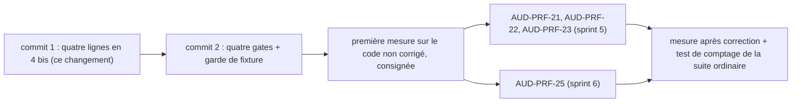

# Conception : budgéter l'orchestration, le rapport qualité, l'évaluation de gouvernance et le portfolio (AUD-PRF-30)

## Contexte

[EXISTANT VÉRIFIÉ] Cinq classes de gate du paquet `com.morpheus.architecture.m19` (`M19PerformanceGate`,
`M19QueryPerformanceGate`, `M19TraceabilityPerformanceGate`, `M19CompositionPerformanceGate`,
`M19FullPublishPerformanceGate`) sont nommées par `-Dtest=` dans `scripts/validate-m19.ps1` (ligne 357) et
`scripts/validate-m19.sh` (ligne 237), hors des motifs Surefire ; le validateur fixe un tas de 768 MiB
(`-DargLine=-Xmx768m`). La lane `M19 performance budgets` de `nightly.yml` les lance sur Linux et Windows.

[EXISTANT VÉRIFIÉ] `GEN-0085`, décision 9 : un budget ajouté après le gel va en section 4 bis, daté, déclaré avant
toute modification du code qu'il juge, valeur tirée de l'usage et non d'une exécution, première mesure sur le code non
corrigé, aucune ligne existante modifiée, une base à lui s'il faut d'autres lignes ; la correction jugée porte aussi
une preuve déterministe dans la suite ordinaire. Le précédent est la section 4 bis du 13/10/2026 (lecture du contenu,
analyse d'un change, page de journal), changement archivé `2026-11-05-declare-a-budget-before-bounding-a-cost`.

[EXISTANT VÉRIFIÉ] Les quatre opérations et leurs points d'entrée :
- état d'orchestration d'un change : `ChangeOrchestrationStateService.active(…)` (`com.morpheus.application.orchestration`) ;
- rapport qualité d'un snapshot : `QualityReportService.assessSnapshot(…)` (`com.morpheus.application.quality`), qui
  porte le contrôle des requirements orphelins visé par `AUD-PRF-23` ;
- évaluation de gouvernance : `PolicyEvaluationService.evaluatePack(…)` (`com.morpheus.application.policy`), pack borné
  par `PolicyBudgets.MAX_RULES_PER_PACK` ;
- page de références d'un portfolio : `PortfolioQueryService.references(portfolioId, offset, limit)`
  (`com.morpheus.application.portfolio`).

[EXISTANT VÉRIFIÉ] La fixture `M19-LARGE-GATE-1` (section 2 du document) déclare 10 000 requirements, 2 000 changes,
4 000 critères et 25 000 liens, mais aucun portfolio ni pack de gouvernance.

Motivation : voir `proposal.md`, section Why.

## Exigences couvertes

| Capacité | Exigence (titre exact) | Rubriques de conception qui y répondent |
|---|---|---|
| `performance-budget-coverage` | L'orchestration, le rapport qualité, l'évaluation de gouvernance et le portfolio ont un budget déclaré avant leur correction | D1, D2, §Traitements |
| `performance-budget-coverage` | Chacun des quatre budgets est mesuré sur une fixture qui tient les lignes avec lesquelles son coût croît | D3, D4 |
| `performance-budget-coverage` | A new budget SHALL NOT move an existing one (existante, appliquée) | D3 |

## Composants et frontières

Sources de test du module `morpheus-architecture-tests`, paquet `com.morpheus.architecture.m19` : les mesures vont dans
les classes de gate existantes dont elles partagent la fixture (orchestration et qualité avec la lecture du contenu,
dans `M19FullPublishPerformanceGate` ; gouvernance avec la page de journal dans `M19QueryPerformanceGate`), et le
portfolio dans une classe nouvelle `M19PortfolioPerformanceGate` si aucune existante ne porte de portfolio — elle est
alors ajoutée au `-Dtest=` des deux validateurs (`GateReachabilityArchitectureTest`). Les gates construisent le runtime
de production par les racines existantes, sans accès SQLite direct.

## Modèle de domaine et invariants

Sans objet.

## Traitements et interactions

Question : dans quel ordre les quatre budgets et leurs corrections doivent-ils arriver ?

Le commit 1 est un ancêtre de toute correction (exigence 1, scénario « Le budget précède la correction »). Les
corrections sont hors de ce changement.

## États et transitions

Sans objet.

## Contrats d'interface

Sans objet : aucune surface publique ; les métriques suivent le format `M19_METRIC` des gates existants.

## Persistance et intégrité

Sans objet pour le produit. La fixture de portfolio et le pack de gouvernance sont écrits dans une base propre à leur
gate (D3), jamais dans la base du profil gelé.

## Transactions, concurrence et idempotence

Sans objet.

## Sécurité et isolation

Sans objet.

## Gestion des erreurs et reprise

Une fixture trop petite fait échouer le gate avant toute mesure, avec un message qui nomme la grandeur manquante
(exigence 2).

## Observabilité

Les lignes `M19_METRIC` de chaque gate, consignées dans le document des budgets à la première mesure.

## Performance et stratégie de mesure

Protocole existant (section 3 du document, `GEN-0085` décision 4) : après warmup, cinq itérations, p95 nearest-rank, sur
l'environnement de référence minimal ; en dessous, le validateur refuse de conclure. Les bornes sont la question D2.

## Compatibilité, migration et retour arrière

Sans objet : des lignes de document et des gates ajoutés ; une ligne retirée l'est avec sa raison écrite, comme la
ligne du journal du 13/10/2026 le prévoyait.

## Décisions

### D1 : budgets nocturnes M19, et la preuve de comptage portée par chaque correction
- **Nature** : [QUESTION] → [PROPOSITION]
- **Exigences servies** : `performance-budget-coverage` › L'orchestration, le rapport qualité, l'évaluation de
  gouvernance et le portfolio ont un budget déclaré avant leur correction
- **Options** : (A) quatre budgets M19 déclarés et mesurés ici, chaque correction apportant son test de comptage ;
  (B) seulement des tests de coût en nombre de requêtes dans `morpheus-store-sqlite`, déterministes et moins chers,
  sans ligne de budget ; (C) les deux, tous ici.
- **Proposition** : A. C'est ce que `GEN-0085` décision 9 et l'exigence en vigueur demandent pour un coût qu'une
  correction prétend borner ; le test de comptage appartient à la correction, qui sait ce qu'elle borne (C mettrait ici
  des comptes qui seraient réécrits par les corrections). Si B est retenu, les deux exigences ajoutées sont remplacées
  par une exigence de comptage et la proposition est réécrite avant implémentation.
- **Alternatives écartées** : B seul — laisse les corrections des sprints 5 et 6 en contradiction avec l'exigence en
  vigueur ; C — double travail.
- **Compromis** : un coût de lane nocturne de plus, et une preuve Linux qui n'arrive que par la lane.
- **ADR** : non concerné (`GEN-0085` couvre).

### D2 : valeur des quatre bornes
- **Nature** : [QUESTION] → [PROPOSITION]
- **Exigences servies** : idem
- **Question** : quelle borne pour chaque opération ? `GEN-0085` veut une valeur tirée de l'usage, fixée avant toute
  mesure, et aucune n'est écrite par ce changement.
- **Proposition** : par analogie avec les lignes du 13/10/2026 — lecture interactive (rapport qualité, page de
  portfolio) comme la lecture du contenu d'un snapshot ; opération composée de lectures (état d'orchestration,
  évaluation d'un pack) comme l'analyse d'un change. Les nombres sont choisis par le mainteneur et écrits dans la
  ligne, avec leur raison.
- **ADR** : non concerné.

### D3 : une base à lui pour le portfolio et le pack
- **Nature** : [DÉCISION]
- **Exigences servies** : `performance-budget-coverage` › Chacun des quatre budgets est mesuré sur une fixture qui
  tient les lignes avec lesquelles son coût croît ; A new budget SHALL NOT move an existing one
- **Choix** : le pack de gouvernance (au nombre maximal de règles, lu dans `PolicyBudgets.MAX_RULES_PER_PACK`) et le
  portfolio (projets membres et références) sont écrits dans une base propre à leur mesure, déterministe depuis le seed
  du profil ; l'orchestration et le rapport qualité lisent le snapshot du profil, que la lecture du contenu publie déjà
  dans sa base à elle.
- **Alternatives écartées** : ajouter portfolio et pack au profil `M19-LARGE-GATE-1` — modifierait la taille SQLite et
  le temps de publication mesurés, interdit par `GEN-0085`.
- **Compromis** : une écriture de fixture de plus dans la lane.
- **ADR** : non concerné.

### D4 : taille de la fixture de portfolio
- **Nature** : [QUESTION] → [PROPOSITION]
- **Exigences servies** : `performance-budget-coverage` › Chacun des quatre budgets est mesuré sur une fixture qui
  tient les lignes avec lesquelles son coût croît
- **Question** : combien de projets et de références ? Le profil gelé n'en déclare aucun.
- **Proposition** : autant de références que de liens du profil gelé, réparties sur quelques projets membres, et une
  page mesurée au milieu de la liste ; la taille est écrite dans la ligne du budget, réduite et dite si elle ne tient
  pas dans le tas du validateur, qui ne change pas.
- **ADR** : non concerné.

## Écarts constatés

| Constat | Source A | Source B | Traitement proposé |
|---|---|---|---|
| Quatre chemins coûteux sans budget (`AUD-PRF-30`) | paquet `m19`, document des budgets | `GEN-0085` décision 9, `AUD-PRF-21` à `-23`, `AUD-PRF-25` | D1 à D4 |
| La capacité `performance-budget-coverage` n'a pas de page durable et son `Purpose` n'y renvoie pas | `openspec/specs/performance-budget-coverage/spec.md` | `docs/developer/specifications/README.md` | la page est créée par ce changement (tâches) ; le `Purpose` est complété dans la spec principale |

## Stratégie de vérification

| Exigence | Scénario | Preuve | État |
|---|---|---|---|
| budget déclaré avant la correction | Le budget précède la correction | `git merge-base --is-ancestor` entre le commit des lignes et chaque correction | manuel, à la revue des corrections |
| idem | Le code non corrigé est mesuré | lignes `M19_METRIC` consignées dans le document | à produire |
| idem | Un budget manqué fait échouer la lane | gates ajoutés, `validate-m19` | à écrire |
| fixture qui tient les lignes | les trois | gardes de fixture des gates, cassées une fois puis restaurées | à écrire |
| A new budget SHALL NOT move an existing one | métriques existantes | `validate-m19` complet, mêmes noms et mêmes comptes | existant |
| gate atteignable | classe nouvelle nommée par les deux validateurs | `GateReachabilityArchitectureTest` | existant |

## Documentation durable et diagrammes à mettre à jour

`docs/project/roadmap/M19_PERFORMANCE_BUDGETS.md` (section 4 bis), `docs/developer/specifications/performance-budget-coverage.md`
(à créer, gabarit de `docs/developer/specifications/README.md`) et sa ligne d'index.

## Questions ouvertes

Aucune autre que D1, D2 et D4, qui sont des décisions du mainteneur à prendre avant les tâches du groupe 2.
