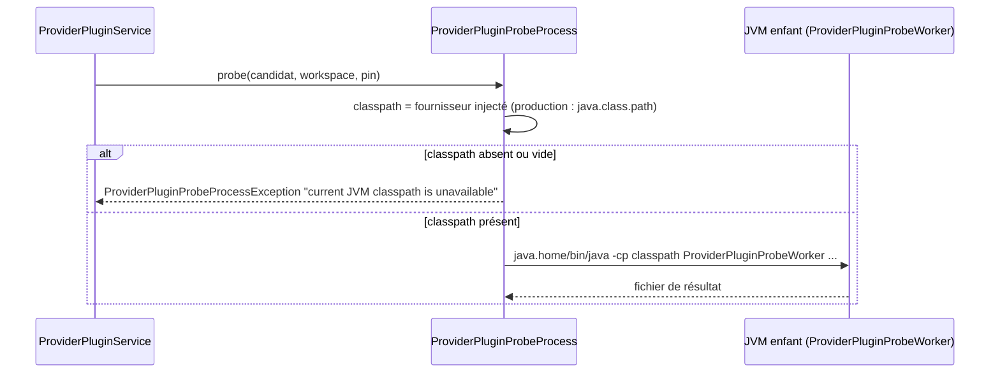

# Conception : construire le classpath du worker du probe depuis le seul classpath de l'hôte

## Contexte

- [EXISTANT VÉRIFIÉ] `ProviderPluginProbeProcess.command` (`:248-269`) : `surefire.test.class.path`, sinon
  `java.class.path`, sinon `ProviderPluginProbeProcessException("current JVM classpath is unavailable", false)` ; puis
  `java.home/bin/java -cp <classpath> ProviderPluginProbeWorker <jar> <workspace> <sha256> <résultat>`.
- [EXISTANT VÉRIFIÉ] Constructeurs package-private : `ProviderPluginProbeProcess(OperationalRecorder)` et
  `ProviderPluginProbeProcess(Duration, OperationalRecorder)` (`:59`, `:63`) ; production : `ProviderPluginService`
  (`:26`) ; tests : `ProviderPluginProcessRoundTripTest`, `ProviderPluginProcessIsolationTest`,
  `ProviderPluginProbeCleanupTraceTest`.
- [EXISTANT VÉRIFIÉ] Sous Surefire, `java.class.path` d'une JVM de test peut se réduire au JAR d'amorçage : c'est la
  raison de la lecture actuelle. Les autres tests du dépôt qui lancent un enfant lisent eux-mêmes
  `surefire.test.class.path` (ex. `ProviderPluginDescendantTerminationTest:224`).
- [EXISTANT VÉRIFIÉ] `SEC-0129` §5 : la JVM enfant vient de `java.home`, jamais du `PATH` ; ce change applique la même
  exigence au classpath.

## Exigences couvertes

| Capacité | Exigence (titre exact) | Rubriques de conception qui y répondent |
|---|---|---|
| `provider-plugin-pinned-entry` | Le worker du probe DOIT être lancé avec le classpath de la JVM hôte seulement | D1 |
| `provider-plugin-pinned-entry` | Aucune source principale NE DOIT lire une propriété de l'outillage de test | D2 |

## Composants et frontières

`morpheus-provider-sdk` : `ProviderPluginProbeProcess` reçoit un fournisseur de classpath ; la production le construit
sur `java.class.path`. `morpheus-architecture-tests` : une méthode lit les sources principales de chaque module du
réacteur (parcours par `RepositoryTree.files`, `.claude/rules/testing.md`).

## Modèle de domaine et invariants

Sans objet.

## Traitements et interactions

Question : d'où vient le `-cp` de l'enfant dans la cible ? Du seul fournisseur injecté ; en production, de
`java.class.path`. Exigence : « Le worker du probe DOIT être lancé avec le classpath de la JVM hôte seulement ».

## États et transitions

Sans objet.

## Contrats d'interface

Sans objet : aucune surface publique.

## Persistance et intégrité

Sans objet.

## Transactions, concurrence et idempotence

Sans objet.

## Sécurité et isolation

Supprime un réglage qui laissait une propriété système choisir le code chargé par la JVM qui exécute du code tiers. Le
reste de la frontière (`SEC-0129` §4, §5) ne change pas.

## Gestion des erreurs et reprise

Refus inchangé et nommé pour un classpath indisponible ; aucun repli sur une autre propriété.

## Observabilité

Sans objet.

## Performance et stratégie de mesure

Sans objet.

## Compatibilité, migration et retour arrière

Le launcher packagé n'a jamais de `surefire.test.class.path` : aucun effet en production. Retour arrière : restaurer la
lecture.

## Décisions

### D1 : injection du classpath par un constructeur de test
- **Nature** : [DÉCISION]
- **Exigences servies** : `provider-plugin-pinned-entry` › Le worker du probe DOIT être lancé avec le classpath de la JVM hôte seulement
- **Choix** : un paramètre `Supplier<String>` du constructeur package-private complet ; les deux constructeurs existants
  y délèguent avec `() -> System.getProperty("java.class.path")` ; les tests de probe du module passent un fournisseur qui
  lit `surefire.test.class.path` dans leur propre source.
- **Alternatives écartées** : déduire le classpath de l'emplacement du JAR de `ProviderPluginProbeWorker` — ne couvre pas
  les dépendances du worker (domaine, application) hors du JAR ombré ; configurer Surefire en `useManifestOnlyJar=false`
  — change le classpath de tous les tests du module pour un seul besoin, et le code principal resterait libre de lire la
  propriété.
- **Compromis** : un constructeur package-private de plus, appelé seulement par les tests (les constructeurs ne sont pas
  jugés par `UnreferencedPublicMethodArchitectureTest`, et celui-ci n'est pas public).
- **ADR** : non concerné.

### D2 : refus textuel des propriétés Surefire dans le code principal
- **Nature** : [DÉCISION]
- **Exigences servies** : `provider-plugin-pinned-entry` › Aucune source principale NE DOIT lire une propriété de l'outillage de test
- **Choix** : une méthode de `morpheus-architecture-tests` parcourt les `src/main/java` des modules du réacteur et
  refuse toute occurrence du littéral `"surefire.`, en nommant fichier et ligne, et exige d'avoir lu au moins une
  source. Intention : « ce nom ne doit pas apparaître ici » → assertion textuelle (une chaîne n'est pas une dépendance).
- **Alternatives écartées** : règle ArchUnit — un nom de propriété est une chaîne, invisible au bytecode ; restreindre au
  SDK — le défaut est de nature transverse, et le compte actuel hors SDK est nul.
- **Compromis** : un nom construit par concaténation échapperait au scan ; la revue le voit.
- **ADR** : non concerné.

## Écarts constatés

| Constat | Source A | Source B | Traitement proposé |
|---|---|---|---|
| L'audit renvoie à « l'injection déjà prévue pour les tests » | `docs/project/audits/2026-11-17/findings.md`, `AUD-TRV-09`, action | les constructeurs n'injectent que délai et recorder (`ProviderPluginProbeProcess.java:59`, `:63`) | D1 crée l'injection |
| L'audit compte neuf autres occurrences | `AUD-TRV-09`, preuve | dix-sept occurrences en sources de test le 17/11/2026 | sans effet : toutes sont des tests |

## Stratégie de vérification

| Exigence | Scénario | Preuve | État |
|---|---|---|---|
| Le worker du probe DOIT être lancé avec le classpath de la JVM hôte seulement | Une propriété d'outillage de test posée au lanceur est ignorée | test unitaire de `command` dans `morpheus-provider-sdk` (fournisseur de production, propriété posée dans une classe isolée) | à écrire |
| idem | Classpath de l'hôte indisponible | test unitaire avec un fournisseur qui rend une chaîne vide, `assertThrows` + message | à écrire |
| idem | (non-régression) probe réel | `ProviderPluginProcessRoundTripTest` avec fournisseur de test | existant, à adapter |
| Aucune source principale NE DOIT lire une propriété de l'outillage de test | Une lecture de propriété Surefire dans le code principal fait échouer le build | nouvelle méthode, violation plantée | à écrire |
| idem | Les sources de test gardent leur lecture | même méthode | à écrire |

Un test qui pose une propriété système s'exécute isolé (`test-jvm-state-isolation`) : préférer un test qui n'en pose
pas, en vérifiant la commande construite par le fournisseur de production.

## Documentation durable et diagrammes à mettre à jour

`docs/developer/specifications/provider-plugin-pinned-entry.md` (deux exigences, matrice, diagramme de séquence).

## Questions ouvertes

Aucune.
