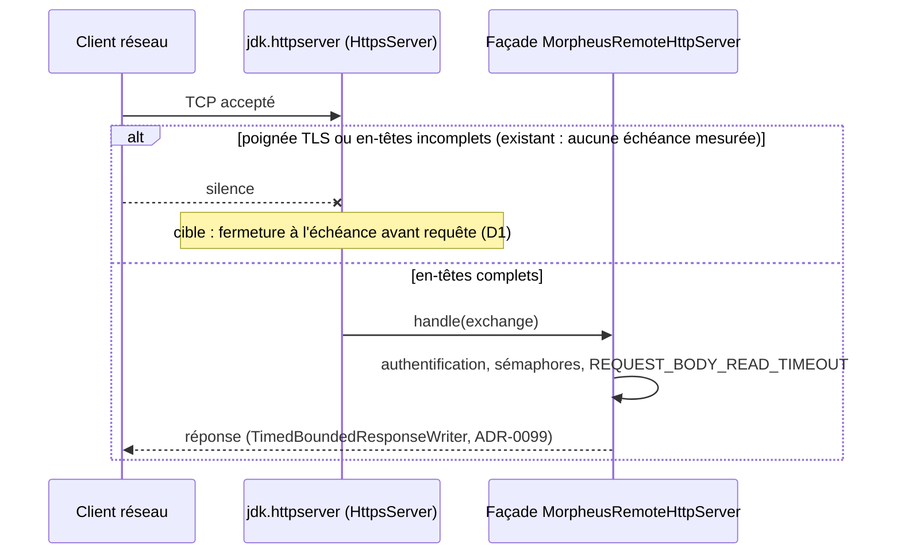

# Conception : fermer une connexion remote qui s'arrête avant l'authentification

## Contexte

- [EXISTANT VÉRIFIÉ] `MorpheusRemoteHttpServerBootstrap` crée `HttpsServer.create(address, listenBacklog)` avec un
  exécuteur à fils virtuels ; `listenBacklog` vaut au moins `MorpheusRemoteHttpServer.DEFAULT_MAX_CONCURRENT_REQUESTS`
  mais ne borne que la file d'acceptation du noyau, pas les connexions acceptées.
- [EXISTANT VÉRIFIÉ] Les budgets de la façade s'appliquent après la lecture des en-têtes par `jdk.httpserver` :
  `REQUEST_BODY_READ_TIMEOUT` pour le corps, `TimedBoundedResponseWriter` pour la réponse (ADR-0099), sémaphores de
  concurrence et d'authentification dans le gestionnaire.
- [EXISTANT VÉRIFIÉ] ADR-0099 écarte `sun.net.httpserver.maxRspTime` (« propriété interne non documentée, posée hors du
  processus : un déploiement qui l'oublie n'a aucune borne ») et interdit de la positionner dans le code de production.
- [EXISTANT VÉRIFIÉ] Le lanceur portable passe `--java-options` sans propriété `jdk.httpserver.*`
  (`distribution/build-portable.sh`).
- [QUESTION] Ce que `jdk.httpserver` d'OpenJDK 21 ferme seul : l'audit observe la fermeture d'une connexion muette en
  39 s, mais pas celle d'une connexion qui a envoyé quelques octets. Le test de reproduction (tâche 2.1) le fixe sur la
  plateforme du dépôt avant tout correctif.

## Exigences couvertes

| Capacité | Exigence (titre exact) | Rubriques de conception qui y répondent |
|---|---|---|
| `remote-pre-authentication-bounds` | A connection that stalls before its request is read is closed in bounded time | D1, Traitements |
| `remote-pre-authentication-bounds` | The number of open connections of the remote server is bounded | D1 |
| `remote-pre-authentication-bounds` | The pre-authentication bounds are stated to the operator | D2 |

## Composants et frontières

`morpheus-api` (`com.morpheus.api.remote` : `MorpheusRemoteHttpServerBootstrap`) ; selon D1, `morpheus-cli`
(lancement du mode remote) et `distribution/`. Une propriété système posée par le code relève de l'environnement du
processus : `ApiTechnologyBoundaryArchitectureTest` refuse l'environnement du processus dans `morpheus-api`, et
`CliTechnologyBoundaryArchitectureTest` le confine aux classes nommées de la CLI — l'option A passe donc par une classe
déjà nommée de la CLI ou s'y fait nommer avec sa raison.

## Modèle de domaine et invariants

Sans objet : aucun type du domaine.

## Traitements et interactions

Question : à quelle étape une connexion est-elle aujourd'hui sans échéance ?

Exigences : `A connection that stalls before its request is read is closed in bounded time`. Le nombre de connexions
(`The number of open connections of the remote server is bounded`) se borne avant `handle`, donc au même niveau que
l'échéance.

## États et transitions

Sans objet.

## Contrats d'interface

Sans objet : aucune route, aucun code de refus ajouté — une connexion fermée avant sa requête ne reçoit aucune réponse
HTTP.

## Persistance et intégrité

Sans objet.

## Transactions, concurrence et idempotence

La borne de connexions est indépendante de `DEFAULT_MAX_CONCURRENT_REQUESTS` (requêtes admises par la façade) : elle
compte des connexions, authentifiées ou non. [PROPOSITION] Elle reste au moins égale au plafond de requêtes, pour qu'un
client authentifié en cours ne soit jamais privé de connexion par la borne.

## Sécurité et isolation

Frontière de confiance : tout client réseau, sans compte. La borne protège descripteurs, moteurs SSL et fils virtuels ;
elle n'est pas une limite par adresse (aucune n'existe aujourd'hui), donc un attaquant peut encore occuper la borne de
connexions pendant la durée de l'échéance : c'est le résiduel que la documentation écrit (D2).

## Gestion des erreurs et reprise

Une connexion fermée à l'échéance ne laisse aucun état : rien n'a été authentifié ni journalisé.

## Observabilité

[PROPOSITION] Aucun compteur nouveau dans ce changement : `jdk.httpserver` ne signale pas une fermeture interne. Si
l'option B (terminateur TLS) est retenue, l'observabilité est celle du terminateur.

## Performance et stratégie de mesure

Le test d'intégration mesure la fermeture sous l'échéance configurée plus une marge ; aucun budget M19 n'est concerné.

## Compatibilité, migration et retour arrière

Un client lent mais légitime qui met plus que l'échéance à envoyer ses en-têtes est coupé : la valeur doit rester
large devant une poignée TLS normale. Retour arrière : retirer les propriétés ou la configuration du terminateur.

## Décisions

### D1 : mécanisme de la borne avant requête
- **Nature** : [QUESTION] — décision du mainteneur
- **Exigences servies** : `remote-pre-authentication-bounds` › A connection that stalls before its request is read is closed in bounded time ; › The number of open connections of the remote server is bounded
- **Options** :
  - **A. Propriétés de `jdk.httpserver` posées par MORPHEUS** : `jdk.httpserver.maxConnections` (propriété documentée du
    module `jdk.httpserver`) et `sun.net.httpserver.maxReqTime` (propriété interne, non documentée), posées par le
    lancement du mode remote avant le premier chargement de `jdk.httpserver`, et vérifiées au démarrage (refus nommé si
    elles ne sont pas en place). Contredit l'esprit d'ADR-0099 pour `maxReqTime`, que cet ADR n'interdit pas à la
    lettre.
  - **B. Terminateur TLS ou proxy exigé devant le serveur** : la borne est déléguée à un composant d'exploitation ;
    MORPHEUS ne change pas, la documentation en fait une exigence de déploiement. Un déploiement qui l'oublie n'a
    aucune borne — l'objection même d'ADR-0099.
  - **C. Accepter soi-même les connexions** : remplacer l'acceptation de `HttpsServer` par une poignée TLS faite par
    MORPHEUS avec échéance ; hors de portée de l'API publique de `jdk.httpserver`, donc un serveur maison.
- **[PROPOSITION]** A, avec `maxConnections` posé comme borne documentée et `maxReqTime` posé et vérifié au démarrage,
  plus B écrit comme défense recommandée. Le refus de démarrer sans les propriétés lève l'objection d'ADR-0099 (« un
  déploiement qui l'oublie n'a aucune borne »).
- **Alternatives écartées** : remplacer `jdk.httpserver` (ADR-0065, ADR-0099 : décision de dépendance majeure pour une
  propriété).
- **ADR** : ADR à proposer — un ADR consolidé qui remplace ADR-0099 en couvrant la durée de vie d'une connexion avant
  et après la requête. Jamais déclaré accepté par ce changement.

### D2 : documenter la borne et son résiduel
- **Nature** : [DÉCISION]
- **Exigences servies** : `remote-pre-authentication-bounds` › The pre-authentication bounds are stated to the operator
- **Choix** : `SECURITY.md` (section du serveur remote) et `docs/user/TEAM_REMOTE_SERVER.md` disent la borne, la
  manière de la régler et le résiduel (aucune limite par adresse) ; `docs/developer/REMOTE_SERVER_PLATFORM.md` dit le
  mécanisme.
- **Alternatives écartées** : ne rien écrire — le constat tient précisément à une frontière non écrite.
- **ADR** : non concerné.

## Écarts constatés

| Constat | Source A | Source B | Traitement proposé |
|---|---|---|---|
| La façade se dit bornée en temps (A-10 du registre des risques) ; la phase avant requête ne l'est pas | `docs/architecture/risks/register.md`, A-10 | `MorpheusRemoteHttpServerBootstrap` | compléter A-10 après la décision D1 |

## Stratégie de vérification

| Exigence | Scénario | Preuve | État |
|---|---|---|---|
| A connection that stalls… | A partial TLS handshake | `MorpheusRemotePreAuthenticationBoundsIntegrationTest#aPartialTlsHandshakeIsClosedWithinTheBound` | à écrire |
| A connection that stalls… | Partial request headers over an established TLS session | `…#partialHeadersAreClosedWithinTheBound` | à écrire |
| A connection that stalls… | A client that completes its request in time is served | tests remote existants (`MorpheusRemoteHttpServerTest`) | existant |
| The number of open connections… | Connections beyond the bound | `…#aConnectionBeyondTheBoundIsNotHeld` | à écrire |
| The pre-authentication bounds are stated… | The operator reads the remote server guide | relecture ; `UserDocumentationSpeaksOfTheInstalledProductTest` | manuel · existant |

## Documentation durable et diagrammes à mettre à jour

Page nouvelle `docs/developer/specifications/remote-pre-authentication-bounds.md` (gabarit de
`docs/developer/specifications/README.md`, ajoutée à son index, section « Frontière HTTP locale et distante ») ;
`SECURITY.md`, `docs/user/TEAM_REMOTE_SERVER.md`, `docs/developer/REMOTE_SERVER_PLATFORM.md`,
`docs/architecture/risks/register.md` (A-10).

## Questions ouvertes

- Valeurs de l'échéance avant requête et de la borne de connexions : à fixer avec D1, puis citées depuis leur constante
  ou leur propriété, jamais recopiées dans la documentation.
