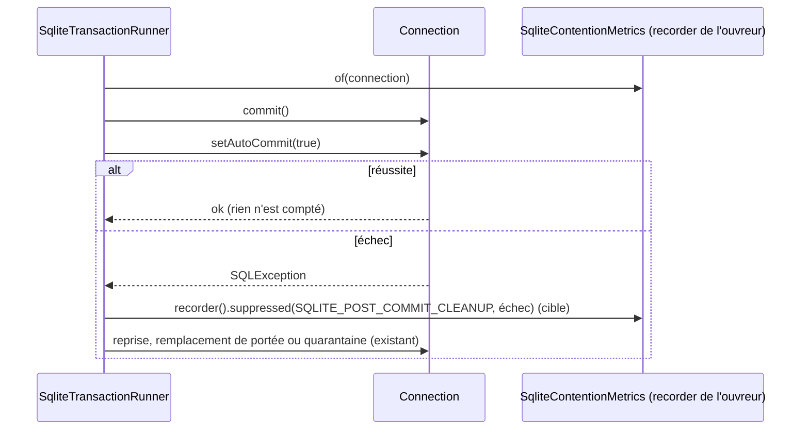

# Conception : compter l'échec de nettoyage après commit d'une transaction SQLite (AUD-QUA-37)

Conception allégée : changement local à une classe du runtime SQLite, plus une famille d'échec écarté.

## Contexte

[EXISTANT VÉRIFIÉ] `SqliteTransactionRunner.run` lit `SqliteContentionMetrics contention =
SqliteContentionMetrics.of(connection)` (ligne 41) avant de commencer, puis appelle
`restoreAfterSuccessfulCommit(connection, previousAutoCommit)` après le commit (ligne 49). Cette méthode retente la
remise en auto-commit (lignes 108-116), demande à la portée de remplacer sa connexion physique
(`SqliteConnectionScope.recoverAfterCommittedCleanupFailure`, ligne 118), sinon met la connexion en quarantaine et la
ferme (lignes 125-133). Chaque issue écrit une ligne `System.Logger` et rien d'autre.

[EXISTANT VÉRIFIÉ] `SqliteContentionMetrics.of` rend les compteurs de l'ouvreur pour une connexion enveloppée par
MORPHEUS (`SqliteConnectionScope` et `SqliteDatabaseLease.LeasedConnectionHandler` implémentent `Carrier`), et un
recorder muet (`OperationalRecorder.noop()`) pour une autre connexion, ce que sa Javadoc dit.

[EXISTANT VÉRIFIÉ] Le store compte déjà deux familles (`SQLITE_LEASE_RELEASE`, `SQLITE_CONFLICT_READ`) ;
`docs/developer/OPERABILITY.md` tient une ligne par famille ; `SuppressedFailureCountersServedTest` et
`SuppressedFailureTraceTest` parcourent `SuppressedFailureFamily.values()`.

[EXISTANT VÉRIFIÉ] `SqliteTransactionRunnerTest` couvre la quarantaine
(`cleanupFailureAfterSuccessfulCommitKeepsDurableMutationSuccessfulAndQuarantinesDirectConnection`) et la reprise
(`transientCleanupFailureAfterCommitIsRecoveredByRetryWithoutQuarantine`) sur des connexions `Proxy` écrites à la main,
qui ne portent aucun recorder.

Motivation : voir `proposal.md`, section Why.

## Exigences couvertes

| Capacité | Exigence (titre exact) | Rubriques de conception qui y répondent |
|---|---|---|
| `suppressed-failure-trace` | L'échec de nettoyage après commit d'une transaction SQLite est compté | D1, D2, D3 |

## Composants et frontières

`com.morpheus.store.sqlite.runtime.SqliteTransactionRunner` (compte), `com.morpheus.application.operability`
(`SuppressedFailureFamily`, famille ajoutée). Le runtime reste interne à son module (`SqliteStorePackagesArchitectureTest`,
`RUNTIME_PUBLIC_TYPES` inchangé) ; `QUARANTINED` reste le moniteur nommé de `RUNTIME_MONITORS`
(`SqliteStoreAdapterHoldsNoMonitorArchitectureTest`), inchangé.

## Modèle de domaine et invariants

Sans objet : aucun type du domaine n'est touché.

## Traitements et interactions

Question : à quel moment l'échec est-il compté, et sur quel recorder ?

Existant : la branche « échec » n'écrit que `System.Logger`. Cible : le compte précède l'issue, une fois. Exigence :
`suppressed-failure-trace` › L'échec de nettoyage après commit d'une transaction SQLite est compté.

## États et transitions

Sans objet : la quarantaine existe et ne change pas.

## Contrats d'interface

Sans objet : la route `metrics` sert déjà toute famille qui a bougé (`suppressed-failure-trace` › The counters SHALL be
served with the metrics the product already exposes).

## Persistance et intégrité

Sans objet : le commit a déjà eu lieu ; rien ne change de ce qui est persisté.

## Transactions, concurrence et idempotence

Le compte a lieu sur le fil de l'opération, après le commit et hors transaction. Le recorder et ses compteurs sont
partagés entre fils par construction (`OperationalMetrics`) ; aucun moniteur n'est ajouté au runtime.

## Sécurité et isolation

L'événement ne porte que la famille et le type (`suppressed-failure-trace` › The trace SHALL name the family and the
type and SHALL NOT carry the message) : le message JDBC, qui peut nommer le chemin de la base, n'y entre pas.

## Gestion des erreurs et reprise

Inchangée : la mutation est rapportée comme réussie, la quarantaine refuse la transaction suivante par
`KnowledgeStoreException("SQLite connection is quarantined …")`. Le compte ne lève rien et ne change aucune issue.

## Observabilité

Compteur `failure.suppressed.sqlite-post-commit-cleanup`, événement `FAILURE_SUPPRESSED`, niveau `WARNING` (D3). Ligne
à ajouter à la table des familles de `docs/developer/OPERABILITY.md`. Les lignes `System.Logger` restent (D2).

## Performance et stratégie de mesure

Sans objet : un appel de recorder sur un chemin d'échec.

## Compatibilité, migration et retour arrière

Sans objet : un compteur ajouté, retiré par `git revert` sans donnée à migrer.

## Décisions

### D1 : un compte par transaction, quelle que soit l'issue
- **Nature** : [DÉCISION]
- **Exigences servies** : `suppressed-failure-trace` › L'échec de nettoyage après commit d'une transaction SQLite est compté
- **Choix** : compter la première `cleanupFailure` dès qu'elle survient, sur `contention.recorder()` passé à
  `restoreAfterSuccessfulCommit`, une seule fois par transaction ; l'issue (reprise, remplacement, quarantaine) n'est
  pas dans l'événement, qui ne porte que famille et type.
- **Alternatives écartées** : trois familles, une par issue — gonfle une liste fermée pour une distinction que la
  quarantaine rend déjà observable par son refus nommé ; ne compter que la quarantaine — une reprise réussie est aussi
  un échec écarté, et sa fréquence annonce la quarantaine.
- **Compromis** : un opérateur sait qu'un nettoyage a échoué, pas comment il s'est résolu, sauf par la ligne de
  `System.Logger`.
- **ADR** : non concerné.

### D2 : les lignes `System.Logger` restent
- **Nature** : [DÉCISION]
- **Exigences servies** : `suppressed-failure-trace` › L'échec de nettoyage après commit d'une transaction SQLite est compté
- **Choix** : garder les trois lignes ; elles disent l'issue et sortent dans tous les modes du journal
  (`docs/developer/OPERABILITY.md`, « Trois classes du produit journalisent par `System.Logger` »).
- **Alternatives écartées** : les retirer — un processus CLI journal éteint perdrait le seul signal visible de la
  quarantaine.
- **Compromis** : un même échec laisse une ligne de texte et un événement.
- **ADR** : non concerné ; `BE-0146` décrit ces lignes `System.Logger` hors du binding, inchangées.

### D3 : niveau `WARNING`
- **Nature** : [DÉCISION]
- **Exigences servies** : `suppressed-failure-trace` › L'échec de nettoyage après commit d'une transaction SQLite est compté
- **Choix** : `WARNING`, comme `SQLITE_LEASE_RELEASE` : la mutation est validée, l'échec dégrade la connexion.
- **Alternatives écartées** : `ERROR` — la ligne `System.Logger` de quarantaine est `ERROR`, mais une famille a un seul
  niveau et la reprise réussie, la plus probable, n'est pas une erreur.
- **Compromis** : la quarantaine n'est pas distinguée par le niveau de l'événement.
- **ADR** : non concerné.

## Écarts constatés

| Constat | Source A | Source B | Traitement proposé |
|---|---|---|---|
| L'échec de nettoyage après commit n'est pas compté | `SqliteTransactionRunner.java:110,119,131` | `SilentCatchArchitectureTest` (« Record the failure »), `suppressed-failure-trace` | D1 |
| Les tests de la quarantaine et de la reprise emploient une connexion sans recorder | `SqliteTransactionRunnerTest` | l'exigence ajoutée lit un compteur | les tests écrits enveloppent la connexion de test dans un `Carrier` ou passent par une `SqliteConnectionScope` ouverte avec un recorder de test |

## Stratégie de vérification

| Exigence | Scénario | Preuve | État |
|---|---|---|---|
| L'échec de nettoyage après commit d'une transaction SQLite est compté | Une connexion mise en quarantaine est visible | cas ajouté à `SqliteTransactionRunnerTest` avec un recorder de test | à écrire |
| idem | Une reprise réussie est comptée aussi | idem | à écrire |
| idem | Une transaction dont le nettoyage réussit n'est pas comptée | `successfulTransactionCommitsAndRestoresAutoCommit` étendu au compteur | à écrire |
| idem | Le compteur est servi par la route existante | `SuppressedFailureCountersServedTest` (parcourt `values()`) | existant |

## Documentation durable et diagrammes à mettre à jour

`docs/developer/OPERABILITY.md` (table des familles), `docs/developer/specifications/suppressed-failure-trace.md`
(exigence, traçabilité).

## Questions ouvertes

Aucune.
