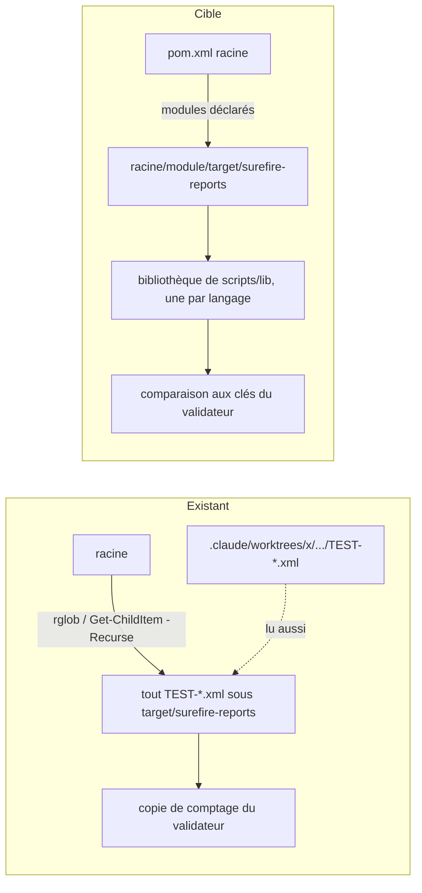

# Conception : compter la présence une fois par plateforme, depuis les modules déclarés

## Contexte

- [EXISTANT VÉRIFIÉ] Quatre familles de comptage coexistent (revérifié sur `1a539c22`) : `Get-SurefireTotals` dans
  neuf `.ps1` (dont deux variantes sans compte généré, `validate-m19.ps1:100` et `validate-m20.ps1:104`), une boucle en
  ligne dans `validate-d2.ps1:121-141`, un heredoc Python `totals(base)` dans `validate-m21.sh:57-68` et ses six
  homologues `validate-m22.sh` à `validate-m27.sh`, un heredoc plat dans `validate-d2.sh:105-120` et
  `validate-m19.sh:81`. `validate-m20.ps1:123-125` relit en plus les rapports pour ses tests sautés.
- [EXISTANT VÉRIFIÉ] Tous partent de la racine : `rglob('target/surefire-reports/TEST-*.xml')` ou
  `Get-ChildItem -Path $Root -Recurse -Filter 'TEST-*.xml'` puis un filtre sur `[\\/]target[\\/]surefire-reports[\\/]`.
  Le compte des POM (`validate-d2.sh:66-69`, `validate-d2.ps1:57-58`, `validate-r2.sh:31`, `validate-r3.sh:43`,
  `validate-r2.ps1:26`, `validate-r3.ps1:26`) ne filtre que `target`.
- [EXISTANT VÉRIFIÉ] `scripts/lib/` porte des bibliothèques jumelles (`Read-QualityRatchets.ps1`,
  `read-quality-ratchet.sh`) et le lanceur `python.sh` ; `scripts/tests/test_read_quality_ratchet.py` rejoue une liste
  de cas partagée contre les deux (exigence `validator-self-test` › Both implementations of a validator SHALL meet the
  same cases).
- [EXISTANT VÉRIFIÉ] `RepositoryTree` (tests d'architecture) écarte `.claude/worktrees` et tout répertoire portant son
  propre `.git` ; `RepositoryTreeOwnershipTest` ne lit que les sources de test Java. `SkippedTestReasonGateTest` lit
  déjà les rapports par module déclaré (`testedPopulation(root)`).
- [EXISTANT VÉRIFIÉ] `scripts/tests/test_script_inventory.py` exige que tout script de `scripts/` soit lancé et testé ou
  excusé par son nom : les deux bibliothèques nouvelles y entrent.

## Exigences couvertes

| Capacité | Exigence (titre exact) | Rubriques de conception qui y répondent |
|---|---|---|
| `gate-verdict-currency` | The split between written and generated executions SHALL be implemented once per scripting language | D1, D3, Traitements |
| `repository-root-location` | A validator SHALL read only the POMs and the Surefire reports of the modules the root POM declares | D2, D3 |

## Composants et frontières

- `scripts/lib/Get-SurefireTotals.ps1` (à créer) : fonction `Get-SurefireTotals -Root <racine> [-Module <nom>]`, rend
  `Written`, `Generated`, `Failures`, `Errors`, `Skipped`, `Suites`.
- `scripts/lib/surefire-totals.sh` (à créer) : fonction `surefire_totals <racine> [<module>]` qui appelle le programme
  Python unique par `morpheus_python` (de `python.sh`) et imprime les mêmes cinq comptes sur une ligne.
- Modules déclarés : la lecture des `<module>` du POM racine vit dans chaque bibliothèque (une fonction par langage),
  réutilisée par le compte des POM de `validate-d2`, `validate-r2`, `validate-r3`.
- Validateurs : chacun source la bibliothèque de son langage (`. "$PSScriptRoot/lib/Get-SurefireTotals.ps1"`,
  `source "$SCRIPT_DIR/lib/surefire-totals.sh"`) et ne garde que sa comparaison aux clés.
- Gate : une méthode de `RepositoryTreeOwnershipTest` (fichier de gouvernance), choisie parce que cette classe tient
  déjà l'intention « un seul parcours, qui écarte les copies ». Assertions textuelles : la cible est du `.sh`/`.ps1`,
  où le texte est la seule prise (`.claude/rules/architecture.md`).

## Traitements et interactions

Question : que lit un validateur, avant et après ?

Le diagramme sert les deux exigences : la cible n'a plus d'arête depuis la racine, et le comptage n'a plus qu'un nœud
par langage.

## Modèle de domaine et invariants

Sans objet : aucun type du domaine.

## États et transitions

Sans objet : aucun cycle de vie.

## Contrats d'interface

Sans objet : aucune surface publique ; le contrat interne des bibliothèques est décrit en Composants.

## Persistance et intégrité

Sans objet : aucune donnée persistée.

## Transactions, concurrence et idempotence

Sans objet.

## Sécurité et isolation

Sans objet : la lecture reste locale et en lecture seule ; le parseur XML garde les réglages des copies actuelles
(`xml.etree.ElementTree`, `[xml]` PowerShell), sans entité externe nouvelle.

## Gestion des erreurs et reprise

Un module déclaré sans répertoire de rapports contribue zéro : le refus d'un réacteur partiel reste celui des gates
Java (`CoverageQualityGateTest`) et des minima. Un rapport XML illisible fait échouer la bibliothèque en nommant le
fichier, comme aujourd'hui.

## Observabilité

La ligne de relevé de chaque validateur garde son format ; aucun nouveau compte publié dans ce changement.

## Performance et stratégie de mesure

Lire seize répertoires connus au lieu de parcourir l'arbre ne peut que réduire le temps ; aucun budget ne s'applique.

## Compatibilité, migration et retour arrière

Les comptes en CI sont inchangés (checkout propre) : le scénario « The summary carries the same counts as before » le
prouve par le harnais fabriqué. Retour arrière : restaurer les copies, sans perte.

## Décisions

### D1 : une bibliothèque par langage, un programme Python pour le shell
- **Nature** : [DÉCISION]
- **Exigences servies** : `gate-verdict-currency` › The split between written and generated executions SHALL be
  implemented once per scripting language
- **Choix** : `Get-SurefireTotals.ps1` et `surefire-totals.sh` (ce dernier encapsulant un seul programme Python), sur
  le modèle des bibliothèques de ratchets.
- **Alternatives écartées** : un seul programme Python appelé aussi par PowerShell — les validateurs `.ps1` n'exigent
  pas Python aujourd'hui sous Windows, ce serait une dépendance nouvelle ; garder les copies et les comparer par un
  test — on teste dix-huit copies au lieu d'en supprimer seize.
- **Compromis** : deux implémentations restent, tenues égales par une liste de cas partagée.
- **ADR** : non concerné (outillage, retour arrière sans coût).

### D2 : lire les modules déclarés plutôt qu'exclure des répertoires
- **Nature** : [PROPOSITION]
- **Exigences servies** : `repository-root-location` › A validator SHALL read only the POMs and the Surefire reports of
  the modules the root POM declares
- **Choix** : construire la liste `<racine>/<module>/target/surefire-reports` depuis les `<module>` du POM racine,
  comme `SkippedTestReasonGateTest`. Pour le compte des POM de D2 et R2/R3, comparer les POM attendus aux POM présents
  au premier niveau de chaque répertoire de module et à la racine, sans parcours récursif.
- **Alternatives écartées** : reproduire en shell et en PowerShell le filtre de `RepositoryTree` (`.claude/worktrees`,
  `.git` imbriqué, liens) — trois listes d'exclusions à tenir égales, et une copie de travail créée ailleurs que sous
  `.claude/worktrees` resterait vue. Le compte des POM de D2 perd toutefois la détection d'un `pom.xml` orphelin hors
  module ; [PROPOSITION] la garder par `git ls-files '*pom.xml'`, qui ne voit que le dépôt suivi.
- **Compromis** : `validate-m21.sh` lit aujourd'hui `morpheus-architecture-tests` par un second parcours ; il devient
  l'appel de la bibliothèque avec `<module>`.
- **ADR** : non concerné.

### D3 : deux interdits textuels dans le gate
- **Nature** : [DÉCISION]
- **Exigences servies** : les deux exigences du changement.
- **Choix** : une méthode refuse `\[[0-9]+\]` dans tout fichier de `scripts/` hors des deux bibliothèques et de
  `scripts/tests/` ; une seconde refuse, dans `scripts/*.sh|*.ps1|lib/*`, `rglob(` et `Get-ChildItem` avec `-Recurse`
  dont le chemin est la racine du dépôt (`$repo`, `$Root`, `$RepoRoot`, `root`, `REPO`). Chaque refus nomme le script et
  la ligne.
- **Alternatives écartées** : interdire tout `-Recurse` — `validate-m19.ps1:184` (archive extraite) et
  `validate-m20.ps1:337` (`Cert:\`) parcourent légitimement autre chose que la racine.
- **Compromis** : un nom de variable inattendu pour la racine échappe à la règle ; la revue le lit, et l'intention est
  écrite dans la PR (section « Intention de chaque assertion textuelle »).
- **ADR** : non concerné.

## Écarts constatés

| Constat | Source A | Source B | Traitement proposé |
|---|---|---|---|
| R2 et R3 comptent aussi les POM par parcours récursif | `validate-r2.*`, `validate-r3.*` | audit (cite D2 seul) | inclus dans ce changement |
| `validate-m20.ps1` lit les rapports deux fois (totaux, puis sautés) | `validate-m20.ps1:104-125` | audit (cite le parcours) | les deux lectures passent par la bibliothèque |
| `RepositoryTreeOwnershipTest` ne tient pas `scripts/` | sa portée (sources de test Java) | exigence de `repository-root-location` | exigence ADDED pour les validateurs |

## Stratégie de vérification

| Exigence | Scénario | Preuve | État |
|---|---|---|---|
| The split … once per scripting language | Every validator delegates its count | méthode nouvelle de `RepositoryTreeOwnershipTest` | à écrire |
| idem | A copy of the rule in a validator is refused | violation plantée puis retirée (trace dans la PR) | manuel |
| idem | Both libraries agree on one list of cases | `scripts/tests/test_surefire_totals.py` | à écrire |
| idem | The summary carries the same counts as before | `scripts/tests/test_validator_verdicts.py` (cas existants verts) | existant |
| A validator SHALL read only … declared | A workspace copy does not fail D2 | cas nouveau de `test_validator_verdicts.py` (copie sous `.claude/worktrees`) | à écrire |
| idem | The executions of a copy do not hide a drop | idem, `validate-m21` | à écrire |
| idem | A module that produced no report … | `test_surefire_totals.py` | à écrire |
| idem | A recursive walk of the root in a script is refused | méthode nouvelle de `RepositoryTreeOwnershipTest` | à écrire |

## Documentation durable et diagrammes à mettre à jour

`docs/developer/specifications/gate-verdict-currency.md` et `docs/developer/specifications/repository-root-location.md`
(exigences, traçabilité, diagramme ci-dessus) ; `scripts/README.md` (les deux bibliothèques).

## Questions ouvertes

Aucune.
