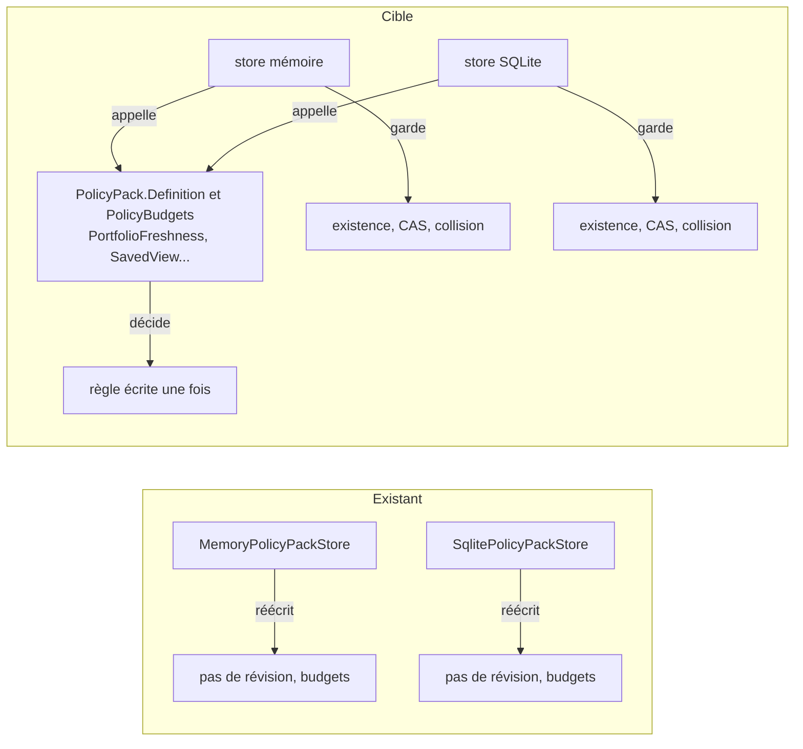
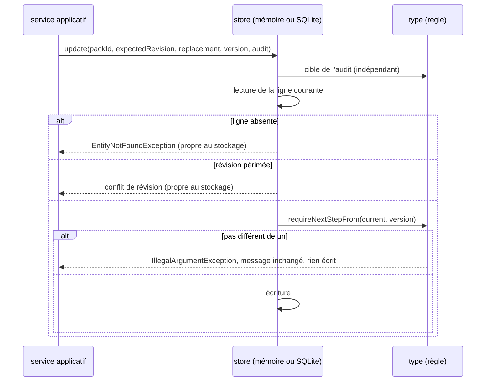

# Conception : décider chaque invariant de persistance une seule fois, hors des stores (AUD-QUA-33)

Étiquettes : [EXISTANT VÉRIFIÉ], [DÉCISION], [PROPOSITION], [QUESTION]. Les décisions D1 à D4 attendent le mainteneur ;
aucun ADR n'est déclaré accepté.

## Contexte

Motivation : voir proposal.md, section Why. État vérifié sur `1a539c22` :

- [EXISTANT VÉRIFIÉ] 66 littéraux d'au moins 25 caractères communs aux sources de `com.morpheus.store.memory` et de
  `com.morpheus.store.sqlite.adapter` (`grep -oE '"[^"\\]{25,}"' | sort -u` sur chaque côté, puis `comm -12`). Un
  littéral (`" + attempt.expectedRevision() + "`) est un fragment de concaténation : 65 messages réels.
- [EXISTANT VÉRIFIÉ] Répartition par store mémoire : `MemorySpecificationKnowledgeStore` 25,
  `MemoryPolicyPackStore` 13, `MemorySavedViewStore` 7, `MemoryChangeLifecycleMutationStore` 6,
  `MemorySnapshotBusinessContentStore` 4 (et 1 partagé avec la connaissance), `MemorySyncStateStore` 4,
  `MemoryPortfolioStore` 2, `MemoryExternalReferenceStore` 2, `MemoryTraceabilityStore` 2.
- [EXISTANT VÉRIFIÉ] Exemples de contrôles identiques : triple condition du pas de révision et de version des politiques
  (`MemoryPolicyPackStore.java:98-101`, `SqlitePolicyPackStore.java:751-754`) ; budgets `PolicyBudgets` et
  `QueryBudgets` ; monotonie de `PortfolioFreshness.observedAt` ; bornes `completedAt` / `attemptedAt` /
  `lastObservedChangeAt` de l'état de synchronisation ; cohérence d'identité et immuabilité de portée d'une vue.
- [EXISTANT VÉRIFIÉ] `PolicyPack` et `PolicyBudgets` vivent dans `com.morpheus.application.policy`, `QueryBudgets` dans
  `com.morpheus.application.query.dsl`, `PortfolioFreshness` dans `com.morpheus.domain.portfolio` ; les ports
  `PolicyPackStore`, `SavedViewStore`, `PortfolioStore`, `SyncStateStore` dans l'application.
- [EXISTANT VÉRIFIÉ] `policy-store-refusals` (spec en vigueur) impose aux deux stores de politiques un ordre de contrôle
  et la même refusal pour une écriture directe au store : un contrôle remonté reste donc appelé **par le store**.
- [EXISTANT VÉRIFIÉ] Parité tenue par `PolicyPersistenceParityTest`, `PortfolioPersistenceParityTest`,
  `SavedViewPersistenceParityTest`, `RequirementPagePersistenceParityTest`.
- [EXISTANT VÉRIFIÉ] `morpheus-application` ne peut pas dépendre en test de `morpheus-store-memory` (cycle du réacteur,
  `.claude/rules/testing.md`) : un contrôle remonté s'y teste directement, sans store.

## Exigences couvertes

| Capacité | Exigence (titre exact) | Rubriques de conception qui y répondent |
|---|---|---|
| `persistence-invariant-ownership` | A storage-independent invariant SHALL give the same refusal in both stores | D1, D3, §Traitements |
| `persistence-invariant-ownership` | A storage-independent refusal SHALL NOT be written in a store | D2, D3 |
| `persistence-invariant-ownership` | The refusals awaiting their move SHALL only decrease | D2, §Lots |

## Composants et frontières

Question : qui décide une règle, et qui ne fait que la demander ?

Exigence : `persistence-invariant-ownership` › A storage-independent invariant SHALL give the same refusal in both
stores. Frontières inchangées : les stores dépendent déjà de l'application et du domaine (`LayerDependencyTest`), aucune
nouvelle arête ; `com.morpheus.store.sqlite.adapter` reste sans moniteur (`SqliteStoreAdapterHoldsNoMonitorArchitectureTest`).

## Modèle de domaine et invariants

Les contrôles deviennent des méthodes des types qui portent la donnée (D1), par exemple
`PolicyPack.Definition.requireNextStepFrom(current, version)` (à écrire), `PortfolioFreshness.requireNotBefore(previous)`
(à écrire), une méthode de budget sur `PolicyBudgets` et `QueryBudgets`. Chaque méthode lève l'exception et le message
d'aujourd'hui, mot pour mot. Un contrôle qui exige une lecture (comptage d'une portée, ligne courante) reçoit la valeur
lue en argument : le store lit, le type décide.

## Traitements et interactions

Question : dans quel ordre une écriture est-elle contrôlée après le déplacement ?

L'ordre de `policy-store-refusals` › A write is checked in one order est conservé : seul l'endroit où le contrôle est
écrit change.

## États et transitions

Sans objet : aucun cycle de vie ne change.

## Contrats d'interface

Sans objet : aucun port ne change de signature, aucune surface publique ni aucun message de refus ne change.

## Persistance et intégrité

Aucune migration. Les contraintes SQLite (unicité, clés étrangères) restent ; elles sont l'autre moitié des contrôles
propres au stockage.

## Transactions, concurrence et idempotence

Le CAS reste dans chaque store, dans sa transaction : un contrôle remonté ne lit rien lui-même, il ne peut donc ni
élargir ni réduire une fenêtre de concurrence.

## Sécurité et isolation

Sans objet : aucune frontière de confiance ne bouge.

## Gestion des erreurs et reprise

Même type d'exception, même message, même ordre, rien écrit en cas de refus. Les tests de parité existants le
vérifient ; les familles qui n'en ont pas en reçoivent un (tâches).

## Observabilité

Sans objet.

## Performance et stratégie de mesure

Sans objet : un appel de méthode remplace un bloc en ligne ; aucun budget M19 n'est concerné.

## Compatibilité, migration et retour arrière

Aucune donnée ni aucun contrat touchés ; le retour arrière est un revert de code.

## Lots

Ordre proposé, chacun livrable seul et vert : (1) le gate avec la liste de dette complète ; (2) politiques ; (3) vues
enregistrées ; (4) portfolio et état de synchronisation ; (5) cycle de vie, références externes, traçabilité et contenu
métier ; (6) connaissance de spécification, le plus gros. Chaque lot retire ses messages de la liste et baisse son
plafond.

## Décisions

### D1 : où vit un contrôle remonté
- **Nature** : [QUESTION] (Q1)
- **Exigences servies** : `persistence-invariant-ownership` › A storage-independent invariant SHALL give the same
  refusal in both stores.
- **Options** : A — méthode du type qui porte la donnée (domaine ou application), appelée par les deux stores ; B —
  classe de garde de l'application par famille (`PolicyStoreRules`, à créer), appelée par les deux stores ; C —
  contrôle dans le service applicatif avant l'appel au store.
- **[PROPOSITION]** A : la règle suit la donnée (`.claude/rules/code-style.md` : validation au plus près du type) ; B
  ajoute une classe par famille sans gain ; C laisse un store appelé directement — parité, store tiers — sans contrôle,
  contraire à `policy-store-refusals` (« removed directly from a store »).
- **ADR** : voir D4.

### D2 : la forme du gate
- **Nature** : [QUESTION] (Q2)
- **Exigences servies** : › A storage-independent refusal SHALL NOT be written in a store, › The refusals awaiting
  their move SHALL only decrease.
- **[PROPOSITION]** Un test d'architecture `PersistenceInvariantOwnershipTest` (à écrire, paquet racine du module de
  tests d'architecture), textuel par nature (il compare des littéraux, `.claude/rules/architecture.md` : un message n'a
  pas de prise sur le bytecode), qui mesure comme la preuve de l'audit et compare à deux listes : `STORAGE_OWNED`, table
  de faits des refus propres au stockage, chacun avec sa catégorie (existence, conflit, collision) ; `AWAITING_A_MOVE`,
  liste de dette exacte, de plafond déclaré qui ne fait que baisser. Les listes nomment des messages, pas des classes :
  `ProductionClassListsArchitectureTest` ne les régit pas.
- **[QUESTION]** La liste de dette entre-t-elle dans `config/debt-counter-ratchets.properties` (gouvernance uniforme)
  ou garde-t-elle un plafond dans le test ? Proposé : la clé de propriétés, pour qu'une hausse touche un fichier de
  gouvernance.
- **Alternatives écartées** : un compteur seul (ne dit pas quel message) ; la revue seule (la dérive constatée est
  justement passée en revue).
- **ADR** : voir D4.

### D3 : la frontière entre indépendant et propre au stockage
- **Nature** : [QUESTION] (Q3)
- **Exigences servies** : les trois.
- **[PROPOSITION]** Propre au stockage : ligne absente (`not found`, `does not exist`, `is not a portfolio member`),
  révision périmée ou état concurrent (`stale ... revision`, `snapshot state changed`, `active snapshot changed before
  activation`), collision d'identité ou d'unicité (`identity collision`, `already exists`, `already registered`,
  `already belongs to`, `already bound`), épuisement de séquence. Indépendant : pas de révision et de version, budgets
  (avec le compte lu en argument), monotonie, bornes temporelles, cohérence d'identité d'un remplacement, cible et
  version d'audit, portée immuable, états réservés à l'activation (`ACTIVE/RETIRED ...`, `only READY snapshots ...`),
  appartenance d'un objet lié au même projet (`belongs to another project`, l'objet lu en argument).
- **Cas à arbitrer** : `policy pack must be active before adding an override` (dépend d'un état lu, décidable sur la
  valeur lue) et les deux messages de résultat de cycle de vie (`Lifecycle mutation applied`, `Idempotent lifecycle
  mutation was already applied`), qui ne sont pas des refus : proposé, les remonter dans le type de résultat.
- **ADR** : non concerné.

### D4 : pas d'ADR
- **Nature** : [QUESTION] (Q4)
- **[PROPOSITION]** Aucun ADR : la décision contraint plusieurs modules (question 2 du filtre de `.claude/rules/adr.md`),
  mais son retour arrière ne casse ni données, ni contrat, ni garantie (question 3). Elle est tenue par le test (D2) et
  une ligne de `.claude/rules/architecture.md`.
- **Alternative** : un ADR, si le mainteneur veut en faire un contrat pour les auteurs de stores tiers.

## Écarts constatés

| Constat | Source A | Source B | Traitement proposé |
|---|---|---|---|
| L'audit compte 66 messages ; l'un est un fragment de concaténation | `AUD-QUA-33` | `comm -12` relancé | 65 messages réels ; le gate ignore les fragments qui commencent par `" +` |
| Lignes SQLite citées par l'audit : 750-754 ; la condition occupe 751-754 | `AUD-QUA-33` | `SqlitePolicyPackStore.java` | sans effet |
| Deux littéraux communs ne sont pas des refus | `MemoryChangeLifecycleMutationStore` | `SqliteChangeLifecycleMutationStore` | D3 |
| Cinq familles sur neuf n'ont pas de test de parité | quatre `*PersistenceParityTest` | familles du Contexte | un test de parité par famille remontée (tâches) |

## Stratégie de vérification

| Exigence | Scénario | Preuve | État |
|---|---|---|---|
| A storage-independent invariant SHALL give the same refusal in both stores | les trois scénarios | `PortfolioPersistenceParityTest`, `SavedViewPersistenceParityTest`, `SyncStatePersistenceParityTest` (à écrire), et un test unitaire par méthode remontée dans son module | existant pour deux, à écrire pour le reste |
| A storage-independent refusal SHALL NOT be written in a store | A rule is copied into both stores ; A refusal only the storage can decide | `PersistenceInvariantOwnershipTest` (violation plantée) | à écrire |
| The refusals awaiting their move SHALL only decrease | les deux scénarios | `PersistenceInvariantOwnershipTest` | à écrire |

## Documentation durable et diagrammes à mettre à jour

- `docs/developer/specifications/persistence-invariant-ownership.md` (à créer, gabarit de
  `docs/developer/specifications/README.md`) et sa ligne d'index sous « Persistance SQLite et stores ».
- `docs/developer/specifications/policy-store-refusals.md` : où l'ordre de contrôle est écrit.
- `.claude/rules/architecture.md` : la ligne de la règle et le nom du test.

## Questions ouvertes

Q1 à Q4 de proposal.md, portées par D1 à D4 : elles se tranchent avant le groupe 2 des tâches. Aucune autre.
