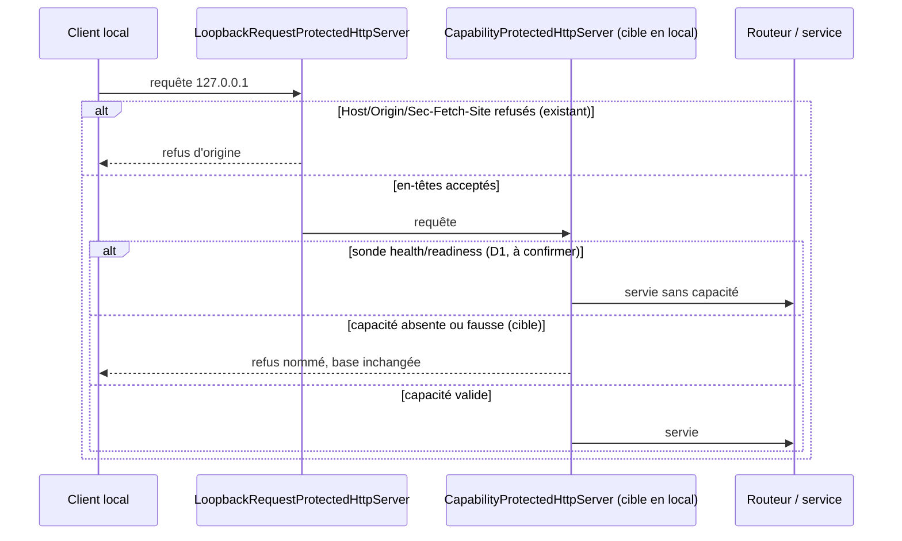

# Conception : décider qui l'API locale croit

## Contexte

- [EXISTANT VÉRIFIÉ] `MorpheusHttpServer.start(databasePath, host, port, …)` (`com.morpheus.api.local`) délègue à
  `MorpheusLocalHttpServerBootstrap` avec `RemoteAccessControls(Optional.empty(), Optional.empty())`. Le bootstrap
  n'enveloppe le serveur par `CapabilityProtectedHttpServer` que si une `MorpheusInternalCapability` est fournie, ce que
  seul le mode remote fait pour son saut loopback privé (en-tête `X-Morpheus-Internal-Capability`, refus
  `INTERNAL_AUTH_REQUIRED`).
- [EXISTANT VÉRIFIÉ] `LoopbackHostPolicy` impose une adresse loopback ; `LoopbackRequestPolicy` refuse un `Host`, un
  `Origin` ou un `Sec-Fetch-Site` étrangers : une défense contre le navigateur (DNS rebinding, CSRF), pas contre un
  processus d'un autre compte qui forge ses en-têtes.
- [EXISTANT VÉRIFIÉ] `MorpheusProjectRegistryApiService.registerProject` : sans `AllowedWorkspaceRoots`,
  `existingDirectory(workspace)` accepte tout répertoire. `morpheus api` n'a pas d'option d'allowlist.
- [EXISTANT VÉRIFIÉ] `SqliteDatabaseSecurity` durcit la base contre l'écriture des autres comptes ; ADR-0105 borne la
  protection des secrets aux autres comptes de l'hôte.

## Exigences couvertes

| Capacité | Exigence (titre exact) | Rubriques de conception qui y répondent |
|---|---|---|
| `local-api-trust-boundary` | The trust boundary of the local API is stated to the operator | D1, D2 |
| `local-api-trust-boundary` | The local API refuses a request that does not carry the local capability | D1 (option B), Traitements |

La seconde exigence suit l'option recommandée de D1. Si le mainteneur retient l'option A seule, elle est retirée du
delta avant l'implémentation (tâche 1.2) ; si l'option C est retenue, elle est remplacée par une exigence d'allowlist.

## Composants et frontières

- `morpheus-api`, `com.morpheus.api.local` : `MorpheusLocalHttpServerBootstrap`, `CapabilityProtectedHttpServer`,
  `MorpheusInternalCapability` (ou une capacité locale distincte, D3). `ApiTechnologyBoundaryArchitectureTest` confine
  l'accès fichier de `morpheus-api` aux classes qu'il nomme : écrire le fichier de capacité dans `morpheus-api` exige
  d'y nommer la classe avec sa raison, ou de faire écrire le fichier par la CLI, qui connaît le répertoire de données.
- `morpheus-cli`, `com.morpheus.cli` : `MorpheusMain.runApi` (câblage), et toute commande livrée qui appelle l'API
  locale.
- La règle de couche reste : `api` ne dépend pas de `cli` (`LayerDependencyTest`).

## Modèle de domaine et invariants

Sans objet : aucun type du domaine.

## Traitements et interactions

Question : où le refus intervient-il dans l'option B, par rapport aux défenses existantes ?

Existant : `K` n'existe en local que si le mode remote fournit sa capacité. Cible (option B) : `K` est toujours présent
en local, avec une capacité publiée dans un fichier privé.

## États et transitions

Sans objet.

## Contrats d'interface

Option B : un en-tête de capacité sur toute route sauf les sondes, un refus nommé (`401`, code à fixer en D3) déclaré
dans `docs/developer/reference/openapi/morpheus-v1.yaml` comme réponse commune. `contracts/public-surfaces.tsv` ne
change pas (aucune route ajoutée ni retirée), mais `PublicHttpRouteConvergenceTest` démarre un vrai serveur local : son
client de test doit présenter la capacité.

## Persistance et intégrité

Le fichier de capacité n'est pas une donnée de la base. [PROPOSITION] Il vit dans le répertoire de données, créé et
durci par `LocalWritePermissionHardener.hardenFile`, réécrit à chaque démarrage, supprimé à l'arrêt propre.

## Transactions, concurrence et idempotence

Sans objet : la vérification de capacité précède toute transaction.

## Sécurité et isolation

- Frontière visée : le compte qui exécute MORPHEUS (et un administrateur), comme pour la base et ADR-0105.
- La capacité est un secret réutilisable **pendant la vie du processus** ; ADR-0105 refuse un secret réutilisable au
  repos. [QUESTION] Un jeton éphémère, dans un fichier privé, renouvelé à chaque démarrage, reste-t-il dans le modèle
  d'ADR-0105 ? C'est un point de l'ADR à proposer.
- Comparaison en temps constant (`MessageDigest.isEqual`, déjà utilisé par `MorpheusInternalCapability`).

## Gestion des erreurs et reprise

Si le fichier de capacité ne peut être écrit ou durci, le serveur local ne démarre pas (refus nommé) : un serveur
local ouvert faute de fichier serait un repli silencieux.

## Observabilité

Les refus de capacité sont comptés dans les métriques du serveur local ; ni le jeton ni son empreinte n'y figurent.

## Performance et stratégie de mesure

Sans objet : une comparaison d'en-tête par requête.

## Compatibilité, migration et retour arrière

**BREAKING** (option B) : un client HTTP local existant (script, outil d'éditeur) reçoit un refus tant qu'il n'envoie
pas la capacité. Notes de version et guide de mise à niveau de la version qui livre le changement. Retour arrière :
retirer l'enveloppe ; aucune donnée perdue.

## Décisions

### D1 : frontière de confiance de l'API locale
- **Nature** : [QUESTION] — décision du mainteneur
- **Exigences servies** : `local-api-trust-boundary` › The trust boundary of the local API is stated to the operator ; › The local API refuses a request that does not carry the local capability
- **Options** :
  - **A. Documenter** : « l'API locale fait confiance à tous les comptes de l'hôte », dans `SECURITY.md` et le guide.
    Aucun changement de code ; la contradiction avec la base durcie est assumée par écrit.
  - **B. Capacité locale** : le serveur exige une capacité par processus, publiée dans un fichier privé du répertoire
    de données et lue par les clients locaux du compte.
  - **C. Allowlist obligatoire en local** : `--allowed-workspace-root` exigé pour `morpheus api`. Borne la lecture de
    répertoires arbitraires, laisse ouvertes les écritures de la base.
- **[PROPOSITION]** B, plus A pour l'écrit : B ferme lecture et écriture au seul compte de l'opérateur, comme la base ;
  C ne ferme pas les écritures. Les sondes restent ouvertes, comme sous saturation (`local-admission-control`).
- **ADR** : ADR à proposer (frontière de confiance de l'API locale, en regard d'ADR-0065 et d'ADR-0105). Jamais déclaré
  accepté par ce changement.

### D2 : où l'écrire
- **Nature** : [DÉCISION]
- **Exigences servies** : `local-api-trust-boundary` › The trust boundary of the local API is stated to the operator
- **Choix** : section « Local API » de `SECURITY.md`, section `morpheus api` de `docs/user/CLI.md`, page développeur
  `docs/developer/specifications/local-api-trust-boundary.md`.
- **Alternatives écartées** : ne l'écrire que dans l'ADR — l'opérateur lit `SECURITY.md` et le guide, pas le registre.
- **ADR** : non concerné.

### D3 : réutiliser ou distinguer la capacité interne
- **Nature** : [PROPOSITION] (si B est retenue)
- **Exigences servies** : `local-api-trust-boundary` › The local API refuses a request that does not carry the local capability
- **Choix** : réutiliser `CapabilityProtectedHttpServer` et la forme de `MorpheusInternalCapability`, avec un code de
  refus propre au client local, distinct de `INTERNAL_AUTH_REQUIRED`, pour que les deux refus se lisent séparément.
- **Alternatives écartées** : un second mécanisme d'authentification — deux codes de comparaison à durcir.
- **ADR** : couvert par l'ADR à proposer de D1.

## Écarts constatés

| Constat | Source A | Source B | Traitement proposé |
|---|---|---|---|
| La protection est bornée aux autres comptes de l'hôte ; l'API locale leur est ouverte | `SECURITY.md`, ADR-0105, `SqliteDatabaseSecurity` | `MorpheusHttpServer.start`, `MorpheusMain.runApi` | D1 |

## Stratégie de vérification

| Exigence | Scénario | Preuve | État |
|---|---|---|---|
| The trust boundary… is stated | The operator reads the security policy | relecture ; `UserDocumentationSpeaksOfTheInstalledProductTest` | manuel · existant |
| The local API refuses… | A request from another account without the capability | `MorpheusLocalApiCapabilityIntegrationTest#aRequestWithoutTheCapabilityChangesNothing` | à écrire |
| The local API refuses… | A request from the operator's client with the capability | `…#aRequestWithTheCapabilityIsServed` | à écrire |
| The local API refuses… | The capability file is private and renewed | `…#theCapabilityFileIsPrivateAndRenewedAtEveryStart` | à écrire |
| The local API refuses… | The probes stay reachable | `…#theProbesAnswerWithoutTheCapability` | à écrire |

## Documentation durable et diagrammes à mettre à jour

Page nouvelle `docs/developer/specifications/local-api-trust-boundary.md` (gabarit et index de
`docs/developer/specifications/README.md`) ; `SECURITY.md` ; `docs/user/CLI.md` ; `docs/developer/API.md` si
l'authentification locale y est décrite ; notes de version et guide de mise à niveau de la version qui livre B.

## Questions ouvertes

Aucune autre que D1 et le point d'ADR-0105, qui se tranchent avant les tâches 2 et suivantes.
