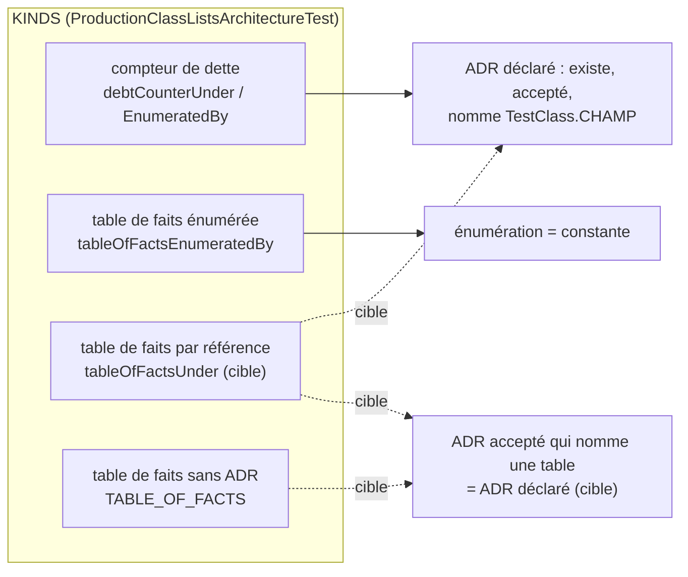

# Conception : déclarer l'ADR de chaque table de faits qu'un ADR énonce

Conception allégée : changement d'outillage de la suite d'architecture et clarification d'un ADR, sans code de
production.

## Contexte

- [EXISTANT VÉRIFIÉ] `ProductionClassListsArchitectureTest.Kind(boolean debtCounter, Optional<String> decision,
  Optional<String> enumerationRoot)` et ses quatre fabriques (lignes 60-74). La Javadoc du record dit déjà qu'une table
  de faits « carries [a decision record] only when a decision record states it », mais aucune fabrique ne construit une
  table de faits avec décision et sans racine d'énumération.
- [EXISTANT VÉRIFIÉ] `everyDebtCounterIsNamedByTheAcceptedDecisionRecordItDeclares` parcourt `debtCounters()` et exige,
  par `acceptedRecord(...)`, un ADR du registre, accepté, dont le texte contient la clé `TestClass.CHAMP`.
- [EXISTANT VÉRIFIÉ] `everyEnumerationADecisionRecordWritesIsDelimitedAndDeclared` parcourt déjà tous les ADR acceptés
  du registre (`DECISION_RECORD_FILE`, `ACCEPTED`) et connaît les noms de chaque liste de `KINDS` : c'est le point de
  greffe naturel du contrôle inverse.
- [EXISTANT VÉRIFIÉ] Mentions `TestClass.CHAMP` de tables de faits sans ADR déclaré, dans les ADR acceptés au
  11/11/2026 : `ARCH-0162` → `SqliteConnectionScopeUseArchitectureTest.ONE_STORE_PER_OPERATION`, `ARCH-0115` →
  `StaticOperationalRuntimeUsersArchitectureTest.MAIN_USERS`. `ARCH-0165` nomme les deux gates de familles sans le champ.
- [EXISTANT VÉRIFIÉ] `.claude/rules/adr.md` : « à tout moment, une décision se lit dans un seul ADR actif ».

## Exigences couvertes

| Capacité | Exigence (titre exact) | Rubriques de conception qui y répondent |
|---|---|---|
| `adapter-internal-boundaries` | Une table de faits qu'un ADR en vigueur énonce DOIT déclarer cet ADR | D1, D2, D4 |
| `adapter-internal-boundaries` | Un ADR accepté qui nomme une table de faits par sa référence DOIT être déclaré par elle | D3, D4 |

## Traitements et interactions

Question : quels contrôles lisent quelle sorte de liste, existant et cible ?

Existant en trait plein : compteurs vers C1, tables énumérées vers C2 (et C1 par `acceptedRecord`). Cible en
pointillé : les tables par référence passent par C1, et toute table de faits est soumise au contrôle inverse C3. Sert
les deux exigences du tableau.

## Décisions

### D1 : une fabrique `tableOfFactsUnder(decisionRecord)`
- **Nature** : [DÉCISION]
- **Exigences servies** : `adapter-internal-boundaries` › Une table de faits qu'un ADR en vigueur énonce DOIT déclarer cet ADR
- **Choix** : fabrique symétrique de `debtCounterUnder`, `new Kind(false, Optional.of(decisionRecord), Optional.empty())`.
- **Alternatives écartées** : (a) faire énumérer les deux `CONFINED_FAMILIES` par `ARCH-0165` — l'ADR décide un régime,
  pas une liste ; une énumération obligerait à modifier l'ADR à chaque classe ajoutée, ce que sa décision 3 exclut
  (« sans ADR ») ; (b) laisser les tables sans ADR et retirer la phrase de la règle — défait le lien que
  `AUD-QUA-22` a gaté côté OpenSpec.
- **Compromis** : aucun.
- **ADR** : non concerné.

### D2 : le contrôle « ADR déclaré » s'applique à toute liste qui déclare un ADR sans énumération
- **Nature** : [DÉCISION]
- **Exigences servies** : même exigence, scénarios « Une table de faits déclare un ADR qui ne l'énumère pas » et « L'ADR d'une table est archivé »
- **Choix** : `everyDebtCounterIsNamedByTheAcceptedDecisionRecordItDeclares` est renommé pour sa portée
  (`everyListIsNamedByTheAcceptedDecisionRecordItDeclares`) et parcourt toute liste de `KINDS` qui porte une décision ;
  la méthode d'origine disparaît dans le même changement, le compte de méthodes `@Test` ne baisse pas (une méthode
  remplace une méthode, le contrôle inverse en ajoute une).
- **Alternatives écartées** : une seconde méthode parallèle pour les tables — duplication d'une boucle de dix lignes.
- **ADR** : non concerné.

### D3 : contrôle inverse greffé sur le parcours des ADR acceptés
- **Nature** : [DÉCISION]
- **Exigences servies** : `adapter-internal-boundaries` › Un ADR accepté qui nomme une table de faits par sa référence DOIT être déclaré par elle
- **Choix** : nouvelle méthode qui réutilise le parcours de `everyEnumerationADecisionRecordWritesIsDelimitedAndDeclared`
  (ADR du registre, statut accepté) et cherche, dans les spans de code, chaque clé `TestClass.CHAMP` de `KINDS`
  déclarée table de faits. Une table nommée par un ADR qu'elle ne déclare pas est refusée ; une table nommée par deux
  ADR est refusée, une décision ne se lisant que dans un seul ADR actif. Exemples prouvés sur un registre temporaire
  (`@TempDir`), comme `aTableOfFactsDeclaringARecordThatDoesNotEnumerateItIsRefusedByNameAndRecord`.
- **Alternatives écartées** : appliquer le contrôle inverse aussi aux compteurs de dette — déjà tenu dans l'autre sens
  par D2, et un compteur nommé par un second ADR relève d'une consolidation que la revue juge.
- **Compromis** : un ADR qui veut citer une table sans la fonder écrit le nom de la classe de test sans le champ.
- **ADR** : non concerné.

### D4 : déclarations et clarification d'ARCH-0165
- **Nature** : [DÉCISION]
- **Exigences servies** : les deux exigences
- **Choix** : `CliTechnologyBoundaryArchitectureTest.CONFINED_FAMILIES` et `ApiTechnologyBoundaryArchitectureTest.CONFINED_FAMILIES`
  sous `ARCH-0165` ; `SqliteConnectionScopeUseArchitectureTest.ONE_STORE_PER_OPERATION` sous `ARCH-0162` ;
  `StaticOperationalRuntimeUsersArchitectureTest.MAIN_USERS` sous `ARCH-0115`. Dans `ARCH-0165`, la décision 3 écrit
  les deux références en span de code ; la section Decision reste sous 2 000 caractères (`archgate check`).
- **Alternatives écartées** : un ADR consolidé qui remplace `ARCH-0165` — le sens de la décision ne change pas, donc
  une clarification suffit (`.claude/rules/adr.md`).
- **ADR** : `ARCH-0165`, `ARCH-0162`, `ARCH-0115` existants ; aucun nouveau.

## Écarts constatés

| Constat | Source A | Source B | Traitement proposé |
|---|---|---|---|
| La règle demande qu'une table déclare l'ADR qui l'énonce ; le mécanisme ne le permet que par énumération | `.claude/rules/architecture.md` (§ `morpheus-api`) | `ProductionClassListsArchitectureTest.Kind` | D1 |
| `ARCH-0162` et `ARCH-0115` nomment des tables qui ne les déclarent pas | ADR acceptés | `KINDS` | D3, D4 |

## Stratégie de vérification

| Exigence | Scénario | Preuve | État |
|---|---|---|---|
| Une table de faits … DOIT déclarer cet ADR | Les six types d'entrée / Un type d'entrée ajouté | `everyListADecisionRecordEnumeratesEqualsItsEnumeration`, `aNameAddedToTheGateAndNotToTheRecordIsNamedWithTheRecordAndTheList` | existant |
| idem | Les listes confinées … sous ARCH-0165 | `everyListIsNamedByTheAcceptedDecisionRecordItDeclares` sur le dépôt réel | à écrire |
| idem | déclare un ADR qui ne la nomme pas / ADR archivé | test sur registre temporaire | à écrire |
| Un ADR accepté qui nomme une table … | les quatre scénarios | test sur registre temporaire + méthode sur le dépôt réel ; violation plantée : retirer la déclaration de `MAIN_USERS`, constater l'échec qui nomme `ARCH-0115` | à écrire |

## Documentation durable et diagrammes à mettre à jour

- `docs/developer/specifications/adapter-internal-boundaries.md` : exigence modifiée et ajoutée, diagramme ci-dessus,
  matrice.
- `.claude/rules/architecture.md` (§ `morpheus-api` : un rôle, un paquet) : une table de faits déclare l'ADR qui
  l'énonce, par énumération (`tableOfFactsEnumeratedBy`) ou par référence (`tableOfFactsUnder`), et un ADR accepté qui
  nomme une table par `TestClass.CHAMP` doit être celui qu'elle déclare.
- `docs/architecture/adr/ARCH-0165-…md` : décision 3 et section Compliance.

## Questions ouvertes

Aucune.
