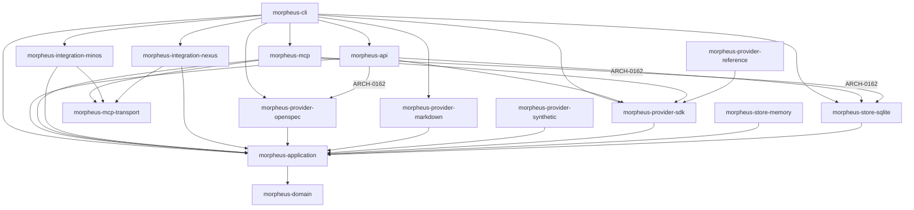

# Conception : dessiner la vue en blocs depuis les dépendances de compilation des POM

## Contexte

- [EXISTANT VÉRIFIÉ] `docs/architecture/arc42/05-vue-blocs.md` : en-tête « Sources actives : reactor `pom.xml`, POM des
  modules… » (`:3`) ; §5.1 (flowchart, nœuds libellés par leur nom de module : `CLI[morpheus-cli…]`,
  `PSDk[morpheus-provider-sdk…]`…) ; §5.4 (nœuds sans nom de module : `O[OpenSpec provider]`, `SDK[Provider SDK]`…) ;
  §5.3 et §5.5 sont des vues de règle ou de rôle, pas de modules.
- [EXISTANT VÉRIFIÉ] Dépendances `compile` ou `runtime` entre modules du réacteur, relevées le 17/11/2026 sur `1a539c22` :
  application → domaine ; SDK, providers intégrés, stores, plugin de référence, testkit → application (+ domaine) ;
  plugin de référence et testkit → SDK ; intégrations → application, `morpheus-mcp-transport` ; `morpheus-mcp` →
  application, SDK, store-sqlite, transport MCP ; `morpheus-api` → application, SDK, openspec, store-sqlite ;
  `morpheus-cli` → application, SDK, openspec, markdown, store-sqlite, intégrations MINOS et NEXUS, mcp, api.
  `morpheus-provider-synthetic` n'est qu'en portée de test pour `api` et `cli`.
- [EXISTANT VÉRIFIÉ] `RepositoryDocumentationCoherenceTest` lit la page pour la pile technique et la liste du réacteur ;
  `reactor-module-documentation` tient la liste des modules, pas les arêtes.
- [EXISTANT VÉRIFIÉ] L'audit compare des **atteignabilités** : la page n'a pas `POS --> APP`, mais `POS --> PSDk --> APP`
  atteint l'application ; les treize arêtes manquantes sont celles qu'aucun chemin du diagramme ne rend.

## Exigences couvertes

| Capacité | Exigence (titre exact) | Rubriques de conception qui y répondent |
|---|---|---|
| `reactor-module-documentation` | Une arête dessinée entre deux modules de la vue en blocs DOIT être une dépendance de compilation | D1, D2 |
| `reactor-module-documentation` | Un module de la vue en blocs DOIT atteindre par ses arêtes tout ce que ses POM lui font atteindre | D1, D2, D3 |

## Composants et frontières

`morpheus-architecture-tests` : une classe de test marquée `@CoherenceCheck` (elle ne lit que des `.md` et des POM :
`CoherenceCheckMarkerTest`) lit les `<module>` du POM racine, les dépendances de chaque POM de module, et les blocs
` ```mermaid ` de `05-vue-blocs.md`. Un nœud désigne un module quand son libellé contient exactement un nom de module
du réacteur. Parcours des fichiers par `RepositoryRoot` (`.claude/rules/testing.md`).

Cible du §5.1, question : quelles dépendances de compilation relient les modules du produit ? (les nœuds hors réacteur —
utilisateur, base, workspace, moteurs externes — gardent leurs arêtes, non comparées)



Ce croquis montre la cible des arêtes entre modules (l'arête `MCP --> PSDk` disparaît avec `AUD-ARC-27`) ; la page
garde sa mise en forme, ses sous-graphes et ses nœuds externes. §5.4 reçoit des libellés de modules et les arêtes
providers → application, plugin de référence → SDK, SDK → application ; le plugin externe (`X`) n'est pas un module et
reste relié au SDK.

## Modèle de domaine et invariants

Sans objet.

## Traitements et interactions

Sans objet : contrôle de build.

## États et transitions

Sans objet.

## Contrats d'interface

Sans objet.

## Persistance et intégrité

Sans objet.

## Transactions, concurrence et idempotence

Sans objet.

## Sécurité et isolation

Sans objet.

## Gestion des erreurs et reprise

Sans objet.

## Observabilité

Sans objet.

## Performance et stratégie de mesure

Sans objet.

## Compatibilité, migration et retour arrière

Documentation et test seulement ; retour arrière sans coût.

## Décisions

### D1 : un nœud désigne un module par son libellé
- **Nature** : [DÉCISION]
- **Exigences servies** : les deux exigences de `reactor-module-documentation` ci-dessus
- **Choix** : un nœud est un module quand son libellé contient un nom `morpheus-…` déclaré dans le POM racine ; un nœud
  dont le libellé en contient deux, ou un nom non déclaré, fait échouer le contrôle.
- **Alternatives écartées** : une table d'identifiants Mermaid dans le test — une copie de plus à tenir égale à la page.
- **Compromis** : §5.4 doit porter des noms de modules dans ses libellés.
- **ADR** : non concerné.

### D2 : arêtes directes réelles, atteignabilité égale
- **Nature** : [PROPOSITION]
- **Exigences servies** : les deux exigences
- **Choix** : (1) toute arête dessinée entre deux modules est une dépendance directe `compile`/`runtime` ; (2) pour chaque
  module dessiné, la fermeture transitive des arêtes, restreinte aux modules dessinés, égale celle des dépendances des
  POM. Le diagramme peut ainsi omettre `POS --> DOMAIN` (atteint par l'application) sans mentir.
- **Alternatives écartées** : égalité stricte des arêtes — imposerait chaque arête vers le domaine et rendrait le schéma
  illisible ; inclusion seule — laisse cacher le câblage de la CLI, défaut constaté.
- **Compromis** : une arête directe omise mais atteinte par un autre chemin passe ; c'est voulu.
- **ADR** : non concerné.

### D3 : annoter les exceptions d'ARCH-0162
- **Nature** : [DÉCISION]
- **Exigences servies** : `reactor-module-documentation` › Un module de la vue en blocs DOIT atteindre par ses arêtes tout ce que ses POM lui font atteindre
- **Choix** : les arêtes `api`/`mcp` → `store-sqlite` et `api` → openspec portent le libellé `ARCH-0162`, avec un lien vers
  l'ADR dans le texte de la section.
- **Alternatives écartées** : arêtes nues — le lecteur ne saurait pas qu'elles sont des exceptions bornées.
- **Compromis** : aucun ; le contrôle ignore les libellés d'arête.
- **ADR** : `ARCH-0162`.

## Écarts constatés

| Constat | Source A | Source B | Traitement proposé |
|---|---|---|---|
| Arêtes provider → SDK | `05-vue-blocs.md:50-52`, `:155-156` | POM des providers, `BUILT_IN_PROVIDERS_IGNORE_THE_SDK` | retirer |
| Treize arêtes de compilation omises | `05-vue-blocs.md` §5.1 | POM de `api`, `mcp`, `cli` | ajouter |
| Le diagramme de `.claude/CLAUDE.md` place `provider-sdk` comme frère sans arêtes détaillées | `.claude/CLAUDE.md` | POM | hors périmètre (surface IA) ; signalé |

## Stratégie de vérification

| Exigence | Scénario | Preuve | État |
|---|---|---|---|
| Une arête dessinée … DOIT être une dépendance de compilation | Une arête provider vers SDK que le POM ne déclare pas | nouveau test, rouge sur la page actuelle | à écrire |
| idem | Une dépendance de test n'autorise pas une arête | nouveau test, arête plantée | à écrire |
| Un module de la vue en blocs DOIT atteindre … | Le câblage de la CLI absent du diagramme | nouveau test, rouge sur la page actuelle | à écrire |
| idem | Une exception d'ARCH-0162 cachée | nouveau test, rouge sur la page actuelle | à écrire |
| idem | Le contrôle a quelque chose à comparer | nouveau test, page sans diagramme plantée | à écrire |

## Documentation durable et diagrammes à mettre à jour

`docs/architecture/arc42/05-vue-blocs.md` §5.1, §5.4 ; `docs/developer/specifications/reactor-module-documentation.md`.

## Questions ouvertes

Aucune.
