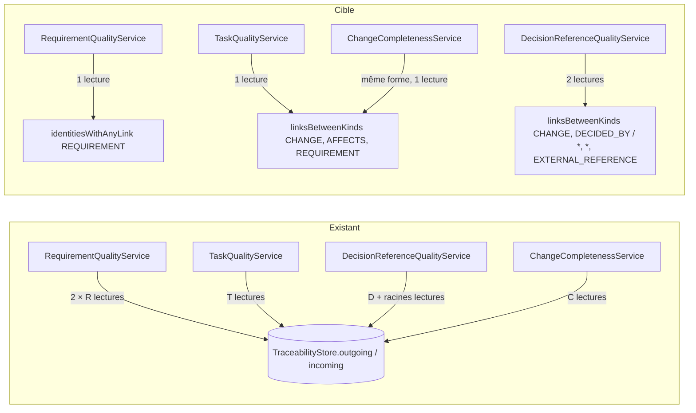

# Conception : trouver les sujets liés du rapport qualité en lectures ensemblistes

## Contexte

[EXISTANT VÉRIFIÉ] sur `1a539c22` (motivation : proposal.md, section Why) :

- `TraceabilityStore` (`morpheus-application/.../store/TraceabilityStore.java:14-39`) n'offre que des lectures par
  extrémité (`outgoing`, `incoming`) et par identité (`findLink`).
- `QualityReportService.assessPublished` (`:54-60`) enchaîne `RequirementQualityService`, `TaskQualityService`,
  `AcceptanceQualityService`, `ChangeCompletenessService` et `DecisionReferenceQualityService` ; toutes sauf
  l'acceptation lisent la traçabilité par sujet (lignes citées dans proposal.md).
- SQLite : la lecture par extrémité joint `snapshot_traceability_links` et `traceability_links`
  (`SqliteTraceabilityStore.endpointSql`, `:155-165`) ; l'index `idx_snapshot_traceability_links_snapshot(snapshot_id,
  link_id)` sert un parcours du snapshot entier (V005).
- Mémoire : `MemoryTraceabilityStore.links(snapshotId)` (`:106-...`) parcourt déjà les liens d'un snapshot ; il refuse
  un snapshot inconnu par `snapshot not found for traceability link: ` (`:117-121`), comme SQLite (`:455-466`).
- [EXISTANT VÉRIFIÉ] L'écriture en lot (`traceability-link-batch-write`) et la lecture du contenu métier
  (`snapshot-content-read-cost`) tiennent (`AUD-PRF-31`) : non touchées.

## Exigences couvertes

| Capacité | Exigence (titre exact) | Rubriques de conception qui y répondent |
|---|---|---|
| `quality-report-traceability-cost` | A quality report SHALL read the traceability of its snapshot a number of times that does not depend on its size | §Décisions D1, D2, D4 ; §Traitements |
| `quality-report-traceability-cost` | The findings of a quality report SHALL be those the links of its snapshot establish | §Décisions D1, D3 ; §Persistance |

## Composants et frontières

- Port `TraceabilityStore` (`com.morpheus.application.store`) : deux lectures ensemblistes (D1). Ajouter une méthode à
  un port oblige ses deux implémentations, ce que le compilateur tient.
- `MemoryTraceabilityStore` (`com.morpheus.store.memory`) et `SqliteTraceabilityStore`
  (`com.morpheus.store.sqlite.adapter`) : implémentations. Le store SQLite reste dans `adapter`, sans moniteur
  (`SqliteStoreAdapterHoldsNoMonitorArchitectureTest`) et sans dépendance nouvelle vers `runtime`
  (`SqliteStorePackagesArchitectureTest`).
- Services de `com.morpheus.application.quality` : emploient les lectures ensemblistes.
- Aucun port nouveau, aucune dépendance nouvelle entre modules (`LayerDependencyTest`).

## Modèle de domaine et invariants

Sans objet : `TraceabilityLink`, `TraceabilityEntityRef` et `TraceabilityRelationType` ne changent pas.

## Traitements et interactions

Question : comment le rapport sait-il quels sujets sont liés, avant et après ?

Explication : chaque service fait une lecture ensembliste puis indexe le résultat en mémoire (table ordonnée par
identité) ; la décision par sujet devient une recherche. Les racines des références externes filtrent en mémoire les
liens dont la source est une racine connue, ce qui garde la sémantique actuelle (un lien depuis une source qui n'est pas
une racine n'est pas compté). Exigence servie : les deux exigences de la capacité.

## États et transitions

Sans objet.

## Contrats d'interface

Sans objet : `quality.report` (CLI seule), `policy.evaluate` et `policy.dry-run` gardent leurs sorties.

## Persistance et intégrité

[PROPOSITION] Requêtes SQLite, sans migration :

- `identitiesWithAnyLink(snapshot, kind)` : `SELECT source_identity_id … WHERE source_kind = ? UNION SELECT
  target_identity_id … WHERE target_kind = ?`, chacune jointe à `snapshot_traceability_links` sur `snapshot_id`,
  résultat ordonné par identité.
- `linksBetweenKinds(snapshot, sourceKinds, relationTypes, targetKinds)` : jointure sur `snapshot_id`, filtres `IN`
  liés par paramètres (un ensemble vide vaut « tous », comme `outgoing` — `sqlite-read-shaping`), ordre `link_id`,
  preuves lues par la forme que livre `AUD-PRF-24` si elle est livrée, sinon par la lecture en tranches existante
  (`findDefinitions`, `:304-336`), jamais une requête par lien.
- Le snapshot inconnu est refusé par `requireSnapshot`, avec le message existant.
- Parité : la mémoire filtre `links(snapshotId)` avec les mêmes règles et le même ordre.

## Transactions, concurrence et idempotence

Sans objet : lectures seules sur la connexion de l'opération (`SqliteConnectionScope`).

## Sécurité et isolation

Sans objet.

## Gestion des erreurs et reprise

Échec SQL traduit en `KnowledgeStoreException` comme les lectures existantes ; snapshot inconnu refusé par nom.

## Observabilité

Sans objet.

## Performance et stratégie de mesure

[DÉCISION] Preuve par compte de lectures du port de traçabilité sur stores mémoire comptés
(`QualityReportTraceabilityCostTest`, à écrire), deux snapshots de tailles différentes. [DÉCISION] Plan de requête
vérifié par un test (`EXPLAIN QUERY PLAN`, pas de parcours complet de `traceability_links` sans index), sur le modèle de
`eachGroupedReadIsServedByThePrimaryKeyWithoutASort` (`SqliteSnapshotBusinessContentReadCostTest`). La mémoire tenue
par un rapport reste celle des liens qu'il lisait déjà un à un.

## Compatibilité, migration et retour arrière

Aucune donnée ni format ne change ; `outgoing` / `incoming` restent pour les traversées. Retour arrière : revert.

## Décisions

### D1 : deux lectures ensemblistes au port
- **Nature** : [PROPOSITION]
- **Exigences servies** : les deux exigences de `quality-report-traceability-cost`
- **Choix** : `Set<DomainIdentity> identitiesWithAnyLink(KnowledgeSnapshotId, TraceabilityEntityKind)` (ensemble trié)
  et `List<TraceabilityLink> linksBetweenKinds(KnowledgeSnapshotId, Set<TraceabilityEntityKind>,
  Set<TraceabilityRelationType>, Set<TraceabilityEntityKind>)` (ensemble vide = tous, ordre `link_id`).
- **Alternatives écartées** : une seule méthode « tous les liens du snapshot » (construit des liens et preuves inutiles
  pour le cas booléen, qui n'a besoin que d'identités) ; une méthode par service (cinq méthodes pour deux formes) ;
  une lecture par lots d'extrémités (`outgoingOf(Set<ref>)`, garde un nombre de lectures qui dépend des tranches).
- **Compromis** : deux méthodes de port de plus, à implémenter par tout store futur.
- **ADR** : non concerné.

### D2 : étendre le correctif à `ChangeCompletenessService`
- **Nature** : [DÉCISION]
- **Exigences servies** : A quality report SHALL read the traceability of its snapshot a number of times that does not depend on its size
- **Choix** : le rapport de complétude lit les liens `AFFECTS` de tous les changements en une lecture.
- **Alternatives écartées** : s'en tenir aux quatre sites de l'audit (le rapport garderait C lectures et l'exigence ne
  tiendrait pas).
- **Compromis** : un site de plus que l'audit ; signalé dans Écarts constatés.
- **ADR** : non concerné.

### D3 : parité prouvée par un test des deux stores
- **Nature** : [DÉCISION]
- **Exigences servies** : The findings of a quality report SHALL be those the links of its snapshot establish
- **Choix** : `TraceabilitySetReadParityTest` (à écrire, `morpheus-architecture-tests`) remplit les deux stores avec les
  mêmes liens (plusieurs snapshots, liens dans un seul sens, types variés) et compare les deux lectures ensemblistes et
  le rapport qualité.
- **Alternatives écartées** : tests séparés par store sans comparaison (ne prouvent pas l'égalité).
- **Compromis** : un test de plus au module d'architecture.
- **ADR** : non concerné.

### D4 : test de coût sur ports comptés
- **Nature** : [DÉCISION]
- **Exigences servies** : A quality report SHALL read the traceability of its snapshot a number of times that does not depend on its size
- **Choix** : `QualityReportTraceabilityCostTest` (à écrire, `morpheus-architecture-tests`) compte toutes les méthodes
  de lecture du port de traçabilité pendant `QualityReportService.assessSnapshot`, sur deux snapshots.
- **Alternatives écartées** : compter les `prepareStatement` (mêle le coût par lien de `AUD-PRF-24`).
- **Compromis** : aucun.
- **ADR** : non concerné.

## Écarts constatés

| Constat | Source A | Source B | Traitement proposé |
|---|---|---|---|
| `ChangeCompletenessService` lit aussi la traçabilité par changement dans le rapport | constat `AUD-PRF-23` (quatre sites) | code `ChangeCompletenessService.java:93-94` | traité ici (D2) |
| `TaskQualityService` relit les liens du même changement pour chaque tâche | code `:76-90` | constat (« par tâche ») | couvert par la lecture ensembliste |

## Stratégie de vérification

| Exigence | Scénario | Preuve | État |
|---|---|---|---|
| A quality report SHALL read… | A larger snapshot costs the same traceability reads | `QualityReportTraceabilityCostTest#aLargerSnapshotCostsTheSameTraceabilityReads` | à écrire |
| idem | The count is checked on every build | rouge sur `HEAD`, comptes nommés | à écrire |
| The findings of a quality report SHALL be… | A requirement linked in one direction only is not orphan | `RequirementQualityContractTest` + cas à ajouter | existant · à compléter |
| idem | A link of another snapshot does not count | `TraceabilitySetReadParityTest` | à écrire |
| idem | Both stores give the same report | `TraceabilitySetReadParityTest`, `QualityReportSnapshotCoherenceTest`, `AggregateQualityReportContractTest` | à écrire · existant |
| idem | An unknown snapshot is refused by name | `MemoryTraceabilityStoreTest`, `SqliteTraceabilityStorePersistenceTest` (cas à ajouter) | à écrire |

## Documentation durable et diagrammes à mettre à jour

`docs/developer/specifications/quality-report-traceability-cost.md` (à créer, gabarit de
`docs/developer/specifications/README.md`, flowchart ci-dessus) et son entrée dans la section « Exploitation, providers
et coûts » de l'index.

## Questions ouvertes

Aucune.
