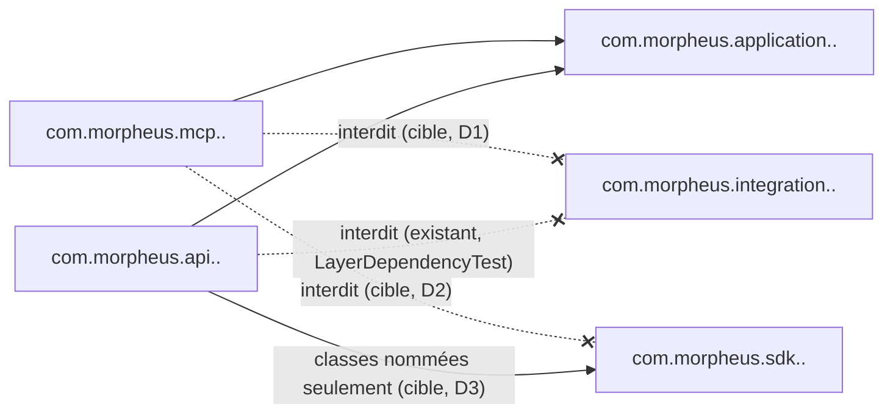

# Conception : interdire au serveur MCP d'atteindre une intégration ou l'hôte de plugins

## Contexte

- [EXISTANT VÉRIFIÉ] `LayerDependencyTest#httpApiMustRemainSiblingOfCliAndMcp` interdit à `com.morpheus.api..` la CLI,
  le MCP, `com.morpheus.integration..`, `com.morpheus.transport..` et les implémentations MINOS/NEXUS/JARVIS.
- [EXISTANT VÉRIFIÉ] `AdapterSiblingArchitectureTest.MCP_IGNORES_HTTP_AND_CLI` (`:100-101`) n'interdit au MCP que
  `API` et `CLI` ; `SUBJECTS` contient `MCP`, `NAMED` contient déjà `INTEGRATIONS` et `SDK`.
  `everyDeclaredSubjectIsTheSubjectOfARuleAndNoOther` et `everyPackageTheseRulesNameResolvesToImportedClasses` tiennent
  la cohérence des sujets et des motifs.
- [EXISTANT VÉRIFIÉ] `AdapterCompositionRootArchitectureTest` : `TRANSPORT_ADAPTERS` = api, mcp ;
  `CONCRETE_ADAPTERS` = store, provider ; `COMPOSITION_ROOTS` est un compteur de dette d'`ARCH-0162`
  (`ProductionClassListsArchitectureTest`, `Kind.debtCounterUnder("ARCH-0162")`) dont la clé de
  `config/debt-counter-ratchets.properties` ne fait que baisser ; `ARCH-0162` §1 exige un ADR consolidé pour y ajouter
  une classe.
- [EXISTANT VÉRIFIÉ] Dans `morpheus-api`, `MorpheusProviderPluginApiService` importe trois types du SDK et rend
  `ProviderPluginViews.RemoteDiscoveryView` / `RemoteProbeView` ; `MorpheusProviderPluginHttpRoutes`
  (`com.morpheus.api.routes.bodiless`) appelle ces méthodes, donc dépend en bytecode des types rendus. L'ensemble exact
  est à mesurer par ArchUnit au moment d'écrire la liste.
- [EXISTANT VÉRIFIÉ] Dans `morpheus-mcp`, seule `MorpheusProviderPluginMcpTools` atteint le SDK ; elle est retirée par
  `remove-the-unserved-provider-plugin-mcp-tool`.
- [EXISTANT VÉRIFIÉ] La raison de `MCP_IGNORES_HTTP_AND_CLI` cite « ADR-0151 », soit `BE-0151`, dont le contexte dit que
  les deux adaptateurs sont frères et ne s'appellent pas.

## Exigences couvertes

| Capacité | Exigence (titre exact) | Rubriques de conception qui y répondent |
|---|---|---|
| `provider-sdk-dependency-boundary` | Le serveur MCP NE DOIT dépendre d'aucune intégration MINOS ou NEXUS | D1 |
| `provider-sdk-dependency-boundary` | Le serveur MCP NE DOIT dépendre d'aucune classe du SDK provider | D2 |
| `provider-sdk-dependency-boundary` | L'adaptateur HTTP N'atteint le SDK provider que par des classes nommées | D3 |

## Composants et frontières

Question : quelles arêtes de transport vers l'intégration et le SDK sont interdites ou bornées ? Les arêtes « cible »
sont celles que ce change ajoute ; l'arête « existant » est déjà tenue. La CLI n'est pas un transport de cette règle :
elle porte le câblage du processus.

## Modèle de domaine et invariants

Sans objet.

## Traitements et interactions

Sans objet : règles de build seulement.

## États et transitions

Sans objet.

## Contrats d'interface

Sans objet : aucune surface publique ne change.

## Persistance et intégrité

Sans objet.

## Transactions, concurrence et idempotence

Sans objet.

## Sécurité et isolation

Le SDK côté hôte lance la JVM enfant du probe (`ProviderPluginProbeProcess`). Interdire au MCP d'y accéder rend
exécutable la garantie de `SEC-0129` « le modèle ne peut pas déclencher l'exécution d'un plugin », aujourd'hui tenue
par le seul texte de l'outil retiré.

## Gestion des erreurs et reprise

Sans objet.

## Observabilité

Sans objet.

## Performance et stratégie de mesure

Sans objet.

## Compatibilité, migration et retour arrière

Aucune donnée. Retour arrière : retirer les cibles ajoutées aux règles.

## Décisions

### D1 : étendre la règle de frère du MCP aux intégrations
- **Nature** : [DÉCISION]
- **Exigences servies** : `provider-sdk-dependency-boundary` › Le serveur MCP NE DOIT dépendre d'aucune intégration MINOS ou NEXUS
- **Choix** : ajouter `INTEGRATIONS` aux cibles interdites de la règle de frère du MCP dans
  `AdapterSiblingArchitectureTest`, renommer la constante et sa méthode de test pour dire ce qu'elles interdisent
  (sans retirer de méthode : `architectureTestsMinimum` ne baisse pas), et prouver la règle par une violation plantée
  (classe de `morpheus-mcp` qui référence une classe de `com.morpheus.integration.minos`, échec constaté, retour arrière ;
  trace dans la Javadoc ou la PR). Intention : « aucune dépendance » → règle ArchUnit ; un doublon textuel n'est utile
  que si une classe d'intégration déclare une constante inlinable (à vérifier, `.claude/rules/architecture.md`).
- **Alternatives écartées** : une règle séparée dans `LayerDependencyTest` — la règle de frère du MCP existe déjà dans
  `AdapterSiblingArchitectureTest`, qui tient ses sujets ; se fier au POM — c'est le trou constaté.
- **Compromis** : aucun.
- **ADR** : non concerné (règle de frère déjà écrite dans `.claude/rules/architecture.md` et `BE-0151`).

### D2 : interdire le SDK au MCP
- **Nature** : [DÉCISION]
- **Exigences servies** : `provider-sdk-dependency-boundary` › Le serveur MCP NE DOIT dépendre d'aucune classe du SDK provider
- **Choix** : ajouter `SDK` aux mêmes cibles, après `AUD-ARC-27`.
- **Alternatives écartées** : passer par `CONCRETE_ADAPTERS` — l'exception de racine nommée n'a pas de sens pour un
  transport qui n'a aucun usage légitime du SDK (`SEC-0129` §7 « rien en MCP »).
- **Compromis** : quand `AUD-ARC-30` déplace l'hôte vers un autre paquet, la cible suit ce paquet (motif à revoir dans
  ce change-là).
- **ADR** : `SEC-0129` (couvre déjà « rien en MCP »).

### D3 : forme de la liste des classes HTTP qui atteignent le SDK
- **Nature** : [QUESTION] décision du mainteneur ; [PROPOSITION] option B.
- **Exigences servies** : `provider-sdk-dependency-boundary` › L'adaptateur HTTP N'atteint le SDK provider que par des classes nommées
- **Options** :
  - **A** — ajouter `com.morpheus.sdk..` à `CONCRETE_ADAPTERS` et les classes mesurées
    (`MorpheusProviderPluginApiService`, et `MorpheusProviderPluginHttpRoutes` si la mesure la retient) à
    `COMPOSITION_ROOTS`. Exige un ADR consolidé qui remplace `ARCH-0162` (§1) et une hausse de la clé du compteur de
    dette, justifiée dans la PR. **ADR à proposer.**
  - **B** — une liste exacte propre, dans `AdapterSiblingArchitectureTest`, des classes d'`api` qui atteignent le SDK,
    déclarée **table de faits** dans `ProductionClassListsArchitectureTest` (chaque entrée avec sa raison : servir les
    routes `provider-plugins`), comparée dans les deux sens. Aucun ADR, aucun compteur relevé.
- **Proposition** : B. Le SDK n'est pas un store ni un provider lu par une opération : c'est une plateforme d'extension
  dont la frontière est décidée par `SEC-0129`. L'ajouter aux racines de composition étendrait une liste qu'`ARCH-0162`
  veut voir rétrécir, et mélangerait deux raisons dans un même compteur.
- **Compromis de B** : une liste de plus ; elle ne promet pas de rétrécir.
- **ADR** : option A : ADR à proposer (remplace `ARCH-0162`) ; option B : non concerné.

## Écarts constatés

| Constat | Source A | Source B | Traitement proposé |
|---|---|---|---|
| La Javadoc de la classe annonce de refuser une arête ajoutée à un POM, le MCP n'est pas couvert pour les intégrations | Javadoc d'`AdapterSiblingArchitectureTest` | `MCP_IGNORES_HTTP_AND_CLI` | D1 |
| La page durable ne décrit pas la règle de frère du MCP | `docs/developer/specifications/provider-sdk-dependency-boundary.md` | `AdapterSiblingArchitectureTest` | tâche 3.3 |

## Stratégie de vérification

| Exigence | Scénario | Preuve | État |
|---|---|---|---|
| Le serveur MCP NE DOIT dépendre d'aucune intégration MINOS ou NEXUS | Une dépendance du serveur MCP vers une intégration fait échouer le build | règle étendue, violation plantée | à écrire |
| idem | La règle juge au moins une classe | `everyPackageTheseRulesNameResolvesToImportedClasses`, `failOnEmptyShould` | existant |
| Le serveur MCP NE DOIT dépendre d'aucune classe du SDK provider | Le serveur MCP sans dépendance au SDK | règle étendue | à écrire |
| idem | Une classe MCP qui importe la découverte de plugins fait échouer le build | violation plantée | à écrire |
| L'adaptateur HTTP N'atteint le SDK provider que par des classes nommées | Une nouvelle classe HTTP qui atteint le SDK | règle de la liste (option retenue) | à écrire |
| idem | Une classe nommée qui n'atteint plus le SDK | test d'exactitude de la liste | à écrire |

## Documentation durable et diagrammes à mettre à jour

`docs/developer/specifications/provider-sdk-dependency-boundary.md` (trois exigences, matrice) ;
`.claude/rules/architecture.md` (section du SDK et des adaptateurs frères) ; option A : l'ADR consolidé et
`docs/architecture/adr/README.md`.

## Questions ouvertes

D3, qui conditionne le groupe 3 des tâches.
