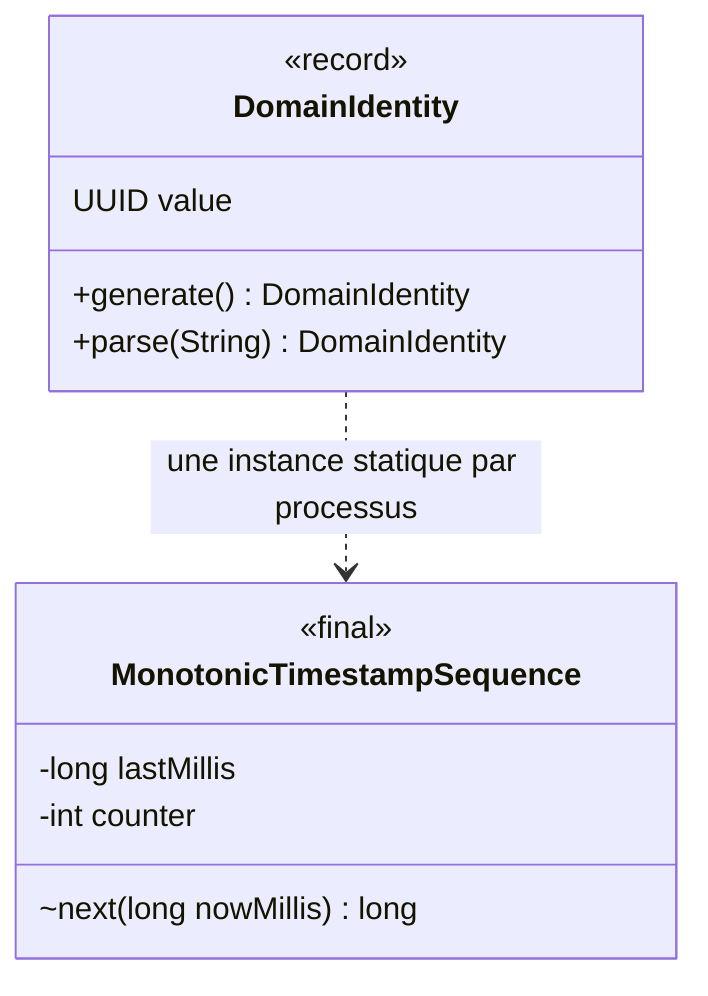
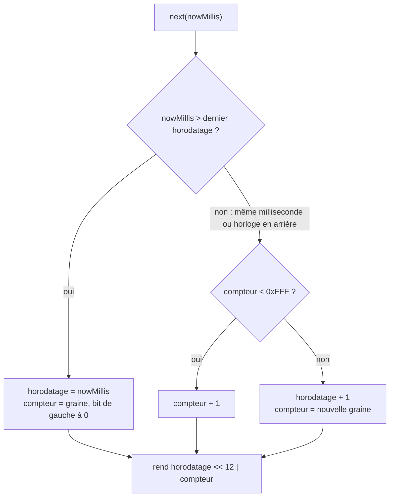

# Conception : générer les identités de domaine dans l'ordre

Conception allégée : changement local au domaine, sans surface publique ni persistance nouvelle.

## Contexte

[EXISTANT VÉRIFIÉ] Avant ce changement, `DomainIdentity.generate()` compose le UUIDv7 de l'horodatage milliseconde, de
`rand_a` (12 bits) et de `rand_b` (62 bits), tous deux tirés d'un `SecureRandom`. L'ordre de deux identités d'une même
milliseconde est celui de deux tirages. Les listes visibles triées par identité en héritent : `ProposedChangeSet` (tri
par `id().toString()`), `ChangeAnalysisResult`, `ChangeAnalysisService`, `RequirementChangeImpact`,
`ChangeOrchestrationStateService`, les services qui trient par `ImplementationTask::id`, et les requêtes SQLite
`ORDER BY id`. Preuve et motivation : proposal.md, section Why.

[EXISTANT VÉRIFIÉ] L'ADR DATA-0140 (archivé) décrit ce tirage et accepte, dans ses conséquences négatives, que l'ordre dans une
milliseconde ne soit pas garanti.

## Exigences couvertes

| Capacité | Exigence (titre exact) | Rubriques de conception qui y répondent |
|---|---|---|
| `domain-identity-generation` | Identities generated by one process compare in the order of generation | §Décisions D1, D2, D3 ; §Traitements et interactions |

## Composants et frontières

- `DomainIdentity` (record, `com.morpheus.domain.identity`) : garde son constructeur canonique unique et son invariant
  UUIDv7 dans le constructeur compact ; `generate()` assemble l'horodatage et le compteur que lui rend la séquence.
- `MonotonicTimestampSequence` (classe `final`, visibilité paquet, même paquet) : tient le dernier horodatage rendu et
  le compteur ; son unique méthode `next(nowMillis)` est `synchronized`.
- Aucune dépendance nouvelle : le domaine reste sans adaptateur (`LayerDependencyTest`).

## Modèle de domaine et invariants

Question : quelles classes portent la génération ? Cible.

Invariant de la séquence : chaque valeur rendue (horodatage décalé de 12 bits, joint au compteur) est strictement plus
grande que la précédente. Invariant de l'identité, inchangé : version 7, variante 2.

## Traitements et interactions

Question : que rend `next` selon l'horloge ? Cible.

## Transactions, concurrence et idempotence

`next` est `synchronized` : deux fils qui génèrent en même temps reçoivent deux valeurs distinctes et ordonnées. Les
règles de moniteur du dépôt visent `com.morpheus.store.sqlite` ; aucune n'interdit un moniteur dans `morpheus-domain`.

## Sécurité et isolation

Un identifiant n'est ni un secret ni un mécanisme d'autorisation (DATA-0168). Le compteur rend prévisible l'ordre de
deux identités d'un même processus, pas leur valeur : `rand_b` garde 62 bits aléatoires et la graine du compteur est
tirée du même `SecureRandom`.

## Compatibilité, migration et retour arrière

Les identités déjà persistées sont relues telles quelles : elles restent des UUIDv7 valides et `compareTo` ne change
pas. Revenir en arrière ne casse aucune donnée ; l'ordre dans une milliseconde redeviendrait aléatoire.

## Décisions

### D1 : un compteur dans `rand_a` plutôt qu'une clé de tri par liste
- **Nature** : [DÉCISION]
- **Exigences servies** : `domain-identity-generation` › Identities generated by one process compare in the order of generation
- **Choix** : rendre la génération monotone dans le processus ; un tri par identité devient un tri par ordre de
  génération, donc par ordre de lecture du fournisseur.
- **Alternatives écartées** : trier chaque liste visible par une clé stable — `Constraint` et `DesignDecision` n'ont
  aucune clé, celle de `ImplementationTask` et de `RequirementDelta` est facultative, l'application compte des dizaines
  de comparateurs par identité, et la pagination SQLite par `id` serait à refaire.
- **Compromis** : l'ordre entre deux processus dans la même milliseconde reste non garanti.
- **ADR** : DATA-0168, qui remplace DATA-0140 (archivé), la décision de format changeant en partie. Option retenue par le
  mainteneur et ADR accepté par lui le 14/11/2026.

### D2 : méthode 1 de RFC 9562 (compteur de longueur fixe), graine au bit de gauche nul
- **Nature** : [DÉCISION]
- **Exigences servies** : même exigence
- **Choix** : compteur de 12 bits dans `rand_a`, réensemencé à chaque nouvelle milliseconde avec son bit de gauche à 0,
  ce qui laisse au moins 2048 incréments avant débordement.
- **Alternatives écartées** : méthode 3 (précision d'horloge accrue) — `System.currentTimeMillis` ne donne que la
  milliseconde et `System.nanoTime` n'est pas une horloge murale ; méthode 2 (`rand_b` incrémenté d'un aléa) — elle
  rend `rand_b` en partie prévisible et demande une arithmétique sur 62 bits.
- **Compromis** : une rafale de plus de 2048 identités dans une milliseconde avance l'horodatage d'une unité au-delà de
  l'horloge.

### D3 : débordement et horloge en arrière continuent sur le dernier horodatage
- **Nature** : [DÉCISION]
- **Exigences servies** : même exigence
- **Choix** : au débordement, l'horodatage avance d'une milliseconde ; quand l'horloge recule, la séquence garde le
  dernier horodatage rendu et incrémente le compteur.
- **Alternatives écartées** : attendre la milliseconde suivante (un fil bloqué dans le domaine) ; lever une exception
  (une génération ne doit pas échouer pour une horloge).
- **Compromis** : l'horodatage encodé peut devancer l'horloge de peu ; DATA-0168 interdit déjà de le lire comme un fait
  métier.

## Écarts constatés

| Constat | Source A | Source B | Traitement proposé |
|---|---|---|---|
| DATA-0140 (archivé) prescrit de trier par des champs explicites alors que l'application trie par identité | DATA-0140 (archivé), Do's | `ProposedChangeSet` et les services cités | DATA-0168 admet le tri par identité comme ordre de génération, sans en faire un fait métier |

## Stratégie de vérification

| Exigence | Scénario | Preuve | État |
|---|---|---|---|
| Identities generated by one process compare in the order of generation | Identities generated within one millisecond | `DomainIdentityTest#identitiesGeneratedInOneMillisecondCompareInTheOrderOfGeneration` ; `CliCommandTranscriptTest` | existant |
| idem | Counter overflow within one millisecond | `MonotonicTimestampSequenceTest#aCounterThatOverflowsMovesToTheNextMillisecondWithAFreshSeed` | existant |
| idem | System clock that goes back | `MonotonicTimestampSequenceTest#aClockThatGoesBackContinuesOnTheLastTimestamp` | existant |
| idem | A value that is not a UUIDv7 is still refused | `DomainIdentityTest#rejectsNonUuidV7Values` | existant |

## Documentation durable et diagrammes à mettre à jour

`docs/developer/specifications/domain-identity-generation.md` (nouvelle page, indexée) ; ADR DATA-0168 et index du
registre ; `docs/architecture/arc42/09-decisions.md` ; exemple de `.claude/rules/code-style.md`.

## Questions ouvertes

Aucune.
