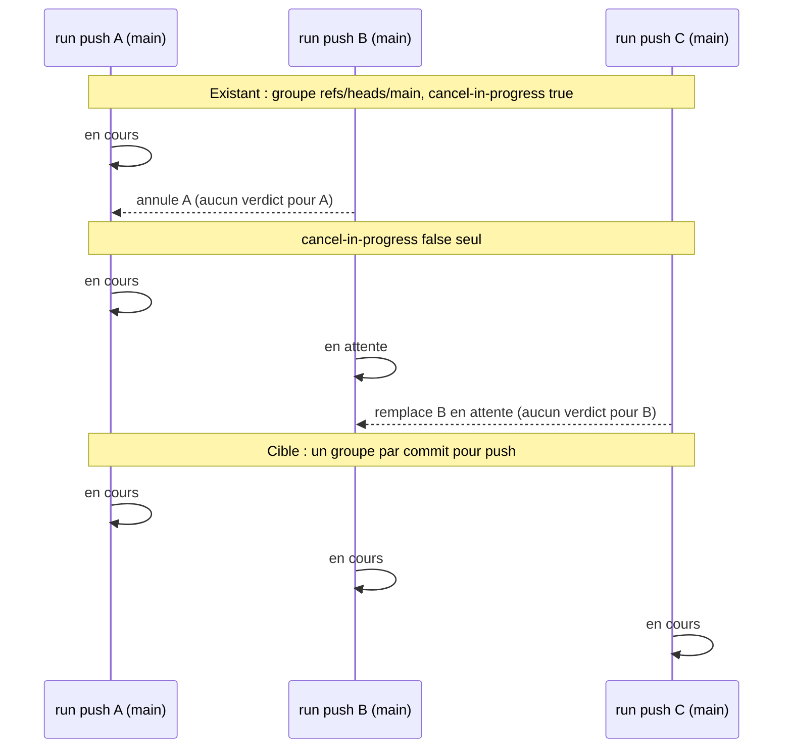

# Conception : donner à chaque fusion sur main son verdict CI

## Contexte

- [EXISTANT VÉRIFIÉ] `ci.yml:12-14` : `group: morpheus-ci-${{ github.workflow }}-${{ github.ref }}`,
  `cancel-in-progress: true`, déclencheurs `push` (`main`), `pull_request`, `workflow_dispatch`.
- [EXISTANT VÉRIFIÉ] `codeql.yml:16-18` : `group: morpheus-codeql-${{ github.ref }}`, `cancel-in-progress: true`,
  déclencheurs `push` (`main`), `pull_request`, `schedule` hebdomadaire, `workflow_dispatch`.
- [EXISTANT VÉRIFIÉ] `security.yml:28-30` : `group: morpheus-security-${{ github.ref }}`, `cancel-in-progress: true` ;
  un `schedule` s'exécute sur `refs/heads/main`, donc dans le même groupe qu'un push sur `main`. La clé de cache
  sauvée porte `${{ github.run_id }}` (`security.yml:252`) : deux runs de confiance parallèles n'écrivent pas la même
  entrée.
- [EXISTANT VÉRIFIÉ] `nightly.yml` et `release.yml` sont déjà en `cancel-in-progress: false`.
- [EXISTANT VÉRIFIÉ] Aucun test ne lit `concurrency` ni `cancel-in-progress` (recherche dans
  `morpheus-architecture-tests`) ; le job `sonar` est tenu par
  `AuditHardeningWorkflowContractTest#everyMergeIsAnalysedByTheMainBranchJobAndNoOtherWorkflowCarriesTheToken`.
- [EXISTANT VÉRIFIÉ] Comportement de GitHub Actions : dans un groupe de concurrence, au plus un run est en cours et un
  seul en attente ; un nouveau run du groupe remplace (annule) le run en attente, même sans `cancel-in-progress`.

## Exigences couvertes

| Capacité | Exigence (titre exact) | Rubriques de conception qui y répondent |
|---|---|---|
| `single-integration-branch` | Le run d'une fusion dans main NE DOIT PAS être annulé par une fusion suivante | D1, D3 |
| `vulnerability-feed-freshness` | A trusted run of the security workflow MUST NOT be cancelled by another trusted run | D2, D3 |

## Composants et frontières

`.github/workflows/ci.yml`, `codeql.yml`, `security.yml` (blocs `concurrency` de premier niveau) ;
`AuditHardeningWorkflowContractTest` (`ci.yml`, `codeql.yml`) et `DependencyCheckWorkflowContractTest`
(`security.yml`), qui lisent déjà ces fichiers.

## Traitements et interactions

Question : que devient le run d'une fusion quand une autre arrive ?

Le troisième cas est la cible (exigence `single-integration-branch` › Le run d'une fusion dans main NE DOIT PAS être
annulé par une fusion suivante) ; le deuxième montre pourquoi la correction proposée par l'audit ne suffit pas.

## Modèle de domaine et invariants

Sans objet : configuration de CI.

## États et transitions

Sans objet.

## Contrats d'interface

Sans objet : aucune surface publique.

## Persistance et intégrité

Sans objet, hors cache NVD : chaque run de confiance sauve sous sa propre clé (`run_id`), et la restauration prend la
plus récente par préfixe ; deux runs parallèles ne se corrompent pas.

## Transactions, concurrence et idempotence

Voir D1 et D2.

## Sécurité et isolation

Sans objet : aucun secret ni permission ne change ; un run de `push` garde `SONAR_TOKEN` dans le seul job `sonar`.

## Gestion des erreurs et reprise

Sans objet.

## Observabilité

Chaque commit de `main` porte ses checks ; l'historique des runs de `main` n'a plus de run « cancelled » dû à la
concurrence.

## Performance et stratégie de mesure

Des runs de `main` qui ne s'annulent plus consomment plus de minutes de runner les jours de fusions rapprochées.
[QUESTION] Le coût n'est pas mesuré ; stratégie : compter, sur les trente derniers jours (`gh run list --workflow
ci.yml --branch main --json conclusion`), les runs `cancelled`, qui bornent le surcoût. Cela n'arrête pas le changement :
un verdict par fusion est l'exigence.

## Compatibilité, migration et retour arrière

Retour arrière : restaurer les trois blocs `concurrency`. Rien n'est perdu.

## Décisions

### D1 : un groupe par commit pour les runs qui ne viennent pas d'une pull request
- **Nature** : [DÉCISION]
- **Exigences servies** : `single-integration-branch` › Le run d'une fusion dans main NE DOIT PAS être annulé par une
  fusion suivante
- **Choix** : `group: morpheus-ci-${{ github.workflow }}-${{ github.event_name == 'pull_request' &&
  github.ref || github.sha }}` et `cancel-in-progress: ${{ github.event_name == 'pull_request' }}` ; même forme pour
  `codeql.yml` (son `schedule` reçoit aussi un groupe par commit).
- **Alternatives écartées** : `cancel-in-progress: ${{ github.event_name == 'pull_request' }}` seul (action de
  l'audit) — un troisième push remplace le run en attente du deuxième, qui reste sans verdict ; supprimer la
  concurrence — les pull requests perdraient l'annulation de leurs runs périmés.
- **Compromis** : deux runs du même commit (`push` et `workflow_dispatch`) partagent un groupe et ne s'annulent pas
  (`cancel-in-progress` faux hors pull request) ; ils se sérialisent.
- **ADR** : non concerné.

### D2 : séparer les runs de confiance de `security.yml`
- **Nature** : [DÉCISION]
- **Exigences servies** : `vulnerability-feed-freshness` › A trusted run of the security workflow MUST NOT be cancelled
  by another trusted run
- **Choix** : `group: morpheus-security-${{ github.event_name == 'pull_request' && github.ref ||
  github.run_id }}` et `cancel-in-progress: ${{ github.event_name == 'pull_request' }}`.
- **Alternatives écartées** : un groupe par événement (`schedule` à part) — deux pushes rapprochés retombent dans le
  défaut ; sérialiser tous les runs de confiance dans un groupe sans annulation — un troisième remplace le deuxième en
  attente.
- **Compromis** : deux rafraîchissements peuvent tourner en parallèle et interroger le flux NVD deux fois ; le verrou
  `odc.update.lock` est par runner, la clé de cache par run.
- **ADR** : non concerné.

### D3 : un contrat par workflow, dans le test qui lit déjà ce workflow
- **Nature** : [DÉCISION]
- **Exigences servies** : les deux exigences.
- **Choix** : une méthode dans `AuditHardeningWorkflowContractTest` pour `ci.yml` et `codeql.yml`, une dans
  `DependencyCheckWorkflowContractTest` pour `security.yml` ; chacune extrait le bloc `concurrency` et exige les deux
  expressions exactes de D1/D2. Assertion textuelle : la cible est un `.yml`.
- **Alternatives écartées** : un test transverse de tous les workflows — `nightly.yml` et `release.yml` ont une
  concurrence volontairement différente (sérialisation sans annulation, sans conflit de groupe).
- **Compromis** : une autre écriture équivalente de l'expression échoue ; on édite alors le test en connaissance de
  cause.
- **ADR** : non concerné.

## Écarts constatés

| Constat | Source A | Source B | Traitement proposé |
|---|---|---|---|
| `codeql.yml` porte le même défaut | `codeql.yml:16-18` | audit (cite `ci.yml` et `security.yml`) | inclus (D1) |
| L'action de l'audit laisse un run en attente être remplacé | comportement de GitHub Actions | `findings.json`, action d'`AUD-DEP-34` | D1 et D2 retiennent un groupe par commit ou par run |
| Le commentaire de `ci.yml` affirme un verdict par fusion | `ci.yml:131-132` | `ci.yml:12-14` | rendu vrai par D1, texte inchangé |

## Stratégie de vérification

| Exigence | Scénario | Preuve | État |
|---|---|---|---|
| Le run d'une fusion … | Une concurrence qui annule un run de main est refusée | `AuditHardeningWorkflowContractTest#aMergeOnMainIsNeverCancelledByTheNextOne` | à écrire |
| idem | Deux fusions rapprochées ; Trois fusions rapprochées | constat sur l'historique des runs de `main` après deux fusions rapprochées | manuel |
| idem | Une pull request garde l'annulation | constat sur une pull request (deux pushes) | manuel |
| A trusted run … | A shared group with cancellation is refused | `DependencyCheckWorkflowContractTest#aTrustedRunIsNeverCancelledByAnotherTrustedRun` | à écrire |
| idem | A merge during the scheduled refresh | constat manuel (dispatch puis fusion) | manuel |

## Documentation durable et diagrammes à mettre à jour

`docs/developer/specifications/single-integration-branch.md` (exigence, comportement « Fusion », diagramme de séquence,
traçabilité) ; `docs/developer/specifications/vulnerability-feed-freshness.md` (exigence, traçabilité).

## Questions ouvertes

- [QUESTION] Surcoût en minutes de runner (voir Performance) : peut attendre, ne change ni les specs ni les tâches.
