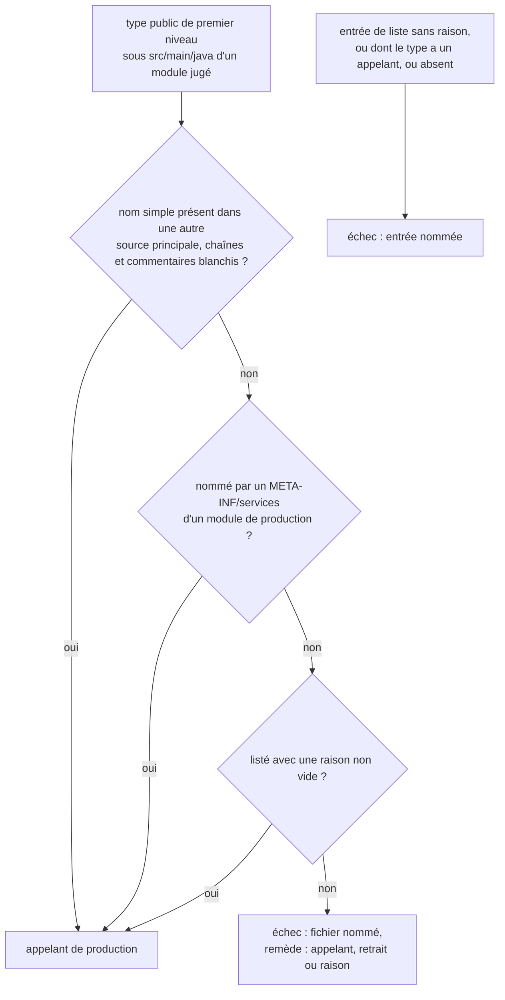

# Conception : donner un appelant de production à tout type public du produit (AUD-QUA-27)

## Contexte

- [EXISTANT VÉRIFIÉ] Les dix classes du constat n'ont aucun appelant de production (relevé du 17/11/2026 sur la tête de
  `docs/openspec-audit-2026-11-17`, `git grep -lw <Nom> -- 'morpheus-*/src/main/*.java'`, fichier propre exclu) :

  | Classe (`com.morpheus.application.…`) | Lignes | Classes de test qui la nomment |
  |---|---|---|
  | `delta.RequirementDeltaApplicationService` | 317 | `RequirementDeltaApplicationServiceTest`, `RequirementDeltaApplicationContractTest`, `PublishedHistoryContractTest`, `CurrentRequirementReaderArchitectureTest` |
  | `delta.RequirementDeltaPromotionService` | 112 | les quatre mêmes |
  | `discovery.ProjectDiscoveryService` | 102 | `ProjectDiscoveryServiceTest`, `OpenSpecDiscoveryIntegrationTest`, `ApplicationTechnologyBoundaryArchitectureTest` |
  | `history.RequirementLogicalRollbackService` | 177 | `RequirementLogicalRollbackServiceTest`, `PublishedHistoryContractTest` |
  | `project.LocalProjectRegistry` | 57 | `LocalProjectRegistryTest` |
  | `security.ExternalLinkPolicy` | 26 | `ExternalLinkPolicyTest` |
  | `sync.LocalSourceWatcher` | 237 | `LocalSourceWatcherBudgetTest`, `SourceSynchronizationCoreTest`, `ScanWorkspaceBoundaryTest`, `IntermediateSymlinkBoundaryTest`, `ApplicationTechnologyBoundaryArchitectureTest`, `SilentCatchArchitectureTest` |
  | `temporal.CurrentRequirementQueryService` | 33 | `CurrentRequirementQueryServiceTest`, `RequirementDeltaApplicationContractTest`, `VersionedRequirementPersistenceTest` |
  | `temporal.TemporalProjection` | 88 | `TemporalProjectionTest` |
  | `traceability.ExternalTraceabilityLinkFactory` | 63 | `ExternalTraceabilityLinkFactoryTest`, `ExternalTraceabilityContractTest`, `ChangeContextQueryContractTest`, `DecisionReferenceQualityContractTest`, `TraceRequirementFinalValidationTest` |

  Total : 1 212 lignes, égal à la mesure de l'audit. Aucun `META-INF/services` ne les nomme.
- [EXISTANT VÉRIFIÉ] **Cascade** non relevée par l'audit. Un rejeu itératif du même scan (un type est mort quand seuls
  des types morts le nomment) rend morts, une fois les dix retirés : `delta.AppliedRequirementDelta`,
  `delta.RequirementDeltaApplicationException`, `delta.RequirementDeltaApplicationPlan`,
  `delta.RequirementDeltaApplicationResult`, `delta.RequirementDeltaPromotionResult`,
  `delta.RequirementPromotionEvidence`, `discovery.ProjectDiscoveryResult`, `discovery.WorkspaceRootCandidate`,
  `discovery.WorkspaceRootKind`, `discovery.WorkspaceRootResolver`, `history.RequirementLogicalRollbackPlan`,
  `history.RequirementLogicalRollbackRequest`, `sync.WorkspacePathBoundary` (paquet `com.morpheus.application`), et
  `SpecificationSource` (`com.morpheus.domain.source`), soit quatorze types et 389 lignes de plus.
- [EXISTANT VÉRIFIÉ] Le même scan relève aussi, hors du constat, `OperationalSlf4jServiceProvider`
  (`com.morpheus.cli.launch`), chargé par SLF4J à travers
  `morpheus-cli/src/main/resources/META-INF/services/org.slf4j.spi.SLF4JServiceProvider` : vivant, et la raison pour
  laquelle la porte doit lire ces fichiers. Il relève enfin tous les types de `morpheus-store-memory` et de
  `morpheus-provider-synthetic`, outillage de vérification que seuls les tests construisent.
- [EXISTANT VÉRIFIÉ] `UnreferencedPublicMethodArchitectureTest` compte les identifiants de toutes les sources Java des
  modules `morpheus-*`, tests compris, et ne juge que les méthodes publiques ; ses modules non jugés sont
  `NOT_JUDGED` (le SDK, le testkit, le plugin de référence, les tests d'architecture et le rapport de couverture).
- [EXISTANT VÉRIFIÉ] Mentions hors code des classes du lot :
  - `ApplicationTechnologyBoundaryArchitectureTest.CONFINED_FAMILIES` nomme `sync.LocalSourceWatcher`,
    `discovery.ProjectDiscoveryService` et `discovery.WorkspaceRootResolver` ; cette liste est un compteur de dette
    d'ARCH-0150, de clé `ApplicationTechnologyBoundaryArchitectureTest.CONFINED_FAMILIES` dans
    `config/debt-counter-ratchets.properties`, et ARCH-0150 l'énumère entre balises (sort « reste tant que la classe
    existe »).
  - `SilentCatchArchitectureTest` porte l'entrée `LocalSourceWatcher.java#IOException`.
  - `scripts/validate-m19.ps1` et `scripts/validate-m19.sh` lancent `ExternalLinkPolicyTest` par `-Dtest`.
  - `docs/developer/REMOTE_SERVER_PLATFORM.md:195` présente `LocalSourceWatcher` comme appliqué ;
    `docs/developer/OPERABILITY.md:313` décrit `ExternalLinkPolicy.safeDefaults()` ;
    `docs/developer/specifications/workspace-boundary-scan-cost.md` nomme le watcher et `WorkspacePathBoundary`.
  - La spec `workspace-boundary-scan-cost` porte l'exigence « What a scan remembers MUST NOT outlive that scan nor
    reach the watcher », dont un scénario décrit le watcher.
- [EXISTANT VÉRIFIÉ] ADR en vigueur qui nomment une classe du lot dans leur section `Decision` (l'audit n'en cite que
  deux) : DATA-0125 point 9 (`LocalSourceWatcher`) ; ARCH-0150 décision 2 (`LocalSourceWatcher`,
  `ProjectDiscoveryService`, `WorkspaceRootResolver`) ; BE-0020 (stratégie portée par `WorkspaceRootResolver` et
  `ProjectDiscoveryService`) ; BE-0035 points 1 et 6 (les deux services de delta) ; ARCH-0136 point 5
  (`TemporalProjection`) ; DATA-0141 (`CurrentRequirementQueryService`) ; DATA-0142 point 4
  (`ExternalTraceabilityLinkFactory`). ARCH-0162 et SEC-0157 en nomment une dans leur `Context` seulement.

## Exigences couvertes

| Capacité | Exigence (titre exact) | Rubriques de conception qui y répondent |
|---|---|---|
| `dead-code-refusal` | A public type of a product module SHALL have a production caller or a written reason | §Décisions D1, D2, D3, §Traitements |

## Composants et frontières

- `morpheus-architecture-tests` : une classe de test nouvelle, `UnreferencedPublicTypeArchitectureTest` (à écrire),
  dans le paquet racine des tests d'architecture, à côté de `UnreferencedPublicMethodArchitectureTest`. Elle ne lit que
  des fichiers et ne charge aucune classe de production ; elle porte donc `@CoherenceCheck` si
  `CoherenceCheckMarkerTest` le dérive (relire la règle à l'application, ne pas le décider ici).
- `morpheus-application`, `morpheus-domain` : suppressions ou câblage selon D1.
- Aucune frontière de couche ne bouge ; `LayerDependencyTest` n'est pas touché.

## Modèle de domaine et invariants

Sans objet : aucun type du domaine ne change d'invariant ; `SpecificationSource` ne disparaît que par cascade (D1).

## Traitements et interactions

Question : comment la porte décide-t-elle qu'un type public a un appelant de production ? (cible, à construire)

Le diagramme répond à l'exigence « A public type of a product module SHALL have a production caller or a written
reason ». Il réutilise la lecture de `UnreferencedPublicMethodArchitectureTest` (blanchiment des chaînes, blocs de
texte et commentaires, comptage d'identifiants) en ne lisant que les sources principales.

## États et transitions

Sans objet : aucun cycle de vie.

## Contrats d'interface

Sans objet tant que toutes les classes sont supprimées. Une classe câblée sur une surface publique apporte sa ligne de
`contracts/public-surfaces.tsv` et son opération OpenAPI dans le même changement (`.claude/rules/governance.md`).

## Persistance et intégrité

Sans objet : aucune des dix classes n'écrit un format persisté propre ; `RequirementDeltaApplicationService` et
`RequirementLogicalRollbackService` écrivent par des ports existants que d'autres services emploient, que leur
suppression ne touche pas.

## Transactions, concurrence et idempotence

Sans objet.

## Sécurité et isolation

`ExternalLinkPolicy` et `LocalSourceWatcher` sont des classes de sécurité **non appliquées** : les supprimer ne retire
aucune garantie livrée. `WorkspacePathBoundary` n'est employé que par le watcher ; le contrôle des scans livrés reste
`ScanWorkspaceBoundary` (ADR SEC-0157). Câbler le watcher, au contraire, ouvrirait un fil d'écoute du système de
fichiers dans un processus livré : ARCH-0150 refuse les fils d'exécution dans l'application, donc le câblage vivrait
dans un adaptateur.

## Gestion des erreurs et reprise

Sans objet.

## Observabilité

Le refus de la porte nomme chaque fichier en défaut et le remède, comme le fait déjà la porte des méthodes.

## Performance et stratégie de mesure

Sans objet : la porte lit les mêmes sources que la porte des méthodes, une fois.

## Compatibilité, migration et retour arrière

Aucune donnée persistée ni surface publique ne change si toutes les classes sont supprimées. Le retour arrière d'une
suppression est un `git revert` ; il remet aussi les entrées de liste et la clé de compteur retirées.

## Décisions

### D1 : sort de chaque classe
- **Nature** : [QUESTION] — décision du mainteneur, classe par classe.
- **Exigences servies** : `dead-code-refusal` › A public type of a product module SHALL have a production caller or a
  written reason.
- **Options** : (a) supprimer la classe, ses tests et les types qui n'existent que pour elle ; (b) la câbler dans un
  processus livré, avec sa surface et ses tests d'intégration ; (c) la garder et la lister avec sa raison dans la porte.
- **[PROPOSITION] par classe** :

  | Classe | Recommandation | Raison |
  |---|---|---|
  | `LocalSourceWatcher` (+ `WorkspacePathBoundary`) | supprimer | DATA-0125 le dit « facultatif » et seul le scan SHA-256 prouve l'état ; aucun processus long n'en a l'usage ; le câbler demande un fil hors de l'application |
  | `ProjectDiscoveryService` (+ `ProjectDiscoveryResult`, `WorkspaceRoot*`, `SpecificationSource`) | supprimer | aucune surface ne résout de racine par repli Git ; la CLI et les serveurs reçoivent le chemin |
  | `RequirementDeltaApplicationService`, `RequirementDeltaPromotionService` (+ six types de `delta`) | supprimer | la publication livrée passe par `ProjectSnapshotImportService.publishFull` (DATA-0144) ; BE-0035 décrit une opération qu'aucune surface n'offre |
  | `RequirementLogicalRollbackService` (+ plan, requête) | supprimer | aucune surface de retour arrière logique |
  | `LocalProjectRegistry` | supprimer | doublon sans appelant |
  | `ExternalLinkPolicy` | supprimer | aucune lecture de lien réseau ne la consulte ; la page `OPERABILITY.md` décrit une garantie non appliquée |
  | `CurrentRequirementQueryService` | supprimer, après avoir nommé dans DATA-0141 le lecteur `CURRENT` réel | DATA-0141 décrit la vue par ce service ; la règle (« jamais un choix arbitraire ») reste vraie du chemin livré, à vérifier |
  | `TemporalProjection` | supprimer, après avoir nommé dans ARCH-0136 le filtrage `CURRENT` réel | idem pour le point 5 d'ARCH-0136 |
  | `ExternalTraceabilityLinkFactory` | à instruire avant de choisir | DATA-0142 point 4 fixe une règle (« ne génère ni ne hashe d'identifiant ») ; vérifier quelle classe livrée la tient |

- **Alternatives écartées** : (c) pour toutes les classes, qui laisserait 1 212 lignes testées hors de tout processus
  livré et la documentation fausse.
- **Compromis** : une suppression retire des tests de contrat d'architecture (`PublishedHistoryContractTest`,
  `RequirementDeltaApplicationContractTest`…) ; chaque méthode `@Test` retirée fait baisser le compte d'exécutions
  déclarées, que `testsMinimum` et `architectureTestsMinimum` de `config/m21-quality-ratchets.properties` bornent par
  en dessous : vérifier la marge à l'application ; ces clés ne baissent pas, une marge insuffisante se traite avant la
  suppression (D5).
- **ADR** : voir D4.

### D2 : la porte compte les noms dans les sources principales seules
- **Nature** : [PROPOSITION]
- **Exigences servies** : `dead-code-refusal` › A public type of a product module SHALL have a production caller or a
  written reason.
- **Choix** : nom simple d'un type public de premier niveau, cherché comme identifiant dans les autres sources
  principales des modules `morpheus-*` après blanchiment des chaînes et commentaires (même expression que la porte des
  méthodes), plus les fichiers `src/main/resources/META-INF/services/*` des modules de production.
- **Alternatives écartées** : une règle ArchUnit sur le bytecode (`classes().should().onlyBeAccessed()` inversé) — le
  module d'architecture n'importe pas tous les modules (le testkit en est absent) et une constante inlinée ne laisse pas
  de dépendance ; elle verrait en revanche un appel indirect : `.claude/rules/architecture.md` (« Règle ArchUnit ou
  assertion textuelle ») donne l'intention en une phrase : « ce nom doit apparaître ailleurs en production », donc le
  texte. Compter les tests comme la porte des méthodes : c'est le trou du constat.
- **Compromis** : un nom simple partagé par deux types (`Diagnostic` dans deux paquets) en fait vivre un mort ; la
  Javadoc de la porte le déclare, comme la porte des méthodes déclare sa limite.
- **ADR** : non concerné (règle de dépôt, réversible sans coût).

### D3 : modules jugés
- **Nature** : [PROPOSITION]
- **Exigences servies** : idem.
- **Choix** : les modules du réacteur qui portent des sources principales, moins `NOT_JUDGED` de la porte des méthodes
  et moins `morpheus-store-memory` et `morpheus-provider-synthetic`, chacun avec sa raison écrite : outillage de
  vérification (`.claude/rules/testing.md`, « Même population, attribution différente »).
- **Alternatives écartées** : lister chaque type de ces deux modules dans la table d'exceptions (plusieurs dizaines
  d'entrées de même raison).
- **ADR** : non concerné.

### D4 : traitement des ADR qui nomment une classe supprimée
- **Nature** : [QUESTION] — décision du mainteneur.
- **Choix proposé** [PROPOSITION] : suivre `.claude/rules/adr.md`. DATA-0125 (point 9 retiré) et BE-0020 (décision
  portée par les classes supprimées) : ADR consolidé qui remplace chacun, **ADR à proposer** ; BE-0035, dont la décision
  entière décrit deux services sans appelant : archivage `Rejetée` ou remplacement consolidé si une règle reste (à
  instruire, **ADR à proposer**) ; ARCH-0150 : retrait des noms de la liste énumérée, que la décision prévoit (« reste
  tant que la classe existe »), dans le même changement que la constante et la clé ; ARCH-0136, DATA-0141, DATA-0142 :
  clarification du nom de la classe qui tient la règle, si le sens ne change pas, sinon ADR consolidé.
- **Alternatives écartées** : laisser les ADR nommer des classes absentes, que `everyClassTheDecisionRecordNamesByAQualifiedNameExistsAtThatName` refuserait pour ARCH-0150 et qu'aucun test ne verrait pour les autres.
- **ADR** : ADR à proposer, jamais déclaré accepté par ce change.

### D5 : ordre des suppressions
- **Nature** : [PROPOSITION]
- **Choix** : écrire la porte d'abord avec la table d'exceptions remplie des types du lot (raison : « en attente de la
  décision AUD-QUA-27 »), puis vider la table classe par classe à chaque suppression ou câblage ; la porte termine vide
  hors des exceptions durables.
- **Alternatives écartées** : supprimer d'abord, porte ensuite — rien ne prouverait qu'un type mort n'est pas revenu
  entre les deux.

## Écarts constatés

| Constat | Source A | Source B | Traitement proposé |
|---|---|---|---|
| Le watcher est décrit comme appliqué | `docs/developer/REMOTE_SERVER_PLATFORM.md:195` | aucun appelant de production | corriger la page avec la décision D1 |
| Une garantie de lien réseau est décrite | `docs/developer/OPERABILITY.md:313` | `ExternalLinkPolicy` sans appelant | corriger la page avec D1 |
| L'audit cite deux ADR | constat `AUD-QUA-27` | sept ADR nomment une classe du lot dans `Decision` | D4 couvre les sept |
| L'audit ne compte que les dix classes | constat `AUD-QUA-27` | quatorze types de plus deviennent morts par cascade | inclus dans le périmètre de chaque suppression |
| `dead-code-refusal` dit « neither a public method nothing references » | `openspec/specs/dead-code-refusal/spec.md`, `## Purpose` | l'exigence ajoutée porte sur les types | éditer le `Purpose` à l'archivage (tâche 5.3) |

## Stratégie de vérification

| Exigence | Scénario | Preuve | État |
|---|---|---|---|
| A public type of a product module SHALL have a production caller or a written reason | A type named only by its tests fails the build | `UnreferencedPublicTypeArchitectureTest#aTypeNamedOnlyByItsTestsIsReported` | à écrire |
| idem | A type loaded through a service registration is not reported | `#aTypeDeclaredByAServiceRegistrationIsNotReported` | à écrire |
| idem | Verification tooling and the plugin SDK are not judged | `#verificationToolingAndThePluginSdkAreNotJudged` | à écrire |
| idem | An excuse without a reason, or for a type that has a caller, fails | `#anExcuseWithoutAReasonOrForALivingTypeFails` | à écrire |
| idem | No type of the audit remains without a production caller or a reason | `#everyPublicTypeOfAProductModuleHasAProductionCallerOrSaysWhy`, table vide en fin de change | à écrire |

## Documentation durable et diagrammes à mettre à jour

- `docs/developer/specifications/dead-code-refusal.md` : exigence R4, diagramme des portes, traçabilité.
- `docs/developer/specifications/workspace-boundary-scan-cost.md` si le watcher est supprimé.
- `docs/developer/REMOTE_SERVER_PLATFORM.md`, `docs/developer/OPERABILITY.md`.
- ADR selon D4, et `docs/architecture/adr/README.md` et `docs/architecture/arc42/09-decisions.md` pour un ADR nouveau.

## Questions ouvertes

Aucune autre que D1 et D4, qui se tranchent avant les tâches du groupe 2.
