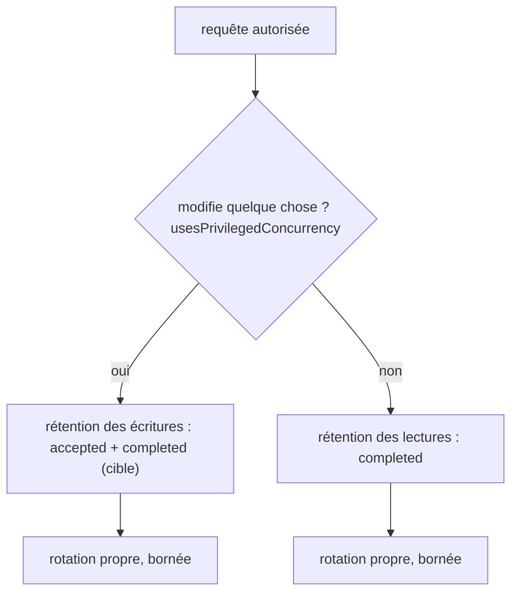

# Conception : empêcher qu'un flot de lectures chasse l'attribution du journal d'accès

## Contexte

- [EXISTANT VÉRIFIÉ] `RemoteAccessJournal.beside(identityFile, metrics)` ouvre un seul `RotatingOperationalLogFile`
  (`FILE_NAME`, `MAX_FILE_BYTES`, `KEPT_GENERATIONS`). `accepted(...)` n'écrit que pour une requête qui modifie quelque
  chose (`MorpheusRemoteHttpServer.usesPrivilegedConcurrency`) ; `completed(...)` écrit pour toute requête autorisée.
- [EXISTANT VÉRIFIÉ] `RotatingOperationalLogFile` (`com.morpheus.application.operability`) supprime la génération la
  plus ancienne à la rotation.
- [EXISTANT VÉRIFIÉ] ADR-0113 décide le journal (contenu, phases, refus `ACCESS_JOURNAL_UNAVAILABLE`, pas de route de
  lecture) ; son raisonnement sur les 401 nomme le risque de rotation sans l'appliquer à un principal authentifié.
- [EXISTANT VÉRIFIÉ] L'exigence existante « The journal SHALL be bounded, private and separate from the identity
  file » de `remote-access-journal` reste vraie dans toutes les options.

## Exigences couvertes

| Capacité | Exigence (titre exact) | Rubriques de conception qui y répondent |
|---|---|---|
| `remote-access-journal` | Un flot de lectures ne chasse pas l'enregistrement d'une écriture | D1 (option A), Persistance |
| `remote-access-journal` | Le risque de rotation du journal par un principal authentifié est écrit | D1, D2 |

La première exigence suit l'option recommandée. Si le mainteneur retient l'option C seule, elle est retirée du delta
avant l'implémentation (tâche 1.2) ; si l'option B est retenue, elle est remplacée par une exigence de borne de débit.

## Composants et frontières

`morpheus-api`, `com.morpheus.api.remote.RemoteAccessJournal` ; `RotatingOperationalLogFile` réutilisé tel quel (deux
instances). Les règles de `RemoteAccessJournalArchitectureTest` (le journal ne lit ni l'échange HTTP ni l'empreinte du
jeton) restent tenues.

## Modèle de domaine et invariants

Sans objet : aucun type du domaine.

## Traitements et interactions

Question : dans quelle rétention va chaque enregistrement (option A) ?

Existant : une seule rétention reçoit les deux flux, et le flux des lectures chasse celui des écritures.

## États et transitions

Sans objet.

## Contrats d'interface

Sans objet : le journal est un fichier lu par l'opérateur, sans route. Le nom des fichiers fait partie de ce que
l'opérateur collecte : un second fichier se documente dans le guide.

## Persistance et intégrité

[PROPOSITION] Option A : deux fichiers à côté du fichier d'identités, `morpheus-remote-access.jsonl` (lectures) et un
fichier des écritures (nom à fixer), chacun avec sa borne et ses générations, créés privés comme aujourd'hui. Le refus
`ACCESS_JOURNAL_UNAVAILABLE` d'une écriture porte sur le fichier des écritures ; une lecture reste servie si son fichier
ne peut être écrit.

## Transactions, concurrence et idempotence

Les deux enregistrements d'une même écriture (`accepted`, `completed`) vont dans le même fichier, pour que l'ordre des
phases se lise dans une seule suite de lignes.

## Sécurité et isolation

Le rôle READ ne peut plus effacer la trace d'une écriture (option A). Un principal WRITE peut encore faire tourner la
rétention des écritures par des écritures, elles-mêmes attribuées : c'est le résiduel que la documentation écrit.

## Gestion des erreurs et reprise

Inchangée : refus d'une écriture sans enregistrement `accepted`, lecture servie, perte comptée
(`remote.access.journal.lost`).

## Observabilité

Le compteur de perte reste unique ; [PROPOSITION] un détail par rétention si la revue le juge utile.

## Performance et stratégie de mesure

Sans objet : une écriture de ligne par requête, comme aujourd'hui.

## Compatibilité, migration et retour arrière

Un opérateur qui collecte `morpheus-remote-access.jsonl` doit collecter aussi le fichier des écritures : notes de
version et guide. Les générations existantes restent lisibles. Retour arrière : revenir à un fichier ; aucune donnée
perdue.

## Décisions

### D1 : parade au risque de rotation par un principal authentifié
- **Nature** : [QUESTION] — décision du mainteneur
- **Exigences servies** : les deux exigences de `remote-access-journal` ajoutées
- **Options** :
  - **A. Rétention séparée** des écritures et des actions d'administration.
  - **B. Borne de débit de lecture par principal** (refus `429` nommé au-delà) : protège le journal et l'API, mais
    ajoute un état par principal et un refus à des clients honnêtes.
  - **C. Risque documenté seulement** dans `SECURITY.md`, la collecte continue étant la seule garantie.
- **[PROPOSITION]** A, plus l'écrit de D2 : elle protège exactement ce que l'enquête cherche, sans refuser de lecture.
- **ADR** : ADR à proposer — un ADR consolidé qui remplace ADR-0113 si A ou B est retenue (la rétention fait partie de
  la décision du journal). Avec C, ADR-0113 est clarifié sans changer de sens. Jamais déclaré accepté ici.

### D2 : écrire le risque
- **Nature** : [DÉCISION]
- **Exigences servies** : `remote-access-journal` › Le risque de rotation du journal par un principal authentifié est écrit
- **Choix** : `SECURITY.md` (sous-section du journal d'accès) et `docs/user/TEAM_REMOTE_SERVER.md`.
- **Alternatives écartées** : ne l'écrire que dans l'ADR — l'opérateur lit `SECURITY.md`.
- **ADR** : non concerné.

## Écarts constatés

| Constat | Source A | Source B | Traitement proposé |
|---|---|---|---|
| ADR-0113 nomme le risque de rotation pour les 401 et le laisse ouvert pour un principal READ | ADR-0113 | `RemoteAccessJournal.completed` | D1 |

## Stratégie de vérification

| Exigence | Scénario | Preuve | État |
|---|---|---|---|
| Un flot de lectures ne chasse pas… | Des lectures en masse après une écriture | `RemoteAccessJournalTest#aFloodOfReadsDoesNotRotateAWayAWriteRecord` (bornes réduites par `open`) | à écrire |
| Un flot de lectures ne chasse pas… | La rétention des écritures reste bornée | `RemoteAccessJournalTest#theWriteRetentionRotatesWithinItsBound` | à écrire |
| Le risque de rotation… est écrit | L'opérateur lit la politique de sécurité | relecture ; `UserDocumentationSpeaksOfTheInstalledProductTest` | manuel · existant |
| (existante) Une écriture est consignée avant d'être servie | tous | `RemoteAccessJournalHttpTest` | existant |

## Documentation durable et diagrammes à mettre à jour

`docs/developer/specifications/remote-access-journal.md` (exigences, diagramme, traçabilité) ; `SECURITY.md` ;
`docs/user/TEAM_REMOTE_SERVER.md` ; notes de version de la version qui livre si un second fichier apparaît.

## Questions ouvertes

Aucune autre que D1, qui se tranche avant les tâches 2 et suivantes.
