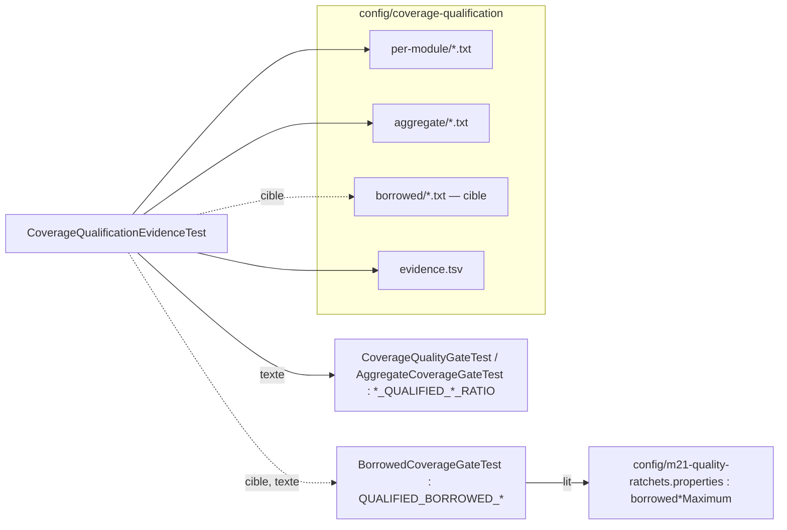

# Conception : conserver la preuve du crédit emprunté

## Contexte

- [EXISTANT VÉRIFIÉ] `BorrowedCoverageGateTest` (`morpheus-coverage-report`) tient `QUALIFIED_BORROWED_LINES`,
  `QUALIFIED_BORROWED_BRANCHES`, `MAXIMUM_MARGIN_LINES = 3L * 24L`, `MAXIMUM_MARGIN_BRANCHES = 3L * 11L` et
  `QUALIFIED_BY_MODULE` ; la mesure citée date du 30/10/2026 (`d3580dc9`, runs `41107774651` et `41107784162`). Il écrit
  `morpheus-architecture-tests/target/m21-borrowed-coverage-summary.txt` (`coverageScope=borrowed-credit`, totaux
  `borrowedLines` / `borrowedBranches`, une ligne par module), que `ci.yml` publie dans l'artefact `m21-integrity-<OS>`
  (`retention-days: 14`).
- [EXISTANT VÉRIFIÉ] `config/coverage-qualification/evidence.tsv` déclare huit résumés, échelles `per-module` et
  `aggregate`, tous à `dbd65062` (runs `42306627340`, `42311778667`, 07/11/2026). `CoverageQualificationEvidenceTest`
  compare les `*_QUALIFIED_*_RATIO` des deux gates de couverture à ces résumés en lisant le texte des gates (ligne 580)
  et exige une tête commune (exigence `coverage-qualification-evidence` › Every scale of a qualification SHALL be
  measured at the same head).
- [EXISTANT VÉRIFIÉ] Calcul sur les résumés conservés (somme agrégée moins somme par module, même population de seize
  modules) : 802 lignes sur les quatre runs ; 381, 383, 382, 383 branches. Le total par différence de sommes égale la
  somme des crédits par module tant qu'aucun module n'a de crédit négatif, ce que le gate refuse (exigence The
  measurement SHALL refuse two reports that do not describe the same code).
- [EXISTANT VÉRIFIÉ] `CoverageScaleSeparationTest` interdit au gate du crédit emprunté de lire les clés et preuves des
  échelles, et aux gates de couverture de lire celles du crédit ; `CoverageQualificationEvidenceTest` n'est pas un
  gate de couverture et lit déjà les deux échelles.

## Exigences couvertes

| Capacité | Exigence (titre exact) | Rubriques de conception qui y répondent |
|---|---|---|
| `coverage-attribution-gap` | The evidence of the qualified borrowed measurement SHALL be kept in the repository at the head of the coverage qualification | D1, D2 |
| `coverage-attribution-gap` | The qualified borrowed measurement SHALL equal the highest measurement of the kept evidence | D2, D3 |

## Composants et frontières

- `config/coverage-qualification/borrowed/<OS>-<run>.txt` (à créer) et quatre lignes `borrowed` dans `evidence.tsv`.
- `morpheus-architecture-tests/.../m21/CoverageQualificationEvidenceTest` et `CoverageQualificationVerifier` : lecture
  de l'échelle `borrowed`, tête commune, complétude, comparaison au plus haut.
- `morpheus-coverage-report/.../BorrowedCoverageGateTest` : constantes requalifiées, commentaire qui cite les preuves
  conservées au lieu des artefacts.
- Frontière tenue : `CoverageScaleSeparationTest` reste vert, le gate du crédit ne lit toujours aucune preuve des
  échelles.

## Traitements et interactions

Question : qui lit quelle preuve, et qui compare quoi ?

Traits pleins : existant. Traits pointillés : ce que le changement ajoute. Exigences : les deux du changement.

## Modèle de domaine et invariants

Sans objet.

## États et transitions

Sans objet.

## Contrats d'interface

Sans objet : aucune surface publique ; le format du résumé conservé est celui qu'écrit le gate, sans retouche.

## Persistance et intégrité

Les résumés sont recopiés tels qu'écrits par le gate (même règle que les deux échelles, `.claude/rules/testing.md`).

## Transactions, concurrence et idempotence

Sans objet.

## Sécurité et isolation

Sans objet.

## Gestion des erreurs et reprise

Si l'artefact des runs du 07/11/2026 a expiré avant l'application, la preuve à la tête commune n'existe plus : voir Q2.

## Observabilité

Sans objet.

## Performance et stratégie de mesure

La mesure qualifiée est la plus haute des résumés conservés, en lignes et en branches séparément (exigence existante
The maximum SHALL be qualified on the highest measurement of both platforms).

## Compatibilité, migration et retour arrière

La requalification fait monter la mesure qualifiée ; le maximum en vigueur reste dans sa fenêtre (au plus trois fois la
dispersion de référence au-dessus), à vérifier par le gate lui-même. Retour arrière : retirer le dossier et la
comparaison.

## Décisions

### D1 : conserver les résumés à côté des deux échelles
- **Nature** : [DÉCISION]
- **Exigences servies** : The evidence of the qualified borrowed measurement SHALL be kept in the repository at the
  head of the coverage qualification
- **Choix** : dossier `borrowed/` et lignes `borrowed` dans le même `evidence.tsv`, mêmes runs que la qualification en
  vigueur.
- **Alternatives écartées** : un manifeste séparé — deux manifestes à tenir à la même tête ; recalculer le crédit à
  partir des résumés des deux échelles — le total par différence ne donne pas le crédit par module de
  `QUALIFIED_BY_MODULE`.
- **Compromis** : la tête commune lie la troisième grandeur aux requalifications des deux échelles.
- **ADR** : GEN-0167 couvre la grandeur ; non concerné.

### D2 : la comparaison vit dans `CoverageQualificationEvidenceTest`
- **Nature** : [DÉCISION]
- **Exigences servies** : les deux exigences.
- **Choix** : lire `QUALIFIED_BORROWED_LINES` et `QUALIFIED_BORROWED_BRANCHES` dans le texte de
  `BorrowedCoverageGateTest`, comme les ratios des deux gates, et exiger l'égalité avec le plus haut des résumés.
- **Alternatives écartées** : faire lire les preuves par `BorrowedCoverageGateTest` — il lui faudrait `evidence.tsv` et
  la tête des échelles, ce que `CoverageScaleSeparationTest` refuse à juste titre.
- **Compromis** : une constante renommée casse la lecture ; le refus nomme la constante attendue.
- **ADR** : non concerné.

### D3 : le maximum ne monte pas
- **Nature** : [DÉCISION]
- **Exigences servies** : The qualified borrowed measurement SHALL equal the highest measurement of the kept evidence
- **Choix** : la requalification ne touche pas `borrowed*CreditMaximum` ; sa baisse relève de Q1.
- **Alternatives écartées** : relever le maximum au sommet de la nouvelle fenêtre — interdit (« ne fait que baisser »,
  GEN-0167).
- **Compromis** : aucun.
- **ADR** : GEN-0167.

## Écarts constatés

| Constat | Source A | Source B | Traitement proposé |
|---|---|---|---|
| Mesure qualifiée codée sous la mesure impliquée par les preuves conservées | `BorrowedCoverageGateTest.java:72-73` (801 / 380) | résumés du 07/11 (802 / 383) | requalification, tâche 2.3 |
| Commentaire de la constante cite des artefacts expirés | `BorrowedCoverageGateTest.java:60-65` | `retention-days: 14` | commentaire réécrit sur les preuves conservées |

## Stratégie de vérification

| Exigence | Scénario | Preuve | État |
|---|---|---|---|
| The evidence … kept … at the head | The borrowed evidence outlives the workflow artifact | `CoverageQualificationEvidenceTest#theBorrowedCreditIsQualifiedOnKeptEvidenceAtTheHeadOfBothScales` | à écrire |
| idem | Borrowed evidence at another head is refused ; A coverage summary filed as borrowed evidence ; Incomplete borrowed evidence | cas fabriqués de la même classe (sur le modèle des cas existants des deux échelles) | à écrire |
| The qualified borrowed measurement SHALL equal the highest … | A qualified measurement under the kept evidence ; on the lowest platform | cas fabriqués, `CoverageQualificationEvidenceTest` | à écrire |
| idem | The requalified measurement passes | même méthode sur le dépôt réel, `BorrowedCoverageGateTest` vert sous `./mvnw verify` | à écrire |

## Documentation durable et diagrammes à mettre à jour

`docs/developer/specifications/coverage-attribution-gap.md` (exigences, diagramme ci-dessus, traçabilité) ;
`docs/developer/specifications/coverage-qualification-evidence.md` (mention du dossier `borrowed/`) ;
`.claude/rules/testing.md` (paragraphe « Le crédit emprunté »), à relire par le mainteneur.

## Questions ouvertes

### Q1 : abaisser le maximum
- **Nature** : [QUESTION] — décision du mainteneur, qui ne change ni les specs ni l'approche.
- **Options** : (a) laisser le maximum à sa valeur actuelle de `config/m21-quality-ratchets.properties`, qui reste
  dans la fenêtre de la nouvelle mesure ; (b) l'abaisser à la mesure qualifiée plus trois fois la dispersion observée
  dans les preuves conservées ; (c) l'abaisser à une marge intermédiaire.
- **[PROPOSITION]** (a). La marge de trois fois la dispersion de référence est celle que GEN-0167 retient et celle des
  ratchets de couverture ; l'audit la trouve large, mais la resserrer sur une dispersion observée de zéro ligne ferait
  échouer une variation ordinaire.

### Q2 : si l'artefact du 07/11/2026 a expiré
- **Nature** : [QUESTION] — décision du mainteneur, qui change les tâches du groupe 2.
- **Options** : (a) requalifier les trois grandeurs à une tête nouvelle (deux runs par plateforme) ; (b) conserver la
  preuve du crédit à sa propre tête, ce qui retire de l'exigence la tête commune.
- **[PROPOSITION]** (a), seule compatible avec l'exigence `coverage-qualification-evidence` › Every scale of a
  qualification SHALL be measured at the same head.
