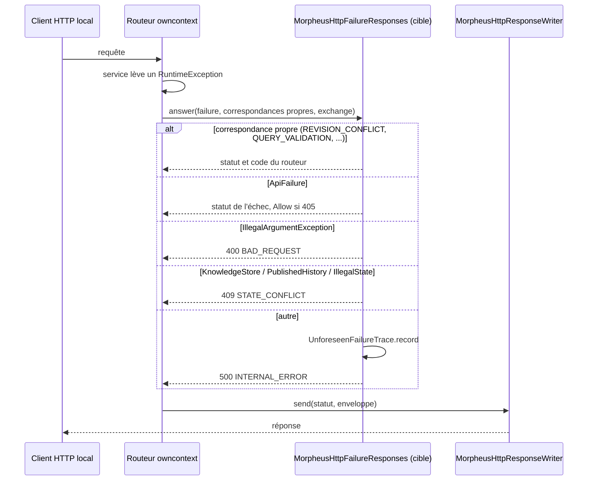

# Conception : rendre chaque échec HTTP par une seule table de correspondance (AUD-QUA-30)

## Contexte

- [EXISTANT VÉRIFIÉ] `MorpheusHttpServer.handle` (`com.morpheus.api.local`) attrape dans l'ordre `ApiFailure` (pose
  `Allow` sur un 405), `IllegalArgumentException` → 400 `BAD_REQUEST`, `KnowledgeStoreException |
  PublishedHistoryException | IllegalStateException` → 409 `STATE_CONFLICT`, `RuntimeException` →
  `UnforeseenFailureTrace.record` puis 500 `INTERNAL_ERROR` « internal MORPHEUS API error ». Il écrit par sa méthode
  privée `send`.
- [EXISTANT VÉRIFIÉ] Les quatre routeurs de `com.morpheus.api.routes.owncontext` recopient cette échelle dans leur
  `handle`, sans `PublishedHistoryException`, et écrivent par `MorpheusHttpResponseWriter`. Ils ajoutent en tête :
  `PolicyConflictException` → 409 `REVISION_CONFLICT` (policy, policy management) ; `QueryValidationException` → 400
  `QUERY_VALIDATION`, `QueryExportBudgetException` → 400 `QUERY_BUDGET_EXCEEDED`, `SavedViewConflictException` → 409
  `REVISION_CONFLICT` (query). Le routeur de raisonnement rend `IllegalArgumentException` en 400
  `REASONING_VALIDATION`, n'a pas de branche 409 et nomme son 500 « internal MORPHEUS reasoning error ».
- [EXISTANT VÉRIFIÉ] `QueryExportBudgetException` et `SavedViewConflictException` étendent `IllegalStateException`, et
  `QueryValidationException` étend `IllegalArgumentException` : l'ordre « propre puis commun » est porteur de sens.
- [EXISTANT VÉRIFIÉ] `HttpRoutesTransportBoundaryArchitectureTest` exige que les routeurs du groupe `owncontext`
  dépendent de `MorpheusHttpResponseWriter` et de `MorpheusHttpRequestDecoder`, et interdit le writer aux deux autres
  groupes ; `ApiServicesAndTransportPackagesArchitectureTest` interdit à `com.morpheus.api.transport` de dépendre d'un
  autre paquet de l'adaptateur.
- [EXISTANT VÉRIFIÉ] `ExtensionRoutesResponseWritingParityTest` fige octet pour octet les réponses des quatre routeurs
  et consigne, dans sa Javadoc, les branches non exercées (les quatre 500, deux `STATE_CONFLICT`,
  `QUERY_BUDGET_EXCEEDED`).
- [EXISTANT VÉRIFIÉ] Le texte d'un échec passe par `BoundaryFailureMessage.safe` (`http-failure-disclosure`) ; celui
  d'un `ApiFailure` est écrit par MORPHEUS et relayé tel quel.

## Exigences couvertes

| Capacité | Exigence (titre exact) | Rubriques de conception qui y répondent |
|---|---|---|
| `http-failure-status-mapping` | Every handler of the local HTTP adapter SHALL answer a failure of the common family with the same status and code | D1, D2, D3 |
| `http-failure-status-mapping` | A router SHALL name its own failures before the common family, and only there | D1 |
| `http-failure-status-mapping` | The build SHALL refuse a handler of the HTTP adapter that maps a failure to a status by itself | D4 |

## Composants et frontières

| Composant | Responsabilité | Frontière |
|---|---|---|
| `MorpheusHttpFailureResponses` (à créer, `com.morpheus.api.transport`) | décide `(statut, ApiErrorEnvelope, Allow?)` pour un `RuntimeException`, avec les correspondances propres reçues en tête ; trace un échec imprévu | ne dépend que de `transport` et de l'application (`KnowledgeStoreException`, `PublishedHistoryException`, `OperationalRecorder`) : `ApiServicesAndTransportPackagesArchitectureTest` |
| `MorpheusHttpServer` | appelle la table puis écrit par sa `send` | inchangé dans son rôle |
| quatre routeurs `owncontext` | déclarent leurs correspondances propres, appellent la table, écrivent par `MorpheusHttpResponseWriter` | la règle de groupe exige toujours le writer |

La table **décide** et n'écrit pas : elle ne dépend pas de `HttpExchange` pour écrire, seulement pour lire le chemin
brut d'un 405 par `MorpheusHttpAllowedMethods`. Elle reste ainsi utilisable par le serveur local, qui n'écrit pas par
le writer partagé.

## Traitements et interactions

Question : comment un échec levé sous un routeur devient-il une réponse, avant et après ?

Le diagramme décrit la cible ; aujourd'hui, chaque routeur porte lui-même toutes les branches du `alt`. Exigences :
les trois de `http-failure-status-mapping`.

Sans objet : États et transitions (aucun cycle de vie), Persistance et intégrité (aucune donnée), Transactions
(aucune portée nouvelle).

## Contrats d'interface

L'enveloppe d'erreur et l'énumération des codes sont dans `docs/developer/reference/openapi/morpheus-v1.yaml`
(`ApiError.code`) ; elles ne changent pas. Le texte d'un 500 n'y est pas contractualisé (voir D3).

## Sécurité et isolation

Le 500 ne relaie jamais le texte d'un échec imprévu ; le texte relayé des autres branches reste filtré par
`BoundaryFailureMessage.safe`. La table ne change pas ce qui est divulgué.

## Observabilité

Un échec imprévu reste compté une fois dans `SuppressedFailureFamily.HTTP_INTERNAL_ERROR`, par
`UnforeseenFailureTrace.record`, appelé par la table seule côté local.

## Compatibilité, migration et retour arrière

Aucune réponse d'une requête servie aujourd'hui ne change, à deux exceptions de branches non atteintes : une
`PublishedHistoryException` sous un routeur et un conflit d'état sous le routeur de raisonnement passent de 500 à 409
(D2). Retour arrière : rétablir les échelles locales, sans perte de donnée.

## Décisions

### D1 : une table qui décide, des correspondances propres en tête
- **Nature** : [DÉCISION]
- **Exigences servies** : `http-failure-status-mapping` › Every handler of the local HTTP adapter SHALL answer a failure of the common family with the same status and code ; › A router SHALL name its own failures before the common family, and only there
- **Choix** : `MorpheusHttpFailureResponses` (à créer) prend une liste ordonnée de correspondances propres
  (type d'exception, statut, code) puis applique la famille commune ; elle rend la décision, l'appelant écrit.
- **Alternatives écartées** : une classe de base des routeurs (héritage : le serveur local n'en hériterait pas) ;
  une table qui écrit elle-même (le serveur local écrit par sa propre `send`, et le writer est interdit hors du groupe
  `owncontext`) ; une `Map` de types (l'ordre de sous-typage doit être explicite).
- **Compromis** : les routeurs gardent un `try/catch (RuntimeException)` d'une ligne qui délègue.
- **ADR** : non concerné (mécanisme interne de l'adaptateur ; ARCH-0155 fixe déjà le paquet `transport`).

### D2 : la famille commune est la même partout, `PublishedHistoryException` comprise
- **Nature** : [DÉCISION]
- **Exigences servies** : `http-failure-status-mapping` › Every handler of the local HTTP adapter SHALL answer a failure of the common family with the same status and code
- **Choix** : la famille commune est celle du serveur local, la plus complète ; les routeurs et le routeur de
  raisonnement la reçoivent entière.
- **Alternatives écartées** : garder une famille par gestionnaire (c'est le défaut constaté) ; retirer
  `PublishedHistoryException` du serveur local (casserait les 409 de l'historique publié).
- **Compromis** : deux branches aujourd'hui inatteignables changent de statut (voir Compatibilité).
- **ADR** : non concerné.

### D3 : le texte du 500 du routeur de raisonnement
- **Nature** : [QUESTION]
- **Exigences servies** : `http-failure-status-mapping` › Every handler of the local HTTP adapter SHALL answer a failure of the common family with the same status and code
- **Options** : (A) un seul texte, « internal MORPHEUS API error », pour tous les gestionnaires ; (B) la table accepte
  un texte de 500 propre au routeur et le raisonnement garde le sien.
- **[PROPOSITION]** : A. Le texte d'un 500 n'est pas dans l'OpenAPI, la branche n'est atteinte par aucune requête
  (Javadoc d'`ExtensionRoutesResponseWritingParityTest`), et B garderait une divergence que rien ne justifie.
- **ADR** : non concerné.

### D4 : la règle qui garde la table seule
- **Nature** : [DÉCISION]
- **Exigences servies** : `http-failure-status-mapping` › The build SHALL refuse a handler of the HTTP adapter that maps a failure to a status by itself
- **Choix** : une règle ArchUnit sur le bytecode, dans `morpheus-architecture-tests`, refuse hors de la table tout
  appel de `UnforeseenFailureTrace.record` dans `morpheus-api`, et tout bloc `catch` de `KnowledgeStoreException`,
  `PublishedHistoryException` ou `IllegalStateException` dans une classe de `com.morpheus.api.local` ou
  `com.morpheus.api.routes`. Le serveur distant est l'exemption nommée, avec sa raison (façade, writer distant). La
  règle est livrée avec la trace de sa violation plantée (Javadoc), et une table de faits de ses exemptions, exacte
  dans les deux sens.
- **Alternatives écartées** : un interdit textuel du littéral `"STATE_CONFLICT"` (une constante l'esquive, et
  `ApiFailure.conflict` l'écrit légitimement) ; aucune règle (la recopie reviendrait au prochain routeur).
- **Compromis** : la lecture des blocs `catch` par ArchUnit a des pièges connus (try-with-resources, lambdas) ; la
  méthode plantée les couvre.
- **ADR** : non concerné ; la table d'exemptions n'est pas énoncée par un ADR.

## Écarts constatés

| Constat | Source A | Source B | Traitement proposé |
|---|---|---|---|
| `PublishedHistoryException` → 409 en local seulement | `MorpheusHttpServer.handle` | quatre routeurs | D2 |
| Raisonnement sans 409, 500 nommé autrement | `MorpheusReasoningHttpRoutes.handle` | autres gestionnaires | D2, D3 |
| Branches 409 et 500 non exercées | Javadoc d'`ExtensionRoutesResponseWritingParityTest` | critère de sortie du sprint 9 | test unitaire de la table (tâche 1.1) ; la Javadoc est corrigée |

## Stratégie de vérification

| Exigence | Scénario | Preuve | État |
|---|---|---|---|
| Every handler … same status and code | les quatre | `MorpheusHttpFailureResponsesTest` (une méthode par branche) | à écrire |
| idem | conflit d'historique sous un routeur | `MorpheusHttpFailureResponsesTest`, et un cas dans `ExtensionRoutesResponseWritingParityTest` | à écrire |
| idem | non-régression octet pour octet | `ExtensionRoutesResponseWritingParityTest`, `ExtensionRoutesRequestBoundaryParityTest` inchangés | existant |
| A router SHALL name its own failures … | les trois | `MorpheusHttpFailureResponsesTest` (ordre propre puis commun, sous-types) et tests existants des routeurs | à écrire / existant |
| The build SHALL refuse … | les deux | `HttpFailureStatusMappingArchitectureTest` et sa violation plantée | à écrire |

## Documentation durable et diagrammes à mettre à jour

`docs/developer/specifications/http-failure-status-mapping.md` (à créer, gabarit de
`docs/developer/specifications/README.md`, ligne ajoutée à la section « Frontière HTTP locale et distante » de l'index) ;
`docs/developer/API.md` (tableau des codes d'erreur) relu ; `.claude/rules/architecture.md` si la règle ajoutée y est
citée parmi les règles de l'adaptateur HTTP.

## Questions ouvertes

D3 attend le mainteneur ; elle ne change ni l'approche ni les autres tâches.
