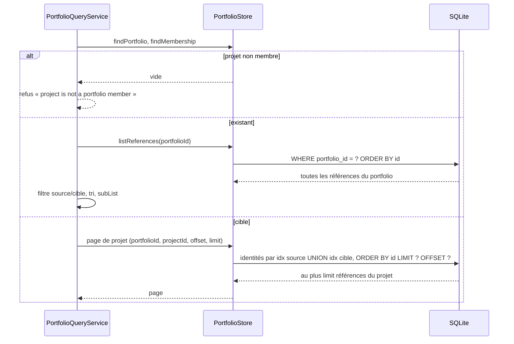
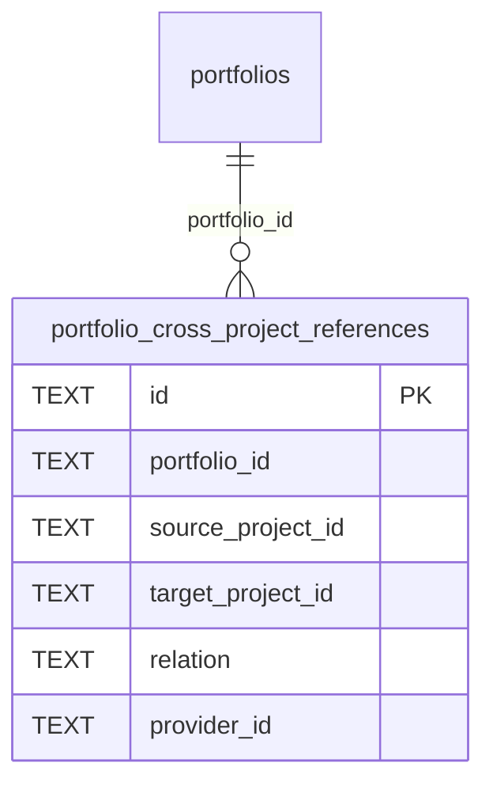

# Conception : paginer les références d'un portfolio dans le store

Motivation : voir proposal.md, section Why. Conception complète : port de persistance, deux stores, une migration et
un ordre visible sur trois transports.

## Contexte

- [EXISTANT VÉRIFIÉ] `PortfolioStore` (paquet `com.morpheus.application.store`) n'offre pour les références que
  `putReference`, `findReference(id)`, `listReferences(portfolioId)`, `outgoing` et `incoming`.
- [EXISTANT VÉRIFIÉ] Consommateurs de `listReferences` en production : `PortfolioQueryService.overview` (compte et
  conflits), `references` (page par `subList`), `projectReferences` (filtre source ou cible, tri naturel, page),
  `conflicts` ; `PortfolioRegistryService.addReference` (dédoublonnage sur clé sémantique, provider, localisateur,
  preuve) ; `QueryExecutionService` (entité `PORTFOLIO_REFERENCE`, budget vérifié après lecture complète).
- [EXISTANT VÉRIFIÉ] `SqlitePortfolioStore.listReferences` : `WHERE portfolio_id = ? ORDER BY id` ; index existants
  `idx_portfolio_reference_source (portfolio_id, source_project_id, source_entity_type, source_entity_id)` et
  `idx_portfolio_reference_target (portfolio_id, target_project_id, target_entity_type, target_entity_id)` (`V013`) ;
  aucun ne sert l'ordre `id` sous `portfolio_id`, d'où le B-tree temporaire relevé par l'audit.
- [EXISTANT VÉRIFIÉ] `MemoryPortfolioStore.listReferences` trie par `CrossProjectReference.compareTo` (clé sémantique,
  puis provider, puis identité) : les deux stores ne rendent pas le même ordre en portée portfolio. La portée projet
  trie en Java par le même ordre naturel dans les deux.
- [EXISTANT VÉRIFIÉ] `CrossProjectReference.semanticKey` concatène projet, type d'entité, identité d'entité, relation,
  projet, type et identité cibles, séparés par `|` ; type et relation sont de longueur variable, donc l'ordre de cette
  chaîne n'est pas celui d'un tri colonne à colonne (`"ab"` précède `"a|"`).
- [EXISTANT VÉRIFIÉ] `CrossProjectReferenceId` est un UUIDv7 généré à l'ajout : l'ordre d'identité est l'ordre
  d'observation, et le texte minuscule d'un UUIDv7 trie comme l'identité (même propriété que celle qu'invoque
  `SqlitePolicyPackStore` pour `policy_audit`).
- [EXISTANT VÉRIFIÉ] `PortfolioQueryService.MAX_PAGE_SIZE` borne la limite ; `QueryBudgets.MAX_SOURCE_ROWS` borne la
  source d'une requête DSL ; le refus porte le code `QUERY_SOURCE_BUDGET_EXCEEDED`.
- [EXISTANT VÉRIFIÉ] L'OpenAPI M23 (`listPortfolioReferences`) déclare `projectId`, `Offset` et `Limit`, et ne dit rien
  de l'ordre.
- [EXISTANT VÉRIFIÉ] Précédent : `requirement-page-reads` (page découpée par le port, ordre total, parité, garde de
  plan) pour `AUD-PRF-05` de l'audit du 09/10/2026.

## Exigences couvertes

| Capacité | Exigence (titre exact) | Rubriques de conception qui y répondent |
|---|---|---|
| `portfolio-reference-reads` | Une page de références d'un portfolio est découpée par le store | D2, D3, Persistance |
| `portfolio-reference-reads` | Une page de références suit un ordre déclaré et total | D1, D3 |
| `portfolio-reference-reads` | Le compte et les conflits d'un portfolio sont calculés par le store | D5 |
| `portfolio-reference-reads` | Un ajout de référence se dédoublonne par une recherche ciblée | D4 |
| `portfolio-reference-reads` | La requête de portée portfolio sur les références lit au plus son budget plus une ligne | D6 |
| `portfolio-reference-reads` | Chaque store livré répond identiquement aux lectures de références | D2, D1 |

## Composants et frontières

| Composant | Paquet | Changement |
|---|---|---|
| `PortfolioStore` | `com.morpheus.application.store` | lectures ajoutées (D2) ; `listReferences` sort des chemins de production |
| `PortfolioQueryService` | `com.morpheus.application.portfolio` | page, page de projet, vue d'ensemble, conflits par le port |
| `PortfolioRegistryService` | `com.morpheus.application.portfolio` | dédoublonnage par recherche ciblée |
| `QueryExecutionService` | `com.morpheus.application.query.dsl` | lecture bornée des références |
| `MemoryPortfolioStore` | `com.morpheus.store.memory` | implémentations, ordre d'identité |
| `SqlitePortfolioStore` | `com.morpheus.store.sqlite.adapter` | requêtes nommées, gardées par le plan |

Aucune frontière ne bouge (`LayerDependencyTest`, `AdapterSiblingArchitectureTest`). `SqliteOperationRuntime` construit
déjà `SqlitePortfolioStore` : aucune arête runtime → adaptateur nouvelle (changement
`bound-the-runtime-to-adapter-edges-of-the-sqlite-store`).

## Modèle de domaine et invariants

Sans objet : `CrossProjectReference` et son ordre naturel ne changent pas ; l'ordre naturel reste celui des conflits.

## Traitements et interactions

Question : que fait le store pour une page de portée projet, avant et après ?

La page de portée portfolio suit le même déroulé, servie par l'index ajouté sans tri. Exigences : « Une page de
références d'un portfolio est découpée par le store », « Une page de références suit un ordre déclaré et total ».

## États et transitions

Sans objet.

## Contrats d'interface

- Routes, outils et commandes inchangés : `portfolio.references`, `portfolio.overview`, `portfolio.conflicts`,
  `portfolio.reference-add`, `query.execute` de `contracts/public-surfaces.tsv` ; aucune ligne ne change.
- `docs/developer/reference/openapi/morpheus-v1-portfolio-m23.yaml`, opération `listPortfolioReferences` : une
  `description` ajoutée qui énonce l'ordre retenu (D1) ; aucun paramètre, aucune borne. La remote M26 ne décrit que la
  route (même texte à ajouter si elle porte une description). `PublicHttpRouteConvergenceTest` reste vert : méthode et
  chemin inchangés.
- Refus inchangés : `project is not a portfolio member: …`, `limit must be between 1 and …`,
  `offset must be non-negative`, `unknown portfolio: …`, `QUERY_SOURCE_BUDGET_EXCEEDED`.

## Persistance et intégrité

Question : quelles lectures la table sert-elle, et par quel index ?

| Lecture | Requête (forme) | Index | État |
|---|---|---|---|
| page de portefeuille | `WHERE portfolio_id = ? ORDER BY id LIMIT ? OFFSET ?` | `(portfolio_id, id)` | à ajouter par migration |
| page de projet | identités `UNION` par source et par cible, puis `ORDER BY id LIMIT ? OFFSET ?` | `idx_portfolio_reference_source`, `idx_portfolio_reference_target` ; tri temporaire borné aux références du projet, excusé avec sa raison dans la garde | existants |
| compte | `SELECT COUNT(*) WHERE portfolio_id = ?` | `(portfolio_id, id)` | à ajouter |
| conflits | groupes `(source…, relation)` ayant plus d'une cible distincte, puis leurs références | `idx_portfolio_reference_source` | existant |
| dédoublonnage | égalité sur toutes les colonnes de l'observation, `IS ?` pour les colonnes facultatives | `idx_portfolio_reference_source` | existant |

- Migration ajoutée, au numéro qui suit la dernière migration présente lors de l'application : `CREATE INDEX` de
  `(portfolio_id, id)` (nom proposé `idx_portfolio_reference_order`), avec un commentaire qui dit les lectures servies.
  L'index ne répète les colonnes de tête d'aucun autre (`sqlite-index-coverage` › The migrated schema SHALL hold no
  index that repeats the leading columns of another).
- `SUPPORTED_SCHEMA_VERSION` avance ; le guide de mise à niveau le plus récent nomme la migration. La version courante
  du réacteur porte déjà un schéma au-delà de la dernière version publiée : pas de passage de version, sauf si cette
  version a été publiée avant l'application (alors lot indivisible de passage, hors de ce changement).
- Parité : `MemoryPortfolioStore` implémente chaque lecture et trie par identité.

## Transactions, concurrence et idempotence

- Chaque lecture est une instruction ; la page et le compte de la vue d'ensemble sont lus dans la même opération
  (une portée, une connexion, ARCH-0162).
- Le dédoublonnage reste « chercher puis écrire » sans verrou : deux ajouts concurrents de la même observation peuvent
  écrire deux lignes, comme aujourd'hui (D4).

## Sécurité et isolation

Sans objet : aucune donnée nouvelle n'est exposée ; la projection distante des références est inchangée.

## Gestion des erreurs et reprise

Erreurs nommées inchangées ; une erreur SQL lève `KnowledgeStoreException` avec le message de la lecture, comme les
lectures existantes du store.

## Observabilité

Sans objet.

## Performance et stratégie de mesure

- Le budget de la page de références d'un portfolio est déclaré et mesuré sur le code non corrigé par le changement
  `budget-orchestration-quality-policy-and-portfolio-reads` (`AUD-PRF-30`), avant celui-ci
  (`performance-budget-coverage` › A cost a correction claims to bound SHALL have a budget declared before the
  correction). Ce changement ne fixe aucun chiffre.
- Preuves structurelles : garde de plan sur chaque requête nommée ; test de coût du service (le double de store refuse
  `listReferences` et compte les références remises).

## Compatibilité, migration et retour arrière

- **Ordre visible** : avec l'option recommandée (D1), la portée projet passe de l'ordre sémantique à l'ordre
  d'identité sur HTTP, MCP et CLI ; la portée portfolio garde l'ordre que le store SQLite rend déjà. Aucun champ ne
  change. À annoncer dans les notes de la version qui porte le changement.
- Données : aucune ligne modifiée ; la migration ajoute un index.
- Retour arrière : pas de migration descendante ; la copie de pré-migration reste le chemin documenté.

## Décisions

### D1 : l'ordre d'une page de références
- **Nature** : [QUESTION] — décision du mainteneur
- **Exigences servies** : `portfolio-reference-reads` › Une page de références suit un ordre déclaré et total ;
  `portfolio-reference-reads` › Chaque store livré répond identiquement aux lectures de références
- **Options** :
  - **Ordre d'identité partout** (ordre d'observation) : servi par un index `(portfolio_id, id)`, total, déjà rendu par
    le store SQLite en portée portfolio. Change l'ordre de la portée projet.
  - **Ordre sémantique partout** (ordre naturel de `CrossProjectReference`) : garde l'ordre de la portée projet, mais
    un tri SQL colonne à colonne ne le reproduit pas ; il faudrait une colonne de clé sémantique persistée, remplie par
    migration pour les lignes existantes, et un index sur elle. Change l'ordre de la portée portfolio côté SQLite.
  - **Ordre propre à chaque portée** : deux ordres à documenter pour une même ressource.
- **[PROPOSITION]** Ordre d'identité partout : le moins coûteux, total, et déjà l'ordre de la portée portfolio en
  production.
- **Compromis** : l'ordre de la portée projet change pour les clients ; l'OpenAPI l'énonce.
- **ADR** : non concerné (ordre de pagination d'une route, réversible sans perte de données) ; la spec et l'OpenAPI le
  fixent.

### D2 : des lectures dédiées dans le port, implémentées par chaque store
- **Nature** : [DÉCISION]
- **Exigences servies** : « Une page de références d'un portfolio est découpée par le store », « Chaque store livré
  répond identiquement aux lectures de références »
- **Choix** : page de portfolio, page de projet, compte, références en conflit, recherche d'une observation, en
  méthodes abstraites de `PortfolioStore` ; les doubles de test qui l'implémentent les reçoivent. `listReferences`
  reste au port tant qu'un test l'emploie, et aucun chemin de production ne l'appelle (vérifié par la revue et par le
  test de coût du service).
- **Alternatives écartées** : une méthode générique de critères — surface plus large que les cinq usages ; un repli par
  défaut sur `listReferences` — il rendrait silencieusement la lecture complète à un store qui l'oublie.
- **Compromis** : quatre doubles de test de `morpheus-application` à compléter.
- **ADR** : non concerné.

### D3 : la page de projet par union d'index, triée sur les seules références du projet
- **Nature** : [DÉCISION]
- **Exigences servies** : « Une page de références d'un portfolio est découpée par le store »
- **Choix** : union des identités trouvées par l'index source et par l'index cible, puis tri par identité et
  `LIMIT/OFFSET`. Le tri temporaire porte sur les références du projet, pas du portfolio ; la garde l'excuse avec cette
  raison (`sqlite-index-coverage` › A guarded read MUST fail the build when its plan gains a table scan or a temporary
  sort).
- **Alternatives écartées** : `source_project_id = ? OR target_project_id = ?` sur l'index d'ordre — parcourt tout le
  portfolio ; deux index de plus `(portfolio_id, source_project_id, id)` et `(portfolio_id, target_project_id, id)` —
  supprimeraient le tri mais pas l'union, pour deux B-trees de plus à chaque ajout.
- **Compromis** : un tri borné par le volume d'un projet.
- **ADR** : non concerné.

### D4 : dédoublonner par une recherche ciblée, sans contrainte d'unicité
- **Nature** : [DÉCISION]
- **Exigences servies** : « Un ajout de référence se dédoublonne par une recherche ciblée »
- **Choix** : une lecture par égalité sur toutes les colonnes de l'observation, servie par l'index source.
- **Alternatives écartées** : une contrainte `UNIQUE` (que l'audit cite comme option) — une base peut porter des
  doublons écrits par deux ajouts concurrents, et la migration échouerait chez l'opérateur ; elle changerait aussi le
  comportement d'un ajout concurrent (refus au lieu de doublon), décision qui sort du constat.
- **Compromis** : la course de deux ajouts identiques reste possible (question ouverte).
- **ADR** : non concerné.

### D5 : compte et conflits calculés par la base
- **Nature** : [DÉCISION]
- **Exigences servies** : « Le compte et les conflits d'un portfolio sont calculés par le store »
- **Choix** : `COUNT(*)` pour la vue d'ensemble ; pour les conflits, une agrégation qui ne retient que les groupes
  `(source, relation)` à plusieurs cibles distinctes, puis la lecture de leurs références ; le service garde le
  regroupement et le tri par ordre naturel.
- **Alternatives écartées** : laisser les conflits en mémoire — la vue d'ensemble relirait encore toute la table.
- **Compromis** : l'agrégation lit l'index sur tout le portfolio, sans matérialiser les références en Java.
- **ADR** : non concerné.

### D6 : la requête DSL lit le budget plus une référence
- **Nature** : [DÉCISION]
- **Exigences servies** : « La requête de portée portfolio sur les références lit au plus son budget plus une ligne »
- **Choix** : la page de portfolio avec décalage 0 et limite `MAX_SOURCE_ROWS + 1`, puis le refus existant ; le tri
  naturel des lignes rendues est inchangé.
- **Alternatives écartées** : un compte préalable — une requête de plus pour la même décision.
- **Compromis** : aucun.
- **ADR** : non concerné.

## Écarts constatés

| Constat | Source A | Source B | Traitement proposé |
|---|---|---|---|
| Les deux stores ne rendent pas `listReferences` dans le même ordre ; la page de portée portfolio diffère donc entre eux | `MemoryPortfolioStore.listReferences` | `SqlitePortfolioStore.listReferences` | D1 aligne les deux stores |
| L'audit propose une contrainte `UNIQUE` sur la clé sémantique | `docs/project/audits/2026-11-17/findings.md`, `AUD-PRF-25` | doublons possibles dans une base existante | D4 : recherche sans contrainte |
| L'audit ne cite pas les conflits dans son action, mais les cite dans sa preuve (vue d'ensemble, conflits) | audit, action | audit, preuve | D5 les inclut, sans quoi la vue d'ensemble relit toute la table |
| Aucun ordre n'est écrit dans l'OpenAPI de la route | `morpheus-v1-portfolio-m23.yaml` | comportement des stores | description ajoutée |

## Stratégie de vérification

| Exigence | Scénario | Preuve | État |
|---|---|---|---|
| Une page de références d'un portfolio est découpée par le store | Une page d'un grand portfolio | test de coût à écrire dans `morpheus-application` (`PortfolioQueryServiceTest` ou voisin) : double qui refuse `listReferences` | à écrire |
| idem | Une page restreinte à un projet | test de service et test de store SQLite à écrire | à écrire |
| idem | Un projet qui n'est pas membre | test existant du service, relu après le changement | existant |
| idem | Une limite hors bornes | test existant du service | existant |
| idem | Le plan de la page SQLite | `SqliteQueryPlanGuardTest`, entrées ajoutées (page de portfolio servie ; page de projet avec excuse) | à écrire |
| Une page de références suit un ordre déclaré et total | Les pages d'une lecture partitionnent ses références | test de parité à écrire | à écrire |
| idem | Un décalage au-delà du total | même test | à écrire |
| Le compte et les conflits d'un portfolio sont calculés par le store | La vue d'ensemble d'un grand portfolio sans conflit | test de coût du service à écrire | à écrire |
| idem | Deux observations contradictoires | `PortfolioIntelligenceContractTest` (M23), relu ; cas de parité | existant · à compléter |
| Un ajout de référence se dédoublonne par une recherche ciblée | Une observation déjà enregistrée | `PortfolioRegistryServiceTest`, cas à compléter avec un double qui refuse `listReferences` | à compléter |
| idem | Une observation qui diffère par sa preuve | `PortfolioRegistryServiceTest`, cas à écrire | à écrire |
| La requête de portée portfolio sur les références lit au plus son budget plus une ligne | Un portfolio au-delà du budget | `QuerySourceBudgetTest`, cas qui compte la limite demandée au store | à compléter |
| idem | Un portfolio sous le budget | `QueryExecutionContractTest` (M24) | existant |
| Chaque store livré répond identiquement aux lectures de références | Parité sur un portfolio difficile | test de parité à écrire, à côté de `PortfolioPersistenceParityTest` (M23) | à écrire |

## Documentation durable et diagrammes à mettre à jour

- `docs/developer/specifications/portfolio-reference-reads.md` à créer (gabarit de
  `docs/developer/specifications/README.md`), avec les deux diagrammes ci-dessus, indexée dans la section
  « Persistance SQLite et stores » du README.
- Guide de mise à niveau le plus récent de `docs/user/` : migration et schéma atteint.
- `docs/developer/reference/openapi/morpheus-v1-portfolio-m23.yaml` : description de l'ordre.

## Questions ouvertes

- D1 se tranche avant l'application (elle change la spec si l'ordre sémantique est retenu).
- [QUESTION] Les doublons qu'un ajout concurrent peut écrire (D4) appellent-ils leur propre changement ? Ils
  n'affectent pas celui-ci.
