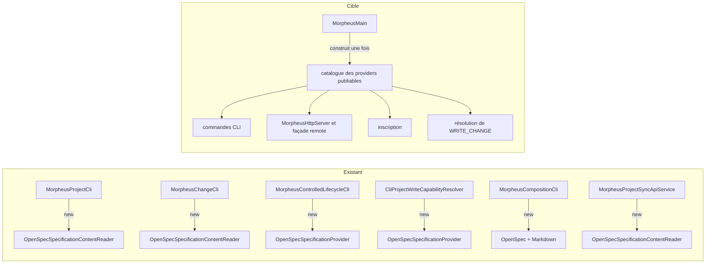
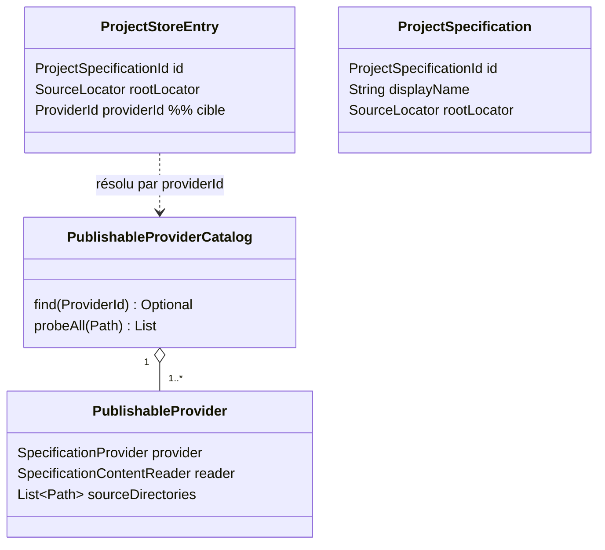
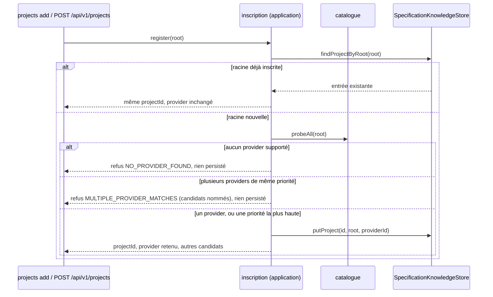
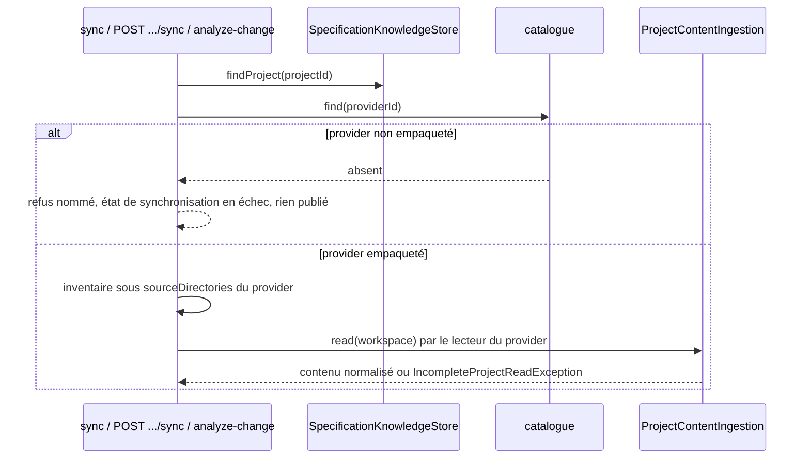
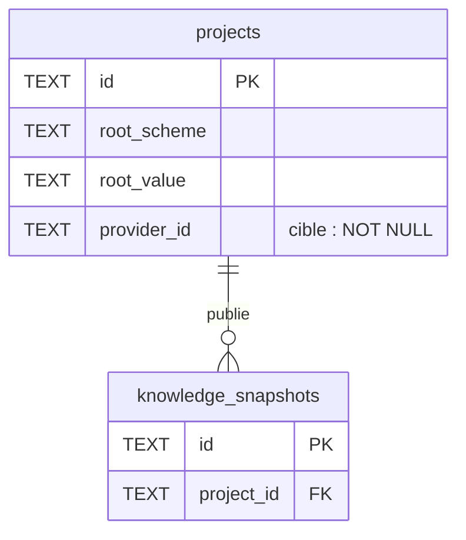

# Conception : publier un projet par le provider avec lequel il est inscrit (AUD-ARC-25)

Étiquettes : [EXISTANT VÉRIFIÉ], [DÉCISION], [PROPOSITION], [QUESTION]. Toutes les décisions structurantes de ce
document attendent le mainteneur : aucune n'est tranchée ici, et aucun ADR n'est déclaré accepté.

## Contexte

Motivation : voir proposal.md, section Why. État vérifié sur `1a539c22` :

- [EXISTANT VÉRIFIÉ] Sept constructions de provider ou de lecteur dans six classes de transport :
  `MorpheusProjectSyncApiService` (lecteur OpenSpec, ligne 70, et `OpenSpecSpecificationProvider.SOURCE_DIRECTORIES`,
  ligne 58), `MorpheusProjectCli` (lignes 121 et 153), `MorpheusChangeCli` (ligne 209), `MorpheusControlledLifecycleCli`
  (lignes 73-74), `CliProjectWriteCapabilityResolver` (lignes 27-28), `MorpheusCompositionCli` (lignes 86-87 et
  101-103, les deux providers et les deux lecteurs empaquetés). Aucune dans `morpheus-mcp`.
- [EXISTANT VÉRIFIÉ] `ProjectStoreEntry` (`com.morpheus.application.store`) porte `id` et `rootLocator` ; la table
  `projects` (`V001__foundation.sql`) porte `id`, `root_scheme`, `root_value`, avec l'index unique `uq_projects_root`
  (`V002__project_root_uniqueness.sql`).
- [EXISTANT VÉRIFIÉ] L'inscription est écrite deux fois — `MorpheusProjectCli` (`add`) et
  `MorpheusProjectRegistryApiService` — et `LocalProjectRegistry` (`com.morpheus.application.project`) l'écrit une
  troisième fois sans qu'aucune classe de production ne l'appelle.
- [EXISTANT VÉRIFIÉ] `ProjectSnapshotImportService.publishFull` appelle `putProject` avec une entrée construite depuis
  le contenu lu ; `putProject` refuse une entrée différente de celle stockée (`project identity collision`).
- [EXISTANT VÉRIFIÉ] `SpecificationProviderRegistry` (`com.morpheus.application.provider`) existe et ne tient que des
  `SpecificationProvider` ; `ProviderSelectionPolicy` choisit, à égalité, le premier identifiant dans l'ordre
  lexicographique avec un avertissement `MULTIPLE_PROVIDER_MATCHES` — `markdown` avant `openspec`.
- [EXISTANT VÉRIFIÉ] Seul `OpenSpecSpecificationProvider` déclare ses répertoires sources (`SOURCE_DIRECTORIES`) ;
  `StructuredMarkdownSpecificationProvider` lit `SOURCE_FILE` (`morpheus/specification.md`) et ne déclare pas de
  répertoire. `LocalSourceInventoryScanner` analyse tout le workspace quand la liste est vide.
- [EXISTANT VÉRIFIÉ] `morpheus-api/pom.xml` dépend de `morpheus-provider-openspec` en portée de compilation, pas de
  `morpheus-provider-markdown` ; `morpheus-cli/pom.xml` dépend des deux.
- [EXISTANT VÉRIFIÉ] Aucun provider empaqueté ne déclare `WRITE_CHANGE` (seul `SyntheticSpecificationProvider`, de portée
  test) : `lifecycle apply` est toujours refusé sur un projet réel, et le restera.
- [EXISTANT VÉRIFIÉ] Garde-fous : `TransportsReadAProjectThroughTheProviderPortTest` (dépendance au port, répertoires non
  nommés), `AdapterCompositionRootArchitectureTest.COMPOSITION_ROOTS` (compteur de dette d'ADR-0162, clé de
  `config/debt-counter-ratchets.properties`), `ProviderAntiLockInTest` (neutralité au port seulement).
- [EXISTANT VÉRIFIÉ] Version : `released-schema-levels.properties` déclare `1.2.1` au dernier niveau publié ; le schéma
  courant (`SqliteSchemaManager.SUPPORTED_SCHEMA_VERSION`) est au-dessus, donc 1.2.2 est ouverte et non publiée.

## Exigences couvertes

| Capacité | Exigence (titre exact) | Rubriques de conception qui y répondent |
|---|---|---|
| `project-provider-binding` | A registered project SHALL keep the provider it was registered with | D2, D4, §Persistance |
| `project-provider-binding` | Registration SHALL refuse a workspace that no packaged provider supports | D6, §Traitements |
| `project-provider-binding` | Registration SHALL report the provider it retains among several supporting ones | D5, D6, §Traitements |
| `project-provider-binding` | A project registered before its provider was recorded SHALL read back with the OpenSpec provider | D3, §Compatibilité |
| `project-provider-binding` | The write capability of a project SHALL be resolved from its registered provider | D7 |
| `project-ingestion-port` | A publication SHALL read a project through the reader of its registered provider | D5, §Traitements |
| `project-ingestion-port` | A sync SHALL scan the directories its registered provider states | D5 |
| `project-ingestion-port` | No transport class SHALL construct a specification provider | D5, D8 |

## Composants et frontières

Question : qui construit les providers, et qui les reçoit ?

Le diagramme répond à `project-ingestion-port` › No transport class SHALL construct a specification provider : la
cible ne laisse qu'un constructeur, le câblage du processus, conformément à ARCH-0135 (invariant 6) et au câblage
explicite de `.claude/rules/architecture.md`.

- `morpheus-application` : le catalogue (D5), l'entrée de projet (D2), l'inscription unique (D6) et le résolveur
  d'écriture (D7). Aucune dépendance vers un provider (`LayerDependencyTest#applicationMustNotDependOnAdapters`).
- `morpheus-cli` : `MorpheusMain` construit le catalogue ; les classes de capacité le reçoivent par leur constructeur.
- `morpheus-api` : le serveur local et la façade remote reçoivent le catalogue de `MorpheusMain`, comme ils reçoivent
  déjà `ChangeWriteCapabilityResolver` (`HttpServerIntegrations`). `MorpheusProjectSyncApiService` ne construit plus de
  provider et sort de `COMPOSITION_ROOTS`.
- `morpheus-store-memory`, `morpheus-store-sqlite` : la colonne et la parité (D2, D3).

## Modèle de domaine et invariants

Question : où vit le provider d'un projet ?

Existant : `ProjectStoreEntry` et `ProjectSpecification`. Cible : le champ `providerId` et les deux types du catalogue,
`PublishableProvider` (à créer) et `PublishableProviderCatalog` (à créer) dans `com.morpheus.application.provider`.
Invariants : `PublishableProvider` refuse un lecteur dont `providerId()` diffère de `provider.id()` (constructeur
compact) ; le catalogue refuse deux entrées de même identifiant, comme `SpecificationProviderRegistry`. Exigences :
`project-provider-binding` › A registered project SHALL keep the provider it was registered with.

## Traitements et interactions

Question : que se passe-t-il à l'inscription, puis à la synchronisation ?

Exigences : `project-provider-binding` › Registration SHALL refuse a workspace that no packaged provider supports,
› Registration SHALL report the provider it retains among several supporting ones ; `project-ingestion-port` › A publication SHALL
read a project through the reader of its registered provider, › A sync SHALL scan the directories its registered
provider states. Le refus d'un provider non empaqueté passe par le chemin d'échec existant de la synchronisation
(`IncrementalSyncService.fail`), sans nouveau code de sortie.

## États et transitions

Sans objet : aucun cycle de vie ne change ; le provider d'un projet est fixé à l'inscription et ne change pas (D4).

## Contrats d'interface

- `contracts/public-surfaces.tsv` : les notes de `project.register` (refus d'un workspace non supporté, provider retenu
  rapporté) et de
  `project.sync`, `change.analysis` (« computed from the OpenSpec content read in the workspace » devient « read
  through the project's registered provider »). Justification de PR.
- `docs/developer/reference/openapi/morpheus-v1.yaml` : la réponse `400` de `POST /api/v1/projects` porte les deux refus
  nommés ; `ProjectRegistrationRequest` ne change que si Q3 retient la sélection explicite (champ `provider`, borné par
  `maxLength`, `additionalProperties: false` conservé). Le gate `PublicHttpRouteConvergenceTest` ne voit pas un champ
  de corps : la revue le lit.
- CLI : `projects add --workspace <dir>` garde sa forme d'appel ; sa sortie ajoute le provider retenu et les autres
  candidats (ligne `provider=` en texte, membres sous `--json`), et ses refus sortent par `CliErrorLine` avec le code de
  refus. La réponse de `POST /api/v1/projects` ajoute les mêmes membres : `PublicPayloadConvergenceTest` ne couvre pas
  cette enveloppe, la revue la lit.
- MCP : aucun outil n'inscrit ni ne synchronise un projet (`EXPLICITLY_NOT_EXPOSED`), rien ne change.

## Persistance et intégrité

Question : comment la table `projects` porte-t-elle le provider ?

Une migration ajoute `provider_id TEXT NOT NULL DEFAULT 'openspec'` par `ALTER TABLE ... ADD COLUMN` (D3) ; aucune
reconstruction de table, qui toucherait les clés étrangères `ON DELETE CASCADE` des tables qui référencent `projects(id)`. Le store SQLite écrit
toujours la colonne ; le défaut ne sert qu'aux lignes existantes. Le store mémoire porte la même valeur ; la parité est
prouvée par un `*PersistenceParityTest` à écrire. Le numéro de migration suit le plus haut de `db/migration/`.

## Transactions, concurrence et idempotence

L'inscription garde son idempotence par racine (`findProjectByRoot` puis `putProject`, index unique
`uq_projects_root`). Deux inscriptions concurrentes de la même racine : la seconde voit l'index unique et lit l'entrée
gagnante, comme aujourd'hui ; aucune ne réécrit le provider de l'autre (D4).

## Sécurité et isolation

- Aucun code tiers : le catalogue ne contient que les providers empaquetés ; les plugins restent confinés au worker du
  probe (SEC-0129).
- Le refus d'inscription relayé à un appelant distant ne porte aucun chemin du serveur (`BoundaryFailureMessage.safe`,
  `ServerLocationDisclosure`) : la sonde porte des sources relatives au workspace.

## Gestion des erreurs et reprise

Refus nommés : `NO_PROVIDER_FOUND`, `MULTIPLE_PROVIDER_MATCHES` à priorité égale (codes existants de `DiagnosticCode`),
et le refus d'un
provider non empaqueté à la synchronisation. Aucun repli : un projet dont le provider manque n'est jamais lu par un
autre.

## Observabilité

Sans objet : aucun journal ni compteur nouveau ; la sortie de `sync` nomme déjà ses diagnostics.

## Performance et stratégie de mesure

L'inscription sonde chaque provider empaqueté une fois (lecture de quelques fichiers). La synchronisation sonde moins
qu'aujourd'hui côté écriture (un provider au lieu de tous). Aucun budget M19 n'est concerné ; aucun chiffre n'est fixé.

## Compatibilité, migration et retour arrière

- Projets existants : `openspec` (D3, Q4), la seule source qu'une synchronisation publiait.
- Version : la migration entre dans la version ouverte (Q5). Si 1.2.2 est publiée avant l'application, le réacteur
  ouvre la version suivante dans le même lot, avec son guide `docs/user/UPGRADE_<version>.md` (`UpgradeGuideCoherenceTest`,
  `ReleasedSchemaLevelsDeclarationTest`).
- Retour arrière : un programme antérieur refuse une base migrée (`schema-upgrade-guidance`) ; la sauvegarde avant mise
  à niveau reste obligatoire.
- **BREAKING** : un répertoire sans source reconnue n'est plus inscrit. Un workspace à deux sources reste inscrit, avec
  OpenSpec, comme il était lu jusqu'ici (D6). Les notes de version le disent.

## Décisions

### D1 : neutralité de la publication, ou OpenSpec seul
- **Nature** : [QUESTION] (Q1)
- **Exigences servies** : toutes celles de ce changement.
- **Options** : A — un projet porte son provider et la publication le résout par un catalogue unique ; B — OpenSpec
  seul pour la publication, écrit dans un ADR qui remplace ADR-0169, avec une règle exécutable qui le tient ; C — statu
  quo, laissé contraire à ADR-0169 et à ARCH-0135.
- **[PROPOSITION]** A : c'est la promesse écrite d'ADR-0169 et d'ARCH-0135, et le provider Structured Markdown est déjà
  empaqueté par la CLI et lu par `composition sync`.
- **Compromis** : une migration, une rupture d'inscription, un catalogue à câbler dans deux serveurs.
- **ADR** : ADR à proposer — voir D8.

### D2 : le provider sur l'entrée persistée du projet
- **Nature** : [QUESTION] (Q2)
- **Exigences servies** : `project-provider-binding` › A registered project SHALL keep the provider it was registered
  with.
- **[PROPOSITION]** `ProjectStoreEntry.providerId` : c'est l'entrée que l'inscription crée et que les transports lisent.
- **Alternatives écartées** : `ProjectSpecification` (domaine) — il est produit par chaque lecteur (cinq sites, dont le
  plugin de référence et le SDK), ce qui toucherait l'API publiée aux auteurs de plugins pour une donnée que seul le
  registre connaît.
- **ADR** : couvert par D8.

### D3 : les projets existants reçoivent `openspec`
- **Nature** : [QUESTION] (Q4)
- **Exigences servies** : `project-provider-binding` › A project registered before its provider was recorded SHALL
  read back with the OpenSpec provider.
- **[PROPOSITION]** Défaut `openspec` à la migration : toute synchronisation et toute analyse antérieures lisaient
  OpenSpec, donc le comportement de chaque projet existant est préservé, échec compris.
- **Alternatives écartées** : sonder à la migration (une migration SQL ne lit pas le workspace, et un workspace peut
  avoir disparu) ; valeur absente résolue au premier usage (un troisième état qu'aucun consommateur ne doit lire comme
  `openspec` en silence).
- **ADR** : couvert par D8.

### D4 : le provider d'un projet ne change pas après l'inscription
- **Nature** : [PROPOSITION]
- **Exigences servies** : `project-provider-binding` › A registered project SHALL keep the provider it was registered
  with.
- **Choix** : `ProjectSnapshotImportService` ne reconstruit plus l'entrée depuis le contenu pour un projet inscrit ; il
  vérifie l'identité et la racine, et n'insère une entrée (avec le provider du lecteur) que pour un projet absent, cas
  des tests de publication directe. `putProject` compare l'identité et la racine, jamais le provider, pour une entrée
  existante.
- **Alternatives écartées** : réécrire le provider à chaque publication (un `composition sync` le ferait varier).
- **ADR** : non concerné.

### D5 : un catalogue des providers publiables, construit par le câblage du processus
- **Nature** : [PROPOSITION]
- **Exigences servies** : `project-ingestion-port` › A publication SHALL read a project through the reader of its
  registered provider, › A sync SHALL scan the directories its registered provider states, › No transport class SHALL
  construct a specification provider.
- **Choix** : `PublishableProviderCatalog` (à créer) associe à chaque `ProviderId` son `SpecificationProvider`, son
  `SpecificationContentReader`, ses répertoires sources, déclarés par une constante du module du provider
  (`StructuredMarkdownSpecificationProvider.SOURCE_DIRECTORIES` à créer, à côté de celle d'OpenSpec), et sa priorité,
  celle que `MorpheusCompositionCli` écrit aujourd'hui (100 pour OpenSpec, 50 pour Markdown). `MorpheusMain` le
  construit et le remet aux commandes et aux serveurs. `composition sync` en tire ses providers et leurs priorités,
  inchangées.
- **Alternatives écartées** : étendre `SpecificationProvider` d'une méthode de répertoires (port publié aux auteurs de
  plugins pour un besoin de l'hôte) ; construire le catalogue dans `ApiRuntime` (l'adaptateur HTTP dépendrait de
  `morpheus-provider-markdown` et resterait une racine de plus).
- **Compromis** : un paramètre de plus dans les constructeurs des classes de capacité et des serveurs.
- **ADR** : couvert par D8.

### D6 : une seule inscription, qui refuse l'absence et rapporte son choix
- **Nature** : [QUESTION] (Q3)
- **Exigences servies** : `project-provider-binding` › Registration SHALL refuse a workspace that no packaged provider
  supports, › Registration SHALL report the provider it retains among several supporting ones.
- **Constat qui oriente la question** : la fixture `experiments/m0/fixtures/openspec-basic` porte à la fois `openspec/`
  et `morpheus/specification.md` ; les deux providers la supportent. Un refus de l'ambiguïté casserait toute inscription
  de cette fixture, et celle de tout dépôt réel qui ferait de même.
- **Options** : A — retenir la priorité la plus haute déclarée par le catalogue (OpenSpec, provider de référence
  d'ADR-0169), rapporter le choix et les autres candidats, refuser seulement à priorité égale ; B — refuser toute
  ambiguïté et exiger une sélection explicite (`--provider`, champ `provider`) ; C — A, plus une sélection explicite
  facultative qui l'emporte sur la priorité.
- **[PROPOSITION]** A dans ce changement : il garde à chaque workspace existant le provider qui le lit aujourd'hui, et
  le choix n'est pas silencieux puisque la réponse le nomme. La sélection explicite (C) se décide à part : elle ajoute
  une surface publique (manifeste, OpenAPI, exigence) qu'aucun cas constaté n'exige.
- **Choix commun aux options** : `LocalProjectRegistry` devient la seule inscription, appelée par la CLI et par HTTP.
  `ProviderSelectionPolicy` n'est pas réutilisée telle quelle : à égalité elle choisit `markdown` avant `openspec` par
  l'ordre des identifiants, avec un simple avertissement.
- **ADR** : couvert par D8.

### D7 : `WRITE_CHANGE` résolu par le seul provider inscrit
- **Nature** : [PROPOSITION]
- **Exigences servies** : `project-provider-binding` › The write capability of a project SHALL be resolved from its
  registered provider.
- **Choix** : `RegisteredProjectWriteCapabilityResolver` lit le provider de l'entrée et ne sonde que lui ; le refus
  « Multiple providers expose WRITE_CHANGE » disparaît, sans objet. `CliProjectWriteCapabilityResolver` reçoit le
  catalogue au lieu de construire OpenSpec.
- **Alternatives écartées** : garder la sonde de tous les providers (le provider qui autorise l'écriture pourrait ne pas
  être celui qui publie).
- **ADR** : non concerné (BE-0083 garde la capacité distincte).

### D8 : la décision écrite
- **Nature** : [QUESTION] (Q6)
- **Choix proposé** : **ADR à proposer**, consolidé, qui remplace ARCH-0135 en y ajoutant : un projet inscrit porte son
  provider ; seul le câblage du processus construit un provider ; la règle exécutable de D5. ADR-0169 reste le choix du
  provider de référence.
- **Alternatives** : remplacer ADR-0169 (il parle du format OpenSpec, pas de l'hôte) ; un ADR nouveau à côté d'ARCH-0135
  (deux ADR actifs pour une même décision, contraire à `.claude/rules/adr.md`).
- **Filtre** : décision entre options réelles, format persisté et surfaces publiques, retour arrière qui casse des
  données : les trois « oui ».

## Écarts constatés

| Constat | Source A | Source B | Traitement proposé |
|---|---|---|---|
| L'audit compte cinq classes et six sites ; l'arbre en porte six et sept | `AUD-ARC-25` (preuve) | `MorpheusCompositionCli.java:86-103` | inclus (D5) |
| Un sync nomme aussi les répertoires d'OpenSpec, que l'audit ne cite pas | `AUD-ARC-25` | `MorpheusProjectSyncApiService.java:58`, `MorpheusProjectCli.java:121` | inclus (D5) |
| L'inscription est écrite trois fois, dont une jamais appelée | `MorpheusProjectCli` (`add`), `MorpheusProjectRegistryApiService` | `LocalProjectRegistry` | une seule inscription (D6) |
| `ProviderSelectionPolicy` choisit en silence à égalité (avertissement seulement) | `ProviderSelectionPolicy` | `.claude/rules/code-style.md` (pas de dégradation silencieuse) | non réutilisée à l'inscription (D6) ; la politique elle-même reste hors périmètre |
| La neutralité promise n'est prouvée qu'au port | ADR-0169, ARCH-0135 | `ProviderAntiLockInTest` | preuve au transport à écrire (tâches 4.x) |
| La fixture « OpenSpec » est aussi un workspace Structured Markdown | `experiments/m0/fixtures/openspec-basic/openspec/` | `experiments/m0/fixtures/openspec-basic/morpheus/specification.md` | oriente Q3 (D6) ; aucune fixture n'est modifiée |

## Stratégie de vérification

| Exigence | Scénario | Preuve | État |
|---|---|---|---|
| A registered project SHALL keep the provider it was registered with | A Structured Markdown workspace is registered ; The two stores agree ; The same root is registered again | `ProjectRegistrationPersistenceParityTest` (à écrire), cas de `MorpheusCliTest` et de `MorpheusProjectRegistryApiServiceContractTest` | à écrire |
| Registration SHALL refuse a workspace that no packaged provider supports | A directory without any specification source | `LocalProjectRegistryTest` (refus et rien persisté, cas à écrire), cas CLI et `MorpheusProjectRegistryApiServiceContractTest` | à écrire |
| Registration SHALL report the provider it retains among several supporting ones | A workspace with an OpenSpec tree and a Structured Markdown source ; Two supporting providers with the same declared priority | `LocalProjectRegistryTest` (cas à écrire), cas CLI sur `openspec-basic` | à écrire |
| A project registered before its provider was recorded SHALL read back with the OpenSpec provider | A database written by the last released schema is upgraded | `ReleasedSchemaUpgradeTest` (cas étendu) | à écrire |
| The write capability of a project SHALL be resolved from its registered provider | les deux scénarios | `RegisteredProjectWriteCapabilityResolverTest` | à écrire (cas ajoutés) |
| A publication SHALL read a project through the reader of its registered provider | les quatre scénarios | `ProviderAntiLockInTest` (preuve au transport), `MorpheusApiProjectSyncIntegrationTest`, tests CLI | à écrire |
| A sync SHALL scan the directories its registered provider states | les deux scénarios | tests CLI de `sync` sur la fixture Markdown | à écrire |
| No transport class SHALL construct a specification provider | A command constructs a reader ; The process wiring builds the catalogue | `TransportsReadAProjectThroughTheProviderPortTest` (règle ajoutée, violation plantée) | à écrire |

## Documentation durable et diagrammes à mettre à jour

- `docs/developer/specifications/project-ingestion-port.md` : exigences ajoutées, diagramme de synchronisation.
- `docs/developer/specifications/project-provider-binding.md` (à créer, gabarit de
  `docs/developer/specifications/README.md`) et sa ligne d'index.
- `docs/architecture/arc42/` : la vue des composants qui montre le câblage des providers (section 5 ou 8, à relire).
- `docs/user/QUICKSTART.md` et le guide de mise à niveau de la version ouverte : inscription et migration.
- L'ADR proposé (D8) et sa ligne d'index si le mainteneur l'accepte.

## Questions ouvertes

Les questions Q1 à Q6 de proposal.md changent l'approche et sont portées par D1, D2, D3, D6 et D8 : elles se tranchent
avant le groupe 2 des tâches. Aucune autre.
