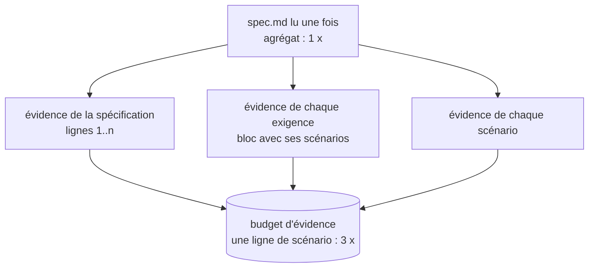

# Conception : qualifier le budget d'évidence sur des corpus réels

## Contexte

- [EXISTANT VÉRIFIÉ] `ProviderIngestionBudget.DEFAULT` : 1 Mio par document, 2 000 fichiers, 32 Mio d'agrégat, 100 000
  lignes, blocs et entités, **512 Kio d'évidence**. `OpenSpecIngestionBudgets.open` ouvre toujours `DEFAULT` ; aucune
  option CLI ni clé de configuration n'en construit un autre (`AUD-ARC-23`).
- [EXISTANT VÉRIFIÉ] `OpenSpecCurrentSpecificationReader.evidence` compte chaque extrait par `addEvidenceFragment`.
  Il est appelé pour la spécification (lignes `1` à `lines.size()`, le fichier entier), pour chaque exigence (bloc qui
  contient ses scénarios) et pour chaque scénario. `OpenSpecRequirementDeltaReader` et `OpenSpecChangeMetadataReader`
  comptent aussi leurs extraits.
- [EXISTANT VÉRIFIÉ] L'évidence ne conserve que `excerptHash` (SHA-256 par `TextDigest.sha256`) et la plage de lignes ;
  l'extrait n'est ni gardé en mémoire au-delà du hachage ni persisté. Le budget d'évidence borne donc un travail de
  hachage, déjà borné par l'agrégat d'octets lus.
- [EXISTANT VÉRIFIÉ] Un refus lève `ProviderIngestionLimitException` ; `OpenSpecSpecificationContentReader` rend toutes
  les catégories `FAILED` avec un diagnostic `INVALID_SOURCE` de source `ingestion-budget`.
- [EXISTANT VÉRIFIÉ] Mesures du 15/11/2026 : specs de 163 850 o (publié), 406 550 o (refus à 524 777), 503 209 o (refus
  à 557 385). Les deux refus interrompent la lecture : le total réel n'est pas connu.

## Exigences couvertes

| Capacité | Exigence (titre exact) | Rubriques de conception qui y répondent |
|---|---|---|
| `provider-ingestion-budget` | The default evidence budget is qualified on measured corpora | §Décisions D1 ; §Performance ; §Stratégie de vérification |

## Composants et frontières

`morpheus-application` (`ProviderIngestionBudget`, port partagé par les providers) ; `morpheus-provider-openspec`
(les trois lecteurs qui citent l'évidence). `ProviderAntiLockInTest` : la borne reste commune aux trois providers.

## Traitements et interactions

Question : combien d'octets un même passage de spécification coûte-t-il au budget ? Existant : jusqu'à trois fois.

Cible : selon D1, chaque ligne citée compte une fois par fichier, et/ou la borne est relevée sur la mesure.

## Performance et stratégie de mesure

Tâche 1 : un outil de mesure de test (hors production) lit chaque corpus avec un budget sans limite pratique et rapporte,
par corpus, les octets de `openspec/specs/`, les octets d'évidence comptés aujourd'hui, les octets d'évidence comptés
ligne par ligne une fois, et la distribution par exigence (médiane, maximum, rapport au texte de l'exigence). Les trois
projets sont mesurés sur leurs arbres de travail, en lecture seule ; les chiffres vont dans la description de la PR et
la page durable, jamais dans une constante.

La marge déclarée est écrite à côté de la borne, avec la mesure qui la fonde et la date ; le test de qualification
relit la borne, pas un littéral recopié.

## Compatibilité, migration et retour arrière

Un corpus admis aujourd'hui reste admis : la cible n'abaisse aucune borne. Retour arrière : restaurer la constante ou le
comptage ; un projet admis entre-temps redevient refusé à son prochain `sync`, sans perte des snapshots publiés.

## Décisions

### D1 : le moyen d'admettre les corpus de qualification
- **Nature** : [PROPOSITION], à trancher par le mainteneur sur la mesure de la tâche 1
- **Exigences servies** : `provider-ingestion-budget` › The default evidence budget is qualified on measured corpora
- **Choix proposé** : compter dans le budget chaque ligne citée **une fois par fichier** (plages fusionnées par
  fichier), puis qualifier la borne sur la mesure avec la marge déclarée, sans la relever si le comptage suffit. Le
  budget borne alors le travail de citation au lieu de la profondeur d'imbrication des extraits.
- **Alternatives** : relever seule la borne (garde la triple charge : la borne utile croît avec la densité de scénarios,
  pas avec le volume) ; supprimer le budget d'évidence au profit de l'agrégat (retire une borne fail-closed que les
  autres providers consomment aussi, refusé sans ADR).
- **Compromis** : le comptage par plages fusionnées ajoute un état par fichier dans la session.
- **ADR** : non concerné tant que la borne reste une constante qualifiée ; D2 ou D3 en exigeraient un.

### D2 : budget réglable par l'opérateur
- **Nature** : [QUESTION]
- **Exigences servies** : aucune dans ce changement
- **Choix** : hors périmètre ; une option ou une clé serait une surface publique (manifeste, aide CLI, OpenAPI si HTTP)
  et un réglage de sécurité (une borne fail-closed relevée sans plafond).
- **ADR** : à proposer si le mainteneur le retient.

### D3 : publication partielle avec raison de troncature
- **Nature** : [QUESTION]
- **Exigences servies** : aucune dans ce changement
- **Choix** : hors périmètre ; changerait la doctrine de publication (un candidat qui échoue ne remplace pas l'`ACTIVE`).
- **ADR** : à proposer si le mainteneur le retient.

## Écarts constatés

| Constat | Source A | Source B | Traitement proposé |
|---|---|---|---|
| L'évidence comptée représente « un peu plus que le texte des exigences » | `AUD-ARC-23` | code : jusqu'à trois fois par ligne de scénario, et refus survenus avant la fin de la lecture | signalé pour la revérification ; la tâche 1 mesure le total réel |
| La constante borne 512 Kio d'évidence alors que l'évidence n'est jamais retenue | `ProviderIngestionBudget.DEFAULT` | `Evidence.excerptHash` | éclaire D1 ; aucune résolution silencieuse |

## Stratégie de vérification

| Exigence | Scénario | Preuve | État |
|---|---|---|---|
| The default evidence budget is qualified on measured corpora | The qualification corpus larger than the largest measured project | `OpenSpecEvidenceBudgetQualificationTest#aCorpusLargerThanTheLargestMeasuredProjectIsRead` (corpus généré, déterministe) | à écrire |
| idem | The specification corpus of this repository | test du module `morpheus-architecture-tests` qui lit `openspec/` par `RepositoryRoot` (exige `accept-a-declared-derived-openspec-schema`) | à écrire |
| idem | A corpus beyond the limit | `OpenSpecEvidenceBudgetQualificationTest#aCorpusBeyondTheLimitIsRefusedAndPublishesNothing` | à écrire |

## Documentation durable et diagrammes à mettre à jour

`docs/developer/specifications/provider-ingestion-budget.md` (borne, mesure qui la fonde, marge, organigramme du
comptage) ; le guide utilisateur qui décrit `sync` (`docs/user/CLI.md`).

## Questions ouvertes

D1 se tranche à la fin de la tâche 1 et conditionne le groupe 2 ; D2 et D3 peuvent attendre sans changer ce
changement.
