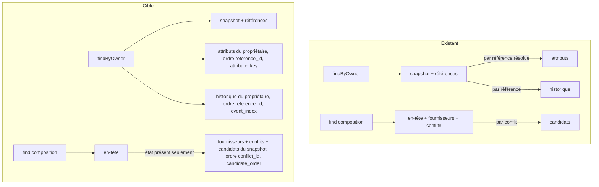

# Conception : lire références externes et conflits de composition en un nombre fixe de requêtes

## Contexte

[EXISTANT VÉRIFIÉ] sur `1a539c22` (motivation : proposal.md, section Why) :

- `SqliteExternalReferenceStore` : `findByOwner` (`:89-115`) vérifie le snapshot (`requireSnapshot`, refus
  `snapshot not found for external reference: `, `:340-350`), lit les références du propriétaire ordonnées par
  `reference_id`, puis `mapReference` (`:245-292`) lit par référence ses attributs résolus (`:294-312`, seulement si
  `resolved_system` n'est pas nul) et son historique (`:314-338`). `findReference` (`:74-87`) lit une seule référence.
- `SqliteCompositionStateStore.find` (`:51-71`) : en-tête, `readProviders` (`:163-...`, une requête), `readConflicts`
  (`:186-210`, une requête, ordre `entity_type, logical_key, field_name`), et `readCandidates` (`:212-...`) par conflit.
  `composition_conflict_candidate` n'a pas de `snapshot_id` : la lecture groupée joint `composition_conflict`
  (index unique `composition_conflict_unique(snapshot_id, …)`, V012).
- Clés des tables enfants : `snapshot_external_reference_attributes(snapshot_id, reference_id, attribute_key)`,
  `snapshot_external_reference_history(snapshot_id, reference_id, event_index)` (V006),
  `composition_conflict_candidate(conflict_id, candidate_order)` (V012).
- Patron déjà livré : `SqliteSnapshotBusinessContentReader.readValuesByOwner` lit chaque table enfant en une requête
  ordonnée par (propriétaire, ordinal) et regroupe en mémoire (`snapshot-content-read-cost`) ; il tient et n'est pas
  touché (`AUD-PRF-31`). Patron de test : `SqliteTraceabilityBatchWriteCostTest` (proxy de `Connection`).

## Exigences couvertes

| Capacité | Exigence (titre exact) | Rubriques de conception qui y répondent |
|---|---|---|
| `external-reference-and-conflict-read-cost` | Reading the external references of an owner SHALL cost a number of statements that does not depend on them | §Décisions D1, D3 |
| `external-reference-and-conflict-read-cost` | Reading the composition state of a snapshot SHALL cost a number of statements that does not depend on its conflicts | §Décisions D2, D3 |
| `external-reference-and-conflict-read-cost` | The references and composition state read SHALL be the values that were stored | §Décisions D1, D2 ; §Persistance |

## Composants et frontières

`SqliteExternalReferenceStore` et `SqliteCompositionStateStore` (`com.morpheus.store.sqlite.adapter`) seulement. Aucun
moniteur (`SqliteStoreAdapterHoldsNoMonitorArchitectureTest`), aucune classe du `runtime` nommée
(`SqliteStorePackagesArchitectureTest`), aucun port ni store mémoire modifié.

## Modèle de domaine et invariants

Sans objet : `ExternalReference`, `ResolvedExternalTarget`, `CompositionConflict` et `CompositionCandidate` gardent
leur forme.

## Traitements et interactions

Question : quelles requêtes une lecture prépare-t-elle, avant et après ?

Explication : chaque table enfant est lue une fois, filtrée par le même propriétaire (ou snapshot) que la lecture
parente, puis regroupée en mémoire dans une table ordonnée par identité de parent ; le mappage d'un parent y prend ses
enfants (liste vide s'il n'en a aucun). Un snapshot sans état de composition s'arrête à l'en-tête, comme aujourd'hui.

## États et transitions

Sans objet.

## Contrats d'interface

Sans objet : `ExternalReferenceStore.findByOwner` et `CompositionStateStore.find` gardent signature et contrat.

## Persistance et intégrité

[PROPOSITION] Requêtes, sans migration :

- attributs : `SELECT reference_id, attribute_key, attribute_value FROM snapshot_external_reference_attributes a JOIN
  snapshot_external_references r USING (snapshot_id, reference_id) WHERE a.snapshot_id = ? AND r.owner_identity_id = ?
  ORDER BY a.reference_id, a.attribute_key` ; même forme pour l'historique, ordre `event_index`. Les attributs d'une
  référence non résolue sont lus et ignorés au mappage, comme aujourd'hui où ils ne sont pas lus : la valeur rendue est
  la même (`resolvedTarget` vide).
- candidats : `SELECT c.conflict_id, … FROM composition_conflict_candidate c JOIN composition_conflict k USING
  (conflict_id) WHERE k.snapshot_id = ? ORDER BY c.conflict_id, c.candidate_order`.

## Transactions, concurrence et idempotence

[EXISTANT VÉRIFIÉ] Lectures sur la connexion de l'opération, sans transaction explicite, comme aujourd'hui ; une
référence ou un état de composition s'écrit dans une transaction du writer, donc parents et enfants sont publiés
ensemble.

## Sécurité et isolation

Sans objet ; valeurs liées par paramètres.

## Gestion des erreurs et reprise

`SQLException` traduite en `KnowledgeStoreException` avec les messages existants ; snapshot inconnu refusé par
`snapshot not found for external reference: ` avant toute lecture enfant.

## Observabilité

Sans objet.

## Performance et stratégie de mesure

[DÉCISION] Deux tests de coût par proxy de `Connection` (`SqliteExternalReferenceReadCostTest`,
`SqliteCompositionStateReadCostTest`, à écrire), deux tailles chacun ; un `EXPLAIN QUERY PLAN` par lecture groupée,
refusant un tri temporaire. Le gate M19 de composition garde son budget et sa fixture ; sa métrique de la nuit suivante
est citée dans la PR.

## Compatibilité, migration et retour arrière

Aucune donnée ni contrat ne change. Retour arrière : revert.

## Décisions

### D1 : une requête par table enfant, filtrée par le propriétaire
- **Nature** : [DÉCISION]
- **Exigences servies** : Reading the external references of an owner SHALL cost…, The references and composition state read SHALL be the values that were stored
- **Choix** : attributs et historique lus une fois chacun pour le couple (snapshot, propriétaire), regroupés par
  référence.
- **Alternatives écartées** : lecture par snapshot entier (lit les enfants de tous les propriétaires pour en servir
  un) ; `LEFT JOIN` unique parent + deux enfants (produit cartésien attributs × événements).
- **Compromis** : une jointure avec la table parente par lecture enfant.
- **ADR** : non concerné.

### D2 : candidats lus par snapshot, regroupés par conflit
- **Nature** : [DÉCISION]
- **Exigences servies** : Reading the composition state of a snapshot SHALL cost…, The references and composition state read SHALL be the values that were stored
- **Choix** : une requête jointe à `composition_conflict` sur `snapshot_id`, ordonnée par `(conflict_id,
  candidate_order)`, lue après l'en-tête et seulement si l'état existe.
- **Alternatives écartées** : ajouter `snapshot_id` à la table des candidats (migration sans besoin).
- **Compromis** : aucun.
- **ADR** : non concerné.

### D3 : tests de coût par proxy de `Connection`
- **Nature** : [DÉCISION]
- **Exigences servies** : les deux exigences de coût
- **Choix** : patron de `SqliteTraceabilityBatchWriteCostTest`, dans le paquet de test des stores SQLite.
- **Alternatives écartées** : chronomètre (non reproductible).
- **Compromis** : aucun.
- **ADR** : non concerné.

## Écarts constatés

| Constat | Source A | Source B | Traitement proposé |
|---|---|---|---|
| `find` de composition coûte 3 + N requêtes | audit : 2 + N | code `SqliteCompositionStateStore.java:51-71` (fournisseurs comptés) | sans effet sur la correction ; la cible est un nombre fixe |
| `findByOwner` est aussi appelé par la résolution vivante | audit : orchestration seulement | `LiveExternalReferenceResolutionService.java:47` | couvert par la même correction |

## Stratégie de vérification

| Exigence | Scénario | Preuve | État |
|---|---|---|---|
| Reading the external references… | A few and many references prepare the same statements | `SqliteExternalReferenceReadCostTest#aFewAndManyReferencesPrepareTheSameStatements` | à écrire |
| idem | The count is checked on every build | rouge sur `HEAD`, comptes nommés | à écrire |
| Reading the composition state… | Few and many conflicts prepare the same statements | `SqliteCompositionStateReadCostTest#fewAndManyConflictsPrepareTheSameStatements` | à écrire |
| idem | A snapshot without composition state reads no child table | `SqliteCompositionStateReadCostTest` (une requête comptée) | à écrire |
| The references and composition state read… | Child values keep their parent and their order | tests de valeur des deux classes + `ExternalReferenceAndConflictReadParityTest` | à écrire |
| idem | A reference without history between two that have some | `SqliteExternalReferenceReadCostTest` (valeurs) | à écrire |
| idem | An unknown snapshot is still refused for references | `MemoryExternalReferenceStoreTest` + cas SQLite à ajouter | existant · à écrire |

## Documentation durable et diagrammes à mettre à jour

`docs/developer/specifications/external-reference-and-conflict-read-cost.md` (à créer, gabarit de
`docs/developer/specifications/README.md`, flowchart ci-dessus) et son entrée dans la section « Persistance SQLite et
stores » de l'index.

## Questions ouvertes

Aucune.
