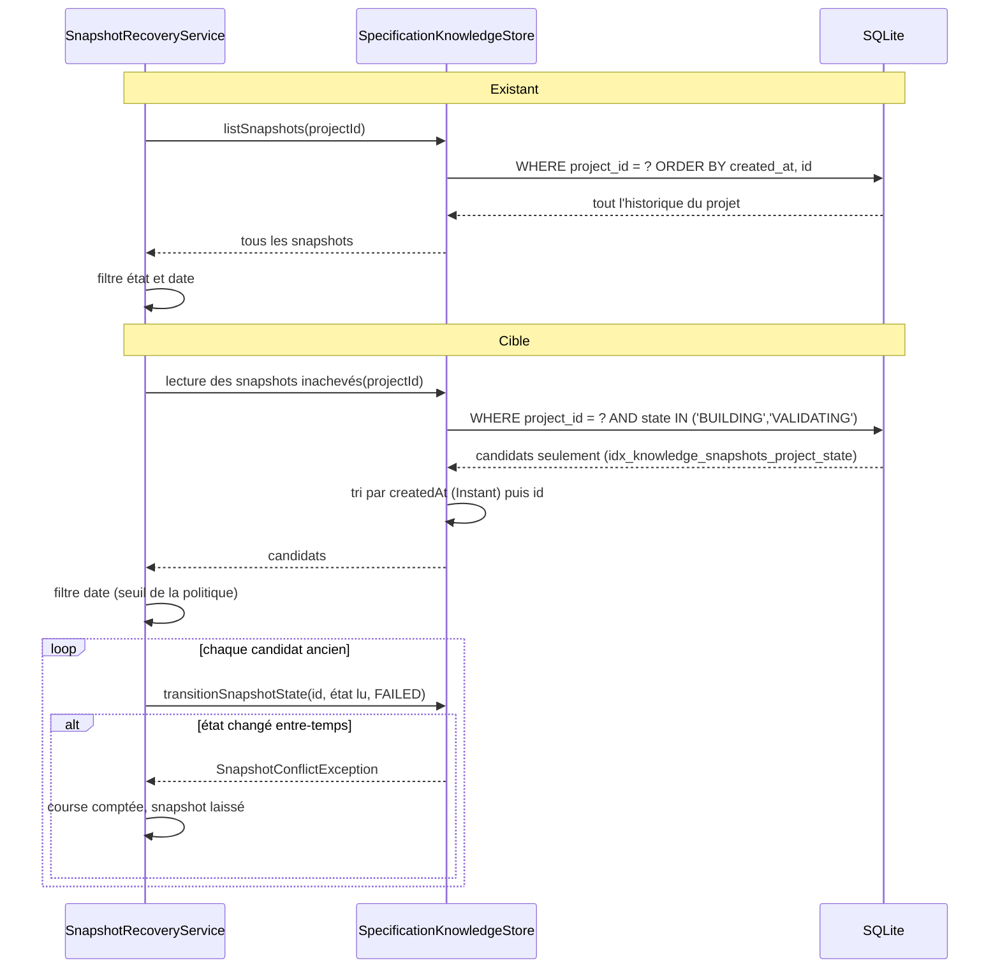

# Conception : ne lire que les snapshots inachevés pour reprendre les publications interrompues

Motivation : voir proposal.md, section Why. Conception complète mais courte : une lecture ajoutée à un port de
persistance, ses deux implémentations et son consommateur.

## Contexte

- [EXISTANT VÉRIFIÉ] Trois sites lancent la reprise : `CliRuntime.recovering` (`morpheus-cli`, 21 commandes),
  `MorpheusMcpRuntime.recoverInterruptedPublications` (`morpheus-mcp`, une fois avant de servir) et
  `MorpheusLocalHttpServerBootstrap` (`morpheus-api`, au démarrage). Tous appellent
  `new RuntimeSnapshotRecovery(store, recorder).recoverAll(Instant.now())`.
- [EXISTANT VÉRIFIÉ] `RuntimeSnapshotRecovery.recoverAll` trie `store.listProjects()` par identité et appelle, par
  projet, `SnapshotRecoveryService.recoverStaleCandidates(projectId, cutoff)`, qui ouvre une opération du
  `OperationalRecorder` (`snapshot.recovery`, `RECOVERY_STARTED`), parcourt `store.listSnapshots(projectId)`, garde
  ceux que `isRecoverable` admet (`BUILDING` ou `VALIDATING`, `createdAt` au plus tard au seuil), les passe à `FAILED`
  par `transitionSnapshotState`, compte `snapshot.recovery.candidate_failed` ou `snapshot.recovery.race`.
- [EXISTANT VÉRIFIÉ] `SpecificationKnowledgeStore.listSnapshots` a une méthode par défaut qui lève
  `UnsupportedOperationException` ; `MemorySpecificationKnowledgeStore` la trie par `createdAt` (`Instant`) puis `id` ;
  `SqliteSpecificationKnowledgeStore` exécute `WHERE project_id = ? ORDER BY created_at, id`, tri sur le **texte**
  d'`Instant.toString()`.
- [EXISTANT VÉRIFIÉ] `V001__foundation.sql` déclare `idx_knowledge_snapshots_project_state ON knowledge_snapshots(project_id,
  state)` et contraint `state` par un `CHECK` sur six valeurs.
- [EXISTANT VÉRIFIÉ] Le texte d'`Instant.toString()` ne trie pas par le temps quand la fraction varie en longueur : c'est
  la raison de `policy_audit.at_key` (`V021`) et `sync_source_archives.archived_key` (`V023`).
- [EXISTANT VÉRIFIÉ] Contrats existants : `SnapshotRecoveryServiceTest` (`morpheus-application`),
  `RuntimeSnapshotRecoveryContractTest`, `SnapshotRecoveryContractTest`, `FailedPublishRecoveryContractTest`
  (`morpheus-architecture-tests`, paquet `m19`), `MorpheusApiRuntimeRecoveryContractTest` (`morpheus-api`).

## Exigences couvertes

| Capacité | Exigence (titre exact) | Rubriques de conception qui y répondent |
|---|---|---|
| `interrupted-publication-recovery` | La reprise ne lit que les snapshots inachevés de chaque projet | D1, D2, Persistance |
| `interrupted-publication-recovery` | La reprise fait échouer les seuls snapshots inachevés créés au plus tard au seuil | D3, Traitements |
| `interrupted-publication-recovery` | Chaque store livré fournit lui-même la lecture des snapshots inachevés | D1, D4 |

## Composants et frontières

| Composant | Paquet | Rôle dans le changement |
|---|---|---|
| `SpecificationKnowledgeStore` | `com.morpheus.application.store` | gagne la lecture des snapshots inachevés d'un projet |
| `SnapshotRecoveryService` | `com.morpheus.application.snapshot` | lit ses candidats par cette lecture |
| `MemorySpecificationKnowledgeStore` | `com.morpheus.store.memory` | implémentation mémoire |
| `SqliteSpecificationKnowledgeStore` | `com.morpheus.store.sqlite.adapter` | implémentation SQL filtrée par état |

Aucune frontière ne bouge : le port reste dans l'application, les stores l'implémentent (`LayerDependencyTest`,
`AdapterSiblingArchitectureTest`).

## Modèle de domaine et invariants

Sans objet : `KnowledgeSnapshotState` et `KnowledgeSnapshotMetadata` ne changent pas.

## Traitements et interactions

Question : quelles lectures la reprise fait-elle pour un projet, avant et après ?

Exigences : les trois de `interrupted-publication-recovery`.

## États et transitions

Sans objet : les transitions `BUILDING → FAILED` et `VALIDATING → FAILED` sont celles d'aujourd'hui.

## Contrats d'interface

Sans objet : aucune surface CLI, MCP ou HTTP ne change.

## Persistance et intégrité

- Requête SQLite (texte à arrêter à l'application, constante nommée pour la garde de plan) :
  `SELECT id, predecessor_id, state, source_revision, created_at FROM knowledge_snapshots WHERE project_id = ? AND state
  IN ('BUILDING', 'VALIDATING')`. Elle est servie par `idx_knowledge_snapshots_project_state` ; aucune migration.
- La constante entre dans `SqliteQueryPlanGuardTest.GUARDED`, recherche de l'index nommé.
- Parité : le store mémoire filtre les mêmes deux états et trie de même (D4).

## Transactions, concurrence et idempotence

Inchangé : chaque transition est un CAS sur l'état lu (`transitionSnapshotState(id, expected, FAILED)`), et une course
est signalée, jamais écrasée. Rejouer la reprise ne trouve plus les candidats déjà passés à `FAILED`.

## Sécurité et isolation

Sans objet.

## Gestion des erreurs et reprise

Inchangé : une erreur du store termine l'opération `snapshot.recovery` en `RECOVERY_FAILED` avec le type d'erreur et
remonte telle quelle (`SnapshotRecoveryServiceTest#aStoreFailureEndsTheOperationAsFailedAndIsRethrownUnchanged`).

## Observabilité

Inchangé : mêmes événements (`RECOVERY_STARTED`, `RECOVERY_COMPLETED`, `RECOVERY_FAILED`) et mêmes métriques, un jeu
par projet.

## Performance et stratégie de mesure

Aucun budget ne fixe ce coût (aucune ligne de `docs/project/roadmap/M19_PERFORMANCE_BUDGETS.md`). La preuve est
structurelle : le plan de la lecture cherche l'index de l'état (garde de plan), et un test rend à la reprise un projet à
long historique publié dont le store ne remet que les candidats. Le nombre de requêtes reste 1 + P (P projets).

## Compatibilité, migration et retour arrière

Aucune donnée ni base ne change. Les doubles de test de `morpheus-application` qui implémentent le port héritent de la
méthode par défaut (D1) : aucun n'a à changer. Retour arrière par revert.

## Décisions

### D1 : une méthode du port, avec un repli par défaut correct
- **Nature** : [DÉCISION]
- **Exigences servies** : `interrupted-publication-recovery` › La reprise ne lit que les snapshots inachevés de chaque
  projet ; `interrupted-publication-recovery` › Chaque store livré fournit lui-même la lecture des snapshots inachevés
- **Choix** : `SpecificationKnowledgeStore` gagne une méthode (nom proposé : `listUnfinishedSnapshots(projectId)`)
  dont l'implémentation par défaut filtre `listSnapshots` sur les deux états — repli correct, admis par
  `.claude/rules/code-style.md` comme la méthode `default` de `VersionedRequirementStore`. Les deux stores livrés la
  redéfinissent, et le test de parité vérifie qu'ils la déclarent eux-mêmes.
- **Alternatives écartées** : méthode abstraite — oblige à toucher une vingtaine de doubles de test qui n'en ont pas
  besoin ; filtrer l'état dans `listSnapshots` — la méthode sert aussi l'historique et changerait de sens.
- **Compromis** : un store livré qui oublierait la redéfinition retomberait sur la lecture complète ; le test de parité
  le refuse (scénario « Un store livré qui hérite de la lecture par défaut »).
- **ADR** : non concerné.

### D2 : une requête par projet, servie par l'index existant
- **Nature** : [DÉCISION]
- **Exigences servies** : `interrupted-publication-recovery` › La reprise ne lit que les snapshots inachevés de chaque
  projet
- **Choix** : garder la boucle par projet de `RuntimeSnapshotRecovery`, chaque requête servie par
  `idx_knowledge_snapshots_project_state`.
- **Alternatives écartées** : une requête tous projets (`WHERE state IN (…)`) — aucun index ne commence par `state`,
  elle parcourrait la table ; un index partiel ajouté par migration la servirait, mais une migration pour une table
  lue une fois par commande n'est pas justifiée, et les comptes rendus par projet (événements, métriques) restent
  attendus pour chaque projet.
- **Compromis** : 1 + P requêtes, chacune bornée par les candidats du projet.
- **ADR** : non concerné.

### D3 : le seuil de date reste appliqué par le service
- **Nature** : [DÉCISION]
- **Exigences servies** : `interrupted-publication-recovery` › La reprise fait échouer les seuls snapshots inachevés
  créés au plus tard au seuil
- **Choix** : la lecture rend tous les inachevés du projet ; `SnapshotRecoveryService.isRecoverable` garde le seuil.
- **Alternatives écartées** : `AND created_at <= ?` en SQL, comme l'audit le suggère — `created_at` est le texte
  d'`Instant.toString()`, dont l'ordre textuel diffère de l'ordre du temps quand la fraction varie en longueur ; la
  comparaison ferait reprendre ou épargner à tort un snapshot proche du seuil.
- **Compromis** : les inachevés récents sont lus puis écartés ; ils sont rares (une publication en cours par projet).
- **ADR** : non concerné.

### D4 : le store SQLite trie les candidats par l'instant, comme le store mémoire
- **Nature** : [DÉCISION]
- **Exigences servies** : `interrupted-publication-recovery` › Chaque store livré fournit lui-même la lecture des
  snapshots inachevés ; scénario « L'ordre des projets et des candidats est inchangé »
- **Choix** : la requête ne trie pas ; le store trie les candidats lus par `createdAt` (`Instant`) puis `id`, l'ordre du
  store mémoire.
- **Alternatives écartées** : `ORDER BY created_at, id` en SQL — ordre textuel, différent du store mémoire sur des
  fractions de longueurs différentes ; une clé d'ordre de largeur fixe — migration, pour quelques lignes.
- **Compromis** : un tri en mémoire de quelques lignes.
- **ADR** : non concerné.

## Écarts constatés

| Constat | Source A | Source B | Traitement proposé |
|---|---|---|---|
| L'action de l'audit propose `created_at <= ?` en SQL | `docs/project/audits/2026-11-17/findings.md`, `AUD-PRF-29` | texte d'`Instant.toString()`, raison de `V021` et `V023` | D3 : seuil gardé en Java |
| `listSnapshots` ne trie pas de la même façon dans les deux stores (`Instant` en mémoire, texte en SQLite) | `MemorySpecificationKnowledgeStore.listSnapshots` | `SqliteSpecificationKnowledgeStore.listSnapshots` | hors périmètre pour `listSnapshots` ; la lecture ajoutée est alignée (D4). À signaler au mainteneur |
| La javadoc de `listSnapshots` dit « Adapters used for recovery must override this method » | `SpecificationKnowledgeStore` | la reprise utilisera la nouvelle lecture | la javadoc est réécrite pour la méthode ajoutée |

## Stratégie de vérification

| Exigence | Scénario | Preuve | État |
|---|---|---|---|
| La reprise ne lit que les snapshots inachevés de chaque projet | Un long historique publié ne s'ajoute pas au coût de la reprise | test à écrire dans `SnapshotRecoveryServiceTest` : double de store qui refuse `listSnapshots` et compte les snapshots rendus | à écrire |
| idem | Le plan de la lecture SQLite cherche l'index de l'état | `SqliteQueryPlanGuardTest`, entrée ajoutée | à écrire |
| idem | Un projet sans snapshot inachevé | `RuntimeSnapshotRecoveryContractTest`, cas ajouté | à écrire |
| La reprise fait échouer les seuls snapshots inachevés créés au plus tard au seuil | Un candidat ancien et un candidat récent | `SnapshotRecoveryServiceTest#onlyTechnicalCandidatesAtOrBeforeTheCutoffAreFailed` | existant |
| idem | Un candidat publié pendant la reprise | `SnapshotRecoveryServiceTest#aCandidateThatMovedUnderTheRecoveryIsReportedAsARaceAndLeftAsItIs` | existant |
| idem | L'ordre des projets et des candidats est inchangé | `RuntimeSnapshotRecoveryContractTest#recoversStaleTechnicalCandidatesAcrossProjectsInDeterministicProjectOrder` | existant |
| Chaque store livré fournit lui-même la lecture des snapshots inachevés | Parité des deux stores | test de parité à écrire (`morpheus-architecture-tests`, paquet `m19`, à côté des contrats de reprise), instants à fractions de longueurs différentes | à écrire |
| idem | Un store livré qui hérite de la lecture par défaut | même test : la méthode est déclarée par la classe du store (lecture réflexive dans le test) | à écrire |

## Documentation durable et diagrammes à mettre à jour

- `docs/developer/specifications/interrupted-publication-recovery.md` à créer (gabarit de
  `docs/developer/specifications/README.md`), avec le diagramme de séquence ci-dessus, et sa ligne d'index dans la
  section « Persistance SQLite et stores » de `docs/developer/specifications/README.md`.

## Questions ouvertes

- [QUESTION] L'écart d'ordre de `listSnapshots` entre les deux stores (Écarts constatés) mérite-t-il son propre
  changement ? Il n'affecte ni les exigences ni les tâches de celui-ci.
