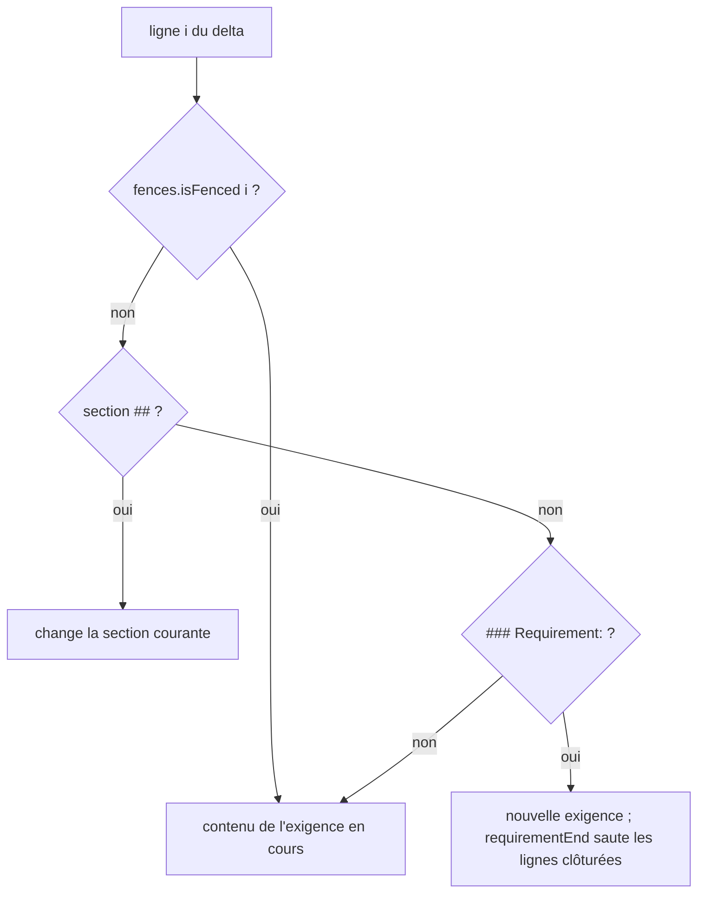

# Conception : lire les deltas OpenSpec à travers les blocs de code, en temps linéaire

## Contexte

- [EXISTANT VÉRIFIÉ] `OpenSpecCodeFences.of(lines)` calcule une fois par fichier quelles lignes sont clôturées ; les deux
  lecteurs de spécifications le construisent déjà (`OpenSpecCurrentSpecificationReader`, `OpenSpecRequirementDeltaReader.normalizeFile`).
- [EXISTANT VÉRIFIÉ] Le lecteur courant passe `fences` à `requirementEnd` et à `headingIndexes` ; il ne le passe pas aux
  deux boucles sur `SCENARIO_HEADING` de `normalizeRequirement`.
- [EXISTANT VÉRIFIÉ] Le lecteur de deltas consulte `fences` pour les sections `##` seulement : ni l'en-tête
  `REQUIREMENT_HEADING` de la boucle principale, ni `requirementEnd(List<String>, int)`, ni les deux boucles sur
  `SCENARIO_HEADING` de `normalizeRequirementDelta` ne le consultent.
- [EXISTANT VÉRIFIÉ] Motifs quadratiques : `REQUIREMENT_HEADING`, `SCENARIO_HEADING`, `SCENARIO_STEP` (lecteur courant
  et lecteur de deltas), `PROPOSAL_TITLE`, `DECISION_HEADING`, `TASK` (`OpenSpecChangeMetadataReader`). Les autres motifs
  du module (`DELTA_SECTION`, `UNNORMALIZED_DELTA_SECTION`, `OPENING_FENCE`, `CLOSING_FENCE`, `SCHEMA_NAME`,
  `scalarDeclaration`) n'ont pas de capture paresseuse suivie d'un `\s*$` et ne sont pas visés.
- [EXISTANT VÉRIFIÉ] `OpenSpecChangeMetadataReader.headingIndexes(List<String>, Pattern)` ne consulte aucune clôture :
  hors du périmètre de `AUD-QUA-29`, signalé en écart.

## Exigences couvertes

| Capacité | Exigence (titre exact) | Rubriques de conception qui y répondent |
|---|---|---|
| `openspec-provider-reading` | A requirement delta follows the same Markdown boundaries as a current requirement | D1, Traitements |
| `openspec-provider-reading` | A scenario heading inside a code fence does not start a scenario | D1 |
| `openspec-provider-reading` | Reading a line costs time linear in its length | D2, Performance |

## Composants et frontières

`morpheus-provider-openspec` seul (`com.morpheus.provider.openspec`). Aucune classe ne change de paquet ni de
visibilité ; `ProviderAntiLockInTest` et les règles de `LayerDependencyTest` ne sont pas concernés.

## Modèle de domaine et invariants

Sans objet : aucun type du domaine ne change ; `Requirement`, `RequirementDelta` et `Scenario` reçoivent les mêmes
champs, seul leur contenu textuel est corrigé.

## Traitements et interactions

Question : où le lecteur de deltas consulte-t-il la clôture, avant et après ?

Existant : seule la branche « section ## » est précédée du test de clôture. Cible : le test de clôture précède toute
reconnaissance d'en-tête (section, exigence, scénario), et `requirementEnd` reçoit `fences` comme dans le lecteur
courant. Exigences : `A requirement delta follows the same Markdown boundaries as a current requirement`, `A scenario
heading inside a code fence does not start a scenario`.

## États et transitions

Sans objet : aucun cycle de vie.

## Contrats d'interface

Sans objet : aucune surface publique ne change ; les diagnostics (`UNCLOSED_CODE_FENCE`, `PARTIAL_INGESTION`,
`UNRECOGNIZED_SECTION`) gardent leurs codes et leurs messages.

## Persistance et intégrité

Sans objet : rien de persisté ne change de forme. Un snapshot déjà publié dont un delta était tronqué reste tel quel
jusqu'à la synchronisation suivante, qui publie l'énoncé entier.

## Transactions, concurrence et idempotence

Sans objet.

## Sécurité et isolation

[EXISTANT VÉRIFIÉ] Un fichier OpenSpec est une entrée non fiable : il vient du dépôt synchronisé. Rendre la lecture
linéaire retire le levier de déni de service décrit par `AUD-SEC-20` sans ajouter de refus.

## Gestion des erreurs et reprise

Sans objet : aucun refus n'est ajouté (D2 écarte la longueur de ligne maximale).

## Observabilité

Sans objet.

## Performance et stratégie de mesure

[PROPOSITION] La preuve est un rapport, pas un seuil absolu : le test lit une même ligne piégée à deux longueurs (la
seconde double de la première, jusqu'à `maxDocumentBytes` de `ProviderIngestionBudget.DEFAULT`) et exige que le temps
de la seconde reste sous un multiple linéaire de la première (l'audit mesure × 4 aujourd'hui). Un seuil en secondes
dépendrait de la machine de CI ; le rapport ne dépend que de la forme du coût.

## Compatibilité, migration et retour arrière

Le titre rogné est identique à celui que rend la capture paresseuse (`(.+?)\s*$` puis `trim()`), donc les identités
dérivées par `StableKey.fromTitle` ne bougent pas. Retour arrière : revenir aux motifs d'origine, sans perte de données.

## Décisions

### D1 : consulter la clôture partout où un en-tête est reconnu
- **Nature** : [DÉCISION]
- **Exigences servies** : `openspec-provider-reading` › A requirement delta follows the same Markdown boundaries as a current requirement ; › A scenario heading inside a code fence does not start a scenario
- **Choix** : passer `OpenSpecCodeFences` à `requirementEnd` du delta, ajouter `!fences.isFenced(index)` au test de
  l'en-tête d'exigence de la boucle principale, et aux quatre boucles sur `SCENARIO_HEADING` des deux lecteurs.
- **Alternatives écartées** : mutualiser dès maintenant `requirementEnd` dans une classe partagée — c'est `AUD-QUA-34`,
  qui demande d'abord l'alignement ; le faire ici mélangerait correctif et refactorisation dans une même revue.
- **Compromis** : la duplication entre lecteurs reste jusqu'à `AUD-QUA-34`.
- **ADR** : non concerné.

### D2 : réécrire les motifs plutôt que borner la ligne
- **Nature** : [DÉCISION]
- **Exigences servies** : `openspec-provider-reading` › Reading a line costs time linear in its length
- **Choix** : chaque motif capture `(.*)` jusqu'à la fin de ligne, sans `\s*$` après une capture paresseuse ; le code
  rogne la capture et refuse une capture vide là où le motif exigeait `.+` (le titre vide n'était pas reconnu : il ne
  l'est toujours pas).
- **Alternatives écartées** : une longueur maximale de ligne refusée par nom dans `ProviderIngestionBudget` — elle
  ajoute un refus à un document légitime et laisse un coût quadratique sous la borne ; un délai d'expiration du moteur
  de regex — `java.util.regex` n'en a pas et ne réagit pas à l'interruption.
- **Compromis** : neuf motifs touchés en une fois ; chacun a un test de titre rogné.
- **ADR** : non concerné.

## Écarts constatés

| Constat | Source A | Source B | Traitement proposé |
|---|---|---|---|
| L'audit dit le lecteur courant correct ; ses deux recherches de scénario ignorent la clôture | `docs/project/audits/2026-11-17/findings.md`, `AUD-QUA-29` | `OpenSpecCurrentSpecificationReader.normalizeRequirement` | corrigé ici (D1), exigence « A scenario heading inside a code fence does not start a scenario » |
| `OpenSpecChangeMetadataReader.headingIndexes` ignore la clôture pour les décisions `###` de `design.md` | `OpenSpecChangeMetadataReader` | exigence existante « Section boundaries follow Markdown structure » (spécifications seulement) | hors périmètre ; à porter par `AUD-QUA-34` ou un constat distinct |
| L'audit cite des numéros de ligne de `a04f32bd` | audit | `1a539c22` | les noms de méthode font foi ici |

## Stratégie de vérification

| Exigence | Scénario | Preuve | État |
|---|---|---|---|
| A requirement delta follows… | A level-two example inside a code fence of a delta | `OpenSpecRequirementDeltaReaderTest#aLevelTwoLineInsideACodeFenceNeitherEndsTheSectionNorWarns` (attente réécrite) | à écrire |
| A requirement delta follows… | A requirement heading shown as an example inside a delta section | `OpenSpecRequirementDeltaReaderTest#aRequirementHeadingInsideACodeFenceOfADeltaSectionIsNotADelta` | à écrire |
| A requirement delta follows… | The same text read as a delta and as a current specification | `OpenSpecDeltaAndCurrentStatementParityTest` | à écrire |
| A scenario heading inside a code fence… | A scenario shown as an example in a statement | cas dans `OpenSpecCurrentSpecificationReaderTest` et `OpenSpecRequirementDeltaReaderTest` | à écrire |
| Reading a line costs time linear… | A requirement heading followed by a long run of spaces | `OpenSpecLineReadingCostTest` (trois lecteurs) | à écrire |
| Reading a line costs time linear… | A title with trailing spaces keeps its identity | tests existants de titre et d'identité, plus un cas par motif | existant · à écrire |

## Documentation durable et diagrammes à mettre à jour

`docs/developer/specifications/openspec-provider-reading.md` : exigences, comportement détaillé (frontières d'un delta,
coût d'une ligne), traçabilité.

## Questions ouvertes

Aucune.
