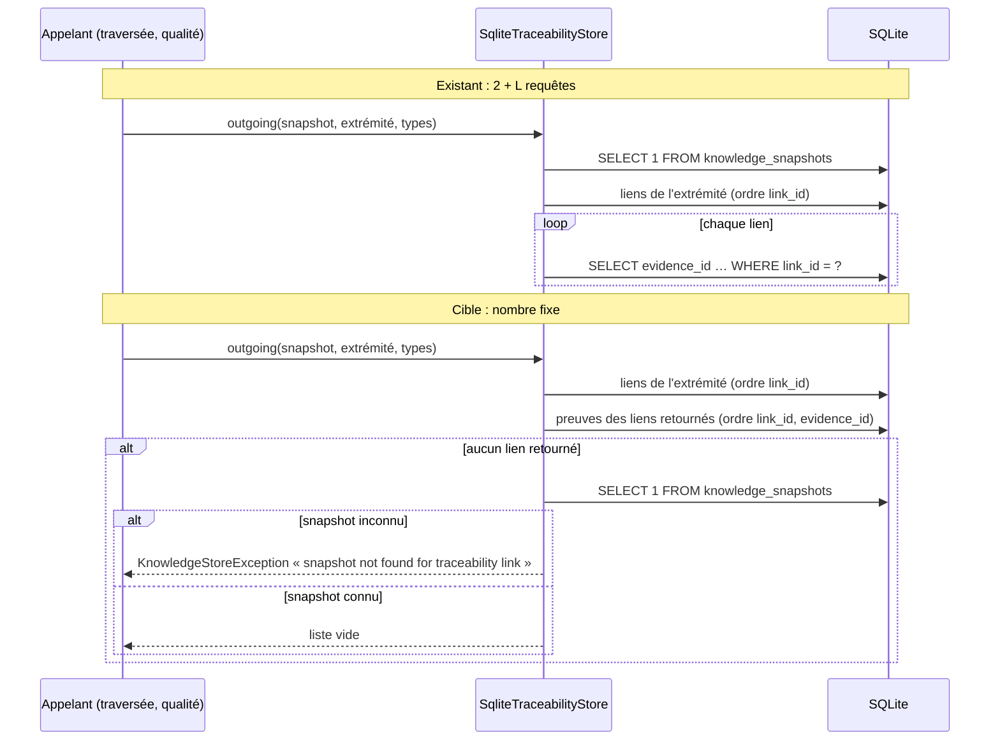

# Conception : lire les liens de traçabilité en un nombre fixe de requêtes

## Contexte

[EXISTANT VÉRIFIÉ] sur `1a539c22` (motivation : proposal.md, section Why) :

- `SqliteTraceabilityStore.endpointQuery` (`:167-199`) : `requireSnapshot` (`:180`), puis la requête par extrémité
  d'`endpointSql` (`:155-165`, filtre de relation en base, ordre `link_id`), puis `mapLink(result)` par ligne, qui lit
  les preuves du lien par une requête préparée dans la boucle (`:414-417`, `:441-453`).
- `findDefinitions` (`:304-336`) lit déjà les définitions et preuves de plusieurs liens en tranches liées par
  paramètres (`bindSlice`, `:338-...`), pour l'écriture en lot.
- `traceability_link_evidence` a pour clé primaire `(link_id, evidence_id)` (V005) : une lecture ordonnée par
  `(link_id, evidence_id)` est servie par la clé.
- `MemoryTraceabilityStore` refuse un snapshot inconnu avant toute lecture (`:117-121`) ; le message est le même que
  SQLite (`snapshot not found for traceability link: `).
- Patron de test : `SqliteTraceabilityBatchWriteCostTest` compte les `prepareStatement` par un `Proxy` de `Connection`
  et compare deux tailles.
- [EXISTANT VÉRIFIÉ] L'écriture à coût constant (`:200-207`, `:298-335`) tient (`AUD-PRF-31`) : elle n'est pas touchée.

## Exigences couvertes

| Capacité | Exigence (titre exact) | Rubriques de conception qui y répondent |
|---|---|---|
| `traceability-link-read-cost` | Reading the links of an endpoint SHALL cost a number of statements that does not depend on the links returned | §Décisions D1, D2, D3 |
| `traceability-link-read-cost` | A read of endpoint links SHALL return every link with all its evidence | §Décisions D1, D2 ; §Persistance |

## Composants et frontières

`SqliteTraceabilityStore` seul (`com.morpheus.store.sqlite.adapter`). Aucun moniteur ajouté
(`SqliteStoreAdapterHoldsNoMonitorArchitectureTest`), aucune classe du `runtime` nommée
(`SqliteStorePackagesArchitectureTest`), aucun port modifié.

## Modèle de domaine et invariants

Sans objet : `TraceabilityLink.evidenceIds()` reste un ensemble ; l'ordre de lecture des preuves n'est pas observable.

## Traitements et interactions

Question : combien de requêtes une lecture de L liens prépare-t-elle, avant et après ?

Explication : la vérification du snapshot ne sert qu'à distinguer « inconnu » de « vide » ; elle n'a lieu que si la
lecture est vide. Exigences servies : les deux exigences de la capacité.

## États et transitions

Sans objet.

## Contrats d'interface

Sans objet : `TraceabilityStore.outgoing` / `incoming` gardent signature et contrat.

## Persistance et intégrité

[PROPOSITION] Lecture des preuves par une seconde requête jointe à la même sélection d'extrémité
(`SELECT e.link_id, e.evidence_id FROM traceability_link_evidence e JOIN snapshot_traceability_links m … WHERE
m.snapshot_id = ? AND l.<kind> = ? AND l.<identity> = ? [AND relation_type IN (…)] ORDER BY e.link_id, e.evidence_id`),
regroupée en mémoire par lien dans une table ordonnée. Aucune migration.

## Transactions, concurrence et idempotence

[EXISTANT VÉRIFIÉ] Les deux requêtes s'exécutent sur la connexion de l'opération, sans transaction de lecture
explicite, comme aujourd'hui. Une écriture concurrente ne peut ajouter de preuves à un lien existant : un lien déjà
défini n'est jamais réécrit (`traceability-link-batch-write`), donc les deux lectures restent cohérentes pour les liens
retournés.

## Sécurité et isolation

Sans objet ; valeurs liées par paramètres, jamais concaténées.

## Gestion des erreurs et reprise

`SQLException` traduite en `KnowledgeStoreException("Cannot query snapshot traceability for …")` comme aujourd'hui.

## Observabilité

Sans objet.

## Performance et stratégie de mesure

[DÉCISION] `SqliteTraceabilityReadCostTest` (à écrire, à côté de `SqliteTraceabilityBatchWriteCostTest`) compte les
`prepareStatement` d'une lecture sur deux tailles (3 liens × 1 preuve, 300 liens × 4 preuves) et dans les deux sens ;
un second test vérifie par `EXPLAIN QUERY PLAN` que la lecture des preuves est servie par un index, sans tri temporaire.
Le gate M19 de traversée mesure le temps sur sa fixture inchangée (une preuve par lien) : la nuit qui suit la livraison
en donne la métrique.

## Compatibilité, migration et retour arrière

Aucune donnée ni contrat ne change. Retour arrière : revert.

## Décisions

### D1 : deux requêtes, liens puis preuves de la même sélection
- **Nature** : [PROPOSITION]
- **Exigences servies** : les deux exigences de `traceability-link-read-cost`
- **Choix** : une requête de preuves jointe à la même sélection d'extrémité, ordonnée par `(link_id, evidence_id)`.
- **Alternatives écartées** : `LEFT JOIN` unique liens + preuves (répète les colonnes du lien par preuve et complique le
  mappage) ; réutiliser la lecture en tranches de `findDefinitions` (nombre de requêtes qui dépend du nombre de
  tranches, donc de L).
- **Compromis** : la sélection d'extrémité est évaluée deux fois par SQLite.
- **ADR** : non concerné.

### D2 : vérifier le snapshot seulement sur un résultat vide
- **Nature** : [DÉCISION]
- **Exigences servies** : les deux exigences
- **Choix** : `requireSnapshot` n'est appelé que si la lecture des liens est vide.
- **Alternatives écartées** : le supprimer (un snapshot inconnu deviendrait une liste vide : dégradation silencieuse) ;
  le garder à chaque appel (une requête par lecture, que la traversée multiplie par nœud).
- **Compromis** : le store mémoire vérifie toujours d'abord ; le résultat observable est le même.
- **ADR** : non concerné.

### D3 : test de coût par proxy de `Connection`
- **Nature** : [DÉCISION]
- **Exigences servies** : Reading the links of an endpoint SHALL cost a number of statements that does not depend on the links returned
- **Choix** : patron de `SqliteTraceabilityBatchWriteCostTest`, dans le même paquet de test.
- **Alternatives écartées** : chronomètre (non reproductible).
- **Compromis** : aucun.
- **ADR** : non concerné.

## Écarts constatés

| Constat | Source A | Source B | Traitement proposé |
|---|---|---|---|
| Le gate M19 de traversée sous-estime un projet à plusieurs preuves par lien | `M19TraceabilityPerformanceGate.java:353` (une preuve) | constat `AUD-PRF-24` | non traité : la fixture d'un budget existant ne bouge pas ; le test de coût couvre la croissance en preuves |

## Stratégie de vérification

| Exigence | Scénario | Preuve | État |
|---|---|---|---|
| Reading the links of an endpoint SHALL cost… | A small and a large read prepare the same statements | `SqliteTraceabilityReadCostTest#aSmallAndALargeReadPrepareTheSameStatements` | à écrire |
| idem | The count is checked on every build | rouge sur `HEAD` (comptes nommés) | à écrire |
| A read of endpoint links SHALL return… | Several evidence per link are all returned | `SqliteTraceabilityReadCostTest` (valeurs) + `TraceabilityLinkReadParityTest` | à écrire |
| idem | An unknown snapshot is still refused | `SqliteTraceabilityStorePersistenceTest` (cas à ajouter), `MemoryTraceabilityStoreTest` | à écrire · existant |
| idem | A known snapshot without link answers empty | `SqliteTraceabilityStorePersistenceTest` (cas à ajouter) | à écrire |

## Documentation durable et diagrammes à mettre à jour

`docs/developer/specifications/traceability-link-read-cost.md` (à créer, gabarit de
`docs/developer/specifications/README.md`, diagramme de séquence ci-dessus) et son entrée dans la section « Persistance
SQLite et stores » de l'index.

## Questions ouvertes

Aucune.
