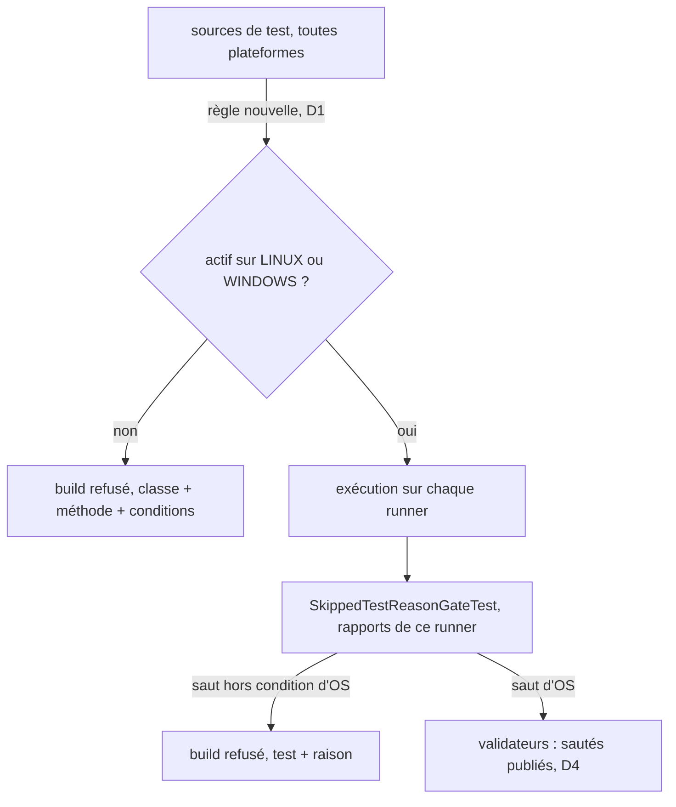

# Conception : refuser un test désactivé sur les deux plateformes de CI

## Contexte

- [EXISTANT VÉRIFIÉ] `SkippedTestReasonGateTest` (`morpheus-coverage-report`) lit, après le réacteur, les rapports
  Surefire des modules déclarés et refuse tout saut dont la raison ne commence pas par `Disabled on operating system`
  (`unexplainedSkipsOf`, ligne 155). `validate-m20.ps1:123-135` (`Get-UnexplainedSkips`) applique la même règle à la
  répétition de release.
- [EXISTANT VÉRIFIÉ] Un run CI ne voit que les rapports de sa plateforme : ni le gate ni le validateur ne savent qu'un
  test sauté sous Linux a été exécuté sous Windows.
- [EXISTANT VÉRIFIÉ] Dix-neuf conditions `@EnabledOnOs`/`@DisabledOnOs` dans les sources de test (`morpheus-api`,
  `morpheus-application`, `morpheus-integration-minos`, `morpheus-integration-nexus`, `morpheus-provider-openspec`,
  `morpheus-store-sqlite`), toutes au niveau méthode ou classe, chacune incluant `LINUX` ou `WINDOWS` dans son ensemble
  actif ; aucune annotation composée.
- [EXISTANT VÉRIFIÉ] `validate-d2.sh:142` et `validate-d2.ps1:158` impriment `skipped=` dans leur ligne de verdict ;
  `validate-m21.*` comptent les sautés (`validate-m21.ps1:47`) sans les publier.
- [EXISTANT VÉRIFIÉ] Le job `macos-smoke` de `nightly.yml` lance `./mvnw -B -ntp clean verify` sur macOS, mais en
  `continue-on-error: true` et hors des checks requis (« macOS is NOT an officially supported MORPHEUS platform ») : un
  test actif sur macOS seul n'est jamais exigé vert avant une fusion. Les plateformes de CI de la règle sont donc Linux
  et Windows, celles des checks `exact-head`.
- [EXISTANT VÉRIFIÉ] GEN-0089 définit une exécution déclarée comme l'unique exécution d'une méthode de test, et la somme
  déclarées + générées comme le total Surefire, sautés compris.

## Exigences couvertes

| Capacité | Exigence (titre exact) | Rubriques de conception qui y répondent |
|---|---|---|
| `skipped-test-justification` | A test of the reactor SHALL be skipped only by an operating-system condition | existant (`SkippedTestReasonGateTest`), D3 |
| `skipped-test-justification` | An operating-system condition MUST leave its test enabled on Linux or on Windows | D1, D2 |
| `skipped-test-justification` | A presence validator SHALL publish the number of skipped executions | D4, Q1 |

## Composants et frontières

- `morpheus-architecture-tests` : classe nouvelle `OperatingSystemConditionLeavesACiPlatformTest` (à écrire), qui
  parcourt les sources de test de tous les modules par `RepositoryTree.files(root)` (exigé par
  `RepositoryTreeOwnershipTest`).
- `morpheus-coverage-report` : `SkippedTestReasonGateTest`, inchangé dans sa règle ; sa Javadoc nomme la règle sœur.
- `scripts/validate-m21.*`, `scripts/validate-d2.*` : ligne de verdict et relevé.

## Modèle de domaine et invariants

Sans objet : aucun type du domaine.

## Traitements et interactions

Question : quelle vérification voit quoi ?

Existant : le second contrôle (`G`). Cible : le premier (`A`) et la publication (`V`). Exigences : les trois de la
capacité.

## États et transitions

Sans objet.

## Contrats d'interface

Sans objet : aucune surface publique ; le format du relevé gagne une ligne `skipped=`.

## Persistance et intégrité

Sans objet.

## Transactions, concurrence et idempotence

Sans objet.

## Sécurité et isolation

Sans objet.

## Gestion des erreurs et reprise

Le refus énumère tous les tests fautifs en une fois. Une condition dont l'argument n'est pas une constante `OS.X`
littérale (variable, expression) est refusée par son nom : la règle ne sait pas la juger et ne la laisse pas passer.

## Observabilité

Le nombre de sautés de chaque plateforme apparaît dans le relevé : un écart entre Linux et Windows devient lisible.

## Performance et stratégie de mesure

Sans objet : un parcours textuel des sources de test.

## Compatibilité, migration et retour arrière

Les dix-neuf conditions actuelles passent la règle. Retour arrière : retirer la classe et la ligne `skipped=`.

## Décisions

### D1 : juger les conditions sur les sources, pas sur les rapports
- **Nature** : [DÉCISION]
- **Exigences servies** : `skipped-test-justification` › An operating-system condition MUST leave its test enabled on
  Linux or on Windows
- **Choix** : règle textuelle sur les sources de test : pour chaque méthode `@Test`/`@ParameterizedTest`/`@TestFactory`,
  ensemble actif = intersection de l'ensemble de la classe et de celui de la méthode (`@EnabledOnOs` donne son
  ensemble, `@DisabledOnOs` son complément, absence = tous) ; refus si l'ensemble ne contient ni `LINUX` ni `WINDOWS`.
- **Alternatives écartées** : exiger dans `SkippedTestReasonGateTest` qu'un test sauté ait été exécuté sur l'autre
  plateforme (option de l'audit) — un run ne dispose pas des rapports de l'autre, il faudrait un job qui fusionne les
  artefacts des deux voies, plus lourd et hors du build local ; une règle ArchUnit sur les annotations compilées — les
  sources de test des modules produit ne sont pas dans l'ensemble importé par la suite.
- **Compromis** : une annotation composée (méta-annotée `@EnabledOnOs`) échapperait ; la règle refuse toute annotation
  de test méta-annotée par une condition d'OS, puisqu'aucune n'existe.
- **ADR** : non concerné.

### D2 : assertion textuelle, cassée une fois
- **Nature** : [DÉCISION]
- **Exigences servies** : idem D1.
- **Choix** : intention « aucune condition d'OS ne désactive un test sur les deux plateformes de CI » ; mécanisme
  textuel, parce que la cible est hors de l'ensemble importé ; la violation plantée (`@EnabledOnOs(OS.MAC)`) est
  consignée dans la PR.
- **Alternatives écartées** : voir D1.
- **Compromis** : aucun.
- **ADR** : non concerné.

### D3 : la règle du gate par rapport ne change pas
- **Nature** : [DÉCISION]
- **Exigences servies** : `skipped-test-justification` › A test of the reactor SHALL be skipped only by an
  operating-system condition
- **Choix** : l'exigence décrit l'existant ; seule la Javadoc de `SkippedTestReasonGateTest` renvoie à la règle sœur.
- **Alternatives écartées** : déplacer le gate dans la suite d'architecture — il doit lire les rapports après tous les
  modules, ce que seul `morpheus-coverage-report` fait.
- **Compromis** : aucun.
- **ADR** : non concerné.

### D4 : publier les sautés sans changer les comptes comparés
- **Nature** : [PROPOSITION] (dépend de Q1)
- **Exigences servies** : `skipped-test-justification` › A presence validator SHALL publish the number of skipped
  executions
- **Choix** : ajouter `skipped=<n>` au relevé et à la ligne de verdict de `validate-m21.*`, garder celui de
  `validate-d2.*`, sans retrancher.
- **Alternatives écartées** : voir Q1.
- **Compromis** : un test sauté reste compté sous `testsMinimum` ; la règle D1 garantit qu'il s'exécute ailleurs.
- **ADR** : non concerné tant que Q1 retient la publication à part.

## Écarts constatés

| Constat | Source A | Source B | Traitement proposé |
|---|---|---|---|
| `validate-m20.ps1` porte une copie de la règle du gate | `validate-m20.ps1:123-135` | `SkippedTestReasonGateTest` | inchangé ici ; la copie disparaît avec la bibliothèque de `count-presence-once-from-the-declared-modules` si elle y est versée |
| `validate-d2` publie les sautés, `validate-m21` non | `validate-d2.sh:142` | `validate-m21.sh:218` | D4 |

## Stratégie de vérification

| Exigence | Scénario | Preuve | État |
|---|---|---|---|
| A test of the reactor SHALL be skipped only … | A failed assumption is refused … ; An operating-system condition is accepted | `SkippedTestReasonGateTest#anOperatingSystemConditionIsAcceptedAndEveryOtherSkipIsNamedWithItsReason` | existant |
| An operating-system condition MUST leave … | A test enabled on macOS only is refused ; disabled on both ; Two conditions that exclude each other | `OperatingSystemConditionLeavesACiPlatformTest` sur sources fabriquées (`@TempDir`) | à écrire |
| idem | A test for one CI platform is accepted | même classe, méthode sur le dépôt réel | à écrire |
| A presence validator SHALL publish … | The summary names the skips ; A run with no skip says so | cas nouveaux de `scripts/tests/test_validator_verdicts.py` | à écrire |

## Documentation durable et diagrammes à mettre à jour

`docs/developer/specifications/skipped-test-justification.md` (à créer, avec le diagramme ci-dessus) et sa ligne
d'index ; `.claude/rules/testing.md` ne change pas (la règle « jamais `@Disabled` sans ticket » reste vraie).

## Questions ouvertes

### Q1 : retrancher les sautés des comptes de présence
- **Nature** : [QUESTION] — décision du mainteneur.
- **Options** : (a) publier à part sans retrancher ; (b) retrancher les sautés du compte déclaré et du compte
  d'architecture ; (c) statu quo.
- **[PROPOSITION]** (a). Avec D1, un test sauté sur une plateforme s'exécute sur l'autre ; le retrancher ferait
  diverger les comptes des deux plateformes, donc requalifier les ratchets sur la plus basse, et changerait la
  définition de GEN-0089.
- **ADR** : (a) et (c) n'en exigent aucun ; (b) exige un ADR à proposer, consolidé, qui remplace GEN-0089.
