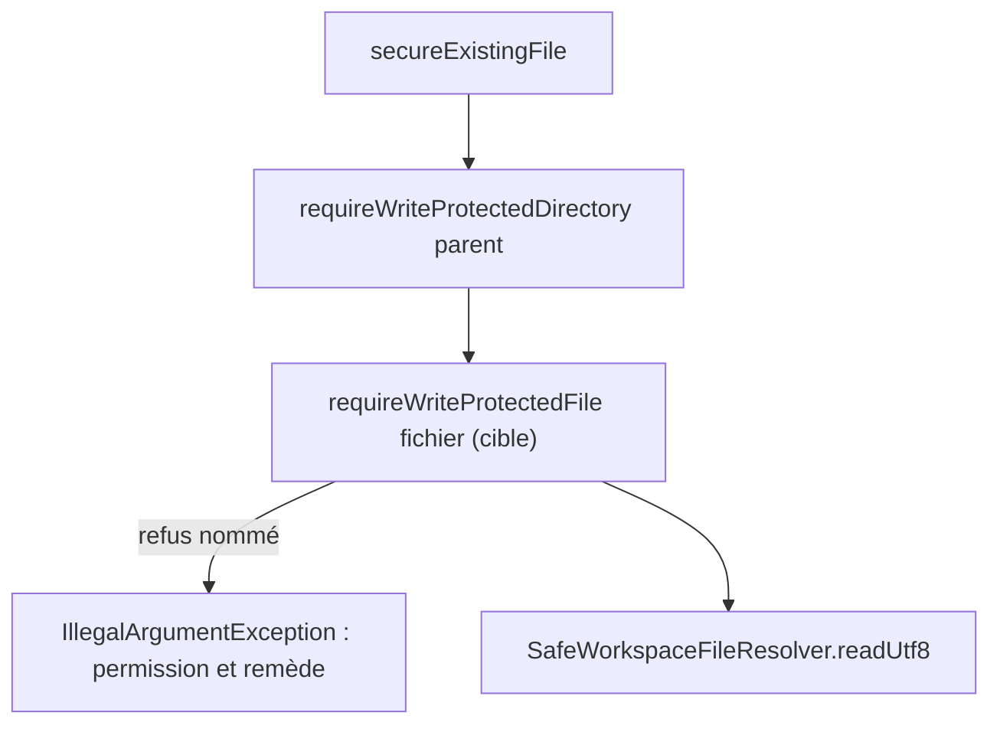

# Conception : refuser un fichier d'identifiants remote que d'autres comptes peuvent écrire

## Contexte

- [EXISTANT VÉRIFIÉ] `RemoteIdentityFileStore.readLines(authFile, failureMessage)` : `secureExistingFile` (régulier, non
  symbolique), `requireWriteProtectedDirectory(parent)`, puis `SafeWorkspaceFileResolver.readUtf8`. Toute
  `RuntimeException` devient `IllegalArgumentException(failureMessage, cause)`.
- [EXISTANT VÉRIFIÉ] `LocalWritePermissionHardener` (`com.morpheus.application.files`) sait déjà, dans `hardenFile`,
  refuser un lien, un fichier non régulier et un propriétaire non fiable (`requireTrustedSensitiveOwner`), puis
  **appliquer** des permissions (`requireHardened`). Il n'offre aucune vérification de fichier en lecture seule.
- [EXISTANT VÉRIFIÉ] `MorpheusRemoteIdentitySnapshotCache` recharge le fichier quand ses métadonnées changent et au
  moins une fois par `DEFAULT_REVALIDATION_INTERVAL` ; une exception du chargeur remonte à `authenticate`.
- [EXISTANT VÉRIFIÉ] Le keystore est lu par `MorpheusRemoteHttpServerBootstrap` après
  `requireWriteProtectedDirectory(parent)`, par `SafeWorkspaceFileResolver.readBytes` borné à
  `MorpheusRemoteHttpServer.MAX_KEYSTORE_BYTES`.

## Exigences couvertes

| Capacité | Exigence (titre exact) | Rubriques de conception qui y répondent |
|---|---|---|
| `remote-credential-file-trust` | The identity file is read only when no other account can write it | D1, D2, Traitements |
| `remote-credential-file-trust` | The TLS keystore is read only when no other account can write it | D1 |

## Composants et frontières

- `morpheus-application`, `com.morpheus.application.files.LocalWritePermissionHardener` : une méthode publique
  `requireWriteProtectedFile(Path)` (à créer) qui fait les vérifications de `hardenFile` sans rien écrire. La classe
  est déjà nommée pour l'accès fichier dans `ApplicationTechnologyBoundaryArchitectureTest` ; aucune liste ne change.
- `morpheus-api`, `com.morpheus.api.remote` : `RemoteIdentityFileStore.readLines` et le chargement du keystore
  appellent cette méthode avant la lecture.

## Modèle de domaine et invariants

Sans objet.

## Traitements et interactions

Question : où la vérification s'insère-t-elle dans la lecture du fichier d'identités ?

Existant : A → B → D. Cible : C entre B et D, au démarrage comme à chaque rechargement par le cache.

## États et transitions

Sans objet.

## Contrats d'interface

Sans objet : aucune route ; le refus au démarrage est une sortie de `morpheus api --remote` (message et code de sortie
existants d'un démarrage refusé). Au rechargement, la requête n'est pas authentifiée (comportement existant d'un
fichier illisible).

## Persistance et intégrité

Aucune permission n'est modifiée à la lecture : durcir en lisant masquerait qu'un autre compte a pu écrire le fichier
avant le durcissement.

## Transactions, concurrence et idempotence

Sans objet.

## Sécurité et isolation

Frontière : les autres comptes de l'hôte, celle qu'ADR-0105 fixe. Un administrateur reste de confiance (même ensemble
que `resolveTrustedWindowsPrincipals`). Le message de refus nomme le fichier par son rôle (« remote auth file »,
« remote TLS keystore ») sans chemin, comme les refus existants.

## Gestion des erreurs et reprise

Refus nommé, aucun repli. Remède écrit : rétablir `rw-------` (ou une ACL au seul propriétaire), ou réécrire le
fichier par `server identity rotate`.

## Observabilité

Sans objet au-delà du message de refus.

## Performance et stratégie de mesure

Le cache ne recharge qu'au changement ou à l'intervalle de revalidation : une vérification de permissions par
rechargement, pas par requête.

## Compatibilité, migration et retour arrière

**BREAKING** au démarrage pour un fichier ou un keystore inscriptible par le groupe ; notes de version et guide
`docs/user/TEAM_REMOTE_SERVER.md`. Retour arrière : retirer l'appel ; aucune donnée perdue.

## Décisions

### D1 : vérifier, ne pas durcir, à la lecture
- **Nature** : [DÉCISION]
- **Exigences servies** : les deux exigences de `remote-credential-file-trust`
- **Choix** : une vérification en lecture seule, partagée par le fichier d'identités et le keystore.
- **Alternatives écartées** : appeler `hardenFile` à la lecture — il effacerait la trace d'une écriture étrangère et
  accepterait la ligne déjà ajoutée ; avertir sans refuser — un avertissement ne protège pas un rôle ADMIN.
- **Compromis** : rupture de démarrage pour un déploiement mal provisionné.
- **ADR** : ADR-0105 (le modèle décidé), non modifié.

### D2 : refuser aussi au rechargement
- **Nature** : [DÉCISION]
- **Exigences servies** : `remote-credential-file-trust` › The identity file is read only when no other account can write it
- **Choix** : la vérification fait partie de `readLines`, donc du chargeur du cache.
- **Alternatives écartées** : ne vérifier qu'au démarrage — un `chmod` après démarrage rouvrirait la voie.
- **ADR** : non concerné.

## Écarts constatés

| Constat | Source A | Source B | Traitement proposé |
|---|---|---|---|
| ADR-0105 suppose un fichier `rw-------` ; la lecture ne le vérifie pas | ADR-0105 | `RemoteIdentityFileStore.readLines` | corrigé ici |

## Stratégie de vérification

| Exigence | Scénario | Preuve | État |
|---|---|---|---|
| The identity file is read only… | A group-writable identity file at start | `RemoteIdentityFileStoreTest#aGroupWritableIdentityFileIsRefusedUnchanged` (POSIX, ignoré hors POSIX avec raison) | à écrire |
| The identity file is read only… | An identity file that becomes group-writable while the server runs | `MorpheusRemoteIdentitySnapshotCacheTest#aReloadOfAGroupWritableFileAuthenticatesNoIdentity` | à écrire |
| The identity file is read only… | An identity file written by the identity commands | `MorpheusRemoteIdentityFileTest`, `MorpheusRemoteIdentityLifecycleTest` | existant |
| The identity file is read only… | An ACL that grants write to an untrusted principal | `LocalWritePermissionHardenerTest` (cas ACL de la nouvelle méthode, Windows) | à écrire |
| The TLS keystore is read only… | A group-writable keystore | `MorpheusRemoteHttpServerStartupPolicyTest#aGroupWritableKeystoreIsRefused` | à écrire |

## Documentation durable et diagrammes à mettre à jour

Page nouvelle `docs/developer/specifications/remote-credential-file-trust.md` (gabarit et index de
`docs/developer/specifications/README.md`) ; `SECURITY.md` (Remote server security) ; `docs/user/TEAM_REMOTE_SERVER.md`
(provisionnement du fichier et du keystore) ; notes de version de la version qui livre.

## Questions ouvertes

Aucune.
