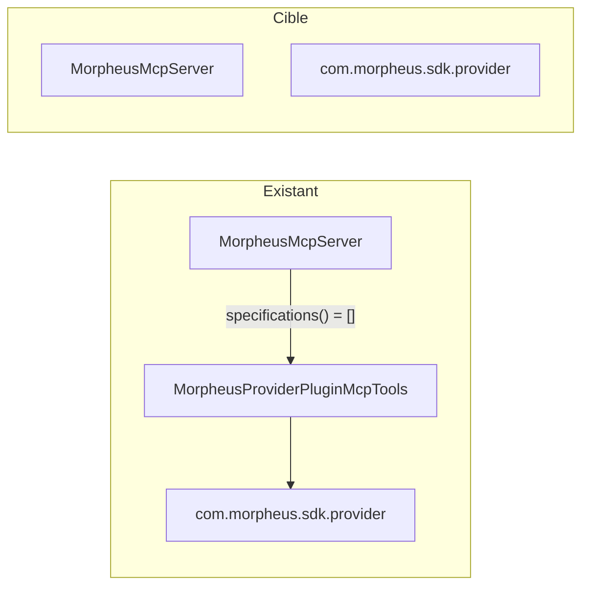

# Conception : retirer l'outil MCP de plugins provider que rien ne sert

## Contexte

- [EXISTANT VÉRIFIÉ] `MorpheusMcpServer.java:164` appelle `new MorpheusProviderPluginMcpTools().specifications()`,
  qui rend `List.of()` faute de répertoire (`MorpheusProviderPluginMcpTools.java:30-31`, `:40-41`). Le constructeur
  `MorpheusProviderPluginMcpTools(Path)` n'a que deux appelants, des tests de `morpheus-mcp`
  (`MorpheusProviderPluginMcpToolsTest`, `MorpheusProviderPluginMcpExposureTest`, deux méthodes `@Test` chacun).
- [EXISTANT VÉRIFIÉ] La classe est le seul importateur de `com.morpheus.sdk.provider` dans `morpheus-mcp/src/main`
  (`ProviderPluginDiscovery`, `ProviderPluginViews`), donc la seule raison de la dépendance `morpheus-provider-sdk` de
  `morpheus-mcp/pom.xml:29`.
- [EXISTANT VÉRIFIÉ] Elle est encore nommée par : `McpStoreFailureInjectionTest:139` et la Javadoc de
  `GrowingCollectionToolsArePageableTest` et de `McpToolFailure` (`morpheus-mcp`) ;
  `ProviderPluginPlatformContractTest:58-71`, `ProviderPluginTrustBoundaryContractTest:202-209`,
  `AuditRemediationContractTest:56`, `SilentCatchArchitectureTest:145` et la Javadoc de
  `PublicSurfaceManifestCoversEveryServedToolTest` (`morpheus-architecture-tests`) ; les listes d'entrées exigées de
  `distribution/build-portable.ps1:150` et `distribution/build-portable.sh:48` ; `docs/developer/MCP.md:48`,
  `docs/developer/PROVIDER_SDK.md:337`, `docs/user/PROVIDER_PLUGINS.md` (section MCP) ; `BE-0102` (§3 de la décision,
  contexte, Do's and Don'ts) ; `SEC-0129` (contexte « Le câblage MCP par défaut ne sert aucun outil de plugin »,
  conformité « répertoire MCP non choisi par l'appelant »).
- [EXISTANT VÉRIFIÉ] `PublicSurfaceManifestCoversEveryServedToolTest` ne juge que les outils servis par le câblage par
  défaut et déclare explicitement ne pas juger `discover_provider_plugins` : c'est le trou que comble l'exigence.

## Exigences couvertes

| Capacité | Exigence (titre exact) | Rubriques de conception qui y répondent |
|---|---|---|
| `public-surface-convergence` | Le module MCP NE DOIT déclarer aucun outil de plugin provider | D1, D2, D3 |

## Composants et frontières

- `morpheus-mcp` : retrait de `com.morpheus.mcp.MorpheusProviderPluginMcpTools` ; `MorpheusMcpServer`
  (`com.morpheus.mcp.server`) n'ajoute plus rien pour les plugins ; le POM perd `morpheus-provider-sdk`.
  `./mvnw dependency:analyze` (0 avertissement, `failOnWarning`) dit si une autre classe du module, tests compris, en
  avait besoin.
- `morpheus-architecture-tests` : le POM garde sa déclaration du SDK, dont dépendent les règles
  d'`AdapterSiblingArchitectureTest` (le paquet du SDK doit être importé) ; la Javadoc de
  `PublicSurfaceManifestCoversEveryServedToolTest` qui justifiait une déclaration de test par cette classe est réécrite.
- Frontière tenue après ce change par `AUD-ARC-29` (règle de bytecode) ; ce change livre le contrôle textuel des noms
  d'outils.

Question : quelle arête disparaît ? L'arête de `morpheus-mcp` vers le SDK n'existe que par la classe retirée ; dans la
cible, aucune classe du module ne nomme le SDK (exigence ci-dessus, et règle d'`AUD-ARC-29`).

## Modèle de domaine et invariants

Sans objet : aucun type du domaine ne change.

## Traitements et interactions

Sans objet : aucun outil servi ne change ; `tools/list` rend la même liste avant et après.

## États et transitions

Sans objet : aucun cycle de vie.

## Contrats d'interface

[EXISTANT VÉRIFIÉ] `contracts/public-surfaces.tsv`, lignes `provider.plugins.discover` et `provider.plugins.probe` :
colonne `mcp` à `EXPLICITLY_NOT_EXPOSED`, inchangée. `ProviderPluginPlatformContractTest` épingle les cinq premières
colonnes des deux lignes, pas la note. Aucune OpenAPI n'est concernée (surface MCP). Les cellules `cli` et `http`
restent identiques.

## Persistance et intégrité

Sans objet : aucune donnée persistée.

## Transactions, concurrence et idempotence

Sans objet.

## Sécurité et isolation

[EXISTANT VÉRIFIÉ] `SEC-0129` §7 : « rien en MCP ». Le retrait supprime un chemin qui, réactivé par un constructeur,
aurait rendu la découverte model-facing ; les garanties remote (répertoire imposé, projection sur liste blanche)
restent portées par `MorpheusProviderPluginHttpRoutes` et `ProviderPluginViews`, inchangés. Les assertions de
`ProviderPluginTrustBoundaryContractTest` qui lisaient la classe (« a model must not choose which directory is searched
for executable code ») sont tenues plus strictement par l'absence de tout outil de plugin.

## Gestion des erreurs et reprise

[EXISTANT VÉRIFIÉ] Le code de refus `PROVIDER_PLUGIN_DISCOVERY_FAILED` n'est produit que par la classe retirée
(`MorpheusProviderPluginMcpTools.java:24`, `:73`) et n'est jamais émis aujourd'hui. Il disparaît avec elle.

## Observabilité

Sans objet.

## Performance et stratégie de mesure

Sans objet.

## Compatibilité, migration et retour arrière

Aucun client ne perd d'outil : aucun câblage ne servait celui-ci. Retour arrière : restaurer la classe et la
dépendance, sans perte de données.

## Décisions

### D1 : retirer la classe plutôt que de la câbler
- **Nature** : [DÉCISION]
- **Exigences servies** : `public-surface-convergence` › Le module MCP NE DOIT déclarer aucun outil de plugin provider
- **Choix** : supprimer la classe, son appel, la dépendance POM et ses deux tests.
- **Alternatives écartées** : ajouter une option de lancement qui fournit un répertoire au serveur MCP — contredit
  `SEC-0129` §7 et la colonne `mcp` du manifeste, et ouvre une surface model-facing sans demande ; garder la classe
  « pour plus tard » — interrupteur dormant refusé par `.claude/rules/code-style.md`.
- **Compromis** : une réouverture future de la découverte en MCP repasse par une décision écrite et une ligne de
  manifeste.
- **ADR** : `SEC-0129` (la couvre déjà) ; non concerné sinon.

### D2 : contrôle textuel des noms d'outils de plugin dans `morpheus-mcp`
- **Nature** : [PROPOSITION]
- **Exigences servies** : `public-surface-convergence` › Le module MCP NE DOIT déclarer aucun outil de plugin provider
- **Choix** : une méthode de test de `morpheus-architecture-tests` (paquet `com.morpheus.mcp` des tests, à côté de
  `PublicSurfaceManifestCoversEveryServedToolTest`) lit les sources principales de `morpheus-mcp` et refuse toute
  occurrence des littéraux `discover_provider_plugins` et `probe_provider_plugin`, en exigeant d'avoir lu au moins une
  source. Intention : « ce nom d'outil ne doit pas apparaître ici » → assertion textuelle
  (`.claude/rules/architecture.md`, tableau du choix). Les assertions M22 qui épinglaient le texte de la classe
  (`ProviderPluginPlatformContractTest:66-71`, `ProviderPluginTrustBoundaryContractTest:208-209`) deviennent l'appel à
  ce contrôle, et le volet d'`AuditRemediationContractTest` / `SilentCatchArchitectureTest` qui lisait la classe est
  retiré avec elle, son sujet n'existant plus.
- **Alternatives écartées** : se fier au seul test des outils servis — il ne voit pas un outil déclaré derrière un
  constructeur non câblé, exactement le cas constaté ; une règle ArchUnit — un nom d'outil est une chaîne, invisible au
  bytecode.
- **Compromis** : un nom d'outil de plugin inventé ailleurs que ces deux littéraux échappe au contrôle textuel ; la règle
  de bytecode d'`AUD-ARC-29` (aucune dépendance de `com.morpheus.mcp..` vers `com.morpheus.sdk..`) le couvre en pratique.
  Les méthodes `@Test` retirées sont compensées : le compte de `architectureTestsMinimum` et de `testsMinimum`
  (`config/m21-quality-ratchets.properties`) ne baisse pas (`.claude/rules/testing.md`).
- **ADR** : non concerné.

### D3 : note de la ligne `provider.plugins.discover`
- **Nature** : [PROPOSITION]
- **Exigences servies** : `public-surface-convergence` › Le module MCP NE DOIT déclarer aucun outil de plugin provider
- **Choix** : remplacer « MCP deliberately exposes no caller-controlled filesystem directory » par une note qui dit que
  le MCP ne déclare aucun outil de plugin provider, le reste de la note inchangé.
- **Alternatives écartées** : laisser la note — elle suggère un outil MCP à répertoire imposé, qui n'existe pas.
- **Compromis** : modification d'un fichier de gouvernance à justifier dans la PR.
- **ADR** : non concerné.

### D4 : texte des ADR qui nomment la classe
- **Nature** : [QUESTION] décision du mainteneur ; [PROPOSITION] clarification.
- **Exigences servies** : `public-surface-convergence` › Le module MCP NE DOIT déclarer aucun outil de plugin provider
- **Choix proposé** : clarifier `BE-0102` en retirant le §3 de sa décision (règle de rédaction d'une classe qui
  n'existe plus) et les puces Do's and Don'ts qui la nomment ; clarifier dans `SEC-0129` la phrase de contexte et la
  ligne de conformité. Le sens des deux décisions ne change pas : aucun outil MCP ne relaie de message d'exception,
  rien n'est exposé en MCP.
- **Alternatives** : ADR consolidé qui remplace `BE-0102` — justifié seulement si le mainteneur lit le retrait du §3
  comme un changement partiel de décision (`.claude/rules/adr.md`).
- **ADR** : `BE-0102`, `SEC-0129` (clarification proposée) ; ADR à proposer seulement si l'alternative est retenue.

## Écarts constatés

| Constat | Source A | Source B | Traitement proposé |
|---|---|---|---|
| Un outil MCP de découverte est annoncé disponible | `docs/user/PROVIDER_PLUGINS.md` (`discover_provider_plugins(directory)`) | aucun câblage ne le sert, et il ne prend aucun argument | réécrire la section MCP (tâche 3.2) |
| Un lancement « avec répertoire » est annoncé | `docs/developer/PROVIDER_SDK.md:337` | aucune option de lancement MCP ne fournit de répertoire | réécrire (tâche 3.2) |
| La liste des classes MCP nomme une classe sans outil servi | `docs/developer/MCP.md:48` | `MorpheusMcpServer.java:164` | retirer la ligne (tâche 3.2) |

## Stratégie de vérification

| Exigence | Scénario | Preuve | État |
|---|---|---|---|
| Le module MCP NE DOIT déclarer aucun outil de plugin provider | Le serveur MCP ne sert aucun outil de plugin | `PublicSurfaceManifestCoversEveryServedToolTest` (existant) + `ProviderPluginPlatformContractTest` (manifeste) | existant |
| idem | Un outil de plugin déclaré mais non servi fait échouer le build | nouvelle méthode de contrôle textuel (D2), violation plantée puis retirée | à écrire |
| idem | Le contrôle voit les sources du module | même méthode, assertion sur le nombre de sources lues | à écrire |

## Documentation durable et diagrammes à mettre à jour

`docs/developer/specifications/public-surface-convergence.md` (exigence, matrice) ; `docs/developer/MCP.md` ;
`docs/developer/PROVIDER_SDK.md` ; `docs/user/PROVIDER_PLUGINS.md` ; `BE-0102` et `SEC-0129` selon D4.

## Questions ouvertes

Aucune autre que D4, qui ne change ni l'exigence ni les tâches de code.
