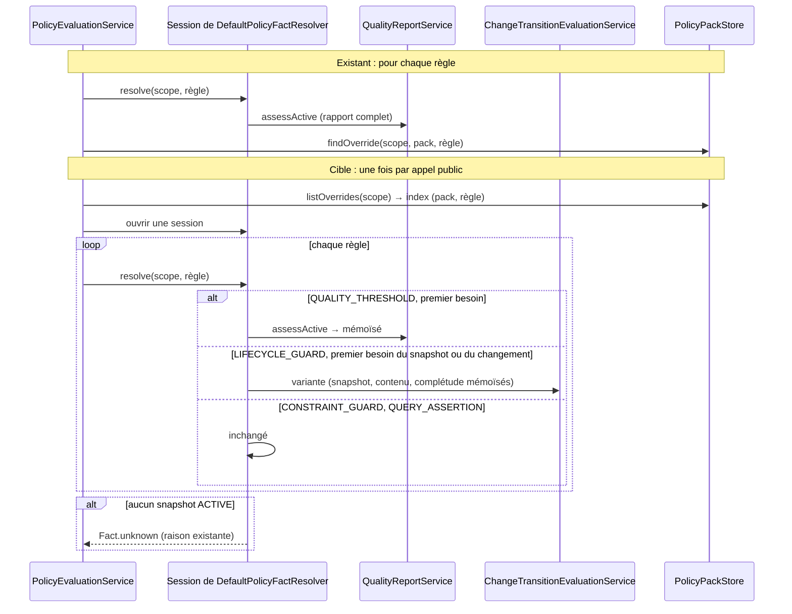

# Conception : résoudre chaque rapport de gouvernance une fois par évaluation

## Contexte

[EXISTANT VÉRIFIÉ] sur `1a539c22` (motivation : proposal.md, section Why) :

- `PolicyEvaluationService` (`morpheus-application/.../policy/PolicyEvaluationService.java`) : `evaluate` (`:21-39`),
  `evaluatePack` (`:41-45`) et `dryRun` (`:47-57`) passent tous par `evaluateVersion` (`:59-96`), qui appelle
  `facts.resolve` puis `store.findOverride` pour chaque règle.
- `PolicyFactResolver` est une interface fonctionnelle (`PolicyFactResolver.java:4-7`) implémentée par
  `DefaultPolicyFactResolver` et par des lambdas de test (`PolicyEvaluationServiceTest`, `PolicyInactivePackRefusalTest`).
- `DefaultPolicyFactResolver` est sans état ; il est construit par `PolicyRuntimeServices.from`
  (`PolicyRuntimeServices.java:45-71`), appelé par opération dans `SqliteOperationRuntime.java:205`.
- `QualityReportService.assessActive` (`:40-43`) relit le snapshot actif et calcule les cinq sous-rapports
  (`:54-60`) ; `CompositionQueryService.findActive` relit l'état de composition et ses conflits.
- `PolicyBudgets.MAX_OVERRIDES_PER_SCOPE` borne les overrides d'une portée à l'écriture : leur lecture en une fois est
  bornée.
- [EXISTANT VÉRIFIÉ] `application.policy..` ne doit contenir ni `ScriptEngine`, ni `Class.forName`, ni SQL
  (`.claude/rules/architecture.md`, cœurs purs) : la mémoïsation est un `Map` local, sans technologie.

## Exigences couvertes

| Capacité | Exigence (titre exact) | Rubriques de conception qui y répondent |
|---|---|---|
| `policy-evaluation-cost` | An evaluation SHALL read the overrides of its scope once | §Décisions D2 ; §Traitements |
| `policy-evaluation-cost` | An evaluation SHALL compute each report its quality and lifecycle rules share once | §Décisions D1, D3, D4 ; §Traitements |

## Composants et frontières

- `com.morpheus.application.policy` : `PolicyFactResolver` gagne une méthode `default` qui ouvre une session de
  résolution pour une évaluation (par défaut : `this`, donc les lambdas existantes restent valides) ;
  `DefaultPolicyFactResolver` rend une session qui mémoïse ; `PolicyEvaluationService` ouvre une session et lit les
  overrides une fois par appel public.
- `com.morpheus.application.orchestration` : aucune modification ici ; la session appelle la variante d'évaluation de
  transition livrée par `assess-the-orchestration-state-of-a-change-once`.
- Frontière : `policy` dépend déjà de `orchestration`, `quality` et `composition` (`DefaultPolicyFactResolver.java:3-16`) ;
  aucune arête nouvelle (`ApplicationPackageCyclesArchitectureTest`).

## Modèle de domaine et invariants

Sans objet : `PolicyEvaluation.Fact`, `RuleResult` et `Report` gardent leur forme ; la sémantique tri-state
(`UNKNOWN` jamais converti en `BLOCK` ou `PASS`, ADR cités par `.claude/rules/code-style.md`) n'est pas touchée.

## Traitements et interactions

Question : que lit une évaluation d'un pack de règles de qualité et de cycle de vie, avant et après ?

Explication : la session vit le temps d'un appel public et meurt avec lui ; aucune valeur ne survit d'une évaluation à
la suivante. Exigences servies : les deux exigences de `policy-evaluation-cost`.

## États et transitions

Sans objet.

## Contrats d'interface

Sans objet : `policy.evaluate` et `policy.dry-run` (`contracts/public-surfaces.tsv`) et leurs opérations OpenAPI
gardent forme et valeurs ; `PolicyPackContractTest` (M25) et `PolicyPersistenceParityTest` les tiennent.

## Persistance et intégrité

Sans objet : lecture seule ; `findOverride` reste au port pour ses autres appelants éventuels (aucune suppression de
méthode de port dans ce changement).

## Transactions, concurrence et idempotence

Voir D3 : les rapports mémoïsés d'une évaluation viennent d'un seul snapshot actif. La session n'est partagée entre
aucun fil : elle est locale à l'appel.

## Sécurité et isolation

Sans objet.

## Gestion des erreurs et reprise

Une exception levée par un rapport n'est pas mémoïsée : elle remonte comme aujourd'hui et termine l'évaluation.

## Observabilité

Sans objet.

## Performance et stratégie de mesure

[DÉCISION] Preuve par compte de lectures sur ports comptés (`PolicyEvaluationCostTest`, à écrire), comme
`ChangeAnalysisTraversalCostTest`. [EXISTANT VÉRIFIÉ] Le budget M19 de durée est déclaré par
`AUD-PRF-30` (sprint 2), avant cette correction.

## Compatibilité, migration et retour arrière

Les lambdas de test qui implémentent `PolicyFactResolver` compilent sans changement grâce à la méthode `default`.
Retour arrière : revert, rien de persisté.

## Décisions

### D1 : une session de résolution par évaluation
- **Nature** : [PROPOSITION]
- **Exigences servies** : `policy-evaluation-cost` › An evaluation SHALL compute each report its quality and lifecycle rules share once
- **Choix** : `PolicyFactResolver.forOneEvaluation()` (méthode `default` qui rend `this`) ; `DefaultPolicyFactResolver`
  rend une instance de session qui porte les mémos (rapport qualité par projet, état de composition par projet,
  snapshot actif, contenu et requirements CURRENT par projet, complétude par changement).
- **Alternatives écartées** : mémoïser dans l'instance de `DefaultPolicyFactResolver` (sa durée de vie est celle du
  runtime d'opération, une hypothèse sur l'appelant que rien ne tient) ; passer un objet de contexte à `resolve`
  (change la signature que les lambdas de test implémentent).
- **Compromis** : une méthode de plus sur un port interne de l'application.
- **ADR** : non concerné.

### D2 : lire les overrides de la portée une fois
- **Nature** : [DÉCISION]
- **Exigences servies** : `policy-evaluation-cost` › An evaluation SHALL read the overrides of its scope once
- **Choix** : chaque appel public lit `listOverrides(scope)` une fois et l'indexe par (pack, règle) dans une table
  ordonnée ; `evaluateVersion` y cherche l'override de chaque règle.
- **Alternatives écartées** : lire par pack (encore 32 lectures pour une portée pleine) ; ajouter au port une lecture
  par pack (aucun besoin, la portée est bornée).
- **Compromis** : lit les overrides de packs inactifs de la portée, bornés par `MAX_OVERRIDES_PER_SCOPE`.
- **ADR** : non concerné.

### D3 : les rapports partagés viennent d'un seul snapshot actif
- **Nature** : [DÉCISION]
- **Exigences servies** : `policy-evaluation-cost` › An evaluation SHALL compute each report its quality and lifecycle rules share once
- **Choix** : la session lit `activeSnapshot` une fois par projet et calcule rapport qualité et entrées de cycle de vie
  sur ce snapshot (`QualityReportService.assessSnapshot`, variante de `AUD-PRF-21`).
- **Alternatives écartées** : relire le snapshot actif par règle et mémoïser par identité de snapshot (garde une lecture
  par règle sans rien apporter).
- **Compromis** : les règles `CONSTRAINT_GUARD` et `QUERY_ASSERTION` relisent encore le snapshot actif par leurs
  services (`ConstraintEvaluationQueryService`, `QueryExecutionService`) : la cohérence d'ensemble n'est pas promise
  (Écarts constatés).
- **ADR** : non concerné.

### D4 : la complétude d'un changement par la variante de l'orchestration
- **Nature** : [DÉCISION]
- **Exigences servies** : même exigence, scénario « Lifecycle guards on one change share their inputs »
- **Choix** : réutiliser la variante de `ChangeTransitionEvaluationService` introduite par
  `assess-the-orchestration-state-of-a-change-once`, la complétude étant mémoïsée par changement.
- **Alternatives écartées** : réécrire une évaluation de transition dans `policy` (duplication d'une décision qui
  appartient au domaine, `LifecycleTransitionDecisionInTheDomainArchitectureTest`).
- **Compromis** : ordre de livraison imposé.
- **ADR** : non concerné.

## Écarts constatés

| Constat | Source A | Source B | Traitement proposé |
|---|---|---|---|
| Les règles de contrainte et de requête relisent le snapshot actif chacune | `DefaultPolicyFactResolver.java:70`, `:216` | D3 | hors périmètre du constat ; signalé, non traité |
| `LIST_OVERRIDES_SQL` est à `:41-46`, l'audit cite `:41-45` | audit (`a04f32bd`) | code (`1a539c22`) | sans effet |

## Stratégie de vérification

| Exigence | Scénario | Preuve | État |
|---|---|---|---|
| An evaluation SHALL read the overrides of its scope once | Many rules, one override read | `PolicyEvaluationCostTest#manyRulesReadTheOverridesOfTheScopeOnce` | à écrire |
| idem | Each rule receives its own override | `PolicyEvaluationServiceTest` (overrides existants) + cas de même identité dans deux packs | existant · à compléter |
| An evaluation SHALL compute each report… | A pack of quality rules computes one report | `PolicyEvaluationCostTest#aPackOfQualityRulesComputesOneReport` | à écrire |
| idem | Lifecycle guards on one change share their inputs | `PolicyEvaluationCostTest#lifecycleGuardsOnOneChangeShareTheirInputs` | à écrire |
| idem | No active snapshot stays unknown | `QualityThresholdFactTest`, `EmptyPopulationQualityPolicyContractTest` + cas de pack mixte | existant · à compléter |
| idem | The count is checked on every build | rouge sur `HEAD` (comptes nommés), vert après | à écrire |

## Documentation durable et diagrammes à mettre à jour

`docs/developer/specifications/policy-evaluation-cost.md` (à créer, gabarit de
`docs/developer/specifications/README.md`) et son entrée dans la section « Exploitation, providers et coûts » de l'index.

## Questions ouvertes

Aucune.
