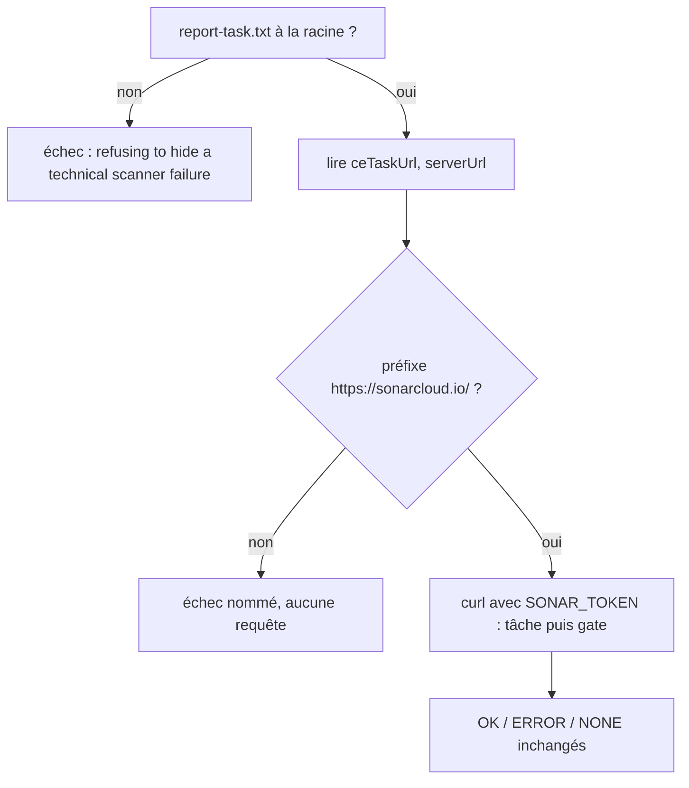

# Conception : n'envoyer le jeton Sonar qu'à l'hôte configuré

<!-- Conception allégée : un script de CI et son test de contrat, sans code de production. -->

## Contexte

- [EXISTANT VÉRIFIÉ] `ci.yml`, job `sonar` : `./mvnw -B -ntp clean verify`, puis le scanner avec
  `-Dsonar.host.url=https://sonarcloud.io` et `continue-on-error: true`, puis, si le scanner a échoué,
  `bash ./scripts/classify-sonar-quality-gate.sh` avec `SONAR_TOKEN` en environnement.
- [EXISTANT VÉRIFIÉ] `scripts/classify-sonar-quality-gate.sh` : `find "$workspace" -type f -path
  '*/target/sonar/report-task.txt' -print -quit` ; lecture de `ceTaskUrl` et `serverUrl` ; `curl` avec
  `Authorization: Bearer ${SONAR_TOKEN}` sur `ceTaskUrl` puis sur `${server_url%/}/api/qualitygates/project_status?…`.
- [EXISTANT VÉRIFIÉ] `SonarQualityGateClassificationContractTest` (classe de cohérence) exige la lecture de
  `report-task.txt`, `ceTaskUrl`, `analysisId`, les branches `ERROR)` et `NONE)` et le refus « refusing to hide a
  technical scanner failure » ; rien sur l'hôte ni sur le chemin.
- [EXISTANT VÉRIFIÉ] `single-integration-branch` : le job `sonar` ne tourne que sur un push sur `main`, seul porteur de
  `SONAR_TOKEN`.

## Exigences couvertes

| Capacité | Exigence (titre exact) | Rubriques de conception qui y répondent |
|---|---|---|
| `sonar-quality-gate-classification` | Le classificateur DOIT lire le rapport de tâche au chemin exact du module racine | D1 |
| `sonar-quality-gate-classification` | Le classificateur NE DOIT PAS envoyer le jeton Sonar hors de l'hôte configuré | D2 |

## Traitements et interactions

Question : à quel moment le jeton peut-il partir, et vers où ? Cible :

Existant : la branche C n'existe pas et A prend le premier fichier trouvé. Exigences : les deux de la capacité.

## Sécurité et isolation

Le contenu de `report-task.txt` est une entrée non fiable : il est écrit dans un workspace où un build complet, ses
tests et ses plugins viennent de tourner. Le contrôle d'hôte est le seul point qui borne la destination d'un secret
durable. La comparaison porte sur le préfixe `https://sonarcloud.io/` **avec** la barre oblique, pour refuser
`https://sonarcloud.io.attacker.example` ; `serverUrl` est admis s'il vaut exactement `https://sonarcloud.io` ou
commence par `https://sonarcloud.io/`. Le message d'erreur nomme le champ et l'hôte attendu, jamais la valeur lue en
entier (elle pourrait contenir un jeton ou une donnée choisie par l'attaquant) — [PROPOSITION], à confirmer en revue.

## Décisions

### D1 : chemin exact du rapport
- **Nature** : [DÉCISION]
- **Exigences servies** : `sonar-quality-gate-classification` › Le classificateur DOIT lire le rapport de tâche au chemin exact du module racine
- **Choix** : `report_task="$workspace/target/sonar/report-task.txt"`, sans `find`.
- **Alternatives écartées** : garder `find` en refusant plusieurs résultats (un fichier planté seul passerait encore si
  le scanner n'a rien écrit).
- **Compromis** : le chemin dépend du scanner Maven ; s'il change, le refus nommé le dit au lieu de prendre un autre
  fichier (tâche 2.3 le vérifie sur une exécution réelle).
- **ADR** : non concerné.

### D2 : hôte attendu écrit une fois
- **Nature** : [PROPOSITION]
- **Exigences servies** : `sonar-quality-gate-classification` › Le classificateur NE DOIT PAS envoyer le jeton Sonar hors de l'hôte configuré
- **Choix** : le script porte la constante `https://sonarcloud.io` ; le test de contrat exige qu'elle égale la valeur de
  `-Dsonar.host.url` du job `sonar`, pour qu'un changement d'hôte se fasse aux deux endroits.
- **Alternatives écartées** : passer l'hôte par une variable d'environnement du job (une valeur que le workflow peut
  changer sans que le script la borne n'ajoute rien à la constante comparée par le test).
- **ADR** : non concerné.

### D3 : preuve par exécution du script, en plus du contrat textuel
- **Nature** : [PROPOSITION]
- **Choix** : le test de contrat (texte du script) exige la constante et la comparaison ; un test qui exécute le script
  avec `bash`, un `report-task.txt` planté et un `curl` factice en tête de `PATH`, mesure qu'aucun appel n'a lieu. Sans
  `bash` disponible, ce second test se signale comme ignoré avec sa raison, jamais comme réussi. Le placer dans le
  module de tests d'architecture le compte dans les exécutions déclarées.
- **Alternatives écartées** : le seul contrat textuel (il prouve la présence d'une ligne, pas son effet).
- **ADR** : non concerné.

## Écarts constatés

Aucun écart constaté entre le script, le job et le test de contrat, hors le contrôle absent qui fait l'objet du change.

## Stratégie de vérification

| Exigence | Scénario | Preuve | État |
|---|---|---|---|
| Le classificateur DOIT lire le rapport de tâche au chemin exact du module racine | Un rapport planté dans un module n'est pas lu | test d'exécution de D3 | à écrire |
| idem | Un rapport absent à la racine fait échouer le job | test d'exécution de D3 | à écrire |
| Le classificateur NE DOIT PAS envoyer le jeton Sonar hors de l'hôte configuré | Un rapport qui désigne un autre hôte est refusé | test d'exécution de D3 (`curl` factice jamais appelé) | à écrire |
| idem | Un hôte qui ne fait que commencer comme l'hôte attendu est refusé | test d'exécution de D3 | à écrire |
| idem | Un rapport conforme est classé comme aujourd'hui | exécution du job `sonar` sur `main` | manuel |
| idem | Le contrat refuse un classificateur sans contrôle d'hôte | nouvelle assertion de `SonarQualityGateClassificationContractTest` | à écrire |

## Documentation durable et diagrammes à mettre à jour

Nouvelle page `docs/developer/specifications/sonar-quality-gate-classification.md` (gabarit de
`docs/developer/specifications/README.md`, logigramme ci-dessus), ligne d'index dans « Gates, preuves et dépendances ».

## Questions ouvertes

Aucune.
