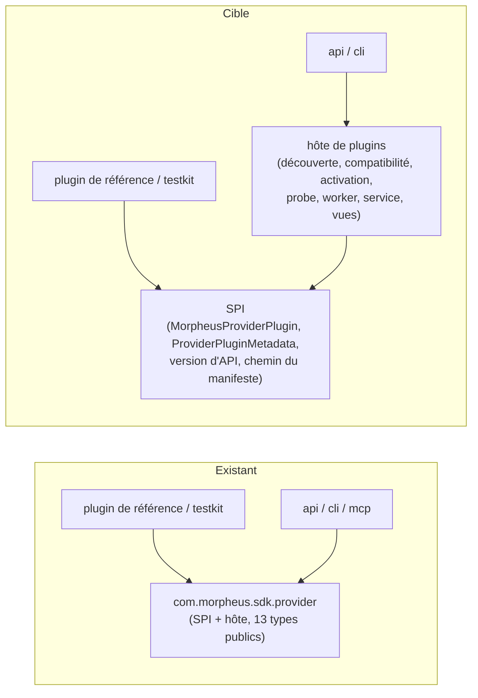

# Conception : séparer le SPI des plugins provider de l'hôte de plugins

## Contexte

- [EXISTANT VÉRIFIÉ] `com.morpheus.sdk.provider` (`morpheus-provider-sdk`) déclare treize types publics de premier
  rang : `MorpheusProviderPlugin`, `ProviderPluginMetadata`, `ProviderSdk`, `ProviderPluginCandidate`,
  `ProviderPluginCompatibility`, `ProviderPluginDiagnostic`, `ProviderPluginDiscovery`, `ProviderPluginDiscoveryResult`,
  `ProviderPluginProbeOutcome`, `ProviderPluginProbeWorker`, `ProviderPluginService`, `ProviderPluginStatus`,
  `ProviderPluginViews` (336 lignes). Les autres classes du paquet (`ProviderPluginActivator`,
  `ProviderPluginActivation`, `ProviderPluginProbeProcess`, `ProviderProbeResultCodec`,
  `ProviderPluginDescendantTermination`, `RemoteTextPolicy`…) ne sont pas publiques.
- [EXISTANT VÉRIFIÉ] Imports de production relevés le 17/11/2026 : plugins (`morpheus-provider-reference`,
  `morpheus-provider-testkit`) → `MorpheusProviderPlugin`, `ProviderPluginMetadata`, `ProviderSdk` ; transports
  (`morpheus-api`, `morpheus-cli`, `morpheus-mcp`) → `ProviderPluginService`, `ProviderPluginDiscovery`,
  `ProviderPluginDiscoveryResult`, `ProviderPluginCandidate`, `ProviderPluginProbeOutcome`, `ProviderPluginViews`.
- [EXISTANT VÉRIFIÉ] `ProviderSdk` mêle la version d'API et le chemin du manifeste (lus par un plugin) et les bornes de
  la découverte (`MAX_PLUGIN_JARS`, `MAX_PLUGIN_JAR_BYTES`, `MAX_PLUGIN_JAR_ENTRIES`, `MAX_METADATA_BYTES`, lues par
  l'hôte). Ce sont des constantes de compilation, que `javac` inline.
- [EXISTANT VÉRIFIÉ] `ProviderPluginProbeWorker` est lancé dans la JVM enfant avec le classpath de l'hôte
  (`ProviderPluginProbeProcess.command`) : il appartient à l'hôte, et l'hôte doit être sur ce classpath.
- [EXISTANT VÉRIFIÉ] `UnreferencedPublicMethodArchitectureTest.NOT_JUDGED` exclut par **module** :
  `morpheus-provider-sdk`, `morpheus-provider-testkit`, `morpheus-provider-reference`, et les deux modules de
  qualification.
- [EXISTANT VÉRIFIÉ] Des tests d'architecture lisent les sources du SDK par chemin
  (`morpheus-provider-sdk/src/main/java/com/morpheus/sdk/provider/…` dans `ProviderPluginPlatformContractTest`,
  `ProviderPluginTrustBoundaryContractTest`, `AuditRemediationContractTest`, `AdapterSiblingArchitectureTest.SDK_SOURCES`,
  et d'autres à relever) : un déplacement les touche tous.
- [EXISTANT VÉRIFIÉ] `SEC-0129` Decision §1 : « `morpheus-provider-sdk` expose le SPI `MorpheusProviderPlugin` » ;
  Conséquences : « Le SDK est une surface publique à maintenir de façon compatible ».

## Exigences couvertes

| Capacité | Exigence (titre exact) | Rubriques de conception qui y répondent |
|---|---|---|
| `provider-sdk-dependency-boundary` | Le SPI publié aux auteurs de plugins NE DOIT contenir que les types destinés aux plugins | D1, D2 |
| `provider-sdk-dependency-boundary` | Un plugin NE DOIT dépendre que du SPI, jamais de l'hôte de plugins | D1, D4 |
| `dead-code-refusal` | A public method of a product module SHALL be referenced or excused by name | D5 |

## Composants et frontières

Question : qui voit quoi après la séparation ? Un plugin ne voit que le SPI ; les transports voient l'hôte, qui dépend
du SPI. Le MCP n'apparaît plus côté cible (`AUD-ARC-27`).

## Modèle de domaine et invariants

Sans objet : aucun type du domaine ne change. Invariant tenu par les règles : l'hôte dépend du SPI, jamais l'inverse.

## Traitements et interactions

Sans objet : la découverte et le probe gardent leur déroulé (`SEC-0129` §2 à §5) ; seuls les paquets changent.

## États et transitions

Sans objet.

## Contrats d'interface

Le contrat publié aux auteurs de plugins est le SPI ; `docs/developer/PROVIDER_SDK.md` en est le guide. Le fichier de
service `META-INF/services/com.morpheus.sdk.provider.MorpheusProviderPlugin` garde son nom : le SPI reste dans
`com.morpheus.sdk.provider`, l'hôte en sort. Aucune surface CLI, MCP ou HTTP ne change ; `contracts/public-surfaces.tsv`
et l'OpenAPI ne bougent pas.

## Persistance et intégrité

Sans objet.

## Transactions, concurrence et idempotence

Sans objet.

## Sécurité et isolation

`ProviderPluginViews` est la liste blanche de divulgation remote (`SEC-0129` §7) : la sortir de l'artefact publié aux
plugins retire aux auteurs de plugins une API dont ils n'ont pas l'usage, sans changer la projection. Le worker garde sa
place sur le classpath de la JVM enfant ; `distribution/build-portable.ps1` et `.sh` vérifient les classes exigées du
JAR ombré et doivent suivre leur nouveau chemin.

## Gestion des erreurs et reprise

Sans objet.

## Observabilité

Sans objet.

## Performance et stratégie de mesure

Sans objet.

## Compatibilité, migration et retour arrière

Un plugin du dépôt n'importe aucun type hôte (mesuré). Un plugin tiers qui en importerait un ne compilerait plus :
**BREAKING** pour lui, d'où D3. Les JAR de plugins déjà construits ne référencent que le SPI s'ils suivent le guide.
Retour arrière : recoller les paquets ; aucune donnée.

## Décisions

### D1 : paquet hôte ou module hôte
- **Nature** : [QUESTION] décision du mainteneur ; [PROPOSITION] option A. ADR à proposer.
- **Exigences servies** : `provider-sdk-dependency-boundary` › Le SPI publié aux auteurs de plugins NE DOIT contenir que les types destinés aux plugins ; › Un plugin NE DOIT dépendre que du SPI, jamais de l'hôte de plugins
- **Options** :
  - **A** — paquet hôte `com.morpheus.sdk.provider.host` (à créer) dans `morpheus-provider-sdk`. Coût faible (aucun
    module, aucune clé de couverture, aucune page de réacteur) ; l'artefact publié porte toujours l'hôte, mais un plugin
    qui l'importe est refusé par la règle pour les plugins du dépôt, et le guide nomme le seul paquet supporté.
  - **B** — module `morpheus-provider-host` (à créer), paquet `com.morpheus.provider.host` (à créer). L'artefact du SDK
    ne porte plus que le SPI. Coût : module de réacteur (POM racine, `ModulePackageCorrespondenceTest`, clés de
    `config/m21-per-module-coverage-floors.properties` au plancher, pages qui listent le réacteur, `05-vue-blocs.md`,
    scripts de build portable) ; et un paquet sous `com.morpheus.provider..` tombe sous les règles des providers
    (frères, `CONCRETE_ADAPTERS` d'`ARCH-0162`), ce qui tranche aussi D3 d'`AUD-ARC-29` — à décider ensemble.
- **Proposition** : A, sauf si le mainteneur publie le SDK comme artefact séparé aux auteurs de plugins, auquel cas B
  est le seul qui ne leur livre pas l'hôte.
- **ADR** : ADR consolidé à proposer qui remplace `SEC-0129` (§1 et conséquence « surface publique ») ; s'il est
  rédigé avec `AUD-ARC-26`, un seul remplacement.

### D2 : contenu exact du SPI
- **Nature** : [PROPOSITION]
- **Exigences servies** : `provider-sdk-dependency-boundary` › Le SPI publié aux auteurs de plugins NE DOIT contenir que les types destinés aux plugins
- **Choix** : SPI = `MorpheusProviderPlugin`, `ProviderPluginMetadata`, et un type de constantes réduit à la version
  d'API et au chemin du manifeste ; les bornes de découverte de `ProviderSdk` passent dans l'hôte. La règle énumère les
  types publics du SPI et les compare à une liste exacte (table de faits, déclarée dans
  `ProductionClassListsArchitectureTest`).
- **Alternatives écartées** : garder `ProviderSdk` entier dans le SPI — publie les bornes de l'hôte comme contrat.
- **Compromis** : renommer ou scinder `ProviderSdk` touche les imports du plugin de référence et du testkit.
- **ADR** : couvert par D1.

### D3 : version d'API du SDK
- **Nature** : [QUESTION] décision du mainteneur.
- **Exigences servies** : `provider-sdk-dependency-boundary` › Le SPI publié aux auteurs de plugins NE DOIT contenir que les types destinés aux plugins
- **Options** : garder `ProviderSdk.API_VERSION` (le contrat du plugin, `MorpheusProviderPlugin`, ne change pas) ; ou le
  relever (un type public quitte l'artefact).
- **Proposition** : le garder : la version d'API compare le contrat qu'un plugin implémente, et la compatibilité
  (`SEC-0129` §3) refuserait sinon tous les plugins existants sans défaut de leur part.
- **ADR** : couvert par D1.

### D4 : règle « un plugin n'atteint pas l'hôte »
- **Nature** : [DÉCISION]
- **Exigences servies** : `provider-sdk-dependency-boundary` › Un plugin NE DOIT dépendre que du SPI, jamais de l'hôte de plugins
- **Choix** : règle ArchUnit dans `AdapterSiblingArchitectureTest` (sujet : `com.morpheus.provider.reference..`, cible :
  le paquet hôte), plus son doublon textuel, l'hôte déclarant des constantes de compilation. Le testkit, hors de
  l'ensemble importé, est tenu par son POM et par le même scan textuel. Violation plantée avant acceptation.
- **Alternatives écartées** : texte seul — ne voit pas une dépendance non épelée.
- **Compromis** : aucun.
- **ADR** : couvert par D1.

### D5 : dispense du contrôle de code mort réduite au SPI
- **Nature** : [DÉCISION]
- **Exigences servies** : `dead-code-refusal` › A public method of a product module SHALL be referenced or excused by name
- **Choix** : `NOT_JUDGED` passe d'une exclusion par module à une exclusion qui, pour le SDK, ne dispense que le paquet
  du SPI ; les méthodes publiques sans appelant de l'hôte reçoivent une raison listée ou disparaissent.
- **Alternatives écartées** : garder le module entier exclu — le défaut constaté.
- **Compromis** : la première exécution peut révéler des méthodes publiques hôtes sans appelant à traiter dans ce
  change.
- **ADR** : non concerné.

## Écarts constatés

| Constat | Source A | Source B | Traitement proposé |
|---|---|---|---|
| L'hôte est publié comme SDK aux auteurs de plugins | `morpheus-provider-sdk/pom.xml:15` (description) | imports réels des plugins | D1 |
| `ProviderSdk` mêle contrat et bornes d'hôte | `ProviderSdk.java` | D2 | D2 |
| La spec de la capacité ne dit rien de la séparation SPI / hôte | `openspec/specs/provider-sdk-dependency-boundary/spec.md` | constat | exigences ajoutées |

## Stratégie de vérification

| Exigence | Scénario | Preuve | État |
|---|---|---|---|
| Le SPI publié aux auteurs de plugins NE DOIT contenir que les types destinés aux plugins | Le SPI ne porte que les types d'un plugin | règle d'énumération (D2) | à écrire |
| idem | Un type hôte ajouté au SPI fait échouer le build | violation plantée | à écrire |
| Un plugin NE DOIT dépendre que du SPI, jamais de l'hôte de plugins | Le plugin de référence compile contre le seul SPI | règle D4 | à écrire |
| idem | Un plugin qui appelle le service du probe fait échouer le build | violation plantée | à écrire |
| A public method of a product module SHALL be referenced or excused by name | An uncalled public method of the plugin host fails the build | `UnreferencedPublicMethodArchitectureTest` modifié, méthode plantée | à écrire |
| idem | The plugin SDK is not judged by MORPHEUS's own calls | même test | existant, à adapter |

## Documentation durable et diagrammes à mettre à jour

`docs/developer/PROVIDER_SDK.md` (paquet supporté, exemple Maven) ; `docs/developer/specifications/provider-sdk-dependency-boundary.md`
et `dead-code-refusal.md` ; `docs/architecture/arc42/05-vue-blocs.md` §5.2 et §5.4 (et le réacteur si option B) ;
l'ADR consolidé ; `.claude/rules/architecture.md` (section du SDK).

## Questions ouvertes

D1 et D3, qui conditionnent le groupe 2 des tâches.
