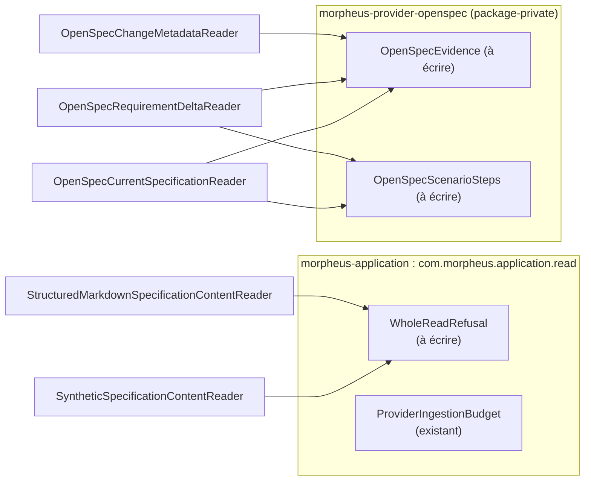

# Conception : partager les refus de lecture complète et l'analyse des lecteurs OpenSpec (AUD-QUA-34)

## Contexte

- [EXISTANT VÉRIFIÉ] `SyntheticSpecificationContentReader.budgetRefusal` (lignes 139-161) et
  `StructuredMarkdownSpecificationContentReader.budgetRefusal` (134-156) construisent le même `ProviderReadResult` :
  diagnostic `INVALID_SOURCE` de message « … content reader failed for group <groupe> : » suivi de
  `ServerLocationDisclosure.relayableText(limit)`, détails `provider`, `group`, `exception`, chaque catégorie `FAILED`
  avec la raison `provider ingestion budget exceeded`. Seul le libellé (« Synthetic » / « Structured Markdown ») change.
- [EXISTANT VÉRIFIÉ] Les branches `IOException | IllegalArgumentException` voisines divergent :

  | | synthetic (122-134) | Markdown structuré (112-130) |
  |---|---|---|
  | message | « Synthetic source read failed: » + message brut | « Structured Markdown normalization failed: » + message brut |
  | détails | `source` | `provider`, `source` |
  | raison de catégorie | vide (`report(category, FAILED, 0, code)`) | message de l'exception, ou `invalid source` |

  Ni l'une ni l'autre ne passe le message par `ServerLocationDisclosure.relayableText`, contrairement au refus de budget.
- [EXISTANT VÉRIFIÉ] `provenance` et `evidence` des trois lecteurs OpenSpec : mêmes appels, noms de paramètres
  différents, et une différence de comportement — `OpenSpecRequirementDeltaReader.evidence` borne le début et la fin de
  l'intervalle à `[1, lines.size()]`, `OpenSpecCurrentSpecificationReader` et `OpenSpecChangeMetadataReader` ne bornent
  que la fin par le début (`Math.max(startLine, end)`). Les appelants actuels calculent des bornes déjà contenues dans le
  document ; la différence ne se voit que sur un intervalle hors du document.
- [EXISTANT VÉRIFIÉ] `normalizeScenario` : 33 lignes de différence sur 77 entre les deux lecteurs qui l'ont
  (`diff` du 17/11/2026), de nommage pour l'essentiel, comme l'audit le dit.
- [EXISTANT VÉRIFIÉ] Les lecteurs OpenSpec font l'objet de deux constats du sprint 3, AUD-QUA-29 (clôtures de code dans
  le lecteur de deltas) et AUD-SEC-20 (neuf motifs quadratiques), qui réécrivent les mêmes méthodes.

## Exigences couvertes

| Capacité | Exigence (titre exact) | Rubriques de conception qui y répondent |
|---|---|---|
| `provider-ingestion-budget` | The synthetic and structured Markdown providers word a refusal of a whole read the same way | §Décisions D1, D2 |

La factorisation OpenSpec (D3) ne change aucun comportement spécifié : elle est tenue par les tests existants des trois
lecteurs, inchangés.

## Composants et frontières

- `com.morpheus.application.read` : une classe nouvelle, `WholeReadRefusal` (nom proposé), qui construit le
  `ProviderReadResult` d'une lecture complète refusée à partir du provider, du groupe, des catégories demandées et de la
  cause. Elle reste dans la frontière d'ADR ARCH-0150 : aucune technologie nouvelle (ni fichier, ni JSON).
- `morpheus-provider-synthetic`, `morpheus-provider-markdown` : les deux `budgetRefusal` et les deux branches
  `IOException` délèguent à cette classe. Les deux providers dépendent déjà de `morpheus-application` ; aucune arête
  nouvelle entre adaptateurs (`AdapterSiblingArchitectureTest`).
- `com.morpheus.provider.openspec` : deux classes package-private, `OpenSpecEvidence` (provenance et preuve) et
  `OpenSpecScenarioSteps` (analyse GIVEN/AND/WHEN/THEN), appelées par les trois lecteurs.

Question : où vivent les écritures partagées après le change ? (cible)

Le diagramme répond à l'exigence ajoutée (côté gauche) et à D3 (côté droit). Le lecteur OpenSpec de contenu
(`OpenSpecSpecificationContentReader`) garde son refus de budget propre (question ouverte).

## Modèle de domaine et invariants

Sans objet : aucun type du domaine ne change.

## Traitements et interactions

Sans objet au-delà du diagramme : chaque lecteur appelle la classe partagée là où il construisait le résultat.

## États et transitions

Sans objet.

## Contrats d'interface

Sans objet : `ProviderReadResult` et `ReadCategoryReport` gardent leur forme (BE-0028). Aucune surface publique.

## Persistance et intégrité

Sans objet : une lecture refusée ne publie rien, avant comme après.

## Transactions, concurrence et idempotence

Sans objet.

## Sécurité et isolation

Le refus de budget passe déjà sa cause par `ServerLocationDisclosure.relayableText` ; le refus de source illisible ne
le fait pas. D2 propose de faire passer la cause des deux refus par la même écriture.

## Gestion des erreurs et reprise

Aucun repli silencieux ajouté ; les refus restent des résultats `FAILED`, sans exception qui s'échappe de `read`.

## Observabilité

Les diagnostics gardent leur code ; le changement porte sur les clés de détail et la raison de catégorie du refus de
source illisible côté synthetic.

## Performance et stratégie de mesure

Sans objet.

## Compatibilité, migration et retour arrière

Un client qui lisait la raison de catégorie vide du refus synthetic d'une source illisible lit une raison ; le provider
synthetic est un outil de vérification, sans client livré. Retour arrière : `git revert`.

## Décisions

### D1 : un utilitaire de refus dans l'application, pas une classe de base
- **Nature** : [PROPOSITION]
- **Exigences servies** : `provider-ingestion-budget` › The synthetic and structured Markdown providers word a refusal of
  a whole read the same way.
- **Choix** : une classe finale à méthodes statiques dans `com.morpheus.application.read`, à côté de
  `ProviderIngestionBudget` que les deux refus emploient.
- **Alternatives écartées** : une classe abstraite commune aux lecteurs (héritage pour deux méthodes) ; un module
  partagé entre providers (une arête de plus dans le réacteur, que `.claude/rules/architecture.md` ne permet qu'avec sa
  correspondance de paquet) ; une méthode `default` du port `SpecificationContentReader` (le port porterait une
  construction de diagnostic).
- **ADR** : non concerné.

### D2 : forme commune du refus de source illisible
- **Nature** : [PROPOSITION]
- **Exigences servies** : idem.
- **Choix** : détails `provider` et `source` (forme Markdown), raison de catégorie fixe (`provider source could not be
  read`, proposée) plutôt que le message de l'exception, et cause relayée par `ServerLocationDisclosure.relayableText`
  dans le message du diagnostic, comme le refus de budget.
- **Alternatives écartées** : garder la forme synthetic (sans `provider`, raison vide) — moins d'information pour
  l'opérateur ; garder le message brut en raison de catégorie — une raison n'est pas filtrée comme un message relayé.
- **ADR** : non concerné.

### D3 : factoriser les lecteurs OpenSpec après le sprint 3
- **Nature** : [DÉCISION] (arêtes `depends_on` de l'audit)
- **Choix** : `OpenSpecEvidence` garde la borne du lecteur de deltas (début et fin ramenés au document), qui contient la
  forme des deux autres ; `OpenSpecScenarioSteps` reprend la boucle une fois AUD-QUA-29 et AUD-SEC-20 appliqués.
- **Alternatives écartées** : factoriser d'abord — figerait les motifs quadratiques et l'écart de clôture dans le code
  partagé ; garder la forme sans borne — un intervalle hors document lèverait une exception au lieu d'un extrait borné.
- **ADR** : non concerné.

## Écarts constatés

| Constat | Source A | Source B | Traitement proposé |
|---|---|---|---|
| Les recopies `evidence` ne sont pas « toutes de nommage » | constat `AUD-QUA-34` | `OpenSpecRequirementDeltaReader.evidence` borne au document | D3 garde la borne |
| Le refus de source illisible ne filtre pas sa cause | refus de budget (`relayableText`) | branches `IOException` des deux lecteurs | D2 |
| Le refus de budget OpenSpec a une forme propre | `OpenSpecSpecificationContentReader:111-116` | les deux autres providers | hors périmètre, question ouverte |

## Stratégie de vérification

| Exigence | Scénario | Preuve | État |
|---|---|---|---|
| The synthetic and structured Markdown providers word a refusal of a whole read the same way | A budget exceeded by either provider | `WholeReadRefusalTest` et un test par provider (`SyntheticSpecificationContentReaderTest`, `StructuredMarkdownSpecificationContentReaderTest`, cas « budget ») | à écrire |
| idem | A source that cannot be read by either provider | idem, cas « source illisible » | à écrire |
| (D3, sans exigence) | — | tests existants des trois lecteurs OpenSpec, inchangés et verts | existant |

## Documentation durable et diagrammes à mettre à jour

- `docs/developer/specifications/provider-ingestion-budget.md` : exigence R3, diagramme, traçabilité.
- `docs/developer/specifications/openspec-provider-reading.md` : composants partagés des lecteurs.

## Questions ouvertes

- Le refus de budget du lecteur OpenSpec doit-il rejoindre `WholeReadRefusal` ? Il porte un diagnostic propre
  (`invalidSource("ingestion-budget", …)`) et ses raisons de catégorie par `failed(…)` ; l'aligner change le diagnostic
  d'une lecture OpenSpec refusée. Peut attendre ce change.
