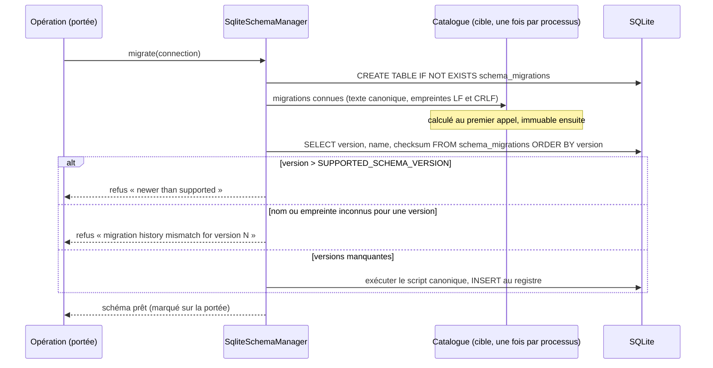

# Conception : vérifier le schéma SQLite sans relire ses migrations

Conception allégée : changement local à une classe du runtime SQLite, sans surface ni schéma touchés. Motivation :
voir proposal.md, section Why.

## Contexte

- [EXISTANT VÉRIFIÉ] `SqliteStoreConnection` construit `new SqliteSchemaManager()` et appelle `migrate(connection)`
  quand la portée active n'a pas encore vérifié le schéma (`SqliteConnectionScope.schemaReadyIfActive`). Une portée
  est une opération (ARCH-0162) : la vérification court donc une fois par requête HTTP, appel MCP et commande CLI.
- [EXISTANT VÉRIFIÉ] `migrate` ouvre une transaction (`SqliteTransactionRunner.runVoid`, transaction différée), crée le
  registre s'il manque (`CREATE TABLE IF NOT EXISTS schema_migrations`), refuse une version future
  (`rejectFutureSchema`, une requête `MAX(version)`), puis boucle sur `MIGRATIONS` : pour chacune, `canonicalScript`
  (lecture de la ressource, normalisation des fins de ligne), `findAppliedMigration` (une requête par version), et si la
  ligne existe `accepts`, qui relit la ressource et calcule `TextDigest.sha256` du texte LF, puis du texte CRLF s'il ne
  concorde pas.
- [EXISTANT VÉRIFIÉ] `accepts` est aussi appelée par `SqliteServerMaintenance` pour vérifier le registre d'une
  sauvegarde avant une restauration hors ligne.
- [EXISTANT VÉRIFIÉ] Les messages de refus sont `SQLite migration history mismatch for version <N>` et
  `SQLite schema version <N> is newer than supported <M>` ; `SqliteMigrationLineEndingCompatibilityTest` et
  `SqliteFutureSchemaCompatibilityTest` les éprouvent.
- [EXISTANT VÉRIFIÉ] `.claude/rules/testing.md` interdit un champ `static` mutable partagé entre tests ; ARCH-0115 a
  retiré les compteurs statiques du runtime SQLite.

## Exigences couvertes

| Capacité | Exigence (titre exact) | Rubriques de conception qui y répondent |
|---|---|---|
| `sqlite-schema-history` | La vérification de schéma d'une opération lit le registre en une requête sans relire les migrations | D1, D2, Traitements |
| `sqlite-schema-history` | La vérification de schéma refuse à chaque opération un registre que le programme ne reconnaît pas | D1, D3, Traitements |

## Composants et frontières

`SqliteSchemaManager` reste package-private dans `com.morpheus.store.sqlite.runtime` ; aucun type n'y devient public
(`SqliteStorePackagesArchitectureTest#theRuntimeDeclaresExactlyTheNamedPublicTypes`). Le catalogue des migrations est un
type imbriqué privé ou package-private du même paquet.

## Modèle de domaine et invariants

Sans objet : aucun type du domaine.

## Traitements et interactions

Question : que fait la vérification d'une opération, avant et après ?

Existant : la ligne `Cat` n'existe pas, chaque migration recharge sa ressource deux fois et le registre est lu par
version. Cible : une lecture du registre, un catalogue calculé une fois. Exigences : les deux de `sqlite-schema-history`
ajoutées par ce changement.

## États et transitions

Sans objet.

## Contrats d'interface

Sans objet.

## Persistance et intégrité

Aucun changement de schéma. L'empreinte inscrite d'une migration appliquée reste celle de son texte canonique, calculée
par `TextDigest.sha256` (`text-digest-and-key-derivation`). Une empreinte inscrite n'est jamais réécrite
(`sqlite-schema-history` › Recorded histories are never rewritten silently).

## Transactions, concurrence et idempotence

- La lecture du registre et l'application des migrations manquantes restent dans la transaction de `migrate`.
- Le catalogue est initialisé par l'idiome du porteur paresseux (classe imbriquée à champ `static final`), sûr sous
  accès concurrent sans verrou explicite ; il est immuable (listes copiées, chaînes), donc partagé sans risque par les
  fils du serveur HTTP.

## Sécurité et isolation

Le refus d'un registre inconnu est la garde qui empêche d'ouvrir une base écrite par un autre programme ou altérée : il
reste évalué à chaque opération (D1). Aucun verdict n'est mémorisé.

## Gestion des erreurs et reprise

- Une ressource absente ou illisible au premier chargement du catalogue lève l'erreur nommée actuelle
  (`SQLite migration resource not found: …`, `Cannot read SQLite migration resource: …`). [PROPOSITION] Le porteur
  paresseux ne mémorise pas un échec : une classe dont l'initialisation statique échoue devient inutilisable
  (`NoClassDefFoundError` aux appels suivants) ; le chargement se fait donc dans une méthode qui lève l'exception
  nommée à chaque appel tant qu'il échoue, et ne publie la valeur qu'une fois complète.
- Les messages de refus ne changent pas.

## Observabilité

Sans objet : `SqliteConnectionScope` compte toujours une vérification de schéma par portée.

## Performance et stratégie de mesure

Aucun budget ne fixe ce coût (aucune ligne de `docs/project/roadmap/M19_PERFORMANCE_BUDGETS.md`). La mesure exigée
est un compte, pas un temps : une requête de lecture du registre et zéro chargement de ressource pour une opération qui
suit la première (scénario « Deux opérations successives sur une base à jour »). Ordre de grandeur relevé par l'audit
du 17/11/2026, comme mesure datée : environ 68 Ko relus et 34 Ko hachés par opération.

## Compatibilité, migration et retour arrière

Aucune donnée ni base ne change ; retour arrière par simple revert.

## Décisions

### D1 : mémoriser les empreintes connues, jamais le verdict
- **Nature** : [DÉCISION]
- **Exigences servies** : `sqlite-schema-history` › La vérification de schéma refuse à chaque opération un registre
  que le programme ne reconnaît pas ; `sqlite-schema-history` › La vérification de schéma d'une opération lit le
  registre en une requête sans relire les migrations
- **Choix** : le catalogue tient, par migration, sa version, son nom, son texte canonique et ses deux empreintes
  admises ; la comparaison au registre se refait à chaque opération.
- **Alternatives écartées** : mémoriser « cette base est à jour » par chemin de fichier — une restauration hors ligne
  ou un autre programme change le registre sans que le processus le sache, et le refus disparaîtrait ; supprimer la
  vérification par opération — contraire à ARCH-0162.
- **Compromis** : une requête de registre par opération reste.
- **ADR** : non concerné ; ARCH-0162 couvre déjà « une vérification par opération », inchangée.

### D2 : un catalogue injectable, une instance de processus par défaut
- **Nature** : [PROPOSITION]
- **Exigences servies** : `sqlite-schema-history` › La vérification de schéma d'une opération lit le registre en une
  requête sans relire les migrations
- **Choix** : `SqliteSchemaManager` reçoit son catalogue par un constructeur package-private ; le constructeur sans
  argument prend le catalogue du processus (porteur paresseux). Un test construit un catalogue avec un chargeur qui
  compte ses lectures et le donne au gestionnaire, sans état statique mutable.
- **Alternatives écartées** : un compteur statique de chargements — refusé par `.claude/rules/testing.md` et contraire
  à ARCH-0115 ; ne rien mesurer — l'exigence deviendrait invérifiable.
- **Compromis** : un constructeur de plus, visible du paquet seulement.
- **ADR** : non concerné.

### D3 : `accepts` lit le même catalogue
- **Nature** : [DÉCISION]
- **Exigences servies** : `sqlite-schema-history` › La vérification de schéma refuse à chaque opération un registre
  que le programme ne reconnaît pas (scénario de la restauration) ; `sqlite-schema-history` › Offline restore verifies
  the ledger before replacing the database
- **Choix** : la méthode statique reste, avec sa signature, et compare aux empreintes du catalogue de processus.
- **Alternatives écartées** : une seconde règle d'acceptation pour la restauration — deux règles divergeraient.
- **Compromis** : aucun.
- **ADR** : non concerné.

## Écarts constatés

| Constat | Source A | Source B | Traitement proposé |
|---|---|---|---|
| L'audit cite `SqliteSchemaManager.java:51-55` pour la boucle ; sur `1a539c22` la garde de portée est ligne 51 et la boucle lignes 56 à 58 | `docs/project/audits/2026-11-17/findings.md`, `AUD-PRF-27` | arbre courant | aucun, décalage de lignes seulement |
| L'audit parle de « 24 SELECT » ; il y en a en plus un `MAX(version)` (`rejectFutureSchema`) | audit | `SqliteSchemaManager.rejectFutureSchema` | la lecture unique du registre sert aussi le refus de version future |

## Stratégie de vérification

| Exigence | Scénario | Preuve | État |
|---|---|---|---|
| La vérification de schéma d'une opération lit le registre en une requête sans relire les migrations | Deux opérations successives sur une base à jour | test du module à écrire (`SqliteSchemaVerificationCostTest`, nom proposé) : catalogue à chargeur compté, connexion dont les requêtes sont comptées | à écrire |
| idem | Une base neuve reçoit toutes ses migrations | `SqliteSchemaMigrationTest` (rejeu, registre) | existant |
| idem | Une base en retard reçoit seulement ses migrations manquantes | `ReleasedSchemaUpgradeTest` | existant |
| La vérification de schéma refuse à chaque opération un registre que le programme ne reconnaît pas | Un registre altéré entre deux opérations d'un même processus | cas à écrire dans `SqliteMigrationLineEndingCompatibilityTest` | à écrire |
| idem | Une version future apparue entre deux opérations | cas à écrire dans `SqliteFutureSchemaCompatibilityTest` | à écrire |
| idem | Un registre écrit par un checkout CRLF reste accepté | `SqliteMigrationLineEndingCompatibilityTest#aLedgerWrittenByACrlfCheckoutOpensAndIsLeftAsRecorded`, complété d'une seconde ouverture | existant · à compléter |
| idem | La restauration hors ligne garde sa règle d'acceptation | `SqliteRestoreLedgerVerificationTest`, complété d'un cas qui ouvre d'abord des bases dans le même processus | à compléter |

## Documentation durable et diagrammes à mettre à jour

`docs/developer/specifications/sqlite-schema-history.md` : les deux exigences, le diagramme de séquence ci-dessus, la
traçabilité.

## Questions ouvertes

Aucune.
